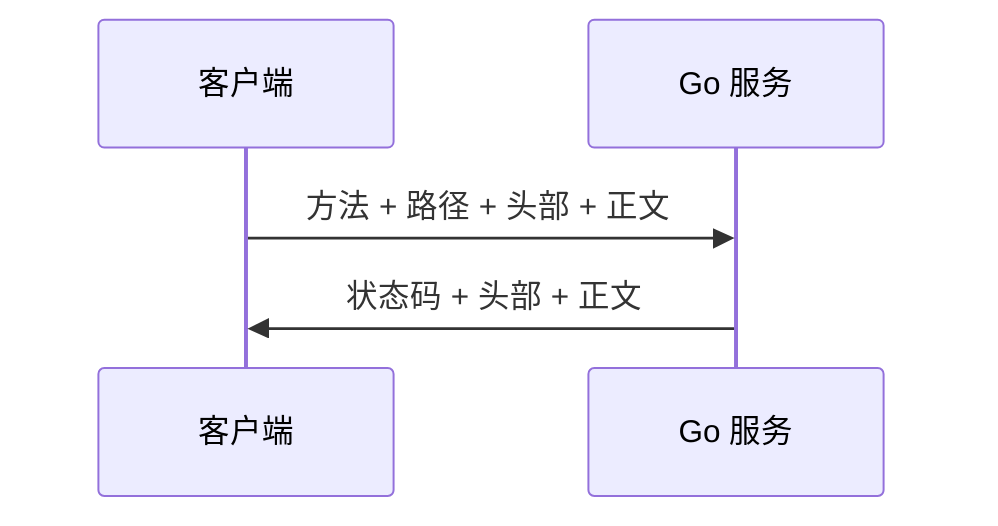
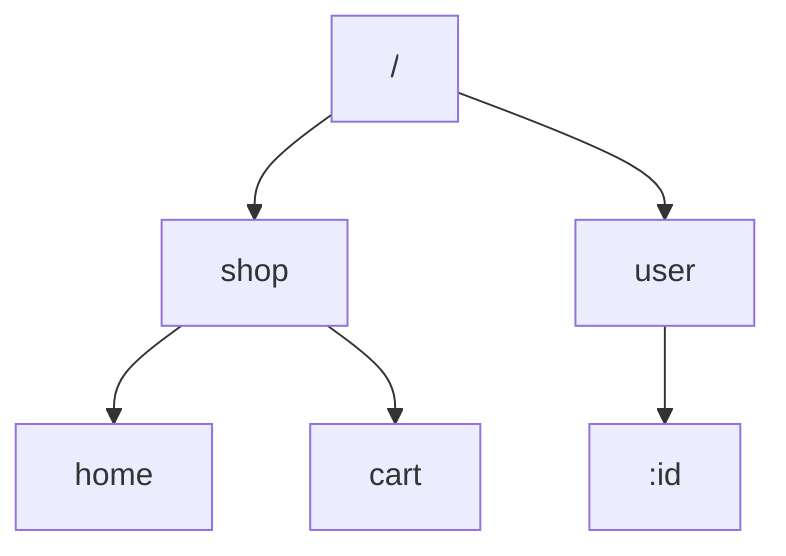
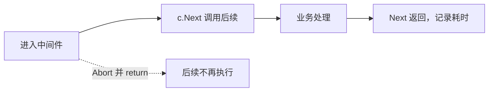

# Gin内容介绍

## 参考

先看两份材料就够：Gin 自带的文档，以及一份把路由、绑定、中间件按顺序讲完的教程。文档用来查方法签名，教程用来建立“请求从哪进来、响应从哪出去”的整体图。下面的例子都改过数据，对照文档时以方法名为准，不要照抄示例里的字段。

## 主要内容

这一篇覆盖三条线：

- Gin 的基本用法：路由、参数、渲染、上传、中间件
- 数据访问放到后面的 GORM 笔记，这里只把 Web 层走通
- 最后能把这些零件收成一个小的 HTTP 服务

## 关于Web

Web 应用通过 HTTP 交换数据。浏览器、手机客户端或另一个服务都是调用方，它们按地址发出请求，服务端返回状态码和正文。

一次交换总是“先请求、后响应”。例如在地址栏输入站点首页，浏览器发出 GET，服务器返回 HTML；提交表单则是 POST，服务器可能返回新页面或一段 JSON。



路径决定找哪段逻辑，方法决定这是读取还是修改。后面 Gin 的路由就是在登记这种组合。

## 创建项目

在 GoLand 里新建一个 Go Modules 项目，模块名自定，目录选在任意工作区，不必放进 `GOPATH/src`。创建完成后在项目根目录执行：

```bash
go mod init webdemo
```

这会生成 `go.mod`。若编辑器把依赖标红，打开设置里的 Go Modules 集成，确认已启用模块模式，并让 IDE 使用项目里的 `go.mod`，而不是旧的 GOPATH 模式。

先不引入框架，用标准库证明“请求进来、文本出去”这条链路：

```go
package main

import (
	"fmt"
	"net/http"
)

func greet(w http.ResponseWriter, r *http.Request) {
	fmt.Fprintln(w, "hi from net/http")
}

func main() {
	http.HandleFunc("/greet", greet)
	if err := http.ListenAndServe(":9090", nil); err != nil {
		fmt.Printf("listen failed: %v\n", err)
	}
}
```

`ResponseWriter` 负责写回客户端，`*http.Request` 是这次进来的请求。浏览器打开 `http://localhost:9090/greet`，应看到纯文本。

把字符串换成 HTML，浏览器就会按标签渲染。重启进程后再刷新：

```go
func greet(w http.ResponseWriter, r *http.Request) {
	fmt.Fprintln(w, "<h1 style=\"color:teal\">hi from net/http</h1>")
}
```

页面上会出现带颜色的标题。HTML 一长，就不该继续嵌在 Go 字符串里。在 `template/hello.html` 写页面，注意不要在页面里引用外部图片地址，静态图放到自己的目录再引用：

```html
<!DOCTYPE html>
<html lang="zh-CN">
<head>
    <meta charset="utf-8">
    <title>plain page</title>
</head>
<body>
    <h1 style="color:teal">标准库返回的页面</h1>
    <p>下一节换成 Gin。</p>
</body>
</html>
```

处理函数改为读文件再写回。`os.ReadFile` 是现在的写法，旧代码里的 `ioutil.ReadFile` 只是它的历史别名：

```go
package main

import (
	"fmt"
	"net/http"
	"os"
)

func greet(w http.ResponseWriter, r *http.Request) {
	raw, err := os.ReadFile("./template/hello.html")
	if err != nil {
		http.Error(w, "page missing", http.StatusInternalServerError)
		return
	}
	w.Header().Set("Content-Type", "text/html; charset=utf-8")
	w.Write(raw)
}

func main() {
	http.HandleFunc("/greet", greet)
	if err := http.ListenAndServe(":9090", nil); err != nil {
		fmt.Printf("listen failed: %v\n", err)
	}
}
```

刷新后看到的是文件里的标题和段落。到这里，一个最小的 Web 页面已经由 Go 进程提供。它的问题也很明显：每增加一种返回格式，都要自己设头部、自己处理错误。

## 为什么要用框架

标准库足够完成路由和响应，但参数解析、JSON、恢复 panic、日志、分组前缀都要重复写。框架预先搭好这些零件，业务代码只描述“哪个路径做什么”。Gin 选择轻量：核心是路由和上下文，其余能力用中间件往上加，而不是把所有功能焊死在内核里。

## Gin框架介绍

Gin 是 Go 编写的 HTTP 框架，路由底层使用基数树实现的 httprouter，按路径查找处理函数很快。它的 API 看起来像更早的 martini，但少了很多反射，延迟更低。社区文档齐全，适合作为第一个 Web 框架：够用来做 REST 接口，也没有厚重的约定。

## Gin框架安装与使用

### 安装

在已经 `go mod init` 的目录里拉取依赖：

```bash
go get github.com/gin-gonic/gin
```

`go.mod` 里会出现版本号。旧文档中的 `go get -u` 会顺便升级到最新次版本，学习阶段锁定一次能编译的版本更稳妥。

### 第一个Gin示例：

```go
package main

import "github.com/gin-gonic/gin"

func main() {
	r := gin.Default()
	r.GET("/ping", func(c *gin.Context) {
		c.JSON(200, gin.H{"text": "pong"})
	})
	r.Run()
}
```

`gin.Default()` 带上日志和恢复中间件。`GET` 的第一个参数是路径，第二个是处理函数。`gin.H` 是 `map[string]interface{}` 的简写。`Run` 不传地址时监听 `:8080`。浏览器打开 `http://127.0.0.1:8080/ping`，应看到 JSON。

## RESTful API

REST 不是某一种库，而是一种用 HTTP 表达资源操作的风格。名称是 Representational State Transfer。调用方通过统一的资源地址，加上不同的方法，表示读取或修改。

四个方法的常见分工：

- `GET` 读取，不应改服务器上的数据
- `POST` 新建
- `PUT` 按整体替换已有资源
- `DELETE` 删除

符合这种分工的接口就叫 RESTful API。前后端分离时，浏览器只拿 JSON，不再让服务器渲染整页，路径设计就更重要。

按“一个动作一个地址”来设计书籍接口，路径里堆满动词：

| 方法 | URL | 含义 |
| --- | --- | --- |
| GET | /book | 查询 |
| POST | /create_book | 新建 |
| POST | /update_book | 修改 |
| POST | /delete_book | 删除 |

同一资源收成一个名词，用方法区分动作：

| 方法 | URL | 含义 |
| --- | --- | --- |
| GET | /book | 查询 |
| POST | /book | 新建 |
| PUT | /book | 修改 |
| DELETE | /book | 删除 |

Gin 为每个方法提供同名注册函数：

```go
func main() {
	r := gin.Default()
	r.GET("/book", func(c *gin.Context) {
		c.JSON(200, gin.H{"op": "read"})
	})
	r.POST("/book", func(c *gin.Context) {
		c.JSON(200, gin.H{"op": "create"})
	})
	r.PUT("/book", func(c *gin.Context) {
		c.JSON(200, gin.H{"op": "replace"})
	})
	r.DELETE("/book", func(c *gin.Context) {
		c.JSON(200, gin.H{"op": "remove"})
	})
	r.Run()
}
```

浏览器地址栏只能发 GET。要试 POST、PUT、DELETE，用专门的 HTTP 客户端，选对方法再看返回的 `op` 字段。

## Gin渲染

### HTML渲染

模板按业务分子目录。例如 `templates/posts/index.html` 与 `templates/users/index.html`。Gin 用 Go 的模板引擎，文件可以用 `define` 起一个名字，渲染时按这个名字查找，而不是按磁盘路径。

`posts/index.html`：

```html
{{define "posts/index.html"}}
<!DOCTYPE html>
<html lang="zh-CN">
<head><meta charset="utf-8"><title>文章</title></head>
<body><h1>{{.heading}}</h1></body>
</html>
{{end}}
```

`users/index.html`：

```html
{{define "users/index.html"}}
<!DOCTYPE html>
<html lang="zh-CN">
<head><meta charset="utf-8"><title>用户</title></head>
<body><h1>{{.heading}}</h1></body>
</html>
{{end}}
```

`LoadHTMLGlob` 用通配符一次载入，`LoadHTMLFiles` 则逐个列出。渲染时传入模板名和数据：

```go
func main() {
	r := gin.Default()
	r.LoadHTMLGlob("templates/**/*")
	r.GET("/posts", func(c *gin.Context) {
		c.HTML(http.StatusOK, "posts/index.html", gin.H{"heading": "文章列表"})
	})
	r.GET("/users", func(c *gin.Context) {
		c.HTML(http.StatusOK, "users/index.html", gin.H{"heading": "用户列表"})
	})
	r.Run(":8080")
}
```

`{{.heading}}` 对应 `gin.H` 里的键。键不存在时输出为空，不会中断响应。

### 自定义模板函数

模板默认会转义 HTML，避免把用户输入当成标签。若某段内容确实是可信的 HTML，要注册一个函数，把字符串转成 `template.HTML`，告诉引擎不要转义。

```go
func main() {
	r := gin.Default()
	r.SetFuncMap(template.FuncMap{
		"raw": func(s string) template.HTML {
			return template.HTML(s)
		},
	})
	r.LoadHTMLFiles("index.tmpl")
	r.GET("/home", func(c *gin.Context) {
		c.HTML(http.StatusOK, "index.tmpl", "<strong>已审核的摘要</strong>")
	})
	r.Run(":8080")
}
```

模板里用管道把当前数据交给 `raw`：

```html
<!DOCTYPE html>
<html lang="zh-CN">
<head><title>home</title></head>
<body><div>{{ . | raw }}</div></body>
</html>
```

`SetFuncMap` 必须写在 `LoadHTMLFiles` 之前，否则加载模板时还看不到这个函数。不要对用户提交的评论使用 `raw`，否则会引入脚本注入。

`.tmpl` 默认没有高亮。在编辑器的文件类型里把 `*.tmpl` 关联到 HTML，标签就会按网页着色。关联步骤见同仓库杂记里的说明。

### 静态文件处理

样式、脚本和图片不要走模板。`Static` 把一个 URL 前缀映射到磁盘目录：

```go
func main() {
	r := gin.Default()
	r.Static("/assets", "./assets")
	r.LoadHTMLGlob("templates/**/*")
	r.Run(":8080")
}
```

请求 `/assets/app.css` 时，Gin 到 `./assets/app.css` 读取并返回。模板里的链接使用这个前缀，不要写绝对磁盘路径。

### 使用模板继承

Gin 默认一次渲染一个模板，没有内置的布局块。需要“多个页面套同一份页头页脚”时，可以用 `gin-contrib/multitemplate`。目录分成布局和页面：

```text
templates
├── includes
│   ├── home.tmpl
│   └── index.tmpl
├── layouts
│   └── base.tmpl
└── scripts.tmpl
```

`base.tmpl` 定义骨架，`includes` 里的文件定义要填进骨架的块。加载时把每一份页面和全部布局配在一起：

```go
func loadTemplates(dir string) multitemplate.Renderer {
	rd := multitemplate.NewRenderer()
	layouts, err := filepath.Glob(filepath.Join(dir, "layouts", "*.tmpl"))
	if err != nil {
		panic(err)
	}
	pages, err := filepath.Glob(filepath.Join(dir, "includes", "*.tmpl"))
	if err != nil {
		panic(err)
	}
	for _, page := range pages {
		files := append(append([]string{}, layouts...), page)
		rd.AddFromFiles(filepath.Base(page), files...)
	}
	return rd
}
```

引擎不用 `LoadHTMLGlob`，而是把渲染器赋给 `HTMLRender`：

```go
func showIndex(c *gin.Context) {
	c.HTML(http.StatusOK, "index.tmpl", nil)
}

func showHome(c *gin.Context) {
	c.HTML(http.StatusOK, "home.tmpl", nil)
}

func main() {
	r := gin.Default()
	r.HTMLRender = loadTemplates("./templates")
	r.GET("/index", showIndex)
	r.GET("/home", showHome)
	r.Run()
}
```

`c.HTML` 的名字要和 `AddFromFiles` 的第一个参数一致，这里用的是文件名。

### 补充文件路径处理

模板和静态目录用相对路径时，工作目录必须是项目根。服务被注册成系统守护进程后，当前目录常常不是源码目录。可以用可执行文件所在位置拼绝对路径：

```go
func currentDir() string {
	exe, err := os.Executable()
	if err != nil {
		return "."
	}
	return filepath.Dir(exe)
}
```

开发时 `go run` 的可执行文件在临时目录，这条路径不一定指向源码。本地调试仍建议在项目根启动；部署时再把模板拷到二进制旁边，并用上面的函数拼接。

### JSON渲染

接口最常见的是 JSON。可以直接给 `gin.H`，也可以给结构体。结构体字段的导出名和 `json` 标签决定输出的键。

```go
func main() {
	r := gin.Default()
	r.GET("/note", func(c *gin.Context) {
		c.JSON(http.StatusOK, gin.H{"text": "saved"})
	})
	r.GET("/profile", func(c *gin.Context) {
		var body struct {
			Nick string `json:"nick"`
			Bio  string
			Age  int
		}
		body.Nick = "lin"
		body.Bio = "learning gin"
		body.Age = 21
		c.JSON(http.StatusOK, body)
	})
	r.Run(":8080")
}
```

`Bio` 没有标签，JSON 键就是 `Bio`。对外接口应显式写标签，避免导出字段名直接漏到协议里。

### XML渲染

`c.XML` 的用法和 JSON 平行。使用 `gin.H` 可以，但结构体需要有名字，匿名结构体不利于生成稳定的标签名。

```go
func main() {
	r := gin.Default()
	r.GET("/note.xml", func(c *gin.Context) {
		c.XML(http.StatusOK, gin.H{"text": "saved"})
	})
	r.GET("/profile.xml", func(c *gin.Context) {
		type Card struct {
			Nick string
			Bio  string
			Age  int
		}
		card := Card{Nick: "lin", Bio: "learning gin", Age: 21}
		c.XML(http.StatusOK, card)
	})
	r.Run(":8080")
}
```

### YMAL渲染

YAML 适合给配置类接口或调试输出。调用 `c.YAML`，数据同样可以是 `gin.H`：

```go
r.GET("/meta", func(c *gin.Context) {
	c.YAML(http.StatusOK, gin.H{"text": "ok", "code": http.StatusOK})
})
```

方法名在文档里是 YAML。老笔记标题里少写了一个字母，查 API 时以 `c.YAML` 为准。

### protobuf渲染

需要二进制、体积更小的响应时，用 `c.ProtoBuf`。消息类型由 proto 文件生成，这里只说明调用方式：字段是生成代码里的指针或切片，响应体不再是文本。

```go
r.GET("/packet", func(c *gin.Context) {
	label := "demo"
	msg := &protoexample.Test{
		Label: &label,
		Reps:  []int64{3, 5},
	}
	c.ProtoBuf(http.StatusOK, msg)
})
```

浏览器直接打开会看到乱码，要用能解析 protobuf 的客户端，并带上同一份消息定义。

## 获取参数

### 获取querystring参数

问号后面的键值对叫查询字符串，例如 `/item/search?name=pen&city=hz`。`Query` 取原值，缺省时得到空串；`DefaultQuery` 在缺省时给一个后备值。

```go
func main() {
	r := gin.Default()
	r.GET("/item/search", func(c *gin.Context) {
		name := c.DefaultQuery("name", "anon")
		city := c.Query("city")
		c.JSON(http.StatusOK, gin.H{
			"ok":   true,
			"name": name,
			"city": city,
		})
	})
	r.Run()
}
```

访问 `http://localhost:8080/item/search?name=pen&city=hz`，两个字段都会有值。只写路径时，`name` 变成 `anon`，`city` 是空串。

### 获取form参数

表单一般用 POST，正文类型是 `application/x-www-form-urlencoded` 或 `multipart/form-data`。读取方法是 `PostForm` 和 `DefaultPostForm`。

```go
func main() {
	r := gin.Default()
	r.POST("/item/search", func(c *gin.Context) {
		name := c.PostForm("name")
		city := c.DefaultPostForm("city", "hz")
		c.JSON(http.StatusOK, gin.H{
			"ok":   true,
			"name": name,
			"city": city,
		})
	})
	r.Run(":8080")
}
```

查询字符串的函数读不到正文，表单函数也读不到 URL 上的问号参数。先确认数据放在哪一段，再选方法。

### 获取path参数

参数写在路径里，用冒号声明名字，例如 `/item/search/:name/:city`。`Param` 按名字取出，斜杠会被路由吃掉，所以一段里不要指望再含有斜杠。

```go
func main() {
	r := gin.Default()
	r.GET("/item/search/:name/:city", func(c *gin.Context) {
		c.JSON(http.StatusOK, gin.H{
			"ok":   true,
			"name": c.Param("name"),
			"city": c.Param("city"),
		})
	})
	r.Run(":8080")
}
```

请求 `/item/search/pen/hz` 时，两个参数分别是 `pen` 和 `hz`。这种形式适合必填、层级清楚的标识，可选条件仍放查询字符串。

### 参数绑定

字段一多，逐个 `Query` 容易漏。`ShouldBind` 按请求的内容类型，把查询串、表单、JSON 或 XML 填进结构体。标签同时声明名字和校验规则。

```go
type SignIn struct {
	Account string `form:"account" json:"account" binding:"required"`
	Secret  string `form:"secret" json:"secret" binding:"required"`
}

func main() {
	r := gin.Default()

	r.POST("/json", func(c *gin.Context) {
		var in SignIn
		if err := c.ShouldBind(&in); err != nil {
			c.JSON(http.StatusBadRequest, gin.H{"err": err.Error()})
			return
		}
		c.JSON(http.StatusOK, gin.H{"account": in.Account})
	})

	r.POST("/form", func(c *gin.Context) {
		var in SignIn
		if err := c.ShouldBind(&in); err != nil {
			c.JSON(http.StatusBadRequest, gin.H{"err": err.Error()})
			return
		}
		c.JSON(http.StatusOK, gin.H{"account": in.Account})
	})

	r.GET("/query", func(c *gin.Context) {
		var in SignIn
		if err := c.ShouldBind(&in); err != nil {
			c.JSON(http.StatusBadRequest, gin.H{"err": err.Error()})
			return
		}
		c.JSON(http.StatusOK, gin.H{"account": in.Account})
	})

	r.Run(":8080")
}
```

JSON 正文类似 `{"account":"lin","secret":"s3cret"}`，表单则是 `account=lin&secret=s3cret`，查询串把同样的键放在问号后面。`binding:"required"` 表示空值直接失败，处理函数拿到的是已经通过校验的结构。

`ShouldBind` 的选择顺序可以记成：

1. GET 只走表单绑定引擎，实际读的是查询串。
2. POST 先看 `Content-Type`。若是 JSON 或 XML，用对应解码器；否则再按表单读。

绑定失败不要再继续业务逻辑。`ShouldBind` 在失败时仍可能写入部分字段，出错后应丢弃这个结构体。若希望同一种内容类型重复绑定，用 `ShouldBindBodyWith`，因为它会把正文缓存下来。

## 文件上传

### 单个文件上传

页面用 `multipart/form-data`，文件控件的 `name` 必须和后端 `FormFile` 的参数一致：

```html
<!DOCTYPE html>
<html lang="zh-CN">
<head><meta charset="utf-8"><title>上传</title></head>
<body>
<form action="/upload" method="post" enctype="multipart/form-data">
    <input type="file" name="doc">
    <button type="submit">提交</button>
</form>
</body>
</html>
```

服务端取出文件头，再保存到指定路径。默认内存上限是 32MiB，更大的文件会落在临时磁盘。可以用 `MaxMultipartMemory` 改这个上限。

```go
func main() {
	r := gin.Default()
	r.POST("/upload", func(c *gin.Context) {
		fh, err := c.FormFile("doc")
		if err != nil {
			c.JSON(http.StatusBadRequest, gin.H{"err": err.Error()})
			return
		}
		dst := filepath.Join(os.TempDir(), filepath.Base(fh.Filename))
		if err := c.SaveUploadedFile(fh, dst); err != nil {
			c.JSON(http.StatusInternalServerError, gin.H{"err": err.Error()})
			return
		}
		c.JSON(http.StatusOK, gin.H{"saved": fh.Filename})
	})
	r.Run()
}
```

只用 `filepath.Base`，避免客户端在文件名里夹带 `../` 写到目录外面。生产环境还要限制扩展名和大小，不能只信原始文件名。

### 多个文件上传

多个文件共用一个表单字段名时，先取整个 `MultipartForm`，再按名字拿出文件头切片。

```go
func main() {
	r := gin.Default()
	r.POST("/upload", func(c *gin.Context) {
		form, err := c.MultipartForm()
		if err != nil {
			c.JSON(http.StatusBadRequest, gin.H{"err": err.Error()})
			return
		}
		list := form.File["doc"]
		for i, fh := range list {
			dst := filepath.Join(os.TempDir(), fmt.Sprintf("%d_%s", i, filepath.Base(fh.Filename)))
			if err := c.SaveUploadedFile(fh, dst); err != nil {
				c.JSON(http.StatusInternalServerError, gin.H{"err": err.Error()})
				return
			}
		}
		c.JSON(http.StatusOK, gin.H{"count": len(list)})
	})
	r.Run()
}
```

HTML 里把控件写成 `<input type="file" name="doc" multiple>`。保存名加上序号，避免两份同名文件互相覆盖。

## 重定向

### HTTP重定向

`Redirect` 写入 301 或 302 和 `Location` 头，浏览器会再发一次请求。站内、站外地址都可以：

```go
r.GET("/jump", func(c *gin.Context) {
	c.Redirect(http.StatusFound, "/ping")
})
```

301 表示永久搬家，中间缓存可能记住它。临时跳转用 302 或 307，避免把 POST 误记成永久行为。

### 路由重定向

有时不想让客户端再发一次请求，只想在服务端改走另一条路由。改写 `Request.URL.Path` 后调用 `HandleContext`，引擎会按新路径重新匹配：

```go
r.GET("/jump", func(c *gin.Context) {
	c.Request.URL.Path = "/ping"
	r.HandleContext(c)
})
r.GET("/ping", func(c *gin.Context) {
	c.JSON(http.StatusOK, gin.H{"text": "pong"})
})
```

客户端仍看到原来的地址，状态码也是第二条路由写出的。这和 HTTP 重定向不同，浏览器地址栏不会变。

## Gin路由

### 普通路由

每种方法单独注册。同一路径可以同时有 GET 和 POST，它们是两条路由。

```go
r.GET("/home", func(c *gin.Context) { c.Status(http.StatusOK) })
r.GET("/session", func(c *gin.Context) { c.Status(http.StatusOK) })
r.POST("/session", func(c *gin.Context) { c.Status(http.StatusOK) })
```

`Any` 对所有方法生效，适合健康检查这种不区分动词的地址：

```go
r.Any("/health", func(c *gin.Context) {
	c.String(http.StatusOK, "up")
})
```

没有任何路由匹配时，默认返回 404 纯文本。`NoRoute` 可以换成自己的页面或 JSON：

```go
r.NoRoute(func(c *gin.Context) {
	c.JSON(http.StatusNotFound, gin.H{"err": "no route"})
})
```

### 路由组

共用前缀的路由放进一组。花括号只是排版，没有语法作用。

```go
func main() {
	r := gin.Default()
	user := r.Group("/user")
	{
		user.GET("/home", func(c *gin.Context) {})
		user.GET("/session", func(c *gin.Context) {})
		user.POST("/session", func(c *gin.Context) {})
	}
	shop := r.Group("/shop")
	{
		shop.GET("/home", func(c *gin.Context) {})
		shop.GET("/cart", func(c *gin.Context) {})
		shop.POST("/checkout", func(c *gin.Context) {})
	}
	r.Run()
}
```

组还可以再分组，用来区分版本或子模块：

```go
shop := r.Group("/shop")
{
	shop.GET("/home", func(c *gin.Context) {})
	v2 := shop.Group("/v2")
	v2.GET("/cart", func(c *gin.Context) {})
}
```

最终路径是前缀拼接的结果，`/shop` 加 `/v2` 加 `/cart` 得到 `/shop/v2/cart`。分组也是挂中间件的边界：鉴权可以只加在 `/user` 上，商品浏览则不加。

### 路由原理

Gin 的路由来自 httprouter。它按 HTTP 方法各建一棵前缀树（基数树）：公共前缀共享节点，参数段单独成一种节点。查找从根走到叶子，时间主要跟路径长度有关，而不是路由总数。因此路由很多时，仍比“遍历一张列表做正则”稳定。冲突的静态路径和参数路径要在注册时就发现，不要留到请求到来才返回错路由。



## Gin中间件

中间件是包在处理函数外面的 `gin.HandlerFunc`。请求先经过它们，再进入业务，返回前还能再执行一段。适合鉴权、分页、日志和耗时统计，不适合写某条接口独有的业务。

### 定义中间件

统计耗时的写法：进来时记下时间，调用 `Next` 让后面的函数跑完，再计算差值。`Set` 可以把数据放进这次请求，后面的函数用 `Get` 或 `MustGet` 取出。

```go
func elapsed() gin.HandlerFunc {
	return func(c *gin.Context) {
		start := time.Now()
		c.Set("uid", "u-18")
		c.Next()
		log.Println(time.Since(start))
	}
}
```

不想再往下执行时调用 `Abort`。它只是做标记，当前函数若还有代码仍会继续，所以 `Abort` 之后通常立刻 `return`。后面注册的处理函数和中间件不会再被调用。



### 注册中间件

中间件可以挂在整台引擎、单条路由或一个路由组上。范围越小，误伤越少。

#### 为全局路由注册

`gin.New()` 不带默认中间件，适合自己决定日志和恢复。`Use` 注册的函数对之后的所有路由生效：

```go
func main() {
	r := gin.New()
	r.Use(elapsed())
	r.GET("/a", func(c *gin.Context) {
		uid := c.MustGet("uid").(string)
		c.JSON(http.StatusOK, gin.H{"uid": uid})
	})
	r.Run()
}
```

`MustGet` 在键不存在时会 panic。不确定是否设置过时用 `Get`，它返回是否存在。

#### 为某个路由单独注册

处理函数前面可以放多个中间件，只影响这一条：

```go
r.GET("/b", elapsed(), func(c *gin.Context) {
	uid := c.MustGet("uid").(string)
	c.JSON(http.StatusOK, gin.H{"uid": uid})
})
```

全局已经 `Use` 过的中间件仍会执行，这里是额外再套一层。

#### 为路由组注册中间件

注册时直接写在 `Group` 的参数里：

```go
shop := r.Group("/shop", elapsed())
{
	shop.GET("/home", func(c *gin.Context) {})
}
```

或者先建组再 `Use`，效果相同：

```go
shop := r.Group("/shop")
shop.Use(elapsed())
{
	shop.GET("/home", func(c *gin.Context) {})
}
```

组上的中间件不会影响组外的路由。鉴权、限流优先挂在组上，而不是复制到每个处理函数前面。

### 中间件注意事项

#### gin默认中间件

`gin.Default()` 已经 `Use` 了 `Logger` 和 `Recovery`。

- `Logger` 把请求方法、路径和耗时写到 `gin.DefaultWriter`。即使环境变量把模式设成 release，这条日志仍会输出，除非换掉 writer。
- `Recovery` 接住处理函数里的 panic，向客户端返回 500，避免整个进程退出。

不想要这两条时，用 `gin.New()` 从空白引擎开始，再按需 `Use`。

#### gin中间件中使用goroutine

处理函数或中间件里若再启动 goroutine，不能继续使用原来的 `*gin.Context`。请求返回后，上下文会被框架回收并复用，异步代码会读到别的请求的数据。应先 `c.Copy()`，把只读副本传进 goroutine。

```go
r.GET("/slow", func(c *gin.Context) {
	cp := c.Copy()
	go func() {
		log.Println(cp.Request.URL.Path)
	}()
	c.Status(http.StatusAccepted)
})
```

副本不能用来写响应。响应仍要在原来的处理函数里完成，goroutine 只做日志、发消息这类不影响本次 HTTP 正文的事。

## 运行多个服务

一个进程可以听多个端口，例如对外 API 和对内调试接口分开。每个端口一个 `http.Server`，用 errgroup 等待它们。任一端口失败，`Wait` 返回错误。

```go
package main

import (
	"log"
	"net/http"
	"time"

	"github.com/gin-gonic/gin"
	"golang.org/x/sync/errgroup"
)

var g errgroup.Group

func publicAPI() http.Handler {
	r := gin.New()
	r.Use(gin.Recovery())
	r.GET("/", func(c *gin.Context) {
		c.JSON(http.StatusOK, gin.H{"who": "public"})
	})
	return r
}

func adminAPI() http.Handler {
	r := gin.New()
	r.Use(gin.Recovery())
	r.GET("/", func(c *gin.Context) {
		c.JSON(http.StatusOK, gin.H{"who": "admin"})
	})
	return r
}

func main() {
	pub := &http.Server{
		Addr:         ":8080",
		Handler:      publicAPI(),
		ReadTimeout:  5 * time.Second,
		WriteTimeout: 10 * time.Second,
	}
	adm := &http.Server{
		Addr:         ":8081",
		Handler:      adminAPI(),
		ReadTimeout:  5 * time.Second,
		WriteTimeout: 10 * time.Second,
	}
	g.Go(func() error { return pub.ListenAndServe() })
	g.Go(func() error { return adm.ListenAndServe() })
	if err := g.Wait(); err != nil {
		log.Fatal(err)
	}
}
```

读超时防止客户端一直不发完请求，写超时防止慢客户端占住连接。两个 `gin.Engine` 互不共享路由，中间件也要各自注册。需要同时停掉时，应监听系统信号，对两个 `Server` 调用 `Shutdown`，而不是直接杀掉进程。
