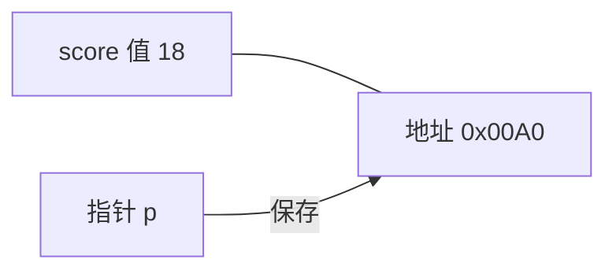

# Go中的指针

理解指针先分清三件事：

- 指针里存的地址
- 这个指针本身的类型
- 顺着地址取出的那个值

实际写代码时只记两个符号就够：`&` 取出变量地址，`*` 顺着地址读写值。

## 关于指针

变量是一块内存的名字。写 `score := 18` 时，名字 `score` 指向保存着 18 的那几个字节，读 `score` 就是读这块内存。名字好记，地址才是机器真正使用的位置。

指针同样是变量，只是它保存的不是业务数据，而是另一块内存的地址。拿到地址之后，可以间接改那块内存，函数因此能影响调用方的变量。



## 指针地址和指针类型

每个变量在运行时都有地址，表示它在进程地址空间中的位置。把 `&` 放在变量前面就得到这个地址。值类型都有对应的指针类型，例如 `int` 对应 `*int`，`string` 对应 `*string`，`int64` 对应 `*int64`。

取地址的写法：

```go
ptr := &v
```

其中：

- `v` 是被取地址的变量，类型记为 `T`
- `ptr` 的类型是 `*T`，称为 T 的指针；星号表示“指向”

例如 `count := 9` 之后，`p := &count`，`p` 的类型是 `*int`，它的内容是 `count` 的地址，不是 9 本身。打印 `p` 看到的是地址，打印 `*p` 才看到 9。

## 指针取值

对变量做 `&` 得到指针，再对指针做 `*` 就回到原来的值，也可以通过 `*` 把新值写回去。

```go
var base = 12
holder := &base
fmt.Println(holder)
fmt.Println(*holder)
*holder = 45
fmt.Println(base)
```

最后一行会打印 45。通过指针写入，改的是 `base` 那块内存，所以原变量跟着变。

函数参数默认按值复制。想改调用方的变量，就要传入指针：

```go
func keep(n int) {
	n = 8
}

func replace(n *int) {
	*n = 16
}

func main() {
	n := 3
	keep(n)
	fmt.Println(n)
	replace(&n)
	fmt.Println(n)
}
```

运行结果：

```bash
3
16
```

`keep` 改的是副本，`main` 里的 `n` 仍是 3。`replace` 拿到的是地址，`*n = 16` 写回原处，第二次打印变成 16。

## new和make函数

指针、切片和 map 一样，必须先有可用的内存才能写入。只声明不分配，解引用会 panic。

切片和 map 用 `make` 分配底层结构：

```go
profile := make(map[string]string)
profile["nick"] = "lee"
fmt.Println(profile)

buf := make([]int, 3, 6)
buf[0] = 9
fmt.Println(buf)
```

下面这段只声明了指针，没有指向任何 `int`：

```go
var p *int
*p = 100
fmt.Println(p)
```

执行到 `*p = 100` 会 panic，因为 `p` 的零值是 `nil`，后面没有合法地址。值类型在声明时就已经带好零值内存，所以 `var n int` 可以直接使用；引用类型和裸指针则要先分配。

分配单个值并拿到它的指针，用内建函数 `new`：

```go
func new(Type) *Type
```

- 参数是类型，不是值
- 返回值是 `*Type`，指向一块已经清成零值的内存

日常代码里 `new` 用得不多，因为对结构体更常写 `&Person{}`。需要“一个指向零值的指针”时，`new` 仍然直接：

```go
ip := new(int)
bp := new(bool)
fmt.Printf("%T\n", ip)
fmt.Printf("%T\n", bp)
fmt.Println(*ip)
fmt.Println(*bp)
```

这里会打印 `*int`、`*bool`，以及 `0` 和 `false`。前面的 `var p *int` 只是声明，应改成 `p = new(int)` 之后再 `*p = 100`。

## make和new的区别

- 二者都负责分配内存
- `make` 只用于切片、map 和 channel，返回的就是这三个类型本身，而不是指针
- `new` 可用于任意类型，把内存设成零值，返回指向该内存的指针
