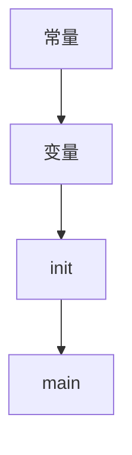
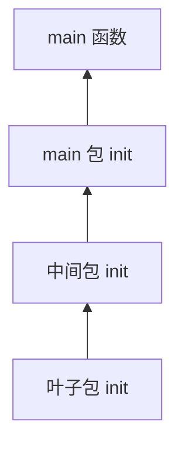

# Go 中的包

## Go中的包的介绍和定义

包是一组 Go 源文件的集合，也是复用代码的基本单位。语言自带不少包，例如 `fmt`、`strconv`、`strings`、`sort`、`errors`、`time`、`encoding/json`、`os`、`io`。

按来源可以分成三类：

- **标准库**：随发行版提供，导入路径不带域名，装好 Go 就能用。
- **自己写的包**：当前模块里的目录。
- **第三方包**：发布在模块路径上的代码，例如用 `shopspring/decimal` 做十进制运算，避免 `float64` 的二进制误差。第三方包也是别人写的包，只是要通过模块工具下载。

## Go包管理工具 go mod

1.11 之前，自定义包必须放在 `GOPATH/src` 下。1.11 引入模块后，项目可以放在磁盘任意位置。1.13 起模块模式已经足够日常使用，不必再把所有仓库塞进 GOPATH。

### go mod init初始化项目

在项目根目录执行一次，生成 `go.mod`：

```bash
go mod init demo/ledger
```

终端会多出一个 `go.mod`，先记下模块路径和语言版本，以后每增加一个依赖再追加 `require`。

```go
module demo/ledger

go 1.22
```

### 引入其它项目的包

假设 `calc` 目录提供加减：

```go
package calc

var Age = 18          // 大写，包外可见
var nickname = "lin"  // 小写，仅本包可见

func Plus(a, b int) int  { return a + b }
func Minus(a, b int) int { return a - b }
```

包外只能调用 `Plus`、`Minus` 和 `Age`。可见性看首字母大小写，不看你在注释里怎么写。

```go
package main

import (
    "fmt"
    "demo/ledger/calc"
)

func main() {
    fmt.Println(calc.Plus(4, 6))
}
```

## Golang中自定义包

一个包就是一个目录下的若干 `.go` 文件。每个文件第一行声明包名：

```go
package 包名
```

注意：

- 同一目录下的文件必须属于同一个包；同一个包也不能拆到多个目录。
- 包名可以和目录名不同，但不要包含减号。
- 包名是 `main` 的才是程序入口，编译后得到可执行文件。没有 `main` 的模块只能当库。

## Go中init()初始化函数

### init函数介绍

导入一个包时，运行时会自动调用它的 `init`。这个函数没有参数、没有返回值，也不能在业务代码里手动再调一次。

单个包内部的顺序是：先常量，再变量，然后 `init`，最后才轮到 `main`。



### init函数执行顺序

编译器从 `main` 出发，沿着 import 画出依赖图，每个包只初始化一次。被依赖的包先完成 `init`，依赖别人的包后完成。也就是说，最底层的包最先就绪。



同一包里若有多个 `init`，按源文件名排序，再按文件中的出现顺序执行。

## Go中的第三方包

可以在 `pkg.go.dev` 上按关键字检索模块。找到 `shopspring/decimal` 后，有三种常见落地方式。

### 方法1：go get 包全名 （全局）

```bash
go get github.com/shopspring/decimal@v1.4.0
```

这条会更新 `go.mod` 并下载模块。缓存放在模块缓存目录，不是旧的 `GOPATH/src`。

### 方法2：go mod download （全局）

```bash
go mod download
```

它按 `go.mod` / `go.sum` 把已经声明的模块拉到本地缓存，多个项目可以共用这份缓存。执行前，依赖必须已经出现在 `go.mod` 里，通常是先在代码中 import，再 `go mod tidy`。

### 方法3：go mod vendor 将依赖复制到当前项目的vendor（本项目）

```bash
go mod vendor
```

这条把构建需要的源码复制到当前仓库的 `vendor` 目录，适合内网构建。同样要先让 `go.mod` 里有这些依赖。

### go mod常见命令

- `go mod download`：把依赖下载到本地缓存
- `go mod edit`：用命令改 `go.mod`，例如加 `replace`
- `go mod graph`：打印模块依赖图
- `go mod init`：在当前目录创建新模块
- `go mod tidy`：补上缺失依赖，删掉没用到的依赖
- `go mod vendor`：复制依赖到 `vendor`
- `go mod verify`：核对缓存是否与 `go.sum` 一致，被改过就返回非零

## 安装依赖

在代码里写上导入路径后运行程序或 `go mod tidy`，工具会下载并回写 `go.mod`：

```go
import (
    "fmt"

    "demo/ledger/calc"
    "github.com/shopspring/decimal"
)

func main() {
    fmt.Println(calc.Plus(4, 6))
    fmt.Println(calc.Age)
    if _, err := decimal.NewFromString("19.90"); err != nil {
        panic(err)
    }
}
```

`go.mod` 里会出现对应的 `require`。同时生成 `go.sum`，为该版本的 zip 和 `go.mod` 各记一条 `h1:` 摘要。有了这两份文件，就可以安全地使用第三方包。

用十进制做加法，避免 `0.1 + 0.2` 这类二进制误差：

```go
package main

import (
    "fmt"
    "github.com/shopspring/decimal"
)

func main() {
    a := decimal.NewFromFloat(0.1)
    b := decimal.NewFromFloat(0.2)
    fmt.Println(a.Add(b))
}
```

## 完整案例

### 寻找依赖

到 `pkg.go.dev` 搜索，作用类似 Maven 的中央仓库索引。

检索 JSON 读取库时可以找到 `tidwall/gjson`。它的模块路径是 `github.com/tidwall/gjson`。拉取：

```bash
go get github.com/tidwall/gjson
```

使用时给出 JSON 文本和路径：

```go
package main

import "github.com/tidwall/gjson"

const payload = `{"user":{"given":"Lin","family":"Zhao"},"years":29}`

func main() {
    got := gjson.Get(payload, "user.family")
    println(got.String())
}
```

路径 `user.family` 会取出 `"Zhao"`。更复杂的语法放在 gjson 那篇笔记里。
