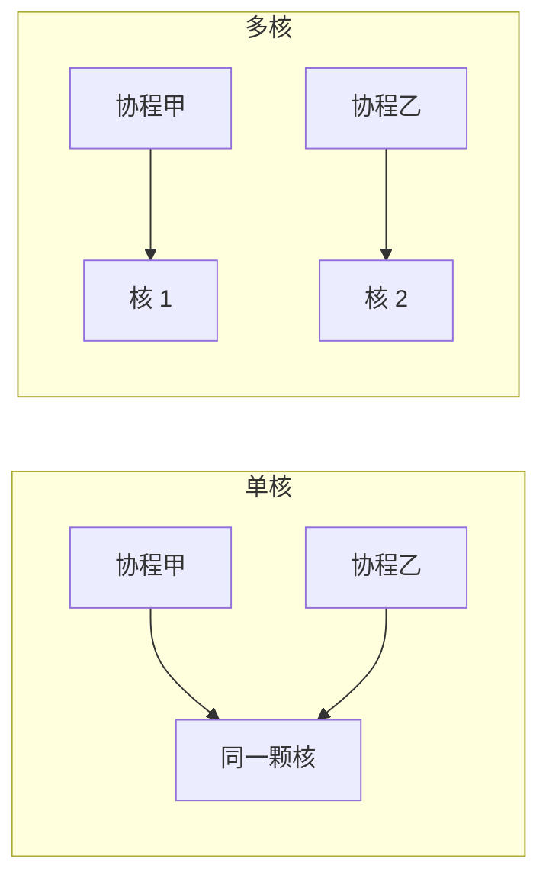
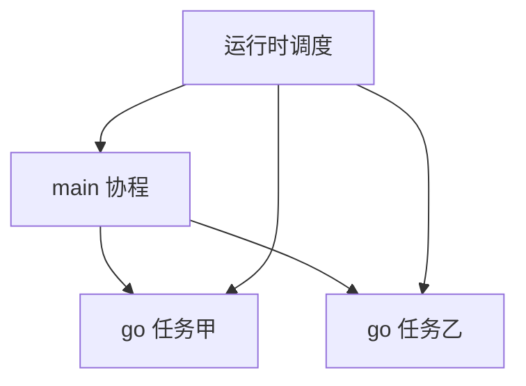
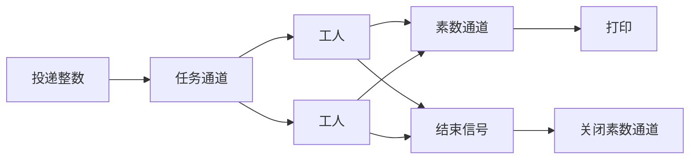

# 用 goroutine 和 channel 做并发

## 为什么要使用goroutine呢

题目：在 1 到一千万的整数里找出素数并打印。

素数只能被 1 和它自己整除。

做法可以分三档：

- 单循环逐个判断，简单但慢
- 把区间拆给多个 goroutine，同时算
- 再用 channel 把“待检测的数”“找到的素数”“工人是否结束”串起来

## 进程、线程以及并行、并发

### 进程

进程是程序的一次执行，操作系统按进程分配地址空间和大部分资源。它是动态的：从创建到退出，至少会经过新建、就绪、运行、阻塞、结束这几种状态。口语里说的“一个正在跑的程序”，指的就是进程。

### 线程

线程是进程里的一条执行流，也是操作系统调度的较小单位。一个进程可以起多个线程，它们共享地址空间。没有进程，线程无处安放。

### 并发和并行

并发是多条执行流争用同一颗核，任意瞬间只有一条在真正执行，其余在排队。并行是多颗核在同一瞬间各跑一条。

单核上的多线程只能并发。核数够用时才能并行。线程数超过核数时，两种现象会同时存在。



## Golang中协程（goroutine）以及主线程

Go 程序先有一条主协程，也就是 `main` 所在的那条。在它上面可以再启动许多 goroutine。这些协程由运行时调度，既能并发也能并行。

协程是用户态的执行流，内核不给它单独建线程对象。在函数调用前写上 `go`，就创建了一条 goroutine。



这和 Java 里开线程的目的相近：都是为了同时推进多件事。差别在于调度发生的层次和默认占用的内存。

### 多协程和多线程

操作系统线程通常预留大约 2MB 的栈。一条 goroutine 起步只要大约 2KB，栈会按需增长。切换时也不必每次陷入内核。同样的内存可以承载更多并发任务，这也是很多服务改用 Go 的原因之一。

## goroutine的使用以及sync.WaitGroup

### 并行执行需求

主协程每 50 毫秒打印一次问候，一共十次；另一条协程以同样的节奏打印。两边要同时进行。启动方式就是在调用前加 `go`。

```go
func worker() {
    for i := 0; i < 5; i++ {
        fmt.Println("worker", i)
        time.Sleep(100 * time.Millisecond)
    }
}

func main() {
    go worker()
    for i := 0; i < 5; i++ {
        fmt.Println("main", i)
        time.Sleep(100 * time.Millisecond)
    }
}
```

输出会交错，没有固定的先后。但 `main` 一返回，进程就退出，不管其他协程是否还在跑。

因此要用 `sync.WaitGroup` 挡住主协程。

先声明计数器：

```go
var wg sync.WaitGroup
```

启动前加一，任务结束时减一：

```go
wg.Add(1)
go worker()
// worker 的末尾调用 wg.Done()
```

完整例子：

```go
var wg sync.WaitGroup

func loop(tag string) {
    defer wg.Done()
    for i := 0; i < 5; i++ {
        fmt.Println(tag, i)
    }
}

func main() {
    wg.Add(2)
    go loop("a")
    go loop("b")
    for i := 0; i < 5; i++ {
        fmt.Println("main", i)
    }
    wg.Wait()
    fmt.Println("主协程结束")
}
```

`Add` 要发生在 `Wait` 之前，最好也发生在 `go` 之前，避免任务跑得太快、`Done` 先于 `Add`。`defer wg.Done()` 可以保证中途 return 也会减计数。

## 设置Go并行运行的时候占用的cpu数量

调度器看 `GOMAXPROCS` 决定用多少操作系统线程同时执行 Go 代码。默认值是机器的逻辑核数。八核机器上，最多有八个线程同时跑 Go 代码。

用 `runtime.GOMAXPROCS` 可以改这个上限。1.5 之前默认是 1，1.5 起默认用满全部逻辑核。

```go
func main() {
    cores := runtime.NumCPU()
    fmt.Println("逻辑核", cores)
    runtime.GOMAXPROCS(cores - 1)
}
```

留出一核给系统和其他进程。设得比 1 还小没有意义，传入小于 1 的值会被忽略并返回旧值。

## for循环开启多个协程

循环里启动多条协程时，计数器同样要配对。

```go
func show(id int, wg *sync.WaitGroup) {
    defer wg.Done()
    for n := 0; n < 3; n++ {
        fmt.Printf("id=%d step=%d\n", id, n)
    }
}

func main() {
    var wg sync.WaitGroup
    for id := 0; id < 4; id++ {
        wg.Add(1)
        go show(id, &wg)
    }
    wg.Wait()
    fmt.Println("主协程结束")
}
```

参数 `id` 要作为实参传进去。若闭包直接捕获循环变量，老版本里所有协程可能看到同一个最终值。1.22 起每次迭代有自己的变量，但显式传参更清晰。

## Channel管道

channel 是语言自带的协程通信方式。goroutine 负责执行，channel 负责把值从一条协程交到另一条。Go 推崇 CSP：通过通信来共享内存，而不是先共享内存再加锁交谈。

通道像队列，先入先出。声明时必须写明元素类型。

### channel类型

通道是引用类型。只声明还不分配队列：

```go
var nums chan int
var flags chan bool
var rows chan []int
```

### 创建channel

用 `make` 分配，第二个参数是缓冲容量，省略则是无缓冲。

```go
nums = make(chan int, 8)
flags = make(chan bool, 2)
rows = make(chan []int, 1)
```

### channel操作

发送和接收都用 `<-`。发送写在箭头右边，接收写在箭头左边。

```go
ch := make(chan int, 3)
```

#### 发送

```go
ch <- 10
```

#### 取操作

```go
got := <-ch
```

#### 关闭管道

```go
close(ch)
```

关闭之后不能再发送，否则 panic。接收会先把剩余值取完，然后再返回元素类型的零值。

#### 完整示例

```go
ch := make(chan int, 3)
ch <- 10
ch <- 21
ch <- 32

fmt.Println(<-ch)
fmt.Println(<-ch)
fmt.Println(<-ch)
fmt.Printf("容量 %d 剩余 %d\n", cap(ch), len(ch))
fmt.Printf("类型 %T\n", ch)
```

对空通道接收会一直堵住；缓冲已满时再发送也会堵住。无缓冲通道要求发送和接收同时有协程在场。示例若再写一次 `<-ch` 或第四次发送，程序就会停住，所以这里只演示三次收发。

## for range从管道循环取值

发完数据后应 `close`。`for range` 会一直收到通道关闭并且取空为止。不关闭的话，range 会在没有新值时永久等待，运行时最终报死锁。

```go
ch := make(chan int, 4)
for n := 0; n < 4; n++ {
    ch <- n
}
close(ch)
for n := range ch {
    fmt.Println(n)
}
```

如果次数已知，用普通 for 接收固定次数，可以不关闭：

```go
ch := make(chan int, 4)
for n := 0; n < 4; n++ {
    ch <- n
}
for n := 0; n < 4; n++ {
    fmt.Println(<-ch)
}
```

接收方不知道还有没有后续数据时，关闭仍然是唯一的结束信号。可以用双返回值判断：

```go
n, open := <-ch
```

`open` 为假表示通道已关且没有剩余值。

## Goroutine 结合 channel 管道

两个函数共用一条通道：一个写入，一个读出，主协程等到两边都结束。

```go
func produce(out chan<- int, wg *sync.WaitGroup) {
    defer wg.Done()
    for n := 0; n < 5; n++ {
        out <- n
        time.Sleep(10 * time.Millisecond)
    }
}

func consume(in <-chan int, wg *sync.WaitGroup) {
    defer wg.Done()
    for n := 0; n < 5; n++ {
        fmt.Println("读到", <-in)
    }
}

func main() {
    ch := make(chan int, 4)
    var wg sync.WaitGroup
    wg.Add(2)
    go produce(ch, &wg)
    go consume(ch, &wg)
    wg.Wait()
}
```

通道自带同步：读得快了会在空通道上等待，写得快了会在满缓冲上等待。不要用共享切片再加睡眠来模拟这种交接。

## goroutine 结合 channel打印素数

流水线分成三段：投递整数、判断素数、打印。工人数量固定，每名工人干完往退出通道送一个信号。集齐信号后再关掉素数通道，打印协程的 range 才能结束。



```go
func feed(nums chan int, limit int, wg *sync.WaitGroup) {
    defer wg.Done()
    for n := 2; n < limit; n++ {
        nums <- n
    }
    close(nums)
}

func isPrime(n int) bool {
    if n < 2 {
        return false
    }
    for d := 2; d*d <= n; d++ {
        if n%d == 0 {
            return false
        }
    }
    return true
}

func sift(nums <-chan int, primes chan<- int, done chan<- struct{}, wg *sync.WaitGroup) {
    defer wg.Done()
    for n := range nums {
        if isPrime(n) {
            primes <- n
        }
    }
    done <- struct{}{}
}

func printPrimes(primes <-chan int, wg *sync.WaitGroup) {
    defer wg.Done()
    for n := range primes {
        fmt.Println(n)
    }
}

func main() {
    const workers = 4
    nums := make(chan int, 64)
    primes := make(chan int, 64)
    done := make(chan struct{}, workers)
    var wg sync.WaitGroup

    wg.Add(1)
    go feed(nums, 200, &wg)
    for i := 0; i < workers; i++ {
        wg.Add(1)
        go sift(nums, primes, done, &wg)
    }
    wg.Add(1)
    go printPrimes(primes, &wg)

    wg.Add(1)
    go func() {
        defer wg.Done()
        for i := 0; i < workers; i++ {
            <-done
        }
        close(primes)
    }()
    wg.Wait()
}
```

判断素数时用 `n % d == 0`。若写成 `d % d`，每个大于 1 的除数都会立刻命中，结果会把几乎所有数都排除。投递方负责关闭任务通道，工人的 range 才能退出；打印方不能自己关，否则还在发送的工人会 panic。

## 单向管道

默认通道既能发也能收。函数签名可以把方向收窄，编译器会阻止用错方向。

```go
both := make(chan int, 1)
both <- 7
fmt.Println(<-both)

var sendOnly chan<- int = make(chan int, 1)
sendOnly <- 7

var recvOnly <-chan int = both
fmt.Println(<-recvOnly)
```

不能把单向通道再转回双向。通常在 `make` 时仍用双向类型，只在参数位置写成 `chan<-` 或 `<-chan`。

## Select多路复用

要同时等多条通道时，若先死等第一条，第二条即使有数据也要排队，延迟会被拉长。`select` 可以同时观察多个发送或接收，谁先就绪就走谁。多个同时就绪时随机挑一个。

```go
left := make(chan int, 2)
right := make(chan string, 2)
left <- 1
right <- "a"

for {
    select {
    case n := <-left:
        fmt.Println("left", n)
    case s := <-right:
        fmt.Println("right", s)
    default:
        fmt.Println("当前都没有数据")
        return
    }
}
```

`default` 让 select 不会阻塞。没有 default 时，select 会等到某个 case 能进行。用 select 排空通道时不必先关闭；若关闭后再接收，case 会不断得到零值，循环停不下来，除非同时检查第二个布尔返回值。

## Goroutine Recover解决协程中出现的Panic

一条协程里的 panic 只会沿着它自己的调用栈往上找 `recover`。主协程里的 recover 接不住子协程。

```go
func hello() {
    for i := 0; i < 3; i++ {
        fmt.Println("hello", i)
    }
}

func boom() {
    defer func() {
        if cause := recover(); cause != nil {
            fmt.Println("boom 已接住", cause)
        }
    }()
    var table map[int]string
    table[0] = "x" // nil 映射上写入会 panic
}

func main() {
    go hello()
    go boom()
    time.Sleep(100 * time.Millisecond)
}
```

`defer` 必须写在会 panic 的同一条协程里，并且注册在 panic 发生之前。

## Go中的并发安全和锁

多个协程同时 `count++` 会丢更新。`++` 不是原子操作，读、改、写三步会交错。

```go
var count int
var wg sync.WaitGroup

func bump() {
    defer wg.Done()
    count++
    time.Sleep(time.Millisecond)
}

func main() {
    for i := 0; i < 20; i++ {
        wg.Add(1)
        go bump()
    }
    wg.Wait()
    fmt.Println(count)
}
```

打印出来的 `count` 常常小于 20。

### 互斥锁

`sync.Mutex` 有一对方法：`Lock` 与 `Unlock`。临界区里只放会改共享数据的那几行，不要把睡眠也锁在里面。

```go
var (
    count int
    wg    sync.WaitGroup
    mu    sync.Mutex
)

func bump() {
    defer wg.Done()
    mu.Lock()
    count++
    mu.Unlock()
}
```

忘记解锁会使其他协程永远停在 `Lock`。可以用 `defer mu.Unlock()`，但要确认 defer 的范围就是临界区。

构建时加上竞争检测：

```bash
go test -race ./...
go build -race -o app .
```

有数据竞争时，运行被检测的程序会打印冲突的调用栈。检测有额外开销，不要默认开在生产二进制上。

### 读写互斥锁

互斥锁在持有期间不允许其他协程进入，读操作也被串行化，并发度下降。

只读且数据不变时，多个读者可以同时进行，它们之间没有竞争。真正要互斥的是“读对写”和“写对写”。

`sync.RWMutex` 因此提供两对方法：

- `Lock` / `Unlock`：写锁，排他
- `RLock` / `RUnlock`：读锁，读者之间不互斥，但与写者互斥

```go
var (
    mu   sync.RWMutex
    text = "v1"
)

func read() string {
    mu.RLock()
    defer mu.RUnlock()
    return text
}

func write(next string) {
    mu.Lock()
    text = next
    mu.Unlock()
}
```

有写者在等待时，新的读者不应无限插队。标准库的实现会避免写者被连续的读者饿死。读多写少的配置、缓存用读写锁；临界区极短或写很频繁时，普通互斥锁更简单。
