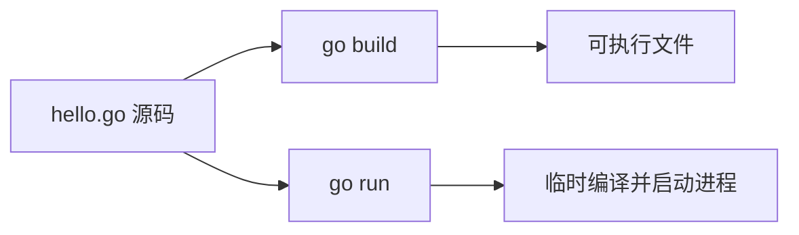

# Go语言发展简史

## 开发文档

标准库的函数说明可以在 Go 官方文档或社区整理的中文手册里查。写代码时不确定某个函数的参数，优先查包文档，而不是凭记忆猜签名。

## Go语言核心开发团队

Ken Thompson 是 Unix 的共同设计者，也设计过 B 语言，并参与了 C 的早期工作。他后来加入 Go 的设计，把系统编程里对简洁和可组合工具的偏好带了进来。

Rob Pike 曾在贝尔实验室参与 Unix 与 Plan 9，并和 Thompson 一起设计了 UTF-8。Go 的并发思想和接口风格，能看到 Plan 9 那条线上的痕迹。

Robert Griesemer 参与过 Java HotSpot 以及 Chrome 所用的 V8 引擎，负责 Go 在类型系统和实现上的不少早期决策。

三人的共同点是：都做过长期运行的系统软件，而不是只写过教学语言。

## Google为什么要创建Go

- 机器早就多核了，不少主流语言仍把并发当成库，而不是语言本身的一部分，写出来的服务难以吃满 CPU。
- 大型代码库越来越难维护：风格不统一、依赖编译慢、大并发下线程模型又太重。
- 公司里大量 C 与 C++ 服务跑得很快，但编译一次要等很久，内存还要人工盯着，线上泄漏很难查。

Go 想同时解决这三件事：编译快、写法直、并发便宜。

## Go语言发展历史

- 2007 年，Pike、Thompson 与 Griesemer 在谷歌开始设计这门语言，形成最初的草稿。
- 2009 年 11 月 10 日，Go 以开源形式对外发布。
- 2015 年 8 月 19 日发布 1.5，编译器和运行时里最后残留的 C 实现被移走，Go 开始用 Go 构建自身。
- 2017 年 2 月 17 日发布 1.8。
- 2017 年 8 月 24 日发布 1.9，同一年也引入了类型别名。
- 2018 年 2 月 16 日发布 1.10，构建缓存进一步加快了重复编译。

之后的版本继续在模块、泛型和工具链上迭代，但这几步决定了语言从实验原型变成可独立引导的工具链。

## Go语言的特点

Go 希望同时拿到静态编译的速度与安全边界，以及脚本语言那种较短的修改周期。有人用“C 的速度加上 Python 的开发手感”来形容它，意思是：二进制直接跑，语法却刻意保持少。

- 表达式、控制流、基本类型、参数按值传递和指针，都从 C 一脉继承下来，但指针不能做算术，编译期就能拦住一类内存错误。

```go
func bump(n *int) {
	*n = 40
}
```

- 每个源文件必须属于一个包，包是组织代码的基本单位，不能有“游离”的文件。
- 运行时带垃圾回收，堆上的对象由收集器回收。这去掉了手动 `free`，但循环引用以外的逻辑泄漏（例如 goroutine 卡住不退出）仍然要自己避免。
- 并发是语言的一部分，而不只是一个库。
  - `go` 关键字就能启动一个 goroutine。
  - goroutine 比操作系统线程轻，可以在少量线程上调度大量任务，方便吃满多核。
  - 模型来自通信顺序进程：用发送和接收协作，而不是用共享内存加锁作为唯一手段。
- channel 是这条模型里的管道。不同 goroutine 通过它传递数据，也能用它表达“做完了”这种同步。
- 函数可以一次返回多个结果，错误因此常常作为最后一个返回值，而不是靠异常抛出。
- 切片、`defer` 这类设施则是 Go 自己的补充：切片负责变长序列，`defer` 把释放动作写在获取资源的旁边。

## Hello Go

下面这段程序只向标准输出打一行字：

```go
package main

// fmt 提供格式化后的输入与输出
import "fmt"

func main() {
	fmt.Println("hi, go")
}
```

## Golang执行流程分析

常用的两条命令：

- `go build hello.go` 生成可执行文件，Windows 上是 `hello.exe`
- `go run hello.go` 编译后立刻运行，不把中间产物留在当前目录



### 两种执行流程分析

- 已经 `go build` 出的二进制可以拷到没有安装 Go 的机器上运行，只要操作系统和 CPU 架构匹配。
- 若只带走 `.go` 源文件并打算用 `go run`，目标机器必须装有同版本工具链。
- 编译时会把程序依赖的运行时打进二进制，所以一个“只打印一行”的程序也会有数兆大小，这是正常现象。

### 什么是编译

- 编译器把源文件翻译成 CPU 能执行的机器码。
- 在源文件目录执行 `go build`。可以用 `-o` 指定输出名；在 Windows 上可执行文件以 `.exe` 结尾。
- 没有错误时命令通常没有额外输出，当前目录多出一个可执行文件。
- 有错误时，编译器会指出文件名和行号，修正那一行后再编译。

## Go语言开发注意事项

- 源文件扩展名是 `.go`。
- 可执行程序的入口固定叫 `main`，且必须放在 `main` 包。
- 标识符区分大小写，`Name` 和 `name` 是两个名字，首字母大写还决定能否被其他包访问。
- 语句末尾不必写分号，编译器会在换行处自动补上。因此一行只放一条语句，不要用分号把多条语句挤在同一行。
- 声明了却没用到的局部变量，以及导入了却没用到的包，都会导致编译失败。
- 花括号必须成对。左花括号一般跟在语句同一行，不能单独挪到下一行，否则自动分号会插在中间，造成语法错误。

## Go语言中的转义字符

字符串里的反斜杠用来表示不便直接敲出的字符：

- `\t`：水平制表，常用来把多列文字对齐
- `\n`：换到下一行
- `\\`：输出一个真正的反斜杠
- `\r`：回车，光标回到当前行开头；和 `\n` 一起出现时就是 Windows 风格的换行
