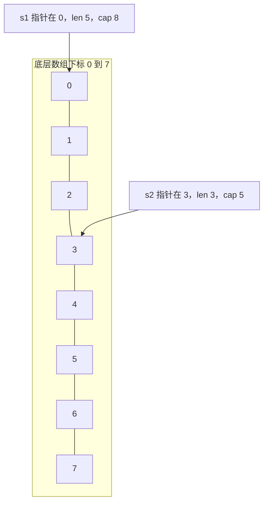

# Go的切片

## 为什么要使用切片

切片是一段长度可变、元素类型相同的序列，底层仍是数组，只是多了一层描述信息。数组长度写在类型里，切片则可以随元素增减更换底层数组，因此更适合事先不知道个数的数据。

它是引用类型。内部记录三样东西：底层数组的地址、当前长度、容量。

声明形式：

```go
var name []T
```

- `name` 是变量名
- `T` 是元素类型

和数组的差别是方括号里不写长度：

```go
nums := []int{4, 5, 6}
fmt.Println(nums)
```

## 关于nil的认识

声明后没有赋值的变量会得到零值，而不是未定义的内存。常见零值如下：

- bool：`false`
- 数值：`0`
- string：`""`
- 指针、切片、map、channel、函数：`nil`

只声明切片、不给字面量也不 `make` 时，它等于 `nil`：

```go
var blank []int
fmt.Println(blank == nil)
```

打印结果：

```bash
true
```

`nil` 切片的长度和容量都是 0，可以传给 `append`，但不能按下标写入。

## 切片的遍历

遍历方式和数组相同，下标从 0 走到 `len` 之前：

```go
nums := []int{4, 5, 6}
for i := 0; i < len(nums); i++ {
	fmt.Print(nums[i], " ")
}
```

也可以 `for i, v := range nums`。`range` 给出的值是副本，改 `v` 不会改切片本身。

## 基于数组定义切片

切片可以引用已有数组的一段，不必先把元素抄一遍。

```go
raw := [5]int{11, 12, 13, 14, 15}
whole := raw[:]
mid := raw[1:4]
head := raw[:3]
tail := raw[3:]
```

对应结果：

```bash
[11 12 13 14 15]
[11 12 13 14 15]
[12 13 14]
[11 12 13]
[14 15]
```

切分区间是左闭右开：`raw[1:4]` 含下标 1、2、3，不含 4。对切片再切一次，得到的新切片仍可能和原切片共享同一块数组，改元素会互相看见。

## 切片的长度和容量

长度用 `len`，容量用 `cap`。长度是当前能按下标访问的元素个数。容量是从切片起点算起，到底层数组末尾还能容纳多少元素。

```go
s := []int{2, 3, 5, 7, 11, 13}
fmt.Printf("len=%d cap=%d\n", len(s), cap(s))

ss := s[2:]
fmt.Printf("len=%d cap=%d\n", len(ss), cap(ss))

sss := s[2:4]
fmt.Printf("len=%d cap=%d\n", len(sss), cap(sss))
```

输出：

```bash
len=6 cap=6
len=4 cap=4
len=2 cap=4
```

最后一条的长度是 2，因为只取了下标 2 和 3，也就是 5 和 7。容量仍是 4，因为从下标 2 一直到原切片末尾还有 5、7、11、13 四个位置。容量里尚未包含进长度的部分，不能直接按下标读，但 `append` 在容量没用完时会利用它们。

## 切片的本质

切片值本身是一个小结构，里面有三项：

- 指向底层数组的指针
- 长度 `len`
- 容量 `cap`

设数组 `a := [8]int{0, 1, 2, 3, 4, 5, 6, 7}`，`s1 := a[:5]` 指向数组开头，长度为 5，容量为 8。`s2 := a[3:6]` 从元素 3 开始，长度为 3，容量为 5（3 到 7）。



两个切片改同一个下标上的元素时，改的是同一块数组。只有 `append` 触发扩容、换了新数组之后，它们才分开。

## 使用make函数构造切片

不依赖现成数组时，用 `make` 造一块新的底层数组：

```text
make([]T, size, cap)
```

- `T`：元素类型
- `size`：长度，这些位置先填零值
- `cap`：容量，省略时等于长度

```go
buf := make([]int, 4, 8)
fmt.Println(buf)
fmt.Printf("长度：%d, 容量%d", len(buf), cap(buf))
```

打印 `[0 0 0 0]`，长度 4，容量 8。下标只能用到 3，不能写 `buf[4] = 1` 来“扩容”，越界会 panic。增加元素要用 `append`，它返回新的切片头，必须接回变量：

```go
grown := []int{1, 2, 3, 4}
grown = append(grown, 9)
fmt.Println(grown)
```

结果是 `[1 2 3 4 9]`。把另一个切片接在后面时，要在切片名后写 `...`，把元素逐个展开：

```go
extra := []int{6, 7, 8}
grown = append(grown, extra...)
fmt.Println(grown)
```

结果是 `[1 2 3 4 9 6 7 8]`。容量不够时，运行时会分配更大的数组并把旧元素拷过去。小切片常见的增长是按大约两倍扩；切片已经很大时，增长比例会降下来，避免一次申请过多内存。扩容后的切片不再和旧的底层数组共享，之前别的切片看不到新元素。

## 使用copy()函数复制切片

切片赋值只复制切片头，两份变量仍指向同一数组。改其中一个的元素，另一个能看见。

- 值类型：改副本不影响原变量
- 引用类型：改副本所指向的数据，原变量也能看见

若要得到一份独立的元素，先 `make` 出同样长度的目标，再用 `copy`：

```go
src := []int{1, 2, 3, 4}
dst := make([]int, len(src))
copy(dst, src)
dst[0] = 8
fmt.Println(src)
fmt.Println(dst)
```

输出：

```bash
[1 2 3 4]
[8 2 3 4]
```

`copy` 拷贝的个数是两个长度中较小的那个。目标比来源短时，多出来的元素会被丢掉。

## 删除切片中的值

标准库没有 `remove`。删掉某个下标，就是把后半段接到前半段后面：

```go
seq := []int{0, 1, 2, 3, 4, 5, 6, 7, 8, 9}
seq = append(seq[:1], seq[2:]...)
fmt.Println(seq)
```

输出：

```bash
[0 2 3 4 5 6 7 8 9]
```

下标 1 上的 1 被跳过。这种写法会移动后面的元素，并且可能让别的切片看到被覆盖的内容，因为它们可能仍共享数组。需要保留原切片时，先 `copy` 再删。

## 切片的排序算法以及sort包

手写冒泡：相邻元素逆序就交换，某一轮没有交换就可以提前结束。

```go
func main() {
	data := []int{9, 6, 3, 8, 1, 4}
	for i := 0; i < len(data); i++ {
		swapped := false
		for j := 0; j < len(data)-i-1; j++ {
			if data[j] > data[j+1] {
				data[j], data[j+1] = data[j+1], data[j]
				swapped = true
			}
		}
		if !swapped {
			break
		}
	}
	fmt.Println(data)
}
```

选择排序每次在未排序区间里找最小值，放到区间起点：

```go
pick := []int{9, 6, 3, 8, 1, 4}
for i := 0; i < len(pick); i++ {
	for j := i + 1; j < len(pick); j++ {
		if pick[i] > pick[j] {
			pick[i], pick[j] = pick[j], pick[i]
		}
	}
}
fmt.Println(pick)
```

整数、浮点和字符串切片可以直接调用 `sort.Ints`、`sort.Float64s`、`sort.Strings`，默认升序：

```go
pick := []int{9, 6, 3, 8, 1, 4}
sort.Ints(pick)
fmt.Println(pick)
```

### 降序排列

`sort.Reverse` 把比较关系反过来。整数切片先转成 `sort.IntSlice`，它实现了排序接口，再套上 `Reverse`：

```go
desc := []int{9, 6, 2, 5, 1, 7}
sort.Sort(sort.Reverse(sort.IntSlice(desc)))
fmt.Println(desc)
```

浮点和字符串同样有 `Float64Slice`、`StringSlice`。排序是原地的，会改掉传入的切片。
