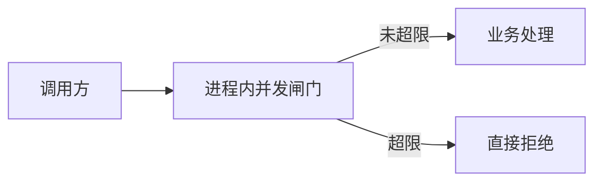
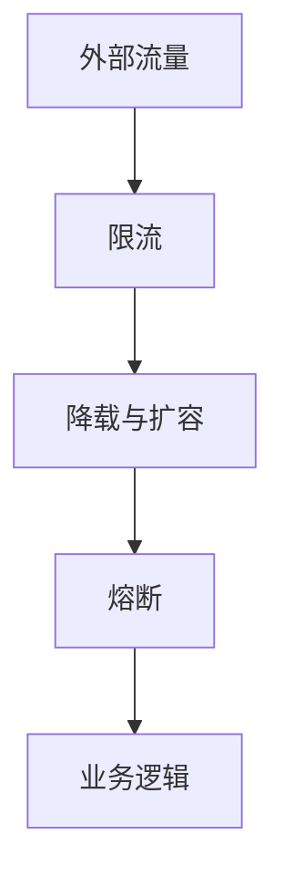

# go-zero架构设计

## 背景

以在线教育场景为例：日活要做到千万级，接口既有登录这种不能丢的请求，也有个人主页这种可以晚一点返回的请求。框架要回答的不是“怎么写一个 handler”，而是流量打满时先保什么、先丢什么。

## 架构设计的几点思考

- 结构必须贴着业务，离开访问路径去套通用分层，生成出来的服务没有人敢改
- 目录和生成方式要让新接口在短时间内能上线
- 语言选型要同时看团队和运行时：脚本语言上手快，Java 生态全，Go 的并发和部署更轻
- 能用成熟组件就不要从零造轮子；和业务绑死、外部组件表达不了的部分再自己写

## 设计原则

- 简单优先，一种需求只留一条推荐路径
- 高可用：单点故障不能把整条链路拖死
- 高并发：入口就要挡住突发流量
- 易扩展：加机器、加接口不改调用方
- 弹性：负载下来后能缩，负载上来后能扩
- 把服务发现、熔断、超时藏进框架，业务函数只处理自己的数据
- 同一件事不提供两套互相打架的写法

## Go服务实现

框架内置的微服务部件包括：

- 限流
- 自适应降载
- 自适应熔断
- 负载均衡
- 级联超时控制
- 缓存
- 可观测性

它们按请求进入的顺序叠在一起，而不是让每个业务项目各抄一份。

## 限流

### 进程内限流

- 限制单个进程同时处理的请求数
- 实现短，判断只看本进程计数
- 阈值可配置，不配也有默认值
- 用来挡住瞬间涌入的异常流量
- 属于业务进程里的第一道闸门，前面还可以再加防火墙



闸门放在真正执行业务之前。超限的请求不再进队列排队，避免把内存堆满。

### 分布式限流

- 计数放在 Redis，用 Lua 保证判断和扣减是一次原子操作
- 可以用令牌桶：按固定速率发令牌，请求取到令牌才通过
- 也可以用漏桶：请求进桶，按固定速率流出，削平尖峰
- 适合短信、推送这类跨进程共享额度的场景

多个实例共用一个桶，才不会出现“每台机器都没超、总和已经超了”的情况。

## 自适应降载

按优先级丢请求，给 CPU 留出恢复空间。

- 容器编排的水平扩容可以在 CPU 到 80% 左右时加副本
- CPU 超过约 90% 时，开始拒绝低优先级请求
- CPU 超过约 95% 时，高优先级请求也拒绝
- HTTP 与 RPC 框架自己完成判断，业务代码不用手写
- 用滑动窗口看一段时间的均值，避免一次毛刺就触发
- 触发后有冷却时间，防止阈值附近来回抖动
- 和自动扩缩一起用：先丢低价值流量，同时让集群变大
- 这是第二道防护

登录、下单算高优先级；个人资料、推荐列表可以先被丢掉。调用方应能区分“被降载拒绝”和“业务失败”，以便稍后重试低优先级请求。

## 自适应熔断

熔断按调用路径统计，而不是按整个进程一刀切。

- 错误率升高时自动打开，恢复后自动闭合
- 做在 HTTP 与 RPC 客户端里
- 采用 Google SRE 的自适应算法，而不是固定错误率阈值一刀切
- 没有沿用 Netflix Hystrix 那套状态机
- 统计窗口大约 10 秒，切成约 40 个小段
- 允许业务改触发条件
- 允许提供失败时的替代结果
- 这是第三道防护

```mermaid
flowchart LR
  req["请求"] --> probe["滑动窗口统计错误率"]
  probe -->|健康| call["继续调用下游"]
  probe -->|不健康| open["熔断并走替代逻辑"]
  open -->|窗口恢复| call
```

### Netflix Hystrix算法 和 Google SRE算法

Hystrix 用关闭、打开、半开三种状态。半开时放进少量探测请求，成功才回到关闭。状态少，但对短暂抖动不够灵敏，探测期间的行为也比较粗。

SRE 的算法看滑动窗口里的成功与失败次数，允许的失败数随流量变化。窗口一直在动，不需要单独的半开阶段，粒度更细，也更不容易被一次尖峰永久打开。

## 负载均衡

均衡建立在服务发现之上：

- 提供方启动时把自己的地址注册上去
- 调用方监听变更，本地保持一份实例列表
- 真正发请求时从列表里挑一个

### Round Robin

轮询按固定次序把请求分给每个实例。

- 实现简单
- 前提是每台机器处理能力接近
- 一旦某台变慢，轮询仍继续把新请求送过去，延迟会被放大

机器规格不一致，或个别实例已经堆积时，轮询不是好的默认选择。

### Power Of Two Choices

这个思路被多家代理和 RPC 实现采用：每次随机看两个候选，把请求交给当前更空闲的那个。

- 作为默认算法，而不是轮询
- 比较的指标包括正在处理的请求数
- 处理时长用指数加权移动平均，最近的样本权重大
- 负载函数形如 e 的负指数，延迟越高得分越低

只看两个候选，统计成本低，又能避开最忙的那一台，比全量扫描再取最优更适合高并发。

## 多重防护

三道闸门叠在一起：

- 入口或网关先做限流，把明显超出配额的流量挡在外面
- 进程内做自适应降载，并交给编排系统扩容，保住还在服务的实例
- 下游已经不可用时触发熔断，停止继续把请求打进故障实例



请求每过一层就少一些无效工作，后面的层才有机会处理真正该处理的调用。

## 级联超时控制

### 进程内超时控制

- 超时就立刻失败，不再做已经没用的计算
- 框架给默认超时，业务可以不写
- 服务端超时要和调用方的等待时间对齐，避免调用方先断开、服务端还在空跑

一条链路的剩余时间是共享的，不是每个下游各自重新计算一整段。

### 服务间的超时控制

- 同样强调尽快失败
- 剩余时间放在 context 里自动往下传
- 服务之间几毫秒的网络开销可以忽略，避免把预算算得过细


A 已经用掉 300 毫秒后，B 和 C 看到的上限是剩下的部分。C 不能再声称自己还有完整的一秒。

## 重试？

框架默认不做超时后的自动重试。

若业务自己加重试，至少要满足：

- 间隔按指数拉长，避免故障时所有客户端一起打回来
- 有单独的重试配额，重试流量不能挤掉正常流量
- 重试的超时必须还在整条链路的剩余时间里，超时了就不要再发

没有幂等保证的写操作更不应当自动重试。

## http请求自动解析校验

请求字段可以来自路径、表单或 JSON。描述里可以标默认值、可空、枚举和数值范围。

解析入口类似 `httpx.Parse`：失败时直接回 400，业务函数拿到的已经是校验过的结构。配合 goctl，字段规则写在 api 描述里，生成代码会把解析接上，减少手写绑定。

## 缓存

缓存要同时对付三类问题：

- 穿透：查询的数据根本不存在，每次都打到数据库
- 击穿：热点键刚好过期，大量请求同时回源
- 雪崩：许多键在同一时刻过期

对应的做法：

- 穿透：查不到也写入一个短命的空值，例如一分钟，挡住重复打库
- 击穿：同一个进程里对同一个键只允许一次回源，其他请求等待这次结果
- 雪崩：过期时间加随机偏移，让键分散失效
- 非主键查询：先把查询条件映射成主键，再按主键读缓存。读取路径是“条件 → 主键 → 缓存”。失效时顺序不能反，先动索引关系再动实体，或按框架规定的顺序来，避免读到旧主键
- 分布式缓存：用带虚拟节点的一致性哈希。增减节点时只迁移少量键，而不是让整环缓存一起失效
- 这些细节很难每次手写都正确。goctl 按表生成带缓存的增删改查，并记录慢 SQL 和命中率，把容易漏的步骤固定下来

## 可观测性

线上要能回答四个问题：请求走过哪些服务、日志在哪、指标是否异常、谁该收到告警。

- 链路跟踪
- 日志
- Metrics
- 监控报警

### 链路跟踪

- 框架把跟踪信息放进 context，调用下游时自动带上
- Trace id 标识整条调用链
- Span id 表示其中一段，带父子层次和先后顺序
- 记录开始和结束时间
- 同时标记这段是客户端发起还是服务端接收

有了 trace id，就能把网关、业务服务和数据库访问串成一条时间线。

### Logging日志

- 按大小或时间滚动文件
- 输出目标可以是控制台、本地文件或挂载卷
- 旧文件自动压缩
- 超过保留期限的文件自动删除

跑在容器里时直接打到标准输出，由平台收集，不必在容器内再管文件。

### 监控报警

- 自动把同类异常收在一起，例如一段时间内的 5xx
- 控制上报频率，先汇总再发，避免告警通道被刷满

### 数据上报

指标可以送到自建的控制台，也可以送到 Prometheus，由后者做查询和告警规则。业务侧只要暴露框架已经埋好的计数和延迟。

## 其它

- 基于 JWT 的鉴权可以挂在路由上，过期和签名校验不用每个接口重写
- MapReduce 用于一次请求要扇出到多个彼此独立的下游：并行调用，任一失败就取消其余调用并尽快返回；有先后依赖的步骤不要放进同一批
- 进程退出时做优雅关闭，把已经接住的请求处理完，并停止接收新连接
- 提供并发控制工具，限制某一段代码的并行度
- 提供资源控制，避免多个 goroutine 同时创建同一条数据库连接
- 带延迟的分布式任务、精简的消息发布订阅、以及比 Logstash 更轻的日志采集组件，都作为工具集而不是业务代码存在
- 因此它既是微服务框架，也是一组日常库

## 工具大于约定和文档

goctl 把约定收成生成器：

- api 描述语法很短，足够表达路由和字段
- 前后端都从这份描述生成，减少对接口文档的口头同步
- 生成 Go 的 REST 与 RPC、以及移动端调用代码，生成结果可以直接编译
- 生成带缓存的数据库访问
- 生成容器镜像和集群部署所需的文件

描述文件是唯一需要手写的契约，其余骨架按它展开。字段改名后重新生成，比在多份手写代码里查找替换更不容易漏。
