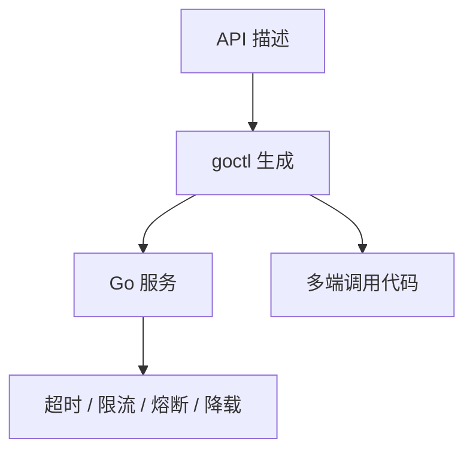
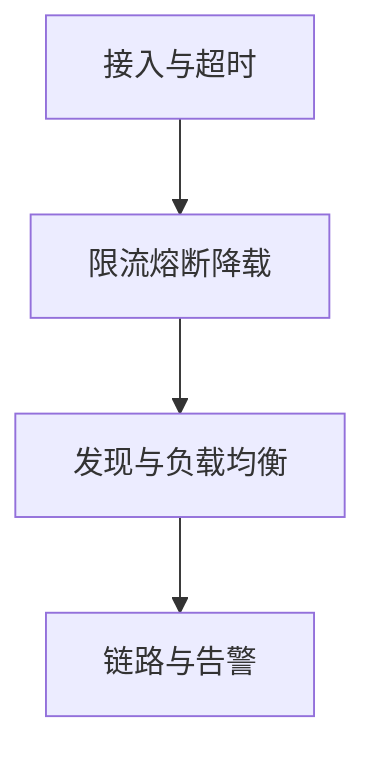

# go-zero 简介

## 来源

整理自公开的框架说明，原文链接不在笔记里重复。

## go-zero介绍

go-zero 把一批工程上反复出现的做法收进同一套 Web 与 RPC 框架：超时、限流、熔断、降载都按弹性思路预留，并在高并发场景里长期用过。

描述接口的格式很短。配套的 `goctl` 能按这份描述生成 Go、iOS、Android、Kotlin、Dart、TypeScript、JavaScript，生成结果可以直接跑。

使用它的直接好处：

- 服务要撑住很高的日活时，稳定性组件不用从零再拼
- 级联超时、限流、自适应熔断和降载已经在框架里，不必再写一套样板
- 这些治理能力也能嵌进既有框架，不一定整站重写
- 一份 API 描述生成多端代码
- 请求参数按声明自动校验
- 附带一批并发和治理工具包



## go-zero框架背景

2018 年初，晓黑板后端在频繁宕机之后，决定离开 Java 加 MongoDB 的单体，改走微服务。对比之后选定：

- 用 Go
  - 运行性能好
  - 语法短
  - 工程效率已经被很多团队验证
  - 部署简单
  - 单机资源占用低
- 自己做微服务框架
  - 团队已经有过自研经验
  - 出问题时要能更快定位
  - 新能力要能以较小代价加进去

## go-zero框架设计思考

设计时同时看两件事：服务要稳，研发不能被框架拖慢。因此有这些约束：

- 保持简单
- 高可用
- 高并发
- 容易扩展
- 弹性设计，默认故障会发生
- 把复杂留在框架里，业务代码保持直白
- 同一件事尽量只留一种写法

不到半年，主链路从 Java 加 MongoDB 迁到以 Go 加 MySQL 为主的微服务，2018 年 8 月底全部上线，并扛住了之后的增长。

## 3. go-zero项目实现和特点

作为同时包含 Web 和 RPC 的框架，它的特点是：

- 工具链尽量代写重复代码
- 接口声明短
- 与 `net/http` 兼容
- 中间件可以插进去扩展
- 性能优先
- 面向故障做弹性设计
- 自带服务发现和负载均衡
- 限流、熔断、降载会自动触发，也能自动恢复
- API 参数自动校验
- 超时可以沿调用链往下传
- 自动缓存控制
- 链路跟踪和统计告警
- 在晓黑板疫情期间的流量高峰上验证过

高可用不是单点开关，而是从接入、治理到资源几层一起做：



## Installation

在项目目录设置代理后拉取模块：

```bash
GOPROXY=https://goproxy.cn/,direct go get github.com/zeromicro/go-zero
```

早期模块路径曾用 `github.com/tal-tech/go-zero`。新项目应核对当前文档里的模块路径，避免装到已迁移的旧地址。

## 5. Quick Start

1. 安装 `goctl`。

   读作 go control，不要拆成三个字母来念。名字的意思是由人控制代码生成，而不是被样板代码牵着走；这里的 go 也不等于整门语言。

   ```bash
   GOPROXY=https://goproxy.cn/,direct go install github.com/zeromicro/go-zero/tools/goctl@latest
   ```

   安装后执行 `goctl --version`，确认可执行文件在 PATH 里。

2. 生成一个 API 服务。

   ```bash
   goctl api new hello
   cd hello
   go run hello.go -f etc/hello-api.yaml
   ```

   默认听 `8888`，端口写在 yaml 里。用 curl 探一下：

   ```bash
   curl -i http://localhost:8888/from/you
   ```

   刚生成时往往返回 `200`，正文可能还是空的，因为业务逻辑还没写。

   接下来改三处：

   - `.api` 文件描述对外路由
   - `servicecontext.go` 把 MySQL、Redis 等依赖交给 logic
   - 各 HTTP 方法对应的 logic 文件里写真正的处理

3. 按同一份 API 生成别的语言：

   ```bash
   goctl api java --api hello.api --dir client
   goctl api dart --api hello.api --dir client
   ```

## 6. go-zero背后的设计思考

把微服务当成一个系统来看时，稳定性、可观测性和少写样板是同一件事的三面。作者有一场完整的设计分享，讲的就是这三面如何落在代码结构上；笔记里不附带视频地址。
