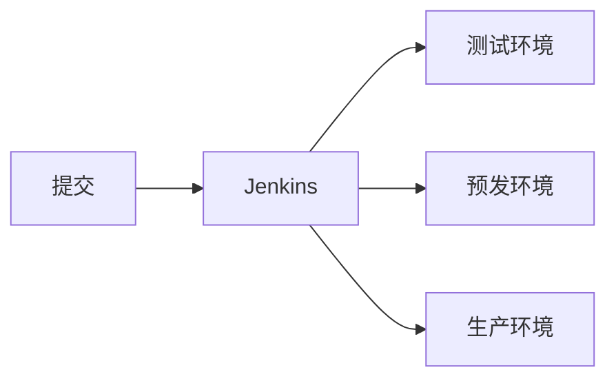

# go-zero 适用场景

## go-zero适用场景

适合接口多、要快速铺开、又希望自带限流和熔断的后端：HTTP API 与 RPC 可以在同一套生成流程里长出来。小实验项目用它略重；已经有稳定单体、短期不拆服务时，不必为了换框架而迁。

## go-zero的实际体验

描述接口的 `.api` 文件比手写 swagger 更短，路由、请求和响应都收在一处。生成出来的目录每个服务都长得一样，新人按 handler、logic、svc 就能找到改动点。

## go-zero发展

后续方向是把监控、注册、限流、分流和队列做成平台能力，而不是每个服务各接一套。同时会有管理端脚手架，用来加快后台页面。社区里已有基于 Gin 与 Vue 的后台方案在做类似的事，可作对照，不必绑死在同一种实现上。

## 微服务的项目结构，monorepo的CI/CD处理

一个服务的目录大致是：

```text
etc/          运行配置
internal/
  config/     配置结构
  handler/    HTTP 入口
  logic/      业务步骤
  svc/        依赖上下文
  types/      请求与响应结构
rpc/          对外的远程调用
```



流水线用 Jenkins 串起测试、预发和生产。灰度集群在晚间六点接流量，若次日十点前没有故障，再同步到其余集群。

## go-zero无感切换

替换线上 Java 服务时不要一次切完全部流量。从边缘接口开始：同一请求先双写到旧实现和新的 Go 服务，对照一周返回值；确认一致后，再把该接口的读流量指到 go-zero。业务由外向内替换，核心链路留到最后。

## 服务的划分

不要一个 URL 就拆一个进程，否则服务数量会暴涨。先按业务域切粗粒度。用户域先做成一个用户服务；等个人中心的发布节奏和流量都明显不同，再把它拆出去。

## 服务发现

注册信息放在 etcd。键名要能表达服务身份，例如按服务名加环境做前缀。leader 会话中断时，集群会重新选举，调用方应依赖租约与探活，而不是写死某一台地址。异常要在客户端记录并配合熔断，避免把故障节点继续打满。

## 缓存的设计与使用案例

读多写少的查询可以在 logic 层加缓存：先读缓存，未命中再查库并回填，写路径删除对应键。键里带上业务主键和版本，避免旧结构污染新代码。缓存故障时退回数据库，不要让缓存不可用变成整站不可用。
