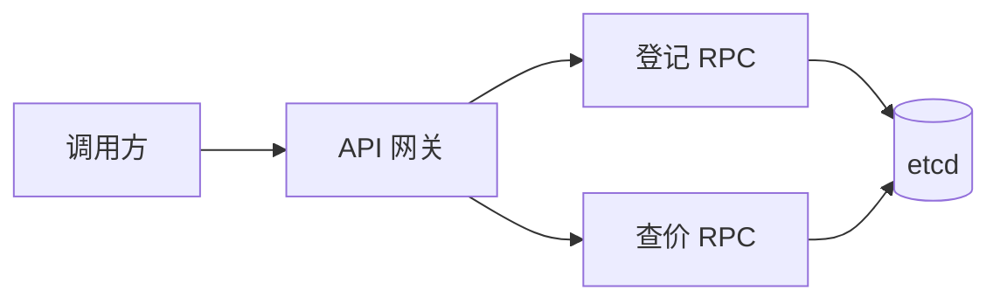
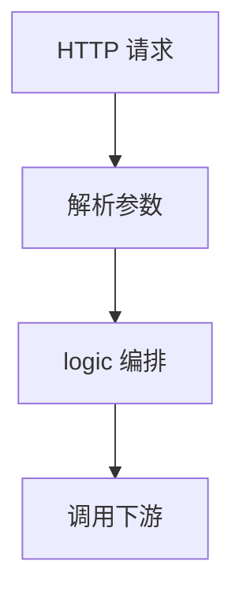

# 使用 goctl 搭一个微服务

## 前言

示例只做“书店”里的两件事：登记一本书，以及按书名查价格。目的是把 go-zero 从 API 到 RPC 的生成过程走通，业务细节尽量省。

工具比口头约定更可靠。`goctl` 用来生成重复的胶水代码，让人把时间花在会变化的业务上。

## 书店微服务架构图

请求先到 API 网关，再分别调用登记服务和查价服务。



## goctl各层代码

生成器能写出的部分按需打开即可；需要手写的是依赖装配和业务分支。

### 网关

网关是唯一的 HTTP 入口，适合做参数解析、路由分发，以及把请求转成下游 RPC。



### RPC

RPC 是远程过程调用。每个下游一个 proto，生成服务端骨架和客户端存根。

### Model

模型层负责表结构和数据访问。本示例先不接数据库，价格先放在进程内，模型层留空。

## 准备工作

### 安装软件

架构里用到 etcd，查价若要缓存还会用到 Redis，持久化则要 MySQL。动手前把 etcd 在本机 `2379` 拉起来；MySQL 与 Redis 可以等真正写模型时再装。

### 安装 protoc-gen-go 工具

生成 protobuf 的 Go 代码需要插件。当前更常见的是 `google.golang.org/protobuf/cmd/protoc-gen-go`，旧路径 `github.com/golang/protobuf/protoc-gen-go` 仍能在老教程里看到。

```bash
go env -w GO111MODULE=on
go env -w GOPROXY=https://goproxy.cn,direct
go install google.golang.org/protobuf/cmd/protoc-gen-go@latest
```

### 安装 goctl工具

```bash
go install github.com/zeromicro/go-zero/tools/goctl@latest
```

早期教程里的模块前缀是 `github.com/tal-tech/go-zero`。新环境以 `zeromicro` 为准，装完执行 `goctl --version`。

### 创建目录

```bash
mkdir bookshop && cd bookshop
go mod init bookshop
```

## 编写API Gateway代码

在 `api` 目录生成描述文件：

```bash
mkdir -p api && cd api
goctl api -o bookshop.api
```

删掉文件头的 info 块，改成登记和查价两个 GET。字段名和路径都按这个示例来，不要照抄别的服务名。

```go
type (
    shelfReq struct {
        title string `form:"title"`
        cents int64  `form:"cents"`
    }
    shelfResp struct {
        ok bool `json:"ok"`
    }
)

type (
    quoteReq struct {
        title string `form:"title"`
    }
    quoteResp struct {
        hit   bool  `json:"hit"`
        cents int64 `json:"cents"`
    }
)

service bookshop-api {
    @server(
        handler: ShelfHandler
    )
    get /shelf(shelfReq) returns (shelfResp)

    @server(
        handler: QuoteHandler
    )
    get /quote(quoteReq) returns (quoteResp)
}
```

语法要点：

- `type` 与 Go 的类型声明同一风格；`service` 里列出 get、post、head、delete 等路由
- `service bookshop-api` 是这份 API 的名字
- `@server` 写服务端属性
- `handler` 是生成出来的处理函数名
- `get /shelf(shelfReq) returns (shelfResp)` 同时声明了方法、路径、入参和出参

生成网关代码：

```bash
goctl api go -api bookshop.api -dir .
```

目录会变成：

```text
api
├── bookshop.api
├── bookshop.go
├── etc
│   └── bookshop-api.yaml
└── internal
    ├── config/config.go
    ├── handler/     shelf、quote 以及 routes.go
    ├── logic/       对应的业务文件
    ├── svc/servicecontext.go
    └── types/types.go
```

启动：

```bash
go run bookshop.go -f etc/bookshop-api.yaml
```

默认端口 8888。此时逻辑还是空的，查价会得到零值：

```bash
curl -i "http://localhost:8888/quote?title=goctl"
```

```text
HTTP/1.1 200 OK
Content-Type: application/json; charset=utf-8

{"hit":false,"cents":0}
```

接下来：

- 在 `internal/svc/servicecontext.go` 注入下游客户端
- 在 `internal/logic` 写登记和查价
- 需要的话用 `goctl` 再生成其他语言的调用代码，前端可以并行开工

## 编写add rpc服务

在 `rpc/shelf` 下先出 proto 模板：

```bash
goctl rpc template -o shelf.proto
```

改成：

```protobuf
syntax = "proto3";

package shelf;

message ShelfReq {
  string title = 1;
  int64 cents = 2;
}

message ShelfResp {
  bool ok = 1;
}

service Shelver {
  rpc Shelf(ShelfReq) returns (ShelfResp);
}
```

生成：

```bash
goctl rpc protoc shelf.proto --go_out=. --go-grpc_out=. --zrpc_out=.
```

不同版本的子命令不完全一样。老文档写 `goctl rpc proto -src shelf.proto`，新版本多要求显式指定 protoc 的输出插件。以 `goctl rpc -h` 为准。

生成后大致有：入口 `shelf.go`、客户端包、`etc/shelf.yaml`、`internal/logic`（在这里写登记）、`internal/server`（一般不改）、`internal/svc`（装配依赖）以及 pb 文件。

```bash
go run shelf.go -f etc/shelf.yaml
```

看到在 `127.0.0.1:8080` 监听即可。端口在 yaml 里改。

## 编写check rpc服务

同样在 `rpc/quote`：

```bash
goctl rpc template -o quote.proto
```

```protobuf
syntax = "proto3";

package quote;

message QuoteReq {
  string title = 1;
}

message QuoteResp {
  bool hit = 1;
  int64 cents = 2;
}

service Quoter {
  rpc Quote(QuoteReq) returns (QuoteResp);
}
```

```bash
goctl rpc protoc quote.proto --go_out=. --go-grpc_out=. --zrpc_out=.
```

`etc/quote.yaml` 的监听改成 `127.0.0.1:8081`，避免和登记服务抢 8080。然后：

```bash
go run quote.go -f etc/quote.yaml
```

## 修改API Gateway代码

网关要发现这两个 RPC。在 `etc/bookshop-api.yaml` 增加：

```yaml
Shelf:
  Etcd:
    Hosts:
      - 127.0.0.1:2379
    Key: shelf.rpc
Quote:
  Etcd:
    Hosts:
      - 127.0.0.1:2379
    Key: quote.rpc
```

`Key` 必须和 RPC 进程注册到 etcd 的键一致。

`internal/config/config.go` 增加客户端配置字段：

```go
type Config struct {
    rest.RestConf
    Shelf zrpc.RpcClientConf
    Quote zrpc.RpcClientConf
}
```

`internal/svc/servicecontext.go` 把配置变成可调用的客户端：

```go
type ServiceContext struct {
    Config Config
    Shelf  shelver.Shelver
    Quote  quoter.Quoter
}

func NewServiceContext(c Config) *ServiceContext {
    return &ServiceContext{
        Config: c,
        Shelf:  shelver.NewShelver(zrpc.MustNewClient(c.Shelf)),
        Quote:  quoter.NewQuoter(zrpc.MustNewClient(c.Quote)),
    }
}
```

logic 通过 `ServiceContext` 拿到客户端。登记逻辑调用 `Shelf`，查价逻辑调用 `Quote`，不要在 handler 里直接拨号。

## 来源

步骤整理自 go-zero 的书店示例说明，原文链接不重复。
