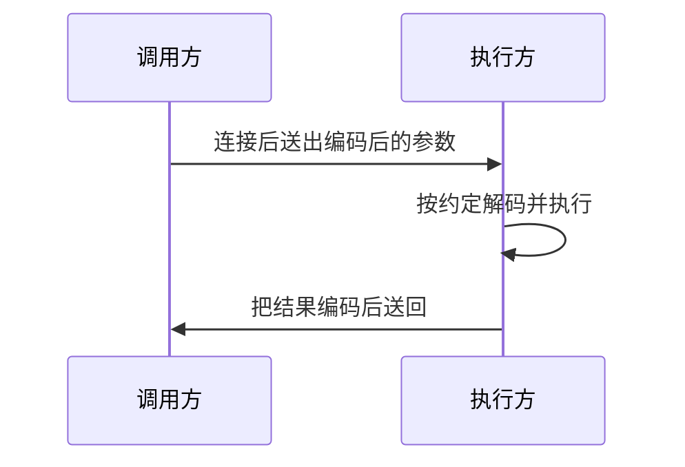

# RPC 入门与第一个 gRPC 服务

## 基本原理

远程调用至少有两端：发起方和执行方。它们先建立 TCP 连接，再在连接上传送字节。至于字节如何分帧、如何表示一条“请调用某个函数”，可以由双方私下约定，也可以采用公开协议。



过程可以拆成两步：

- 调用方把参数收成字节流发出去
- 执行方按同一份约定还原参数，执行对应逻辑，再把结果送回

RPC 把这两步收进框架：调用看起来接近本地函数，序列化、连接和错误码由库处理。大家共用一套协议之后，不同团队生成的客户端和服务器才能对接。框架本身不产生业务价值，它减少的是每次手写套接字的成本。

## gRPC

gRPC 是其中一种实现。它语言中立、平台中立，官方提供 Java、C++、Go、PHP 等多种代码生成结果。传输走 HTTP/2，消息体默认用 Protobuf。Go 的运行时库是独立模块，服务端用它来监听，客户端用它来拨号。

选它而不是手写 TCP 的原因：流控、超时、状态码和代码生成都有现成约定，接口变更时重新生成即可，不必同步修改两边的编解码。

## Protobuf

Protobuf 是一种二进制数据格式，不绑定某一门语言。同一份 `.proto` 可以生成 Java、C#、C++、Go、Python 的类型和读写代码。和 XML、JSON 相比，字段用数字编号而不是重复出现的名字，体积更小，解析更快。适合服务之间的请求、配置快照和需要长期保存的数据。

它的特点可以概括成：编码紧凑、向后兼容（新增字段用新编号）、由编译器生成访问代码。很多 RPC 框架都接受这种消息定义，gRPC 只是最常见的搭配。

描述文件只定义数据和方法，不写业务。业务留在手写的实现里，生成代码负责把字节变成结构体。

## 什么是protoc

`protoc` 是 `.proto` 的编译器。它不直接认识每一种语言的全部细节，而是分成两段：


- 第一段用 C++ 写成的编译器读取语法，得到消息、字段编号和服务的描述
- 第二段把描述交给插件，由插件按模板输出 Go、Java 或其他语言

因此安装官方编译器之后，还要另装 Go 插件，否则 `--go_out` 找不到可执行文件。

Windows 上从 Protobuf 的发布页下载对应的压缩包，解压后得到 `protoc.exe`。把它放到固定目录，例如 `D:\tools\protoc`，再把该目录加进系统 `Path`。新开终端执行 `protoc --version`，能打出版本号才算完成。没有图形界面的环境则把同样的二进制放到 `/usr/local/bin`。

## 什么是 protoc-gen-go

`protoc-gen-go` 是输出 Go 源码的插件。官方编译器包里不含它。用 Go 安装后，可执行文件出现在 `GOPATH/bin` 或 `go env GOPATH` 指向的 bin 目录，该目录也必须在 `Path` 里。

```bash
go install google.golang.org/protobuf/cmd/protoc-gen-go@latest
```

旧文档写的是 `go get -u github.com/golang/protobuf/protoc-gen-go`。那个仓库仍能生成代码，但新的 API 在 `google.golang.org/protobuf`。学习旧项目时认准项目已经在用的那一套，不要两套插件混跑。

生成命令：

```bash
protoc --go_out=. api/stock.proto
```

`--go_out` 告诉 `protoc` 去 `Path` 里找名为 `protoc-gen-go` 的程序，并把描述从标准输入交给它。输出目录是 `.` 时，包路径还要看 proto 文件里的 `go_package` 选项。

若同时要 gRPC 的桩代码，还需要 `protoc-gen-go-grpc`，并增加 `--go-grpc_out`。老插件把这两步合成 `--go_out=plugins=grpc`。下面的示例按老命令讲解，因为生成结果里客户端和服务端在同一个文件。

## protoc-gen-go的源码

插件仓库按职责拆包，阅读时不必从第一行看到最后一行，先分清谁在读描述、谁在写文本：

- `main`：入口很短。`doc` 文件只放说明；有的版本用空白导入把 gRPC 生成逻辑的 `init` 拉进来；`main` 本身初始化生成器，再把结果写到编译器要求的响应里
- `generator`：绝大部分渲染在这里。把消息变成结构体、把字段变成 getter。写文本的方法通常叫 `P`，内部接一块缓冲区，最后一次性输出
- `grpc`：在生成器之上补服务。它会把 proto 里的 `service` 和 `rpc` 变成客户端接口、服务端接口和注册函数。不启用 grpc 插件时，这些不会出现
- `descriptor`：内置的描述文件，说明 `.proto` 自身如何被表示
- `plugin`：编译器与插件之间的请求、响应消息定义

生成器不执行业务，它只把“字段 1 是 int32、名字叫 prod_id”翻译成 Go 结构体标签。改需求要改 `.proto` 再生成，不要手改带 “DO NOT EDIT” 的文件。

## 开启第一个gRPC项目

用模块建一个空目录：

```bash
go mod init example.com/stock
go get google.golang.org/grpc
go install github.com/golang/protobuf/protoc-gen-go@latest
```

第二条安装的是与老教程匹配的插件。装完后在 `PATH` 里应能直接运行 `protoc-gen-go`，否则 `protoc` 会报找不到插件。

编辑器可选安装 Protobuf 语法插件，这样 `.proto` 里的关键字和字段编号会高亮，漏写分号也能提前看见。没有插件不影响命令行生成。

## 创建文件

在项目里新建 `stock.proto`，用 proto3 语法描述“按商品编号查库存”：

```protobuf
syntax = "proto3";

package catalog;

option go_package = "example.com/stock/catalog";

message StockQuery {
  int32 sku = 1;
}

message StockReply {
  int32 qty = 1;
}

service Stock {
  rpc Fetch(StockQuery) returns (StockReply);
}
```

字段后面的 `= 1` 是编号，不是默认值。编号一旦发布就不能改用，否则旧客户端会把字节解到错误的字段。`service` 里的 `rpc` 声明方法名、入参类型和返回类型。这一步还没有 Go 代码。

## 生成 Go PRC文件

在 proto 所在目录执行：

```bash
protoc --go_out=. stock.proto
```

若 `go_package` 指向别的目录，输出会落在对应路径。只加 `--go_out` 时，生成文件包含消息，不一定包含服务桩。文件头会注明插件版本和源文件名，并写明不要手改。

生成结果里值得认识的部分如下，这里用缩短后的形状说明，不是编译器的原文：

```go
type StockQuery struct {
    Sku int32 `protobuf:"varint,1,opt,name=sku,proto3" json:"sku,omitempty"`
}

func (x *StockQuery) GetSku() int32 {
    if x != nil {
        return x.Sku
    }
    return 0
}

type StockReply struct {
    Qty int32 `protobuf:"varint,1,opt,name=qty,proto3" json:"qty,omitempty"`
}

func (x *StockReply) GetQty() int32 {
    if x != nil {
        return x.Qty
    }
    return 0
}
```

除此之外，生成文件通常还有：

- `Reset`、`String`、`ProtoReflect`：给运行时读写未知字段和调试用
- 一段压缩过的原始描述字节：反射和兼容性检查靠它，不要试图手写
- `init`：进程启动时向全局注册这个文件描述符

`GetSku` 对 nil 接收者返回 0，所以链式调用前不必先判断每一层都非空，但业务上的“0 件库存”和“没有这条消息”仍然要用调用是否出错来区分。

## 创建GRPC服务端

只有消息类型时，还不能监听端口。服务端需要生成代码里的注册函数，以及自己写的方法实现。下面从 proto 里的服务声明重新生成，再补上实现和 `main`。

## 引入Service

服务声明已经写在上面的 `service Stock` 中。若第一次生成时没打开 grpc 插件，消息在而接口不在。用老插件把桩代码一并输出到 `catalog` 目录：

```bash
protoc --go_out=plugins=grpc:./catalog stock.proto
```

新插件则分成两条输出：

```bash
protoc --go_out=./catalog --go-grpc_out=./catalog stock.proto
```

生成文件里会多出客户端、服务端和注册函数，形状如下。

客户端接口把 context、请求和可选的调用参数收成一次方法调用：

```go
type StockClient interface {
    Fetch(ctx context.Context, in *StockQuery, opts ...grpc.CallOption) (*StockReply, error)
}
```

内部实现持有一条连接，`Invoke` 的全名是 `/包名.服务名/方法名`，必须和服务器注册的名字一致：

```go
func (c *stockClient) Fetch(ctx context.Context, in *StockQuery, opts ...grpc.CallOption) (*StockReply, error) {
    out := new(StockReply)
    err := c.cc.Invoke(ctx, "/catalog.Stock/Fetch", in, out, opts...)
    if err != nil {
        return nil, err
    }
    return out, nil
}
```

服务端接口更窄，没有 `CallOption`，因为那些选项属于调用方：

```go
type StockServer interface {
    Fetch(context.Context, *StockQuery) (*StockReply, error)
}
```

同时会生成一个未实现的空结构。把它嵌进自己的服务，尚未写完的方法会返回 `Unimplemented`，而不是在进程里 panic。注册函数把接口和一张方法表交给 `grpc.Server`：

```go
func RegisterStockServer(s *grpc.Server, srv StockServer) {
    s.RegisterService(&stockServiceDesc, srv)
}
```

方法表里的处理函数先解码出 `StockQuery`，若服务器上挂了拦截器就先走拦截器，否则直接调 `Fetch`。拦截器就是 gRPC 的中间件：日志、鉴权和恢复都可以写在这里，而不必进业务方法。

## 创建实现类

在 `catalog` 包新建 `stock_server.go`，实现生成的服务端接口。方法签名要和接口一致，接收者用指针。不要在注释里写个人网名或与代码无关的署名。

```go
package catalog

import (
    "context"
    "log"
)

type StockImpl struct{}

func (s *StockImpl) Fetch(ctx context.Context, in *StockQuery) (*StockReply, error) {
    log.Printf("sku=%d", in.GetSku())
    return &StockReply{Qty: 42}, nil
}
```

这里先返回固定库存，用来证明链路通了。下一步再按 `in.GetSku()` 查数据库。注意参数只有 context 和请求，不要把客户端才有的 `CallOption` 加到服务端方法上，否则和生成的接口对不上，注册时无法通过编译。

老示例里若写成带 `opts ...grpc.CallOption` 的方法，那是误把客户端签名抄到了服务端，`RegisterStockServer` 会因为类型不符而失败。

## 创建RPC服务

`main` 负责三件事：创建 gRPC 服务器、注册实现、在 TCP 端口上服务。

```go
package main

import (
    "log"
    "net"

    "example.com/stock/catalog"
    "google.golang.org/grpc"
)

func main() {
    srv := grpc.NewServer()
    catalog.RegisterStockServer(srv, &catalog.StockImpl{})

    lis, err := net.Listen("tcp", ":9099")
    if err != nil {
        log.Fatalf("listen: %v", err)
    }
    log.Print("listening on 9099")
    if err := srv.Serve(lis); err != nil {
        log.Fatalf("serve: %v", err)
    }
}
```

`NewServer` 可以接收拦截器选项，例如一元调用的日志拦截器。拦截器签名大致是：拿到 context、请求、方法信息和真正的 handler。它可以在调用 handler 前后记日志，也可以直接返回错误从而不进入业务。这就是“中间件”在 gRPC 里的位置，和 HTTP 框架里先 `Next` 再记耗时是同一类结构。

```go
func logCalls(ctx context.Context, req interface{}, info *grpc.UnaryServerInfo, handler grpc.UnaryHandler) (interface{}, error) {
    log.Println(info.FullMethod)
    return handler(ctx, req)
}
```

注册时写成 `grpc.NewServer(grpc.UnaryInterceptor(logCalls))`。多个拦截器再用链式工具串起来，不要在每个 `Fetch` 里复制日志代码。

客户端另写一个进程即可验证。它拨号、构造生成的客户端、再调用：

```go
conn, err := grpc.Dial("127.0.0.1:9099", grpc.WithTransportCredentials(insecure.NewCredentials()))
if err != nil {
    log.Fatal(err)
}
defer conn.Close()

cli := catalog.NewStockClient(conn)
reply, err := cli.Fetch(context.Background(), &catalog.StockQuery{Sku: 7})
if err != nil {
    log.Fatal(err)
}
log.Println(reply.GetQty())
```

能打印 42，说明 proto、生成代码、实现和监听已经接上。接下来把 `WithTransportCredentials` 换成真实证书，并为 `Fetch` 传入带超时的 context，避免下游卡住时客户端一直等待。

超时不要写死在业务方法里再另起一个计时器。调用方创建带截止时间的 context，gRPC 会把剩余时间发给服务端；服务端的 `ctx.Done()` 关闭时，应当停止查库并返回。服务端也可以用拦截器统一限制上限，防止客户端把截止时间设得过长。

```go
ctx, cancel := context.WithTimeout(context.Background(), 300*time.Millisecond)
defer cancel()
reply, err := cli.Fetch(ctx, &catalog.StockQuery{Sku: 7})
```

错误要用状态码区分，而不是只看 `err != nil`。库存服务尚未实现时返回 `codes.Unimplemented`，参数非法返回 `codes.InvalidArgument`，下游超时返回 `codes.DeadlineExceeded`。调用方用 `status.FromError` 取出码，再决定是提示用户还是重试。没有幂等保证的写操作不要因为 `Unavailable` 就自动重发。

生成文件里的服务描述大致包含服务全名、方法名和处理函数。处理函数先把字节解成 `StockQuery`，再看服务器是否配置了一元拦截器。拦截器的典型顺序是：恢复 panic、校验元数据里的令牌、记方法名和耗时、最后才调用 `Fetch`。任何一个拦截器直接返回错误，后面的拦截器和业务都不会执行。这和 HTTP 中间件里调用 `Next` 之前就 `Abort` 是同一类控制流。


字段编号是兼容的关键。已经发布的 `sku = 1` 不能改成别的号，也不能把 1 号挪给另一个含义。新增字段用新编号，旧客户端会忽略不认识的编号，新服务端对缺失字段看到零值。删除字段时把编号留空，写进注释，避免以后的人复用。`proto3` 里零值默认不写出，所以“库存就是 0”和“对方没填”在线上很难区分；若业务需要区分，把字段改成包装类型或在注释里约定 0 的含义。

本地联调时先确认三件事：`go_package` 与 import 路径一致、监听地址和拨号地址相同、生成命令里的插件版本与 `go.mod` 里的 protobuf 运行时匹配。版本错开时，常见现象是生成的 `ProtoReflect` 在编译期就对不上，而不是运行期才返回空库存。对齐版本后重新生成，不要手改生成文件里的描述字节。

生成文件还可以按阅读顺序拆开看，而不必通读那串描述字节。文件开头是版本断言，用来保证插件和运行时没有错代。接着是两个消息结构，每个结构除了业务字段，还带内部状态、大小缓存和未知字段切片，这些给反射和前后兼容用，业务代码不要去改。每个消息有 `Reset` 把内容清回零值，`String` 给日志，`GetXxx` 在接收者为 nil 时返回零值。

客户端一侧是一个接口加一个未导出的实现。`NewStockClient` 只保存 `ClientConnInterface`，真正的网络在 `Invoke` 里发生。因此换传输、加鉴权元数据，都发生在拨号和 `CallOption`，而不是在改这个生成的方法。服务端一侧的 `RegisterStockServer` 把方法表登记进 `grpc.Server`。表里的处理函数负责解码、调用拦截器、再把返回值编码。`UnimplementedStockServer` 可以嵌进实现结构，这样以后 proto 增加了新 rpc，旧的实现仍能编译，新方法会返回未实现，而不是漏注册导致空指针。

把这些部分和手写的 `StockImpl`、`main` 分开记：生成物表达契约，手写代码表达库存怎么算、进程听哪个端口。契约变化时只改 proto 并重新生成，手写方法若签名没变就不用动。签名变了，编译器会直接指出 `StockImpl` 少了方法，比运行到一半才发现字段对不上要早得多。
