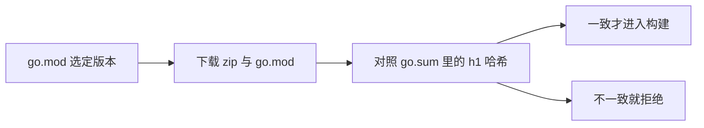

# 有了 go.mod，为什么还要 go.sum

模块机制大致走过三段：

- **GOPATH 时代**（约 1.8 之前必须设置）：所有源码挤在 `$GOPATH/src`，版本靠目录位置表达。
- **Vendor 时代**：工具链里没有类似 maven、npm 的中央仓库，主要靠 `go get` 把代码抓下来。
- **Go Modules**：依赖去中心化。`go.mod` 记录模块身份与版本约束：
  - `module`：本模块路径
  - `go`：语言版本
  - `require`：依赖及选定版本
  - `replace`：把某个依赖指到本地目录或另一路径
  - `exclude`：声明不使用某个版本

`go.sum` 则记下每个依赖制品的密码学哈希，用来发现“版本号没变、内容变了”。

## go vendor 与 dep

长期只用 `go get`，构建结果会跟着上游漂移。1.6（2016-02）起正式支持 vendor 目录，把依赖快照放进仓库，重复构建才有着落，但它本身不负责选择版本。

`dep` 是官方用来试版本算法的实验工具，并不打算永远留在工具链里。核心团队吸收社区反馈后做出 Modules，并在 2019-09-03 发布的 1.13 中正式支持，同时上线模块镜像、索引和校验和服务，用来缓解分发与中间人篡改。

## go.sum 作用

模块可以从 GitHub、GitLab、Gitee 等任意托管地址拉取，没有统一的中心库替你保证“这个 tag 永远是当初那份代码”。作者删掉 v1.1 再推一个新的 v1.1 时，只看版本号发现不了替换。

`go.sum` 因此给每个版本留两行左右的记录：一行是模块 zip 的 `h1:` 哈希，另一行是该版本 `go.mod` 文件的哈希。第一次把依赖写进项目时，工具会计算这些摘要并追加到 `go.sum`。

之后执行 `go mod download`，会用本地 `go.sum` 与即将使用的文件重新比对。摘要相同才继续；不同就中止，避免被调包的依赖进入编译。

所以不要手改 `go.sum` 去“消掉冲突”。它和 `go.mod` 应一起提交。若确需更新摘要，用 `go get` 或 `go mod tidy` 让工具重写，而不是自己粘贴一行哈希。
