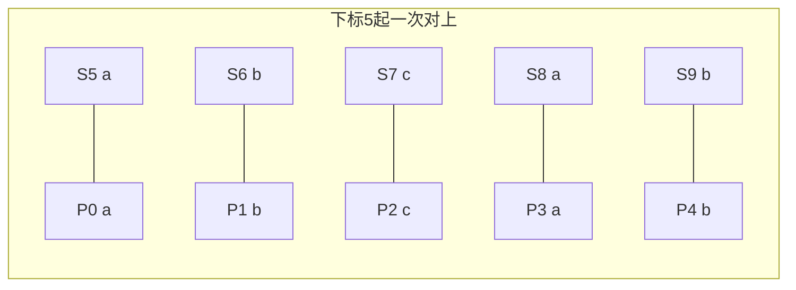

# KMP：少回头的字符串查找

## 字符串匹配问题

主串里要找一个连续片段，找到就给出**第一次**出现时，模式串开头在主串中的下标；找不到就给出 `-1`。

下面用主串 `S = "bcabaabcab"`、模式串 `P = "abcab"` 来讲。正确答案是下标 `5`（从 0 数）：`bcaba | abcab`。

### 暴力匹配算法

设主串扫到下标 `i`，模式串扫到下标 `j`。

- 当前字符一样：两个下标都往右走一格。
- 当前字符不一样：模式串回到开头，主串退回到「这一轮起点的下一格」。写成式子就是 `i = i - j + 1`，`j = 0`。

走一遍 `S = "bcabaabcab"`、`P = "aabc"`（故意换一条会失配的模式，便于看回溯）：

1. 起点 0：`'b'` 对 `'a'`，立刻失败，起点挪到 1。
2. 起点 1：`'c'` 对 `'a'`，再失败。
3. 起点 2：`'a'=='a'`，下一格主串是 `'b'`、模式是 `'a'`，失败。已经对上的那一格作废，起点只能变成 3，也就是刚才失配的 `'b'`，不能把它跳过去。
4. 起点 3 的 `'b'` 再次对 `'a'` 失败。起点 4：`"aabc"` 四个字符都对上（下标 4 到 7），返回 4。

字符反复被拿来比，最坏大约是两串长度相乘。模式串自身若有重复前缀，这些回头大多是多余的。

```python
def plain_index(text, pat):
    """返回 pat 在 text 中第一次出现的起点，没有则 -1。"""
    if pat == "":
        return 0
    n, m = len(text), len(pat)
    start = 0
    while start <= n - m:
        k = 0
        while k < m and text[start + k] == pat[k]:
            k += 1
        if k == m:
            return start
        start += 1
    return -1
```

### 复杂度

- 时间：最坏 `O(|S| · |P|)`，例如主串全是 `a`、模式串是很多个 `a` 再加一个 `b`。
- 空间：只用几个下标，`O(1)`。

### 边界

- 模式串为空：约定返回 `0`（空片段在任何位置都能对上，第一次是开头）。
- 模式串比主串还长，或主串为空而模式串非空：直接 `-1`，不要去访问越界下标。

## 利用已匹配前缀：KMP

暴力慢，是因为失配后把已经对上的字符全扔了。KMP 先问模式串自己：它的某个前缀，是不是同时也是更短的一段后缀。失配时，模式串只退到这个「既是前缀又是后缀」的长度，主串下标不回头。

### 部分匹配表

`pi[k]` 表示模式串前 `k+1` 个字符里，最长的、真前缀同时又是真后缀的长度。

以 `P = "abcab"` 手工填表：

| 下标 | 0 | 1 | 2 | 3 | 4 |
| 字符 | a | b | c | a | b |
| pi   | 0 | 0 | 0 | 1 | 2 |

- 前 1、2、3 个字符没有更短的公共头尾，记 0。
- 下标 3 的 `'a'` 等于开头的 `'a'`，长度 1。
- 下标 4 的 `'b'` 接着对上第二个字符 `'b'`，长度变成 2。也就是末尾 `"ab"` 等于开头 `"ab"`。

### 匹配过程

主串 `S = "bcabaabcab"`，模式 `P = "abcab"`，`pi = [0,0,0,1,2]`。

1. 主串 `'b'` 对模式 `'a'` 失败，模式停在 0，主串前进。同样跳过 `'c'`。
2. 从主串下标 2 起 `"aba"` 对上模式前三个 `"abc"`？`'a'=='a'`，`'b'=='b'`，第三个 `'a'!='c'`。此时模式下标 `j = 2`，失配，退到 `pi[1] = 0`（退的是 `j-1` 那一格已经成功的长度）。主串停在这颗 `'a'` 上重新当开头。
3. 主串下标 4 的 `'a'` 重新当模式开头，对上一个字符后，下标 5 的 `'a'` 对模式第二个 `'b'` 失败。`j` 退回 0，主串仍停在下标 5。
4. 从下标 5 再试：`a b c a b` 五个都相等。比完最后一个字符时主串下标 `i` 已经加到 10，模式长度 `j` 是 5，起点是 `10 - 5 = 5`。



失配而 `j > 0` 时，令 `j = pi[j - 1]`，主串的 `i` 原地不动。这就是和暴力的差别。

```python
def border_table(pat):
    """pi[k] = pat[0..k] 最长真前缀与真后缀的公共长度。"""
    pi = [0] * len(pat)
    width = 0
    pos = 1
    while pos < len(pat):
        if pat[pos] == pat[width]:
            width += 1
            pi[pos] = width
            pos += 1
        elif width > 0:
            width = pi[width - 1]
        else:
            pi[pos] = 0
            pos += 1
    return pi


def kmp_index(text, pat):
    if pat == "":
        return 0
    pi = border_table(pat)
    i = j = 0
    while i < len(text):
        if text[i] == pat[j]:
            i += 1
            j += 1
            if j == len(pat):
                return i - j
        elif j > 0:
            j = pi[j - 1]
        else:
            i += 1
    return -1
```

### 复杂度

- 预处理表：每个模式字符进一次、退若干次，退的总次数不超过进的次数，`O(|P|)`。
- 匹配：主串下标只增，模式下标退的总次数也不超过主串长度，`O(|S|)`。
- 合计 `O(|S| + |P|)`，额外空间是那张表 `O(|P|)`。

### 边界

- 主串 `"aaaa"`、模式 `"aaab"`：表是 `[0,1,2,0]`。对到第四个字符才失败，`j` 从 3 退到 `pi[2] = 2`，再退到 `pi[1] = 1`，再退到 0，然后主串结束，返回 `-1`。不能在退到 0 之后把主串也拉回去，否则会和暴力一样重复扫描。
- 模式比主串长：循环自然结束，返回 `-1`。
