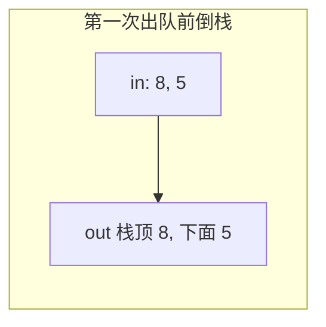

# 剑指 Offer 1 到 24

每题按「题目、思路、走一遍、代码」来写。是非题和容易踩边界的题另外写复杂度和一个反例。

#### 队列

队列只在一端进、另一端出。进的那端叫队尾，出的那端叫队头。先放进去的先出来。

用列表模拟时：

- 进队：`append`，新元素落在尾部。
- 看队头：下标 `0`。看队尾：下标 `-1`。
- 出队：弹出下标 `0`。从尾部 `pop()` 则变成栈，不再是队列。

走一遍：依次放入 8、5、3。队头到队尾是 `8, 5, 3`。弹出一次得到 8，剩下 `5, 3`。

#### 栈

栈只允许在同一端插入和删除，这一端是栈顶，另一端是栈底。后放进去的先出来。

- 入栈：`append`。
- 看栈顶：下标 `-1`。
- 出栈：`pop()`，弹出最后一个。

走一遍：压入 8、5、3。栈底到栈顶是 `8, 5, 3`。弹出得到 3，不是 8。

## 1. 两个栈实现一个队列

### 题目

用两个栈完成队列的压入和弹出，元素是整数。队列要先入先出，栈本身是后入先出，所以两个栈的职责要分开。

### 思路

`in_box` 只负责接收新元素。`out_box` 只负责弹出。弹出时如果 `out_box` 是空的，就把 `in_box` 逐个倒进去。倒栈会把顺序反过来：`in_box` 里越早压入的，越晚才被倒出来，于是落在 `out_box` 的栈底，下一次从 `out_box` 弹出时反而最先离开。

核对：`in_box` 先压 A 再压 B，栈顶是 B。倒进 `out_box` 时先弹出 B、再弹出 A，`out_box` 的栈顶变成 A。弹出得到 A，最早进入的先出来。

`out_box` 不空时不要倒。否则新倒进去的元素会压在还没弹出的旧元素上面，顺序就乱了。

### 走一遍

1. 入队 8，入队 5。`in_box = [8, 5]`，`out_box` 空。
2. 出队：把 5 再 8 倒进 `out_box`，栈顶是 8，弹出 8。
3. 入队 3。此时 `out_box` 里还剩 5，不要倒。
4. 出队得到 5。再出队：`out_box` 空了，把 3 倒过去，弹出 3。
5. 再出队：两边都空，返回空。



### 代码

```python
class TwoStackQueue:
    def __init__(self):
        self.in_box = []
        self.out_box = []

    def push(self, value):
        self.in_box.append(value)

    def pop(self):
        if not self.out_box:
            while self.in_box:
                self.out_box.append(self.in_box.pop())
        if not self.out_box:
            return None
        return self.out_box.pop()
```

### 复杂度

每次元素最多进 `in_box` 一次、进 `out_box` 一次，均摊每个操作 `O(1)`。最坏一次弹出要把整个入栈倒空，是 `O(n)`。空间 `O(n)`。

### 边界

连续弹出到空，必须返回空，不能去读空栈的栈顶。若在 `out_box` 还有元素时就倒栈，序列 `入 8、入 5、出、入 3、出` 会先得到 8 再得到 3，把 5 压在后面，队列被破坏。

### 二分查找法

有序数组才能二分。每次拿区间中点比较：相等就找到；目标更大则丢掉左半（含中点）；目标更小则丢掉右半（含中点）。区间每次大约砍掉一半。

##### 时间复杂度

最坏要追到只剩一个元素，`T(n) = T(n/2) + O(1)`，所以是 `O(log n)`。最好中点一次命中，`O(1)`。

##### 空间复杂度

下面的写法只用三个下标，额外空间 `O(1)`。改成递归的话，栈深是 `O(log n)`。

##### 二分法代码实现

```python
def binary_search(seq, goal):
    lo, hi = 0, len(seq) - 1
    while lo <= hi:
        mid = (lo + hi) // 2
        if seq[mid] == goal:
            return mid
        if seq[mid] < goal:
            lo = mid + 1
        else:
            hi = mid - 1
    return None
```

### 走一遍

有序数组 `[1, 3, 5, 7, 9]`，找 7。

- `lo = 0, hi = 4`，中点下标 2，值 5，比 7 小，`lo = 3`。
- 中点下标 3，值 7，命中，返回 3。

找 4：5 太大则 `hi` 收到 1；3 太小则 `lo` 收到 2；此时 `lo > hi`，返回空。说明 4 不在里面。

循环条件必须是 `lo <= hi`。只写 `<` 时，区间缩到单个元素就会漏掉它。相等时若题目要「第一次出现的位置」，不能立刻返回，还要把 `hi` 收到 `mid` 左边继续缩。

## 2. 旋转数组的最小数字

### 题目

把一个非递减数组前部的若干个数搬到末尾，叫旋转。输入这个旋转结果，输出最小值。例如 `[4, 5, 6, 1, 2, 3]` 来自 `[1, 2, 3, 4, 5, 6]`，最小值是 1。元素都大于 0；数组为空时返回 0。

### 思路

最小值是唯一「比左邻更小」的跌落点，也是两段有序片段的接缝。用二分看中点和右端：

- 中点大于右端：跌落在中点右侧，左边界收到 `mid + 1`。
- 中点小于右端：跌落在中点或左侧，右边界收到 `mid`。
- 两者相等：右端可能是重复值，只能把右边界收一格，避免删错半边。

### 走一遍

`[4, 5, 6, 1, 2, 3]`。

- 中点 6，右端 3，6 > 3，左边界落到 1 的下标。
- 中点变成 1，右端 3，1 < 3，右边界落到 1。
- 左右重合，返回 1。

没有旋转的 `[1, 2, 3]`：中点 2 小于右端 3，右边界不断左移，最后停在 1。

### 代码

```python
def min_rotated(nums):
    if not nums:
        return 0
    lo, hi = 0, len(nums) - 1
    while lo < hi:
        mid = (lo + hi) // 2
        if nums[mid] > nums[hi]:
            lo = mid + 1
        elif nums[mid] < nums[hi]:
            hi = mid
        else:
            hi -= 1
    return nums[lo]
```

### 复杂度

没有重复值时 `O(log n)`。大量重复、每次都走相等分支时退化成 `O(n)`。空间 `O(1)`。

### 边界

空数组返回 0。`[2, 2, 2, 0, 2]` 若在相等时把半边直接丢掉，可能把 0 删掉；每次只收一格才能停在 0。单元素 `[8]` 循环不进，返回 8。

##### 什么叫做数组

数组是一段连续内存上的同类型元素，用下标访问。下标从 0 开始，最后一个下标是长度减 1。长度在创建时定好，不能像列表那样随意加长。

列表也用下标，但长度可变。元组定长，而且创建之后元素也不能改。讨论算法时，下面把 Python 列表当作数组来用。

## 3.在二维数组中的查找

### 题目

二维数组每一行从左到右变大，每一列从上到下变大。写一个函数，判断目标整数在不在里面。各行长度相同。

### 思路

从右上角出发。它是当前行最大的，也是当前列最小的。

- 相等：找到了。
- 目标更小：这一列都更大，列下标减 1。
- 目标更大：这一行都更小，行下标加 1。

每次扔掉一行或一列。从左上角做不到这件事，因为左上角既不是行最大也不是列最大，两个方向都可能有答案。

### 走一遍

```text
1  4  7
2  5  8
3  6  9
```

找 6。右上角 7 更大，看 4；4 更小，往下看 5；5 更小，再往下看 6，命中。

找 10。7 → 8 → 9，9 仍然更小，行越界，没有。

### 代码

```python
def find_in_matrix(goal, grid):
    if not grid or not grid[0]:
        return False
    row, col = 0, len(grid[0]) - 1
    while row < len(grid) and col >= 0:
        cur = grid[row][col]
        if cur == goal:
            return True
        if goal < cur:
            col -= 1
        else:
            row += 1
    return False
```

### 复杂度

时间 `O(行数 + 列数)`。逐格扫描是 `O(行 × 列)`。额外空间 `O(1)`。

### 边界

空数组，或第一行是空的，直接假，不能去读 `grid[0]` 的长度以外的内容。目标比左上角还小，或比右下角还大，会沿着边走到越界后返回假。

## 4.包含min 函数的栈

### 题目

实现一个栈，除了压入、弹出、看栈顶，还要在 `O(1)` 时间里拿到当前栈中的最小值。

### 思路

普通栈弹出后，最小值可能变了，每次都重扫是 `O(n)`。再用一个栈专门记最小值，用空间换这次扫描。

第一种：辅助栈和数据栈始终一样长。压入时，若新值更小就压入新值，否则把辅助栈当前栈顶再压一次。弹出时两个栈一起弹。

第二种：辅助栈只在出现「小于或等于当前最小值」时才压入。弹出时，只有数据栈栈顶等于辅助栈栈顶才一起弹。相等也必须压，否则两个相同的最小值，弹出一个之后最小值就丢了。

### 走一遍

压入 4、6、3、3。

第一种辅助栈：`[4, 4, 3, 3]`。弹出一次后最小值仍是 3，再弹出后最小值回到 4。

第二种辅助栈：`[4, 3, 3]`。若压入第二个 3 时用「严格小于」才记录，辅助栈只有 `[4, 3]`，第一次弹出 3 会把最小值错退回 4，栈里其实还有一个 3。

### 代码

```python
class MinStackSync:
    """辅助栈与数据栈等长。"""

    def __init__(self):
        self.data = []
        self.mins = []

    def push(self, value):
        self.data.append(value)
        if not self.mins or value < self.mins[-1]:
            self.mins.append(value)
        else:
            self.mins.append(self.mins[-1])

    def pop(self):
        if not self.data:
            return None
        self.mins.pop()
        return self.data.pop()

    def top(self):
        return self.data[-1] if self.data else None

    def min_value(self):
        return self.mins[-1] if self.mins else None


class MinStackSparse:
    """辅助栈只记录新的最小值，相等也要记录。"""

    def __init__(self):
        self.data = []
        self.mins = []

    def push(self, value):
        self.data.append(value)
        if not self.mins or value <= self.mins[-1]:
            self.mins.append(value)

    def pop(self):
        if not self.data:
            return None
        if self.data[-1] == self.mins[-1]:
            self.mins.pop()
        return self.data.pop()

    def top(self):
        return self.data[-1] if self.data else None

    def min_value(self):
        return self.mins[-1] if self.mins else None
```

### 复杂度

压入、弹出、取最小值都是 `O(1)`。第一种空间始终是 `O(n)`；第二种在最小值很少变化时更省，最坏仍是 `O(n)`。

### 边界

空栈上取最小值或弹出，返回空。连续相等的最小值是第二种写法的反例，比较符要用 `<=`。

## 5.替换空格

### 题目

把字符串里的每个空格换成 `%20`。`"hi there"` 变成 `"hi%20there"`。

### 思路

在原缓冲里从后往前写可以避免每个空格都把尾部挪一遍。Python 字符串不可变，这里用一个新列表收集字符，再拼起来。遇到空格就依次放入 `%`、`2`、`0`，这样不依赖库里的整段替换。

### 走一遍

`"a b"`：`'a'` 照抄，空格变成三个字符，`'b'` 照抄，得到 `a%20b`。

### 代码

```python
def replace_blank(raw):
    buf = []
    for ch in raw:
        if ch == " ":
            buf.append("%20")
        else:
            buf.append(ch)
    return "".join(buf)
```

### 复杂度

时间 `O(n)`，新串空间 `O(n)`。若在一个字符数组中间反复插入，每次插入都挪尾部，会退化成 `O(n^2)`。

### 边界

没有空格：原样返回。全是空格：`"  "` 变成 `"%20%20"`。空串返回空串。

## 6.斐波那契数列

### 题目

`F(0) = 0`，`F(1) = 1`，其后 `F(n) = F(n-1) + F(n-2)`。输入 `n`，输出第 `n` 项，`n <= 39`。

### 思路

递归每次拆成两项，同一项被算很多次，调用量大约按 `2^n` 涨。迭代只保留最近两项。

第一种用三个变量滚动。第二种把项放进列表，新项等于最后两项之和；空间是 `O(n)`，时间仍是 `O(n)`，比递归稳。

### 走一遍

求 `F(6)`。从 `F(0)=0`、`F(1)=1` 出发滚动，依次得到 1、2、3、5、8。整列是 0, 1, 1, 2, 3, 5, 8，所以 `F(6) = 8`。循环正好跑 `n-1` 次。

### 代码

```python
def fib_roll(n):
    if n < 2:
        return n
    later, earlier = 1, 0
    ans = 0
    for _ in range(n - 1):
        ans = later + earlier
        earlier, later = later, ans
    return ans


def fib_list(n):
    seq = [0, 1]
    while len(seq) <= n:
        seq.append(seq[-1] + seq[-2])
    return seq[n]
```

### 复杂度

两种迭代都是时间 `O(n)`。滚动空间 `O(1)`，列表空间 `O(n)`。朴素递归大约 `O(2^n)`。

### 边界

`n = 0` 返回 0，`n = 1` 返回 1。若循环写成 `range(n)` 且初值放错，第 0 项会被算成 1。

## 7.青蛙跳台阶

### 题目

青蛙一次能跳 1 级或 2 级。上 `n` 级有多少种跳法，顺序不同算不同。

### 思路

最后一跳是 1 级，则前面是 `n-1` 的跳法；最后一跳是 2 级，则前面是 `n-2` 的跳法。`f(n) = f(n-1) + f(n-2)`。`f(1) = 1`，`f(2) = 2`。这和斐波那契同形，起点差 1。

### 走一遍

- 1 级：只有 `1`。
- 2 级：`1+1`，`2`。
- 3 级：`1+1+1`，`1+2`，`2+1`，共 3。
- 4 级：5 种。`f(4) = 3 + 2`。

### 代码

```python
def frog_ways(steps):
    if steps < 1:
        return 0
    if steps <= 2:
        return steps
    prev, cur = 1, 2
    for _ in range(3, steps + 1):
        prev, cur = cur, prev + cur
    return cur
```

### 复杂度

时间 `O(n)`，空间 `O(1)`。

### 边界

`n < 1` 没有台阶可跳，返回 0。`n = 2` 必须是 2，不能按 `F(2) = 1` 去返回。

## 8.变态跳台阶

### 题目

一次可以跳 1 级、2 级，直到一次跳 `n` 级。上 `n` 级有多少种跳法。

### 思路

`f(1) = 1`。对 `n > 1`，最后一跳可以是 1 到 `n` 的任意长度，所以

`f(n) = f(n-1) + f(n-2) + ... + f(1) + 1`

最后那个 1 是「一步跳完 n 级」。而 `f(n-1)` 同样等于它前面所有项再加那个一步跳完，因此 `f(n) = 2·f(n-1)`。展开得 `f(n) = 2^(n-1)`。

### 走一遍

- 1 级：`(1)`，1 种。
- 2 级：`(1,1)`、`(2)`，2 种。
- 3 级：`(1,1,1)`、`(1,2)`、`(2,1)`、`(3)`，4 种。
- 4 级是 8 种，正好是上一项的两倍。

### 代码

```python
def frog_any(steps):
    if steps <= 0:
        return 0
    ans = 1
    for _ in range(2, steps + 1):
        ans *= 2
    return ans
```

`2 ** (steps - 1)` 在 `steps >= 1` 时和这个循环相同。

### 复杂度

循环是 `O(n)`。直接做幂是 `O(log n)` 或在定长整数上视为 `O(1)`。空间 `O(1)`。

### 边界

`n = 0` 返回 0。`n = 1` 时幂是 `2^0 = 1`，不能写成 `2^n`，否则变成 2。

## 9. 奇数移到偶数前面，同类先后不变

### 题目

调整整数数组，奇数都在偶数前面，而且奇数与奇数、偶数与偶数之间的相对顺序保持不变。

### 思路

稳定性是这题的附加约束，不能用左右对撞交换，那会打乱原来的先后。

一种是扫两遍：先按原顺序收集奇数，再收集偶数。时间 `O(n)`，空间 `O(n)`。

另一种借用冒泡：相邻一对若是「偶数在前、奇数在后」就交换。奇数只会越过偶数往前，同类之间不交换，所以稳定。时间 `O(n^2)`。

### 走一遍

`[5, 2, 7, 4, 1, 6]`。

两遍收集：奇数 `5, 7, 1`，偶数 `2, 4, 6`，合成 `[5, 7, 1, 2, 4, 6]`。

冒泡里 `2` 和 `7` 交换、`4` 和 `1` 交换，最后同样是这个顺序。`5` 始终在 `7` 前面，`2` 始终在 `4` 前面。

### 代码

```python
def odd_even_stable(nums):
    odds = [x for x in nums if x % 2 == 1]
    evens = [x for x in nums if x % 2 == 0]
    return odds + evens


def odd_even_bubble(nums):
    arr = list(nums)
    for i in range(len(arr)):
        for j in range(len(arr) - i - 1):
            if arr[j] % 2 == 0 and arr[j + 1] % 2 == 1:
                arr[j], arr[j + 1] = arr[j + 1], arr[j]
    return arr
```

### 复杂度

收集法时间 `O(n)`、空间 `O(n)`。冒泡法时间 `O(n^2)`、额外空间 `O(1)`（若不计结果拷贝）。

### 边界

负数按余数判断时，Python 里 `-3 % 2 == 1`，`-4 % 2 == 0`，奇偶仍然正确。空数组返回空。全奇数则后半段为空。若题目改成「不稳定也可以」，双指针能做到原地 `O(n)`，但 `[5, 2, 7]` 可能变成 `[5, 7, 2]` 以外的奇数顺序，不符合这一题。

### 知识点：冒泡排序法

每一趟把尚未归位区间里的最大值换到右端。相邻逆序才交换。

`[5, 1, 4, 2]`：

- 第一趟：`1, 5, 4, 2` → `1, 4, 5, 2` → `1, 4, 2, 5`
- 第二趟：`1, 4, 2, 5` → `1, 2, 4, 5`
- 后面没有逆序。

```python
def bubble_sort(nums):
    arr = list(nums)
    for i in range(len(arr)):
        for j in range(len(arr) - 1 - i):
            if arr[j] > arr[j + 1]:
                arr[j], arr[j + 1] = arr[j + 1], arr[j]
    return arr
```

时间 `O(n^2)`，空间 `O(1)`。已经有序时若加上「这一趟没有交换就结束」，最好能到 `O(n)`。

## 10.栈的压入，弹出序列

### 题目

第一个序列是压栈顺序，数字互不相同。判断第二个等长序列能不能成为某个弹出顺序。压入不必一次压完，可以压入、弹出交替进行。

### 思路

用一个辅助栈按压入序列模拟。每压入一个，就趁栈顶等于弹出序列的当前期待值时连续弹出。压入序列走完后，栈空说明每个弹出都对上了。

### 走一遍

压入 `6, 3, 1, 4`，弹出 `3, 6, 4, 1`。

- 压 6。栈顶不是 3。
- 压 3。栈顶是 3，弹出。栈顶 6 又等于下一个期待，弹出。
- 压 1。栈顶 1 不是 4。
- 压 4。弹出 4，再弹出 1。栈空，可以。

反例：弹出 `4, 6, 3, 1`。

- 必须先把 `6, 3, 1, 4` 都压进去才能第一次弹出 4。
- 弹出 4 后栈顶是 1，下一个期待却是 6。1 还压在 6 上面，6 出不来。返回假。

### 代码

```python
def is_pop_order(push_seq, pop_seq):
    if len(push_seq) != len(pop_seq):
        return False
    stack = []
    expect = 0
    for value in push_seq:
        stack.append(value)
        while stack and stack[-1] == pop_seq[expect]:
            stack.pop()
            expect += 1
    return not stack
```

### 复杂度

每个元素最多入栈出栈一次，时间 `O(n)`，空间 `O(n)`。

### 边界

两个空序列：循环不跑，栈空，返回真。长度不同直接假。弹出序列若在中途取下标时 `expect` 已经走到末尾，而栈顶又等于一个不存在的期待，访问会越界；因为数字互异且长度相同，栈非空时 `expect` 一定还没走完，这个前提不能丢。

#### 知识点：链表

链表的结点不必排在连续内存里。每个结点存一个值和一个指向后继的指针。找第 `k` 个要从头走 `k` 步，是 `O(n)`；已知结点时，把它的后继指针改掉就能插入，是 `O(1)`。

数组按下标访问是 `O(1)`，中间插入要搬动后面的元素。

下面结点写成 `val` 加 `after`。`after` 为空表示后面没有结点。

## 11. 从栈尾到栈头打印链表

### 题目

输入链表，按从尾到头的顺序返回结点值列表。

### 思路

单链表只能顺着指针走，不能从尾部开始。先把值压进栈（列表尾部），走完再倒序输出。每次插到结果列表开头也能得到逆序，但每次插入都要搬动已有元素，总时间会变成平方。

### 走一遍

链表 `9 → 6 → 4`。栈依次压入 9、6、4，倒过来是 `[4, 6, 9]`。

### 代码

```python
def tail_to_head(head):
    stack = []
    cur = head
    while cur:
        stack.append(cur.val)
        cur = cur.after
    stack.reverse()
    return stack
```

### 复杂度

时间 `O(n)`，栈空间 `O(n)`。递归打印看起来不用显式栈，其实用的是调用栈，深度也是 `O(n)`，链很长时可能溢出。

### 边界

空链表返回 `[]`，循环不会去读空指针的值。

## 12.链表中的倒数第k个结点

### 题目

输入链表和正整数 `k`，返回倒数第 `k` 个结点。`k` 从 1 计，倒数第 1 个是最后一个。

### 思路

先让快指针走 `k` 步，慢指针再和它一起走。快指针到末尾时，慢指针离末尾正好 `k` 个结点（含它自己）。

### 走一遍

`8 → 3 → 5 → 1 → 6`，`k = 2`。

- 快指针先走到 5（走了两步，停在 5 之前？从 8 走一步到 3，再走一步到 5）。
- 一起走：快 1 慢 3；快 6 慢 5；快到空，慢停在 1。倒数第二是 1。

`k = 6` 比长度 5 大：快指针走第六步时已经是空，返回空。

### 代码

```python
def kth_from_end(head, k):
    if k <= 0:
        return None
    fast = head
    for _ in range(k):
        if fast is None:
            return None
        fast = fast.after
    slow = head
    while fast:
        fast = fast.after
        slow = slow.after
    return slow
```

### 复杂度

时间 `O(n)`，空间 `O(1)`。先数长度再走 `n-k+1` 步也是 `O(n)`，但要遍历两次。

### 边界

`k <= 0` 没有对应结点，返回空。若 `k = 0` 仍让两个指针重合返回头结点，会把「倒数第 0 个」错答成第一个。`k` 等于长度时，快指针正好走到空，慢指针还在头上，应返回头结点。

## 13.反转链表

### 题目

反转单链表，返回新的头结点。

### 思路

第一种用两个指针。`prev` 一开始为空，表示新链表的头还没有。当前结点的后继先存起来，再让它指向 `prev`，然后两个指针各前进一步。

第二种用三个指针。头结点先变成尾，`after` 置空；从第二个结点起，让它指向前一个，三个指针一起右移。最后处理「右指针已经为空」时中间那个结点。

### 走一遍

`1 → 2 → 3`。

第一种：

- 1 指向空，`prev` 变成 1，当前变成 2。
- 2 指向 1，`prev` 变成 2，当前变成 3。
- 3 指向 2，`prev` 变成 3，当前变空。
- 返回 3。链是 `3 → 2 → 1`。

### 代码

```python
def reverse_two(head):
    prev = None
    cur = head
    while cur:
        nxt = cur.after
        cur.after = prev
        prev = cur
        cur = nxt
    return prev


def reverse_three(head):
    if head is None or head.after is None:
        return head
    left, mid = head, head.after
    right = mid.after
    left.after = None
    while right:
        mid.after = left
        left, mid = mid, right
        right = right.after
    mid.after = left
    return mid
```

### 复杂度

两种都是时间 `O(n)`、空间 `O(1)`。

### 边界

空链表返回空。只有一个结点时后继本来就是空，直接返回它自己。若忘了先保存后继，第一轮改指针后后面的结点就丢了。

## 14.复杂链表的复制

### 题目

每个结点有值、后继指针，还有一个随机指针，指向链表中任意结点或空。复制整条链表。返回的结点必须是新建的，不能把原结点交出去。

### 思路

分三步，避免用一张「原结点 → 新结点」的字典：

1. 在每个原结点后面插一个复制结点。`A → B` 变成 `A → A' → B → B'`。
2. 复制结点的随机指针，指向「原随机指针所指结点的后继」。那个后继就是对应的复制结点。
3. 把交错的两条链拆开，恢复原链，返回复制链的头。

### 走一遍

`A(1)` 的随机指针指向 `C`，`B(2)` 指向 `A`，`C(3)` 指向 `B`。链是 `A → B → C`。

插入后：`A → A' → B → B' → C → C'`。

`A.rand` 是 `C`，所以 `A'.rand` 应是 `C.after`，也就是 `C'`。`B'.rand` 是 `A'`，`C'.rand` 是 `B'`。

拆开后原链仍是 `A → B → C`，新链是 `A' → B' → C'`，随机指针都落在新链上。

### 代码

```python
class RandNode:
    def __init__(self, num):
        self.num = num
        self.after = None
        self.rand = None


def clone_with_random(head):
    if head is None:
        return None
    cur = head
    while cur:
        copied = RandNode(cur.num)
        copied.after = cur.after
        cur.after = copied
        cur = copied.after
    cur = head
    while cur:
        if cur.rand is not None:
            cur.after.rand = cur.rand.after
        cur = cur.after.after
    cur = head
    cloned_head = head.after
    while cur:
        copied = cur.after
        cur.after = copied.after
        cur = cur.after
        if cur is not None:
            copied.after = cur.after
    return cloned_head
```

### 复杂度

三趟扫描，时间 `O(n)`，除了新链表本身不再要额外字典，辅助空间 `O(1)`。

### 边界

空链表返回空。随机指针为空时不要去读它的后继。只有一个结点且随机指针指向自己：插入后 `A → A'`，`A'.rand` 应指向 `A'`，也就是 `A.rand.after`。

## 15. 两条链第一次共享的结点

### 题目

两条单链表在某个结点之后共用后半段（结点是同一个对象，不只是值相等）。找出第一个共用结点。没有则返回空。

### 思路

共用的是尾部，所以两条链从交点到结尾的长度相同。先各自走完，长的那条先多走「长度差」步，然后一起走，第一次相遇的结点就是入口。

也可以先一起走到较短的那条结束，再用剩下的步数当长度差，效果一样。写的时候必须让更长的那条先走，两条都可能是更长的一方。

### 走一遍

链甲：`3 → 7 → 8 → 9`。链乙：`1 → 8 → 9`。`8` 和 `9` 是同一对结点。

长度 4 和 3，甲先走 1 步到 7。然后 7 对 1，8 对 8，相遇在 8。

若乙更长，差值为正的是乙，应该让乙先走。把「谁更长」写死成甲，就会让短链去跳，步数一多就空指针。

没有交点时，对齐后会一起走到空，返回空。值相同但不是同一个结点，不能算公共结点。

### 代码

```python
def first_shared(head_a, head_b):
    def length(node):
        count = 0
        while node:
            count += 1
            node = node.after
        return count

    len_a, len_b = length(head_a), length(head_b)
    if len_a < len_b:
        head_a, head_b = head_b, head_a
        len_a, len_b = len_b, len_a
    for _ in range(len_a - len_b):
        head_a = head_a.after
    while head_a is not None and head_a is not head_b:
        head_a = head_a.after
        head_b = head_b.after
    return head_a
```

### 复杂度

时间 `O(len_a + len_b)`，空间 `O(1)`。

### 边界

一边是空：长度差等于另一边的长度，先走完就结束，返回空。完全不相交的两条链也返回空。比较要用结点身份，不能比 `val`。

## 16.合并两个排序的链表

### 题目

两条链都按值单调不减。合成一条仍单调不减的链。

### 思路

第一种：哑结点当临时头。每次把两条链当前较小的结点接到尾后，指针前移。一条走空后，把另一条整段接上。

第二种：递归。较小的那个结点成为当前头，它的后继是「它的剩余部分」和另一条链的合并结果。

### 走一遍

`1 → 4 → 6` 和 `2 → 3 → 7`。

比较 1 和 2，接 1；4 和 2，接 2；4 和 3，接 3；4 和 7，接 4；6 和 7，接 6；第一条空了，接上 7。结果 `1 → 2 → 3 → 4 → 6 → 7`。

### 代码

```python
class _Node:
    def __init__(self, val):
        self.val = val
        self.after = None


def merge_iter(head_a, head_b):
    dummy = _Node(0)
    tail = dummy
    while head_a is not None and head_b is not None:
        if head_a.val <= head_b.val:
            tail.after = head_a
            head_a = head_a.after
        else:
            tail.after = head_b
            head_b = head_b.after
        tail = tail.after
    tail.after = head_b if head_a is None else head_a
    return dummy.after


def merge_recur(head_a, head_b):
    if head_a is None:
        return head_b
    if head_b is None:
        return head_a
    if head_a.val <= head_b.val:
        head_a.after = merge_recur(head_a.after, head_b)
        return head_a
    head_b.after = merge_recur(head_a, head_b.after)
    return head_b
```

两条链的结点只要有 `val` 和 `after` 即可，哑结点用同一种结构。

### 复杂度

都是时间 `O(len_a + len_b)`。迭代额外空间 `O(1)`，递归栈 `O(len_a + len_b)`。

### 边界

一条是空，直接返回另一条，包括两条都空。值相等时上面的 `<=` 会先接第一条，相等元素的相对顺序和「先比较到谁」有关；题目只要求单调不减，不要求跨链表稳定。

## 17.圆圈中最后剩下的数

### 题目

`n` 个小朋友编号 `0` 到 `n-1` 围成圈。从 0 开始报数，每次数到 `m` 就让当前这个出列，然后从下一位重新从 0 报。最后剩下的编号是多少。`n` 或 `m` 小于 1 时返回 -1。

### 思路

令 `f(1) = 0`。有 `n` 个人时，第一轮出列的是编号 `(m - 1) % n`。下一次从 `m % n` 这个编号开始，这是一个长度为 `n-1` 的子问题，只是编号整体平移了 `m` 位。所以

`f(n) = (f(n-1) + m) % n`

从 2 推到 `n` 即可，不必真的用链表删人。链表模拟是 `O(nm)`，公式是 `O(n)`。

### 走一遍

`n = 5`，`m = 3`。圈是 0, 1, 2, 3, 4。

- 数到 3，出列 2。从 3 继续。
- 3, 4, 0 数完，出列 0。从 1 继续。
- 1, 3, 4 数完，出列 4。从 1 继续。
- 1, 3 再数，出列 1。剩下 3。

公式：`f(1) = 0`，`f(2) = (0+3)%2 = 1`，`f(3) = (1+3)%3 = 1`，`f(4) = (1+3)%4 = 0`，`f(5) = (0+3)%5 = 3`。

### 代码

```python
def last_remaining(n, m):
    if n < 1 or m < 1:
        return -1
    last = 0
    for size in range(2, n + 1):
        last = (last + m) % size
    return last
```

### 复杂度

时间 `O(n)`，空间 `O(1)`。

### 边界

`n = 1`：只有 0 号，循环不跑，返回 0。`m = 1`：每次出列当前起点，最后剩下 `n-1`。例如 `n = 5, m = 1`，公式给出 4。`n < 1` 或 `m < 1` 返回 -1，不能对 0 取模。

## 18.链表中环的入口点

### 题目

链表若有环，返回环的入口结点；没有环就返回空。

### 思路

快指针每次两步，慢指针每次一步。

- 快指针走到空：没有环。
- 两者相遇：有环。

设头到入口是 `s`，入口到相遇点是 `d`，环长 `c = d + m`（`m` 是相遇点再走回入口的距离）。相遇时慢指针走了 `s + d`，快指针走了 `2(s + d)`，多走的是若干圈：`s + d = k·c`。于是 `s = k·c - d = (k-1)·c + m`。也就是说，从头再走 `s` 步，等于从相遇点再走 `m + 若干整圈`。让一个指针回到头、两个指针都改成一步，再次相遇就在入口。

### 走一遍

`1 → 2 → 3 → 4 → 5 → 3`，入口是 3。环长 3。

慢指针 1, 2, 3, 4；快指针 1, 3, 5, 4。在 4 相遇。`s = 2`（1 和 2），从 4 再走两步是 5 然后 3，和从头走两步到 3 相同。第二阶段在 3 相遇。

### 代码

```python
def cycle_entry(head):
    fast = slow = head
    while fast is not None and fast.after is not None:
        fast = fast.after.after
        slow = slow.after
        if fast is slow:
            break
    else:
        return None
    fast = head
    while fast is not slow:
        fast = fast.after
        slow = slow.after
    return fast
```

`while` 正常结束会走进 `else`，表示快指针已经出链，没有环。`break` 则跳过 `else`。

### 复杂度

时间 `O(n)`，空间 `O(1)`。

### 边界

空链表、单结点无环、两个结点互相不指：都返回空。整条链就是一个环（头结点就是入口）时，第一次相遇后，从头出发的指针一步都不用走就已经和慢指针在头上重合，应返回头。

## 19.二进制中的1的个数

### 题目

输入整数，输出它的二进制里有多少个 1。负数按补码计。

#### 补码要点

固定字长里，负数存的是「模减去它的绝对值」。8 位时 `-2` 是 `11111110`。对补码再取补码回到自身。`~x = -x - 1`，所以 `~4 = -5`，`~(-2) = 1`。更完整的进位例子见同目录的补码笔记，这里只为「负数的 1 要数补码」服务。

32 位里看负数：先和 `0xffffffff` 做与，截成 32 位补码，再数 1。

### 思路

第一种：非负直接数二进制里的字符 `'1'`；负数先加上 `2^32` 变成补码的无符号值再数。

第二种：`x & (x - 1)` 会清掉最右边的 1。能做几次，就有几个 1。

`13` 是 `1101`。

- `13 & 12 = 12`（`1100`），清掉最低位的 1。
- `12 & 11 = 8`（`1000`）。
- `8 & 7 = 0`。

共 3 次。

### 代码

```python
def ones_by_text(n):
    if n < 0:
        n += 1 << 32
    return bin(n).count("1")


def ones_by_clear(n):
    if n < 0:
        n &= 0xFFFFFFFF
    count = 0
    while n:
        n &= n - 1
        count += 1
    return count
```

### 复杂度

第一种跟 32 位里 1 的写法有关，是 `O(1)` 字长。第二种循环次数等于 1 的个数，最多 32 次。

### 边界

`0` 一个 1 都没有，循环不进，返回 0。`-1` 的 32 位补码是 32 个 1。若负数不先截断，Python 的无限符号位会让「减一再与」永远清不完。

## 20.不用加减乘除做加法

### 题目

求两个整数的和，函数体里不能用 `+`、`-`、`*`、`/`。

### 思路

加法拆成「不算进位的各位和」加上「进位」。

不算进位时，相同得 0、不同得 1，这就是异或。进位只在两位都是 1 时发生，先按位与，再左移一位。把这两个结果再加一次，直到进位变成 0。

Python 整数不固定字长，负数会带无限多个 1。每一步都和 `0xffffffff` 相与，锁在 32 位里。结果的最高位若是 1，再用 `~(x ^ 0xffffffff)` 变回 Python 的负数。

### 走一遍

`13 + 7`。`13` 是 `1101`，`7` 是 `0111`。

- 异或 `1010`，进位 `(0101 << 1) = 1010`。
- 再异或得到 `0000`，进位 `10100`。
- 再异或得到 `10100`，进位 0。`10100` 是 20。

### 代码

```python
def add_bits(a, b):
    mask = 0xFFFFFFFF
    a &= mask
    b &= mask
    while b:
        carry = ((a & b) << 1) & mask
        a = (a ^ b) & mask
        b = carry
    if a & 0x80000000:
        return ~(a ^ mask)
    return a
```

### 复杂度

进位最多穿过 32 位，时间 `O(1)`，空间 `O(1)`。

### 边界

`-4 + 6`。截成 32 位后反复异或和进位，得到 2。若不截断，负数的符号位会一直向左产生新的 1，循环停不下来。`0 + 0` 进位一开始就是 0，直接返回 0。

## 21. 出现次数过半的那个数

### 题目

有个数出现次数超过数组长度的一半，找出来。不存在则返回 0。例如长度 9 时要超过 4 次。

### 思路

第一种：字典计数，某个键的次数一旦超过 `n/2` 就返回。时间 `O(n)`，空间 `O(n)`。

第二种：不同的数互相抵消。扫的时候记候选人 `cand` 和票数。相同就加票，不同就减票，票数到 0 就换成当前数。最后再数一遍候选人是否真的超过一半。抵消只能保证「如果存在多数，它会留下来」，不保证留下来的一定是多数。

### 走一遍

`[4, 4, 1, 4, 2, 4, 3]`。长度 7，超过一半意味着至少 4 次。

- 4 票数 1，再一个 4 票数 2，1 抵消成 1，4 回到 2，2 抵消成 1，4 回到 2，3 抵消成 1。
- 候选人 4。复核出现 4 次，大于 3，返回 4。

反例 `[1, 2, 3, 1]`。长度 4，要超过 2 次才行，1 只出现 2 次。抵消可能留下 1，复核不超过，必须返回 0。不做复核就会错。

### 代码

```python
def majority_count(nums):
    freq = {}
    half = len(nums) // 2
    for num in nums:
        freq[num] = freq.get(num, 0) + 1
        if freq[num] > half:
            return num
    return 0


def majority_vote(nums):
    cand = None
    votes = 0
    for num in nums:
        if votes == 0:
            cand = num
            votes = 1
        elif num == cand:
            votes += 1
        else:
            votes -= 1
    if cand is None or nums.count(cand) <= len(nums) // 2:
        return 0
    return cand
```

### 复杂度

计数法时间 `O(n)`、空间 `O(n)`。投票法时间 `O(n)`、额外空间 `O(1)`。

### 边界

空数组：投票法候选人保持空，返回 0。只有一个元素：它超过一半，两种都返回它。全部相同：票数不会被减到 0。

## 22.数组中只出现一次的数字

### 题目

整型数组里除了两个数只出现一次，其他数都出现偶数次。把这两个落单的数报出来。

### 思路

相同的数异或成 0，0 异或任何数还是它自己。把全部异或起来，成对的都消掉，剩下的是那两个独有数的异或 `xor_all`。它不为 0，所以至少有一位是 1。这一位上，两个独有数一个是 0、一个是 1。

用这一位把数组拆成两组，成对的数会进同一组。两组各自再异或，就得到两个答案。

### 走一遍

`[2, 3, 2, 5, 3, 9]`。全部异或等于 `5 ^ 9`。`5` 是 `0101`，`9` 是 `1001`，异或 `1100`，最低的 1 在值为 4 的那一位。

- 这一位是 0 的组：`2, 3, 2, 3, 9`，异或得 9。
- 这一位是 1 的组：只有 5。

答案 5 和 9。

### 代码

```python
def two_uniques(nums):
    if len(nums) < 2:
        return None
    xor_all = 0
    for num in nums:
        xor_all ^= num
    bit = 1
    while xor_all & bit == 0:
        bit <<= 1
    left = right = 0
    for num in nums:
        if num & bit:
            left ^= num
        else:
            right ^= num
    return left, right
```

### 复杂度

两趟扫描，时间 `O(n)`，空间 `O(1)`。找最低的 1 最多移动字长那么多次。

### 边界

长度小于 2：题目前提不成立，返回空。若某一个独有数是 0，分组时它落在「该位为 0」的组，异或结果可以是 0，这是合法答案，不能把 0 当成「还没初始化」。

## 23.整数中1出现的次数

### 题目

计算从 1 到 `n` 的所有整数里，十进制数字 1 一共出现了多少次。例如 1 到 13：1、10、11、12、13，其中 11 有两个 1，一共 6 次。`n` 很大时不能把每个数都转成字符串来数。

### 思路

按数位分开数。设当前位的权重是 `base`（1、10、100……）。把 `n` 拆成高位 `high`、当前位 `cur`、低位 `low`。

- `cur = 0`：这一位取 1 的次数是 `high * base`。当前位若硬写成 1，会比 `n` 大，所以高位只能到 `high - 1`，一共 `high` 种，低位可以任取，有 `base` 种。
- `cur > 1`：高位可以到 `high`（含），次数是 `(high + 1) * base`。
- `cur = 1`：高位取 `0` 到 `high - 1` 时低位任意，再加高位等于 `high` 时低位只能是 `0` 到 `low`，合计 `high * base + low + 1`。

`base` 超过 `n` 就停。最高位的 `high` 会变成 0，但 `cur` 可能仍是 1 或更大，这一位要算进去，不能因为「上一轮高位变 0」就提前退出。

### 走一遍

`n = 13`。

- 个位 `base = 1`：`high = 1, cur = 3, low = 0`，`cur > 1`，次数 `(1+1)*1 = 2`（数字 1 和 11）。
- 十位 `base = 10`：`high = 0, cur = 1, low = 3`，次数 `0*10 + 3 + 1 = 4`（10、11、12、13）。
- 合计 6。

`n = 20`：个位 `cur = 0`，`high = 2`，次数 2（1 和 11）。十位 `cur = 2 > 1`，`high = 0`，次数 10（10 到 19）。合计 12。

### 代码

```python
def count_ones_until(n):
    if n <= 0:
        return 0
    base = 1
    total = 0
    while base <= n:
        high = n // (base * 10)
        cur = (n // base) % 10
        low = n % base
        if cur == 0:
            total += high * base
        elif cur == 1:
            total += high * base + low + 1
        else:
            total += (high + 1) * base
        base *= 10
    return total
```

### 复杂度

循环次数是十进制位数，时间 `O(log n)`，空间 `O(1)`。逐个数去数是 `O(n log n)`。

### 边界

`n <= 0` 返回 0。`n = 1` 只有个位，`high = 0, cur = 1, low = 0`，次数 1。若循环条件写成「高位不为 0」，最高位永远进不去，`n = 13` 会少算十位上的 4 次。

## 24.丑数

### 题目

只含质因子 2、3、5 的正整数叫丑数。1 也算第一个。求从小到大第 `index` 个丑数。14 含有质因子 7，不是丑数。6 和 8 是。

### 思路

第一种：从 1 开始逐个判断。能整除 2 就一直除 2，3 和 5 同样。最后剩下 1 才是丑数。直观，但非丑数也要一个个看，第 `n` 个丑数远在 `n` 的后面，前面的合数都白判断了。

第二种：每个丑数都是更早的丑数乘 2、3 或 5（1 除外）。用三个指针，分别表示「下一个要乘 2 / 3 / 5 的丑数」在已生成列表中的位置。每次取三个乘积的最小值放进列表，对应指针前移。同一个最小值可能被两个指针同时生成，两个都要移，避免重复放进列表。

### 走一遍

列表从 `[1]` 开始，三个指针都在 0。

- `2, 3, 5` 最小是 2，乘 2 的指针移到 1。列表 `[1, 2]`。
- `4, 3, 5` 最小是 3。列表 `[1, 2, 3]`。
- `4, 6, 5` 最小是 4。列表 `[1, 2, 3, 4]`。
- `6, 6, 5` 最小是 5。列表到 5。
- `6, 6, 10` 最小是 6，两个指针都移。列表 `[1, 2, 3, 4, 5, 6]`。
- 下一轮 `8, 9, 10` 最小是 8。第 7 个是 8。

判断函数：18 反复除得到 1，是丑数；14 除完 2 剩下 7，不是。

### 代码

```python
def is_ugly(num):
    for factor in (2, 3, 5):
        while num % factor == 0:
            num //= factor
    return num == 1


def nth_ugly_scan(index):
    if index < 1:
        return 0
    found = 0
    num = 0
    while found < index:
        num += 1
        if is_ugly(num):
            found += 1
    return num


def nth_ugly(index):
    if index <= 0:
        return 0
    ugly = [1]
    p2 = p3 = p5 = 0
    while len(ugly) < index:
        by2, by3, by5 = ugly[p2] * 2, ugly[p3] * 3, ugly[p5] * 5
        nxt = min(by2, by3, by5)
        ugly.append(nxt)
        if nxt == by2:
            p2 += 1
        if nxt == by3:
            p3 += 1
        if nxt == by5:
            p5 += 1
    return ugly[-1]
```

### 复杂度

三指针：时间 `O(index)`，空间 `O(index)`。逐个判断的时间取决于第 `index` 个丑数有多大，远大于 `O(index)`。

### 边界

`index <= 0` 返回 0。`index = 1` 返回 1，循环不生成新数。生成 6 时若只移动一个指针，下一个最小值还是 6，列表会出现重复，后面的名次全部错一位。
