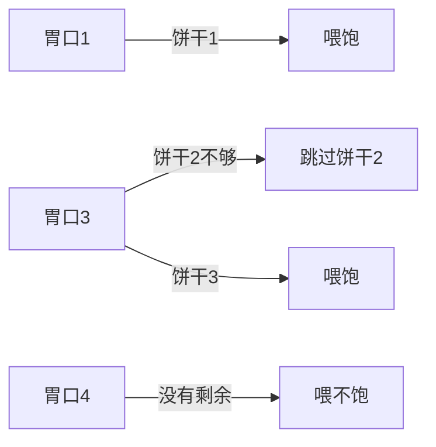

# 贪心：每一步只拿当前最划算的

贪心每一步做局部最好的选择，并且要求这个选择不会堵死后面的最优。它通常要先排序，否则「当前最大 / 最小」看不到。

## 分发饼干

### 来源

LeetCode 455，给孩子分饼干。

### 描述

每个孩子最多一块饼干。孩子 `i` 的胃口是 `g[i]`，饼干 `j` 的尺寸是 `s[j]`。只有 `s[j] >= g[i]` 才算喂饱。求最多能喂饱几个人。

本题例子不用「三块小饼干对三个胃口」那组数。改成：

- 胃口 `[3, 1, 4]`，饼干 `[2, 3, 1]`。
- 能喂饱 2 人：尺寸 1 给胃口 1，尺寸 3 给胃口 3。胃口 4 没有更大的饼干。

另一组：胃口 `[2, 6]`，饼干 `[5]`。只能喂饱胃口 2，答案是 1。把唯一的 5 留给胃口 6 会喂饱 0 人，更差。

### 思考

把饼干和胃口都从小到大排好。用最小的、刚刚够的饼干去满足当前最容易满足的孩子。大饼干留着对付大胃口。

反过来，从最难满足的孩子开始、把当前最大的饼干给他，也对：大饼干若连他都喂不饱，就更喂不饱后面更大的胃口，这块饼干可以扔掉（看下一个孩子）；喂得饱就立刻分掉。两种顺序都是贪心，下面用「小饼干优先」。

### 走一遍

胃口排成 `[1, 3, 4]`，饼干排成 `[1, 2, 3]`。

1. 饼干 1 正好够胃口 1，两根指针一起后移，喂饱人数 = 1。
2. 饼干 2 不够胃口 3，饼干指针后移。
3. 饼干 3 够胃口 3，人数 = 2。
4. 饼干用完，胃口 4 留下。



### 代码

```python
def feed_children(appetite, cookies):
    """返回最多能喂饱的人数。"""
    kids = sorted(appetite)
    snacks = sorted(cookies)
    kid = 0
    snack = 0
    while kid < len(kids) and snack < len(snacks):
        if snacks[snack] >= kids[kid]:
            kid += 1
        snack += 1
    return kid
```

排序决定了时间，比较本身是线性的。快排或归并都是 `O(n log n)`，这里 `n` 取两段长度里较大的那个。额外空间若用原地排序可以是 `O(1)`，Python 的 `sorted` 会另开数组，是 `O(n)`。

### 边界

胃口 `[8]`、饼干 `[7, 7]`：两块都不够，答案必须是 0。若实现时在「不够」的分支里误把孩子指针也加一，就会把没喂饱的人算进去。空胃口或空饼干同样是 0。

## 判断子序列

### 来源

LeetCode 392。原文这一节只有标题，下面按题意补成一课。

### 描述

字符串 `s` 是不是字符串 `t` 的子序列：能否在 `t` 里从左到右挑出若干字符，拼出 `s`。不要求这些字符连在一起，但顺序不能反。

例子：`s = "bd"`，`t = "abxde"`，可以挑下标 1 的 `b` 和下标 3 的 `d`，答案为真。`s = "db"` 对同一个 `t` 为假，因为 `d` 出现时 `b` 已经在它左边，后面没有另一个 `b`。

### 思考

两根指针。`t` 的指针永远往右；只有字符相等时 `s` 的指针才往右。这是贪心：每次都用 `t` 里**最靠左**的那个匹配，把右边的位置留给 `s` 的后续字符。更靠右的匹配只会让后面更紧。

### 走一遍

`s = "bd"`，`t = "abxde"`。

1. `a` 不等于 `b`，只移动 `t`。
2. `b` 相等，`s` 也前进，下一目标是 `d`。
3. `x` 跳过。
4. `d` 相等，`s` 走完，返回真。

反例 `s = "db"`：先在下标 3 匹配到 `d`，`t` 只剩 `'e'`，再也碰不到 `b`，返回假。

### 代码

```python
def is_subseq(small, large):
    i = 0
    for ch in large:
        if i < len(small) and small[i] == ch:
            i += 1
    return i == len(small)
```

### 复杂度

时间 `O(|t|)`，空间 `O(1)`。`s` 更长时循环结束 `i` 仍小于 `|s|`，自然为假。

### 边界

`s` 为空：什么都不用挑，是任何串的子序列，包括空的 `t`。`t` 为空而 `s` 非空：为假。字符相等但要逆序，如 `"ba"` 对 `"ab"`，为假。
