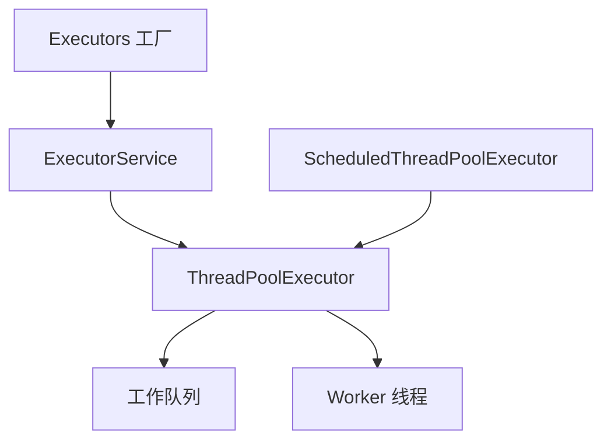
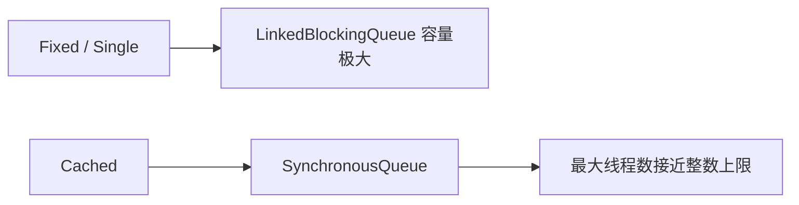
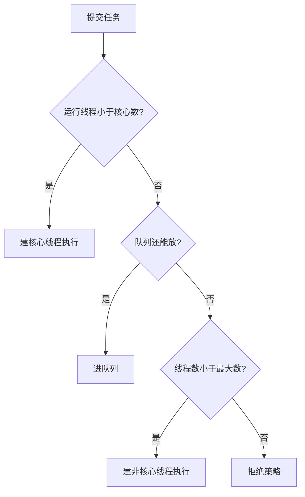

# 线程池（Java 中有哪些方法获取多线程）

## 前言

把一段逻辑交给另一条执行流，常见入口有四类：

- 实现 `Runnable`
- 实现 `Callable`
- 直接 `new Thread`
- 把任务提交给线程池

前三种每来一份工作就新建线程。线程池把“建线程”和“提交任务”拆开，线程可以反复使用。

## Callable 接口

`Runnable.run` 没有返回值，异常也不能直接抛给提交者。`Callable.call` 可以返回结果，也可以把受检异常丢出来。批处理、要知道成功还是失败的任务，更适合 `Callable`。

`Runnable` 的形态：

```java
class LogJob implements Runnable {
    @Override
    public void run() {
        System.out.println("只负责跑，没有返回值");
    }
}
```

`Callable` 需要返回一个结果。例如清算任务返回处理笔数：

```java
class SettleJob implements Callable<Integer> {
    @Override
    public Integer call() {
        System.out.println("清算线程开始");
        return 64;
    }
}
```

`Thread` 的构造器只接受 `Runnable`。`FutureTask` 同时实现了 `Runnable` 和 `Future`，构造时吃进一个 `Callable`，于是就能交给 `Thread`：

```java
FutureTask<Integer> task = new FutureTask<>(new SettleJob());
Thread worker = new Thread(task, "settle");
worker.start();
```

结果用 `task.get()` 取。任务还没跑完时，`get` 会一直等到算出结果或抛出执行异常：

```java
System.out.println("结算笔数 " + task.get());
```

主线程若在任务还没开始时就 `get`，自己会被堵住，界面或接口线程就失去了并发的意义。要么把 `get` 放到确实需要结果的那一行，要么先看 `isDone`：

```java
while (!task.isDone()) {
    Thread.onSpinWait();
}
```

忙等只适合演示。生产代码应使用带超时的 `get`，或者在任务结束的回调里继续。

### 注意

同一个 `FutureTask` 交给两条线程，计算只会发生一次。`run` 内部有状态，第二次进入会直接返回。

```java
FutureTask<Integer> once = new FutureTask<>(new SettleJob());
new Thread(once, "first").start();
new Thread(once, "second").start();
```

要两份独立结果，就建两个任务对象：

```java
FutureTask<Integer> first = new FutureTask<>(new SettleJob());
FutureTask<Integer> second = new FutureTask<>(new SettleJob());
new Thread(first, "first").start();
new Thread(second, "second").start();
```

## ThreadPoolExecutor

### 为什么用线程池

线程池限制同时运行的线程数。多出来的任务进队列，有线程空闲后再取出来执行。它管三件事：复用线程、卡住最大并发、统一关闭和监控。

任务在被执行之前，待在阻塞队列里，而不是待在一个无限膨胀的 `new Thread` 列表里。

### 线程池的好处

线程少而稳定时，CPU 不必频繁保存和恢复线程上下文。这和对象池是同一类想法：创建很贵的资源先准备好，用的时候取，用完归还。

具体有三条：

- 少创建、少销毁。线程的栈和内核数据结构不用反复申请
- 任务到达时往往已经有空闲线程，不用等操作系统把线程建好
- 线程数有上限。无界地 `new Thread` 会把内存耗在栈上，也会让调度变慢。池子把数量、队列和拒绝行为收在一个地方

### 架构说明

调用链从工具类走到实现类：



记住四个名字就够：`Executor` 是执行任务的接口，`ExecutorService` 加上了提交和关闭，`Executors` 是工厂，`ThreadPoolExecutor` 是真正带参数的池。

### 创建线程池

工厂方法方便，但每个方法都把队列或最大线程数设成了极端值：

- `newFixedThreadPool(n)`：固定 n 条线程，队列是不设上限的链表队列。适合长期、数量稳定的任务，多余任务在队列里等
- `newSingleThreadExecutor()`：只有一条线程，任务按提交顺序执行。前一个抛异常，池子会再补一条线程继续后面的任务
- `newCachedThreadPool()`：线程数可以涨到 `Integer.MAX_VALUE`，队列却不存任务。来一个短任务就尽量复用，没有空闲线程就新建。适合大量很短的异步小任务，不适合把慢任务往里丢
- `newScheduledThreadPool(n)`：核心线程数是 n，最大线程数是 `Integer.MAX_VALUE`，队列是延迟队列，用来做定时和周期任务

创建之后用 `execute` 提交 `Runnable`，用完必须 `shutdown`，否则非守护线程会把进程留住：

```java
ExecutorService pool = Executors.newFixedThreadPool(4);
pool.execute(() -> System.out.println(Thread.currentThread().getName() + " 处理一笔开户"));
pool.shutdown();
```

八笔开户、四条线程的完整例子：

```java
import java.util.concurrent.ExecutorService;
import java.util.concurrent.Executors;

/**
 * 工厂方法演示复用。生产环境改用下面的 ThreadPoolExecutor 构造器。
 */
public class AccountPoolDemo {
    public static void main(String[] args) {
        ExecutorService pool = Executors.newFixedThreadPool(4);
        try {
            for (int i = 1; i <= 8; i++) {
                final int ticket = i;
                pool.execute(() ->
                        System.out.println(Thread.currentThread().getName() + " 处理开户单 " + ticket));
            }
        } finally {
            pool.shutdown();
        }
    }
}
```

输出里线程名会重复出现，例如 `pool-1-thread-1` 处理完第 1 单后再处理第 6 单。八笔业务只有四条线程，这就是复用。

### 让任务按延迟或周期运行

`Executors.newScheduledThreadPool(corePoolSize)` 返回的是 `ScheduledThreadPoolExecutor`，它是 `ThreadPoolExecutor` 的子类。构造时核心线程数用传入值，最大线程数用整数上限，空闲存活时间是 0 纳秒，队列是 `DelayedWorkQueue`。

延迟一次：

```java
/**
 * command：到点执行的任务
 * delay：延迟多久
 * unit：延迟的单位
 */
public ScheduledFuture<?> schedule(Runnable command, long delay, TimeUnit unit)
```

固定频率：

```java
/**
 * initialDelay：第一次执行前的等待
 * period：相邻两次“开始时刻”的间隔
 * 若上一次还没结束，下一次会等它结束再立刻开始，不会并行叠在同一条工作线程上
 */
public ScheduledFuture<?> scheduleAtFixedRate(Runnable command,
                                              long initialDelay,
                                              long period,
                                              TimeUnit unit)
```

固定延迟：

```java
/**
 * delay 从“上一次完全结束”开始算，而不是从开始时刻算
 */
public ScheduledFuture<?> scheduleWithFixedDelay(Runnable command,
                                                 long initialDelay,
                                                 long delay,
                                                 TimeUnit unit)
```

周期任务如果执行时间长于 `period`，`scheduleAtFixedRate` 不会并发跑同一任务的两份，只是下一轮紧跟着开始。要的是“结束后再歇一会儿”，用 `scheduleWithFixedDelay`。

## 底层实现

`newFixedThreadPool` 和 `newSingleThreadExecutor` 的队列都是 `LinkedBlockingQueue`，默认容量 `Integer.MAX_VALUE`。`newCachedThreadPool` 的队列是 `SynchronousQueue`，它不保存元素，最大线程数却几乎没有上限。



所以工厂方法不是“不能用”，而是默认值把风险藏起来了：要么队列能堆积到把堆撑满，要么线程能创建到把栈撑满。

## 线程池的重要参数

`ThreadPoolExecutor` 的构造器有七个参数：

- `corePoolSize`：核心线程数。池子创建后不会马上建满，有任务来才创建，直到达到这个数。可以把它理解成平时值班的窗口
- `maximumPoolSize`：线程数上限，必须不小于核心数。核心都在忙、队列也满了，才会继续建线程，直到这个上限
- `keepAliveTime`：非核心线程空闲多久后退出。默认只对超出核心数的线程生效；`allowCoreThreadTimeOut(true)` 之后核心线程也会退出
- `unit`：上面那个时间的单位
- `workQueue`：核心线程都在忙时，新任务先进入这里。银行里就是候客区。有界用 `ArrayBlockingQueue`，无界用默认容量的 `LinkedBlockingQueue`，直接移交用 `SynchronousQueue`
- `threadFactory`：给线程起名、设置是否守护。至少把名字设成业务含义，出问题才能在 `jstack` 里认出来
- `handler`：核心、队列、最大线程都满了之后怎么拒绝新任务



## 拒绝策略

四种内置策略都实现 `RejectedExecutionHandler`：

- `AbortPolicy`：默认。抛 `RejectedExecutionException`，调用方立刻知道没接住
- `DiscardPolicy`：丢掉新任务，不抛异常。只适合丢了也不影响正确性的统计、日志
- `CallerRunsPolicy`：既不丢也不抛，改由提交任务的那条线程自己跑。提交速度会被拖慢，形成反压
- `DiscardOldestPolicy`：丢掉队列里最老的一个，再尝试把当前任务放进去。队列里若是最新的数据更重要，可以用；不能用在不能丢旧任务的业务上

## 线程池底层工作原理

1. 池子建好后先等任务，默认不会预创建核心线程，除非调用 `prestartAllCoreThreads`
2. `execute` 进来后按上面的图判断：少于核心数就建线程；否则尝试入队；队列满了再扩到最大线程数；还不行就拒绝
3. 线程干完手里的任务，会再到队列里取下一个
4. 线程空闲超过 `keepAliveTime`，若当前线程数大于核心数，这条线程退出。全部任务都结束后，池子收缩到核心数（若允许核心超时，会收缩到 0）

用银行窗口对照：

1. 核心窗口是 2。前两位顾客直接办理
2. 后面三位顾客发现窗口都在忙，进候客区，也就是有界队列
3. 候客区也坐满了，就临时加开窗口，直到加到最大线程数
4. 窗口和候客区都满了，再来的顾客按拒绝策略处理，避免无限涌入把系统压垮
5. 高峰过去，临时窗口空闲超过存活时间就关掉，只留核心窗口

## 工厂方法为什么不直接拿去上线

固定大小、单线程、可缓存，三种工厂方法在生产里都不直接用。参数要自己写到构造器里，让队列长度和最大线程数变成代码评审能看见的数字。

阿里巴巴 Java 开发手册里和线程池相关的两条可以概括成：

- 业务里不要到处 `new Thread`。线程的创建和回收交给池子，避免把内存耗在大量栈上，也避免调度抖动
- 不要用 `Executors` 的工厂创建会长期运行的池。工厂把队列或最大线程数设成 `Integer.MAX_VALUE`：
  - `FixedThreadPool` 和 `SingleThreadExecutor` 的队列几乎无界，任务堆积会撑爆堆
  - `CachedThreadPool` 和 `ScheduledThreadPool` 的最大线程数几乎无界，线程堆积会撑爆栈，表现为 `unable to create new native thread`

手册的原意是让写代码的人看见运行规则，而不是背工厂名字。

## 手写线程池

### 采用默认拒绝策略

下面这个池子：核心 2，最大 4，空闲 1 秒，队列长度 2。同时能接住的任务大约是最大线程数加队列长度，也就是 6。第 7 个若在前面的任务还没结束时到达，就会触发拒绝。示例里让任务睡一会，保证队列来得及被塞满。

```java
import java.util.concurrent.LinkedBlockingQueue;
import java.util.concurrent.ThreadPoolExecutor;
import java.util.concurrent.TimeUnit;

/**
 * 核心 2，最大 4，队列 2。慢任务下，第 7 个提交会走拒绝策略。
 */
public class ManualPoolDemo {
    public static void main(String[] args) {
        ThreadPoolExecutor pool = new ThreadPoolExecutor(
                2,
                4,
                1L,
                TimeUnit.SECONDS,
                new LinkedBlockingQueue<>(2),
                new ThreadPoolExecutor.AbortPolicy());
        try {
            for (int i = 1; i <= 8; i++) {
                final int ticket = i;
                pool.execute(() -> {
                    System.out.println(Thread.currentThread().getName() + " 受理 " + ticket);
                    try {
                        TimeUnit.MILLISECONDS.sleep(500);
                    } catch (InterruptedException ex) {
                        Thread.currentThread().interrupt();
                    }
                });
            }
        } finally {
            pool.shutdown();
        }
    }
}
```

`AbortPolicy` 下能看到：

```text
pool-1-thread-1 受理 1
pool-1-thread-2 受理 2
pool-1-thread-3 受理 5
pool-1-thread-4 受理 6
Exception in thread "main" java.util.concurrent.RejectedExecutionException
```

前两个建核心线程，接下来两个进队列，再两个把线程扩到 4。队列仍满、线程也到上限时，后面的提交抛 `RejectedExecutionException`。若任务快到提交循环还没结束就已经跑完，队列腾得出空位，异常就不一定出现。睡眠是为了把拒绝条件稳定住。

### 采用 CallerRunsPolicy 拒绝策略

把最后一个参数换成 `new ThreadPoolExecutor.CallerRunsPolicy()`。被拒绝的任务会在 `main` 里执行，日志里出现 `main 受理 7` 这类行。提交线程被拿去干活，就暂时不能继续往池里灌任务，这是一种自然的减速。

### 采用 DiscardPolicy 拒绝策略

换成 `DiscardPolicy` 后，超出能力的任务没有日志、没有异常。只适合可以丢的采样。资金、订单不能用它。

### 采用 DiscardOldestPolicy 拒绝策略

这个策略从队列头部丢掉一个还没执行的任务，再把当前任务放进去。日志里会少掉中间某个编号，而不是少掉最后几个。若队列里排的是过期的刷新请求、只想保留最新的，可以用；若队列里是必须按顺序处理的订单，不可以用。

## 线程池的合理参数

`corePoolSize` 和 `maximumPoolSize` 看任务是在算还是在等。

- CPU 密集

任务几乎不阻塞，核心一直在跑指令。线程数比核心数多很多时，只是增加上下文切换。

经验值是：CPU 核数加 1。多出来的那一条用来填补偶尔的缺页或轻微阻塞。核数用 `Runtime.getRuntime().availableProcessors()` 取，容器里要确认 JVM 看见的是限额后的核数。

单核上把 CPU 密集任务拆成很多线程不会变快，总的运算时间还是那一颗核的时间。

- IO 密集

线程经常停在磁盘或网络上，停着的时候 CPU 可以去跑别的线程。

粗算：`核数 * 2`。再细一点用：

```text
线程数 ≈ 核数 / (1 - 阻塞系数)
```

阻塞系数 0.8 到 0.9 表示线程大部分时间在等。8 核、阻塞系数 0.9 时，大约 `8 / 0.1 = 80` 条。这个数是起点，还要受数据库连接数、下游限流和内存的约束。线程可以开到 80，连接池只有 20 时，多出来的线程只会堵在取连接上。

公式给出的是数量级。上线后看队列长度、拒绝次数和 CPU 利用率，再把核心数和队列长度改一版。
