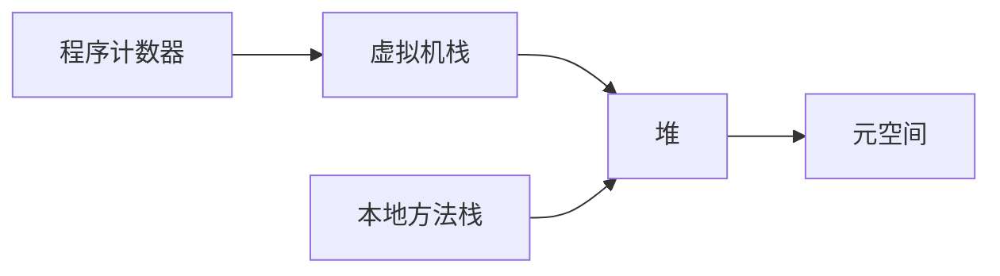
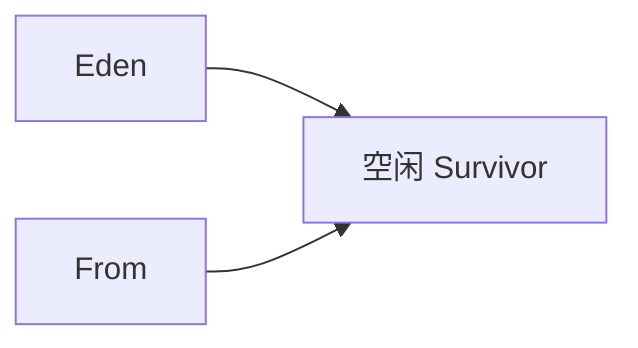

# JVM 体系结构

## 概览

HotSpot 里线程私有的是程序计数器、虚拟机栈、本地方法栈；共享的是堆和方法区。JDK 8 起方法区由元空间实现，占用的是本地内存。

垃圾收集主要扫堆和方法区里的废弃类元数据。栈溢出多半是递归过深。

## 类加载器

- 类加载器把字节码放进方法区，并在堆上生成 Class 对象。
- 双亲委派：先交给父加载器，处理不了才自己加载，避免核心类被同名类替换。
- 因此应用写的 `java.lang.String` 进不了启动类加载器。

## 常见的垃圾回收算法

- 引用计数

每个对象带计数，多一处引用加一，失效减一，到 0 就回收。互相指向时计数都不为 0，会漏掉。HotSpot 不用它做主算法。

- 复制

新生代常用。Eden 加两块 Survivor。活对象拷到空闲区，原块整块丢弃，没有碎片；代价是要留一块空区域。

- 标记清除

先从 GC Roots 标出可达对象，再清掉未标记的。适合存活对象多的老年代。缺点是留下大小不一的空洞。

- 标记整理

标记后把存活对象滑到一端，再清掉边界外的空间。碎片没了，但要修正引用，停顿更高。
