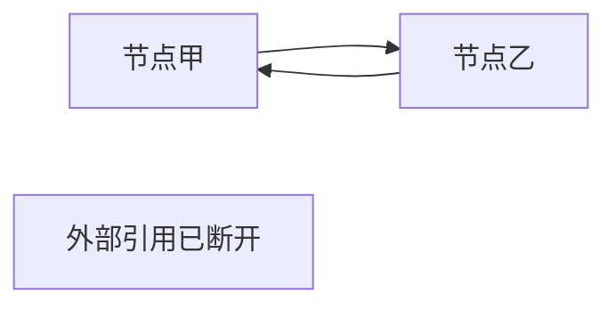
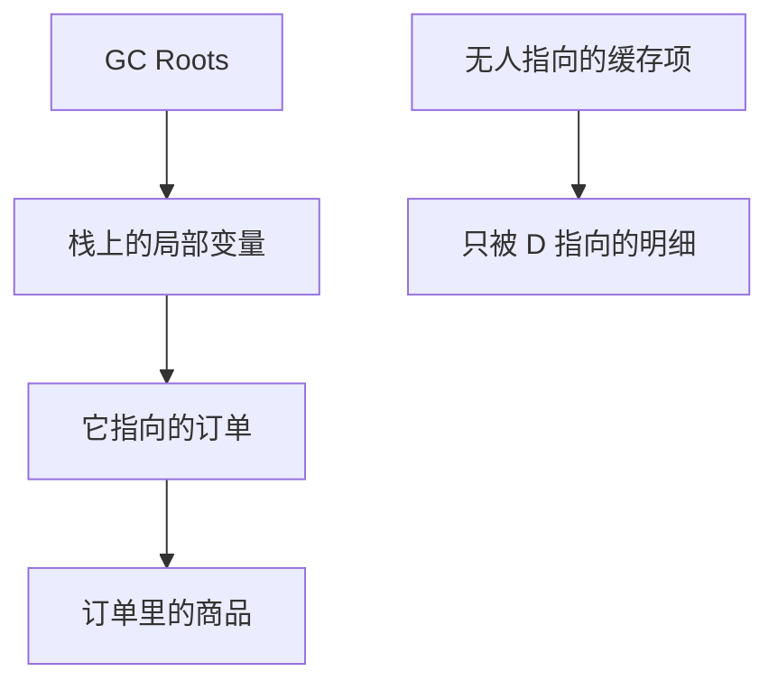

# JVM 面试：怎么判定垃圾，GC Roots 是什么

## 收集器靠什么认出可以丢掉的对象

### 什么样的内存算垃圾

进程里一块内存，如果之后再也不会被程序用到，它就是垃圾，应该还给分配器。

### 两条判定路线

#### 引用计数法

Java 里操作对象必须经过引用。一种直观做法是给对象加计数器：

每多一处引用，计数加一。

每失效一处引用，计数减一。

计数变成 0，就认为没有人再用它。

主流 Java 虚拟机不拿它当主方案，因为两个对象互相引用、外界已经失去入口时，双方计数都大于 0，谁也回收不了。这个算法知道即可。



#### 枚举根节点做可达性分析

为了避开循环引用，Java 从一组称为 GC Roots 的活跃引用出发，顺着引用关系走对象图。走得到的对象算存活，走不到的对象算死亡。



图里从根能走到的是存活对象；`D` 和 `E` 虽然互相或单向连着，但没有从根过来的路径，下一轮就可以回收。

根集合必须是当前肯定还活着的引用，地位类似文件系统里的根目录：不从这里出发，就无法判断下面的节点是否还挂在树上。

#### 一句话理解 GC Roots

想象三样东西：背包、水壶、杯套。背包扣着水壶，水壶套着杯套，三者连成一条链。

某天背包被扔掉，只剩水壶和杯套。若把背包当成 GC Roots，绳子断了之后，水壶从根上不可达，就可以被收走。背包还扣着水壶时，水壶就不会被当成无人认领的对象。

#### 那些对象可以当做 GC Roots

- 虚拟机栈栈帧局部变量表里的引用
- 方法区里类的静态字段指向的对象
- 方法区里常量指向的对象
- 本地方法栈里 JNI 引用的对象

#### 代码说明

```java
/**
 * 能当 GC Roots 的典型位置：
 * 栈帧局部变量、类的静态字段、常量、JNI 引用。
 */
public class RootTraceDemo {

    // 静态字段指向的对象，会作为根
    // private static RootTraceDemo shared;

    // 常量指向的对象，同样从根开始被扫描
    // private static final RootTraceDemo FIXED = new RootTraceDemo();

    public static void holdOnStack() {
        // 局部变量在方法执行期间是根
        RootTraceDemo onStack = new RootTraceDemo();
        System.gc();
        System.out.println("建议一次回收后，onStack 仍被局部变量抓住");
        System.out.println(onStack);
    }

    public static void main(String[] args) {
        holdOnStack();
    }
}
```

`holdOnStack` 返回之后，局部变量消失，如果没有别的根指向那个对象，它才会变成不可达。在方法还没返回时调用 `System.gc()`，对象仍然活着，因为栈上的引用就是根。
