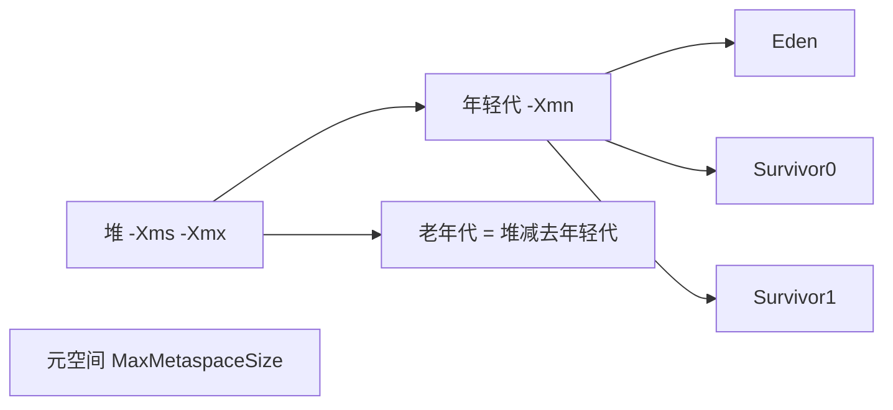
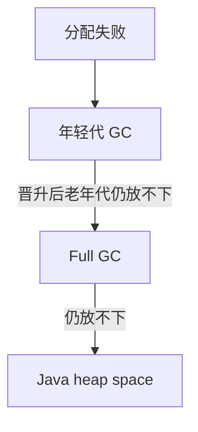
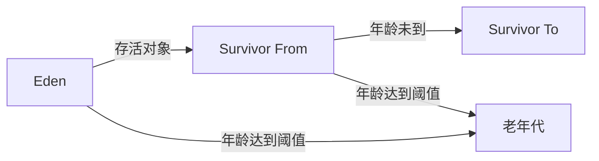

# JVM 参数调优

## 前言

如果简历上写了调过 JVM，面试官常追问：默认值你怎么查到的。

运行中的进程用 `jps` 找进程号，用 `jinfo` 读某一个标志。

```text
-Xms：堆的起始大小
-Xmx：堆的上限
-Xss：每条线程的栈大小
```

`-Xms` 和 `-Xmx` 设成一样，堆就不会在运行中来回扩容和收缩，减少由此触发的 Full GC。

## JVM 参数类型

- 标准参数（从早期 JDK 一直保留）
  - `-version`
  - `-help`
  - `java -showversion`
- 非标准 X 参数
  - `-Xint`：只用解释器
  - `-Xcomp`：第一次执行就编译成本地代码
  - `-Xmixed`：解释和编译混合，默认就是这种
- XX 参数（调优时最常改的一层）
  - 布尔型
    - 写法：`-XX:+名字` 打开，`-XX:-名字` 关闭
    - 例子：`-XX:-PrintGCDetails` 表示不打印 GC 详情
  - 键值型
    - 写法：`-XX:键=值`
    - 例子：`-XX:MaxMetaspaceSize=64m` 把元空间上限改成 64MB

## 查看运行的 Java 程序，JVM 参数是否开启，具体值为多少？

先跑一个短生命周期被故意拉长的程序，方便在它还活着时去查：

```java
/**
 * 停住，给 jps / jinfo 留时间。
 */
public class PauseForFlags {
    public static void main(String[] args) throws InterruptedException {
        System.out.println("flags-demo");
        Thread.sleep(Long.MAX_VALUE);
    }
}
```

查询命令：

```text
jps：列出本机 Java 进程
jinfo：读取某个进程的 JVM 标志
```

先拿到进程号：

```text
jps -l
```

```text
23110 PauseForFlags
23140 jdk.jcmd/sun.tools.jps.Jps
```

再问它有没有打开 GC 详情：

```text
jinfo -flag PrintGCDetails 23110
```

默认常见结果：

```text
-XX:-PrintGCDetails
```

减号表示关闭。

在启动参数里改成加号：

```text
-XX:+PrintGCDetails
```

IDE 里写在 VM options，命令行则直接放在类名前面：`java -XX:+PrintGCDetails PauseForFlags`。

再次 `jps -l`，对新的进程号执行：

```text
jinfo -flag PrintGCDetails 23188
```

结果变成：

```text
-XX:+PrintGCDetails
```

加号说明这次启动已经打开该标志。

一次打出全部标志：

```text
jinfo -flags 23188
```

## 题外话（容易看错的两个参数）

`-Xms` 和 `-Xmx` 看起来像 X 参数，实际上是两个 XX 参数的别名。

- `-Xms` 等价于 `-XX:InitialHeapSize`。默认大约是物理内存的 1/64。
- `-Xmx` 等价于 `-XX:MaxHeapSize`。默认大约是物理内存的 1/4。

具体比例会随 JDK 版本和是否打开压缩指针略有出入，以 `jinfo -flag InitialHeapSize` 为准。

## 查看 JVM 默认参数

- `-XX:+PrintFlagsInitial`

  - 打印所有标志的出厂默认值，还没经过你的命令行覆盖
  - 用法
    - `java -XX:+PrintFlagsInitial -version`
    - 只关心某一个名字时再配合过滤

```text
java -XX:+PrintFlagsInitial -version | grep HeapSize
```

- `-XX:+PrintFlagsFinal`

  - 打印命令行和 ergonomics 都作用完之后的最终值
  - `:=` 表示这个值被改过，`=` 表示仍是默认

```text
java -XX:+PrintFlagsFinal -version | grep MaxHeapSize
```

## 工作中常用的 JVM 基本配置参数



### 查看堆内存

用 `Runtime` 读当前进程看到的堆，而不是猜默认比例：

```java
/**
 * totalMemory 接近已提交的堆，maxMemory 接近 -Xmx。
 */
public class HeapReport {
    public static void main(String[] args) {
        long committed = Runtime.getRuntime().totalMemory();
        long ceiling = Runtime.getRuntime().maxMemory();
        System.out.println("committed(-Xms 附近) = " + committed + " 字节、"
                + (committed / 1024.0 / 1024.0) + "MB");
        System.out.println("ceiling(-Xmx) = " + ceiling + " 字节、"
                + (ceiling / 1024.0 / 1024.0) + "MB");
    }
}
```

一台 16GB 机器上可能看到大约：

```text
committed(-Xms 附近) = 260046848 字节、248.0MB
ceiling(-Xmx) = 4076863488 字节、3888.0MB
```

起始堆大约是物理内存的 1/64，上限大约是 1/4。容器里要看的是容器配额，不是宿主机内存；JDK 10 之后默认会识别 cgroup 限制。

### 打印 JVM 默认参数

`-XX:+PrintCommandLineFlags` 只打印启动时真正生效的那一小行，比 `PrintFlagsFinal` 短：

```text
-XX:InitialHeapSize=260046848 -XX:MaxHeapSize=4160749568 -XX:+PrintCommandLineFlags -XX:+UseCompressedOops -XX:+UseG1GC
```

JDK 9 以后很多环境的默认收集器已经是 G1，不一定再是 Parallel。以你这行输出的最后一项为准。

### 常见调优参数

- `-Xms`：起始堆，默认约物理内存的 1/64，等价于 `-XX:InitialHeapSize`
- `-Xmx`：堆上限，默认约物理内存的 1/4，等价于 `-XX:MaxHeapSize`
- `-Xss`：每条线程的栈，常见默认 512KB 到 1MB，等价于 `-XX:ThreadStackSize`
  - `jinfo -flag ThreadStackSize <pid>` 若看到 0，表示沿用平台默认
  - Linux/x64 常见 1MB
  - macOS 常见 1MB
  - Windows 取决于虚拟内存设置
- `-Xmn`：年轻代大小。设置之后，老年代大约是 `-Xmx` 减去年轻代
- `-XX:MetaspaceSize`：元空间触发回收的初始阈值
  - 元空间实现的是方法区，放类元数据，使用本地内存，不占 Java 堆
  - 可以用 `-Xms10m -Xmx10m -XX:MetaspaceSize=64m -XX:+PrintFlagsFinal` 观察最终值
  - 默认阈值只有二十多 MB。类生成很多的框架（大量动态代理）可以适当抬高，避免频繁扩容
- `-XX:+PrintGCDetails`：打印每次 GC 的分区占用。JDK 9 之后更推荐 `-Xlog:gc*`

GC 日志可以分成两类：



用一小段代码把 GC 打出来。堆固定 10MB，再分配 20MB 的数组：

```text
-Xms10m -Xmx10m -XX:+PrintGCDetails
```

```java
byte[] block = new byte[20 * 1024 * 1024];
```

堆只有 10MB，20MB 的数组放不进去：

```text
Exception in thread "main" java.lang.OutOfMemoryError: Java heap space
	at HeapReport.main(HeapReport.java:8)
```

失败前会先尝试年轻代回收和 Full GC，日志类似：

```text
[GC (Allocation Failure) [PSYoungGen: 2048K->512K(2560K)] 2048K->760K(9728K), 0.004 secs]
[Full GC (Allocation Failure) [PSYoungGen: 512K->0K(2560K)] [ParOldGen: 248K->640K(7168K)] 760K->640K(9728K), ...]
```

原因就是 `-Xms10m -Xmx10m` 把堆钉死在 10MB，数组却要 20MB。GC 日志里同时出现了普通 GC 和 Full GC。

#### 年轻代 GC

年轻代回收只处理 Eden 和 Survivor：

```text
[GC (Allocation Failure) [PSYoungGen: 2048K->512K(2560K)] 2048K->760K(9728K), 0.004 secs]
```

`Allocation Failure` 表示这次是因为分配不下才触发的。

```text
[PSYoungGen: 2048K->512K(2560K)] 2048K->760K(9728K)
```

读法：

```text
[区名: GC前占用 -> GC后占用 (该区容量)] 整堆GC前 -> 整堆GC后 (整堆容量)
```

年轻代从 2048K 降到 512K，说明大部分对象死了。整堆只从 2048K 降到 760K，差额是晋升到老年代、年轻代日志里不再统计的那一部分。

#### Full GC

老年代也参与，并且通常停顿更长：

```text
[Full GC (Allocation Failure) [PSYoungGen: 0K->0K(2560K)] [ParOldGen: 640K->620K(7168K)] 640K->620K(9728K), ...]
```

老年代从 640K 只降到 620K，说明活对象几乎清不掉。活对象大过整堆时，Full GC 之后仍会 OOM。

### -XX:SurvivorRatio

这个参数决定 Eden 和一块 Survivor 的比值，默认 `-XX:SurvivorRatio=8`，即 Eden:S0:S1 = 8:1:1。年轻代里 Eden 占 8 份，两块 Survivor 各占 1 份。

设成 `-XX:SurvivorRatio=4`，比例变成 4:1:1。数值只描述 Eden 相对“一块” Survivor 的倍数，S0 和 S1 始终一样大。

从收集器的角度看，堆分成年轻代（Eden、From、To）和老年代。



一次年轻代复制的顺序：

- Eden 满了触发回收，活对象拷到空着的那块 Survivor，年龄记为 1。下次再回收时，同时扫描 Eden 和当前的 From，还活着的拷到 To；年龄已经达到晋升阈值的直接进老年代，年龄加一。
- 拷贝结束后，Eden 和 From 整块丢弃，里面不再有活对象。
- To 和 From 对调名字。原来的 To 成为下一轮的 From。对象就这样在两块 Survivor 之间搬，默认搬到 15 次（`-XX:MaxTenuringThreshold`）仍活着，就晋升老年代。

### -XX:NewRatio

它控制老年代相对年轻代的倍数，不是年轻代内部的比例。

默认 `-XX:NewRatio=2`：老年代 2 份，年轻代 1 份，年轻代大约是整堆的 1/3。

`-XX:NewRatio=4`：老年代 4 份，年轻代 1 份，年轻代大约是整堆的 1/5。数值写的是老年代那一侧。

年轻代过小，对象来不及在 Survivor 里死去，会频繁回收，也会过早晋升，把压力转给老年代。

### -XX:MaxTenuringThreshold

晋升年龄的上限。对象在两块 Survivor 之间每熬过一次年轻代回收，年龄加一。默认 15，合法范围一般是 0 到 15。

查看当前进程：

```text
jinfo -flag MaxTenuringThreshold <pid>
```

设成 0：对象不在 Survivor 停留，第一次就进老年代。老年代对象本来就多、年轻代只是短暂缓冲时，可以减少复制次数。设得更大，对象在年轻代多留几轮，有机会在那里被回收，但 Survivor 要装得下。

并行收集器下，JVM 还可能按 Survivor 的占用动态决定晋升年龄，不一定真的等到阈值。阈值是上限，不是每次都必须走到的固定年龄。
