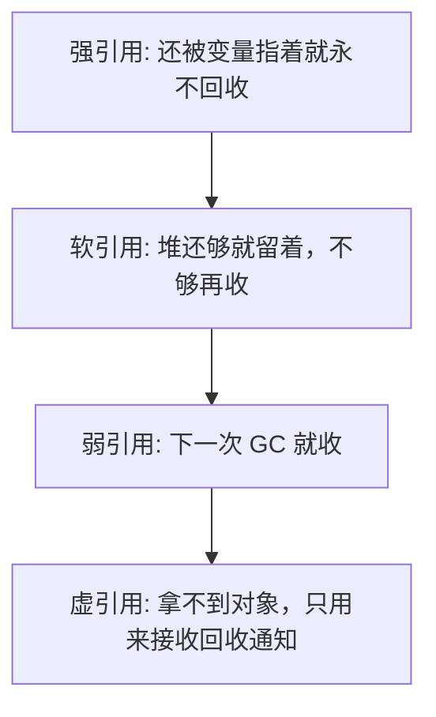
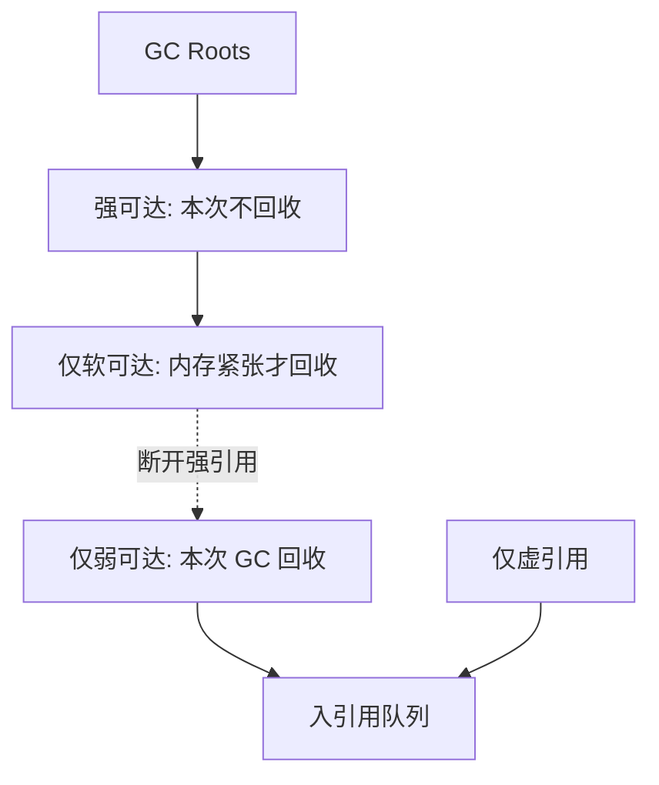

# Java 中的引用

## 前言

写下一行：

```java
Person p = new Person();
```

等号左边的 `p` 是引用，放在栈帧里。等号右边的对象在堆上。只要这个引用还在，收集器就把对象当成必须保留的。这种普通引用就是强引用。

## 整体架构

四级引用从强到弱，决定的是“在什么条件下可以收走对象”：



## 强引用

内存已经不够、甚至快要 OOM 时，垃圾收集器也不会收走还有强引用的对象。

只要还有一个强引用指向它，对象就是可达的。最常见的写法就是把 `new` 出来的结果赋给变量。即使以后业务再也不会用这个变量，只要变量还在作用域里，JVM 就当它活着。忘记把不再使用的集合清空，是 Java 里典型的逻辑泄漏：不是内存没还回去，而是强引用一直握着。

对象失去所有强引用之后才变成可回收的。途径包括离开作用域，或者把变量显式写成 `null`。真正清扫的时机仍由收集器决定。

```java
/**
 * obj2 还指着对象时，把 obj1 置空并建议 GC，对象仍然活着。
 */
public class StrongHoldDemo {
    public static void main(String[] args) {
        Object obj1 = new Object();
        Object obj2 = obj1;
        obj1 = null;
        System.gc();
        System.out.println(obj1);
        System.out.println(obj2);
    }
}
```

输出类似：

```text
null
java.lang.Object@4e25154f
```

`obj1` 已经是 null，`obj2` 仍能打印对象。收集器看见 `obj2` 这条强引用，不会收走堆上的实例。

## 软引用

软引用比强引用弱一档，类型是 `java.lang.ref.SoftReference`。只被软引用指着的对象：

- 堆空间还够时，尽量留着
- 堆空间不够、快要抛出堆溢出之前，会被收掉

适合做内存敏感的缓存：放得下就命中，放不下就丢，下次再加载。不要用软引用保存不能丢的业务数据，回收时机由 JVM 决定。

```java
import java.lang.ref.SoftReference;

/**
 * 第一段堆很空，软引用还在。
 * 第二段用 -Xms6m -Xmx6m，再分配大数组，软引用会被清掉。
 */
public class SoftHoldDemo {

    public static void whenHeapIsFine() {
        Object heavy = new Object();
        SoftReference<Object> soft = new SoftReference<>(heavy);
        System.out.println("fine heavy = " + heavy);
        System.out.println("fine soft  = " + soft.get());
        heavy = null;
        System.gc();
        System.out.println("after gc heavy = " + heavy);
        System.out.println("after gc soft  = " + soft.get());
    }

    public static void whenHeapIsTight() {
        System.out.println("---- tight heap ----");
        Object heavy = new Object();
        SoftReference<Object> soft = new SoftReference<>(heavy);
        System.out.println("tight heavy = " + heavy);
        System.out.println("tight soft  = " + soft.get());
        heavy = null;
        try {
            byte[] pressure = new byte[4 * 1024 * 1024];
            System.out.println("allocated " + pressure.length);
        } catch (OutOfMemoryError ex) {
            System.out.println("分配失败: " + ex);
        } finally {
            System.out.println("finally heavy = " + heavy);
            System.out.println("finally soft  = " + soft.get());
        }
    }

    public static void main(String[] args) {
        whenHeapIsFine();
        whenHeapIsTight();
    }
}
```

堆宽裕时，手动 GC 之后 `soft.get()` 通常仍不是 null。强引用已经断开，但内存不紧张，软引用对象被留下来。

把启动参数设成 `-Xms6m -Xmx6m` 再跑第二段。分配数 MB 的数组会迫使收集器去找空间，只剩软引用的对象会被清掉，`finally` 里 `soft.get()` 变成 null。若数组本身也放不进 6MB，会先抛 `OutOfMemoryError`，软引用同样已经在失败前被尝试回收。

## 弱引用

不管堆空不空，只要发生 GC，只被弱引用指着的对象就会被收走。

类型是 `java.lang.ref.WeakReference`，寿命比软引用短。

```java
import java.lang.ref.WeakReference;

/**
 * 没有制造内存压力，只调用一次 System.gc，弱引用就空了。
 */
public class WeakHoldDemo {
    public static void main(String[] args) {
        Object data = new Object();
        WeakReference<Object> weak = new WeakReference<>(data);
        System.out.println(data);
        System.out.println(weak.get());
        data = null;
        System.gc();
        System.out.println(data);
        System.out.println(weak.get());
    }
}
```

输出形态：

```text
java.lang.Object@1b6d3586
java.lang.Object@1b6d3586
null
null
```

这里没有把堆撑满。一次 GC 就足够让 `weak.get()` 变成 null。`System.gc()` 只是建议，测试里通常会执行；不能在业务里依赖它“肯定马上发生”。

## 缓存该选软引用还是弱引用

场景：服务要反复打开一批本地图片。

- 每次都读磁盘，延迟高
- 全部放进堆，图片一多就溢出

软引用缓存可以折中。用路径当 key，值是图片字节的软引用。内存紧张时 JVM 收掉字节数组，条目可以再惰性加载。

```java
Map<String, SoftReference<byte[]>> pictures = new HashMap<>();
```

真正的图片缓存还要处理并发和失效，示例只说明引用级别。

### WeakHashMap 是什么

`WeakHashMap` 的 key 是弱引用。外部把 key 的强引用丢掉之后，下一次 GC 可以收走 key，映射条目随后也被清掉。一些缓存和反射场景用它存放“有人用才留着”的附属数据。

普通 `HashMap` 把 key 放进表里时，表自己持有强引用。你把局部变量置空，条目还在。

```java
private static void plainMap() {
    Map<Integer, String> map = new HashMap<>();
    Integer key = new Integer(7);
    map.put(key, "plain");
    System.out.println(map);
    key = null;
    System.gc();
    System.out.println(map);
}
```

`new Integer(7)` 避开了 -128 到 127 的缓存语义问题：这里故意不用字面量，是为了让这个 Integer 对象没有别的强引用。即便如此，`HashMap` 内部仍握着它，GC 之后条目还在。

换成 `WeakHashMap`：

```java
import java.util.HashMap;
import java.util.Map;
import java.util.WeakHashMap;

/**
 * 局部变量置空后，WeakHashMap 的条目会在 GC 之后消失。
 */
public class WeakMapDemo {
    public static void main(String[] args) {
        plainMap();
        System.out.println("==========");
        weakMap();
    }

    private static void plainMap() {
        Map<Integer, String> map = new HashMap<>();
        Integer key = new Integer(7);
        map.put(key, "plain");
        System.out.println(map);
        key = null;
        System.gc();
        System.out.println(map);
    }

    private static void weakMap() {
        Map<Integer, String> map = new WeakHashMap<>();
        Integer key = new Integer(7);
        map.put(key, "weak");
        System.out.println(map);
        key = null;
        System.gc();
        System.out.println(map);
    }
}
```

输出：

```text
{7=plain}
{7=plain}
==========
{7=weak}
{}
```

`Integer.valueOf(7)` 或字面量 `7` 会指向缓存池里的永久对象，那个对象永远有强引用，`WeakHashMap` 也不会删条目。用弱引用当 key 时，不要用会被常量池或缓存长期握住的对象。

## 虚引用

### 概念

虚引用也叫幽灵引用，类型是 `java.lang.ref.PhantomReference`。

它不参与“能不能通过引用把对象留住”。一个对象即使挂了虚引用，只要没有强、软、弱引用，该收还是收。`get` 永远返回 null，所以不能靠虚引用访问对象。构造时必须传入 `ReferenceQueue`。

它的用途是跟踪回收进度：对象已经无法再被业务使用、即将或刚刚被收走时，引用对象会被放进队列。比 `finalize` 更可控，因为 `finalize` 只会由收集器线程调一次，而且时机模糊。直接内存的回收就用虚引用加队列，在入队后释放堆外块。

可以把它理解成对象生命周期末尾的一个回调，但回调里拿不到原对象，只能知道“这一份引用已经到站”。

### 场景

堆外内存、文件句柄这一类资源，希望在 Java 对象真的不可达之后得到通知，再去调用本地释放函数。业务缓存不要用虚引用，用软引用或显式过期即可。

## 引用队列 ReferenceQueue

软引用、弱引用、虚引用都可以在构造时绑定一个队列。对象被判定可以回收时，对应的引用对象会被放进队列。轮询这个队列，就能做扫尾工作，而不必去改对象本身。

```java
Object data = new Object();
ReferenceQueue<Object> queue = new ReferenceQueue<>();
WeakReference<Object> weak = new WeakReference<>(data, queue);
```

GC 之前 `queue.poll()` 是 null。GC 之后对象不可达，`weak.get()` 变成 null，队列里能取出刚才那个 `WeakReference`。

```java
import java.lang.ref.ReferenceQueue;
import java.lang.ref.WeakReference;
import java.util.concurrent.TimeUnit;

/**
 * 回收前引用对象会进入 ReferenceQueue。
 */
public class QueueNoticeDemo {
    public static void main(String[] args) throws InterruptedException {
        Object data = new Object();
        ReferenceQueue<Object> queue = new ReferenceQueue<>();
        WeakReference<Object> weak = new WeakReference<>(data, queue);

        System.out.println(data);
        System.out.println(weak.get());
        System.out.println(queue.poll());

        data = null;
        System.gc();
        System.out.println("已建议 GC");
        TimeUnit.MILLISECONDS.sleep(200);

        System.out.println(data);
        System.out.println(weak.get());
        System.out.println(queue.poll());
    }
}
```

输出形态：

```text
java.lang.Object@4e25154f
java.lang.Object@4e25154f
null
已建议 GC
null
null
java.lang.ref.WeakReference@1d81eb93
```

第三行是 null，说明回收前队列是空的。最后一行能取出弱引用本身，说明它在对象被收走时入队了。业务可以在这个时刻删掉外表的索引。虚引用必须配合队列使用，否则创建出来也收不到通知。

## GC Roots 和四种引用



- 从 GC Roots 沿强引用能走到的对象，这次收集不会收走
- 只剩软引用时，堆还够就留，不够就收
- 只剩弱引用或只挂虚引用时，这次 GC 就会把对象清掉；清掉之前引用对象可以进队列，用来做通知
