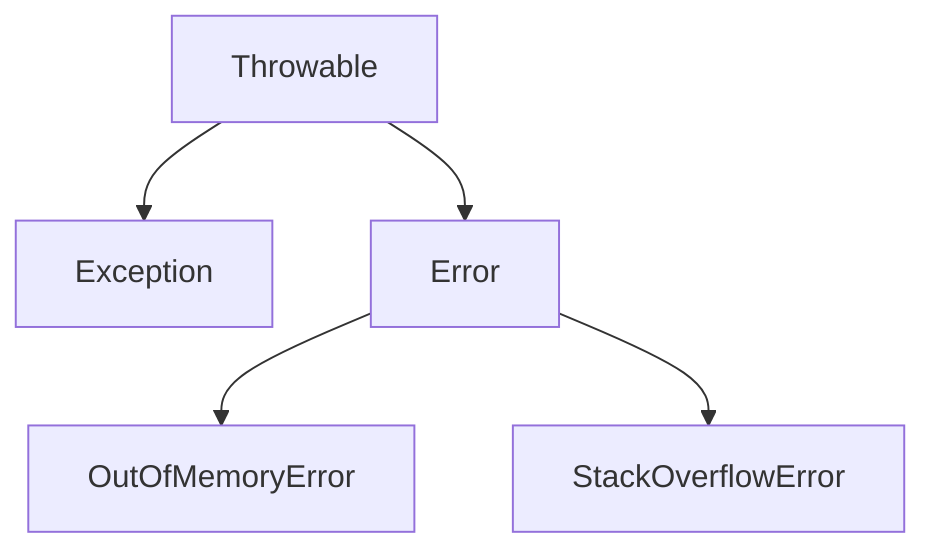

# Java 内存溢出 OOM

## 经典错误

JVM 里最常被放在一起对比的两个错误：

`StackOverflowError`：栈帧一层层堆到虚拟机栈装不下。

`OutOfMemoryError: Java heap space`：堆上分配对象失败。

除此之外，名字同属 `OutOfMemoryError`、原因却不同的还有：

- `java.lang.StackOverflowError`
- `java.lang.OutOfMemoryError: Java heap space`
- `java.lang.OutOfMemoryError: GC overhead limit exceeded`
- `java.lang.OutOfMemoryError: Direct buffer memory`
- `java.lang.OutOfMemoryError: unable to create new native thread`
- `java.lang.OutOfMemoryError: Metaspace`

## 架构

`OutOfMemoryError` 和 `StackOverflowError` 都继承 `Error`，不是 `Exception`。业务里的 `try/catch (Exception)` 接不住它们。它们表示 JVM 已经无法按正常语义继续分配资源。



## StackOverflowError

最容易复现的方式是没有终止条件的递归。每调用一次就压入一个栈帧，默认栈往往只有几百 KB 到 1MB（常见默认约 1MB，可用 `-Xss` 调整），深度上去之后栈被撑破。

```java
/**
 * 无出口递归。栈帧耗尽后抛 StackOverflowError。
 */
public class DeepCallDemo {
    public static void main(String[] args) {
        dive();
    }

    private static void dive() {
        dive();
    }
}
```

运行结果：

```text
Exception in thread "main" java.lang.StackOverflowError
	at DeepCallDemo.dive(DeepCallDemo.java:11)
```

这不是堆不够。把 `-Xmx` 调大没有帮助，要查的是递归终止条件和 `-Xss`。

## OutOfMemoryError

### Java heap space

对象都分配在堆上。堆的上限由 `-Xmx` 决定，一次申请超过剩余空间，就抛堆溢出。

```java
/**
 * 启动参数示例：-Xms12m -Xmx12m
 * 申请 40MB，堆只有 12MB，直接失败。
 */
public class HeapOomDemo {
    public static void main(String[] args) {
        byte[] block = new byte[40 * 1024 * 1024];
        System.out.println(block.length);
    }
}
```

```text
Exception in thread "main" java.lang.OutOfMemoryError: Java heap space
```

### GC overhead limit exceeded

JVM 发现程序把绝大部分时间花在垃圾收集上，而且每次几乎收不回空间，就会抛这个错误。HotSpot 的经验阈值是：大约 98% 的时间在做 GC，回收掉的堆却不到 2%，并且这种情况连续出现多次。

若不去抛这个错误，腾出来的一点点空间马上又被填满，CPU 停在 GC 上，业务线程几乎得不到执行。

为了尽快看到它，把堆压到很小，并打开 GC 日志：

```text
-Xms10m -Xmx10m -XX:+PrintGCDetails
```

循环往列表里塞不会被释放的字符串，活对象越积越多：

```java
import java.util.ArrayList;
import java.util.List;

/**
 * 启动参数：-Xms10m -Xmx10m -XX:+PrintGCDetails
 * 列表一直握着引用，Full GC 收不回空间。
 */
public class GcOverheadDemo {
    public static void main(String[] args) {
        int n = 0;
        List<String> held = new ArrayList<>();
        try {
            while (true) {
                held.add(String.valueOf(++n).intern());
            }
        } catch (Throwable ex) {
            System.out.println("停在 n=" + n);
            ex.printStackTrace();
        }
    }
}
```

日志里会反复出现 Full GC，年轻代和老年代占用几乎不下降，最后：

```text
[Full GC (Ergonomics) ... 9184K->9100K(9728K), ...]
Exception in thread "main" java.lang.OutOfMemoryError: GC overhead limit exceeded
```

数字会随 JDK 略有差别，形态是“回收前后几乎一样大”。

### Direct buffer memory

NIO 和 Netty 会用直接缓冲区。`ByteBuffer.allocateDirect` 通过本地方法向操作系统要堆外内存，Java 堆里只留一个 `DirectByteBuffer` 当作引用。读写不必先把数据在堆和堆外之间拷一遍，所以快。

`ByteBuffer.allocate`：内存算在 Java 堆里，受 GC 管理，和通道交换时常常要多一次拷贝。

`ByteBuffer.allocateDirect`：内存算在堆外，GC 不直接扫描这块本地内存。只有堆里的 `DirectByteBuffer` 被回收，Cleaner 才会把堆外内存还回去。

如果业务一直 `allocateDirect`，堆又很空，GC 迟迟不跑，堆里的引用就不释放，堆外配额先被用光。下一次再申请就会抛 `Direct buffer memory`。现象是堆还很闲，进程已经因为堆外内存失败。

把堆外上限压到 5MB，再申请 6MB：

```text
-Xms10m -Xmx10m -XX:+PrintGCDetails -XX:MaxDirectMemorySize=5m
```

```java
import java.nio.ByteBuffer;

/**
 * MaxDirectMemorySize=5m 时，下面这次分配会失败。
 */
public class DirectOomDemo {
    public static void main(String[] args) {
        System.out.println("direct limit MB = "
                + (sun.misc.VM.maxDirectMemory() / (1024 * 1024)));
        ByteBuffer outside = ByteBuffer.allocateDirect(6 * 1024 * 1024);
        System.out.println(outside.capacity());
    }
}
```

```text
Exception in thread "main" java.lang.OutOfMemoryError: Direct buffer memory
	at java.base/java.nio.Bits.reserveMemory(Bits.java:...)
	at java.base/java.nio.DirectByteBuffer.<init>(DirectByteBuffer.java:...)
```

JDK 9 之后 `sun.misc.VM` 被封装，打印上限可以改用 `jdk.internal` 或干脆删掉那一行，异常信息本身已经说明是堆外配额。

### unable to create new native thread

错误表示操作系统拒绝再为这个进程创建本地线程，不是 Java 堆不够。

高并发服务若来一个请求就 `new Thread`，很容易撞上进程的线程上限。

常见原因：

- 应用创建的线程数超过了系统能承载的数量，每条线程还要占栈空间
- Linux 对单个用户或进程的线程数有 `ulimit -u` 限制，默认常见是 1024 或更高。超过之后就会看到 `unable to create new native thread`

处理方向：

1. 先减少线程数量。用有界线程池代替“请求到了再 new”。多数业务并不需要几千条同时睡眠的线程。
2. 确认业务模型确实需要更多线程后，再评估抬高 `nproc` / `ulimit -u`，同时看内存够不够支撑每条线程的栈。

```java
import java.util.concurrent.TimeUnit;

/**
 * 仅用于理解错误形态。不要在生产机器上跑，它会把进程线程数打满。
 */
public class NativeThreadOomDemo {
    public static void main(String[] args) {
        for (int i = 0; ; i++) {
            System.out.println("started = " + i);
            new Thread(() -> {
                try {
                    TimeUnit.HOURS.sleep(8);
                } catch (InterruptedException ex) {
                    Thread.currentThread().interrupt();
                }
            }, "sleeper-" + i).start();
        }
    }
}
```

线程数接近限制时：

```text
Exception in thread "main" java.lang.OutOfMemoryError: unable to create new native thread
```

查看当前用户可创建的最大进程/线程数：

```text
ulimit -u
```

### Metaspace

元空间存放类的元数据，使用的是本地内存，不是 `-Xmx` 那块 Java 堆。`-XX:MetaspaceSize` 是触发回收的阈值，默认大约二十多 MB；真正的上限是 `-XX:MaxMetaspaceSize`，不设置时受本地内存限制。

方法区里主要是：

- 已被加载的类信息
- 运行时常量池
- 即时编译后的代码

静态变量在 JDK 8 之后跟类对象一起放在堆上，不要和元空间混为一谈。类的结构信息才在元空间。

要模拟溢出，需要不断生成新类，而不是不断 `new` 同一个类的实例。可以用字节码库在运行时造子类，并把元空间上限压小：

```text
-XX:MetaspaceSize=8m -XX:MaxMetaspaceSize=8m
```

```java
import net.sf.cglib.proxy.Enhancer;
import net.sf.cglib.proxy.MethodInterceptor;

/**
 * 启动参数：-XX:MetaspaceSize=8m -XX:MaxMetaspaceSize=8m
 * 需要 cglib 在类路径上。每个增强类都会占用元空间。
 */
public class MetaOomDemo {
    static class Dummy {
    }

    public static void main(String[] args) {
        int created = 0;
        try {
            while (true) {
                created++;
                Enhancer enhancer = new Enhancer();
                enhancer.setSuperclass(Dummy.class);
                enhancer.setUseCache(false);
                enhancer.setCallback((MethodInterceptor) (obj, method, params, proxy) ->
                        proxy.invokeSuper(obj, params));
                enhancer.create();
            }
        } catch (Throwable ex) {
            System.out.println("创建到第 " + created + " 个类时失败");
            ex.printStackTrace();
        }
    }
}
```

失败形态：

```text
创建到第 180 个类时失败
java.lang.OutOfMemoryError: Metaspace
```

次数随类的大小和 JDK 版本变化。若没有 cglib，可以用 JDK 自带的 `Proxy` 不断生成新接口的代理类，效果相同：类加载器握着这些 Class，元空间不释放。
