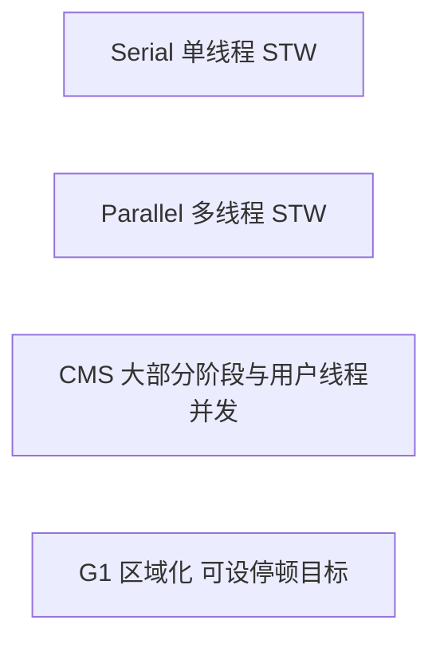
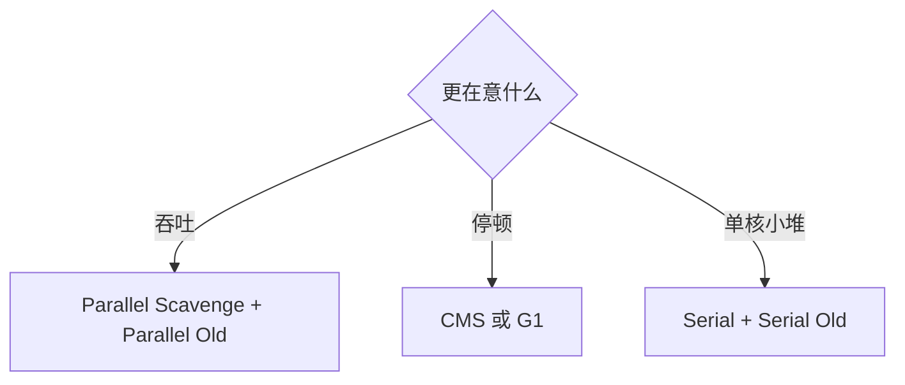
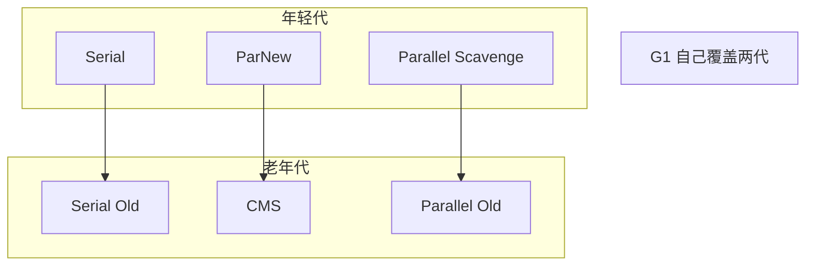
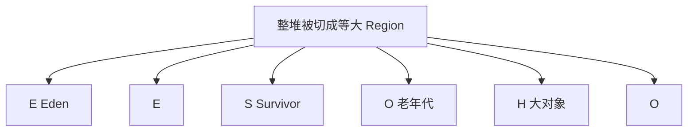

# 垃圾收集器

## 算法和收集器各自回答什么问题

算法回答“怎么判断和怎么清扫”，收集器回答“用几条线程、停不停用户程序、在哪一代上做”。没有一种收集器在所有业务上都最好，所以 HotSpot 按分代把几种收集器配在一起。

常见算法：

- 引用计数：几乎不用，解决不了循环引用
- 复制：年轻代，活对象少，拷贝成本低
- 标记清除：老年代可用，速度快，留下碎片
- 标记整理：老年代常用，把活对象挪到一边，消除碎片

## 四种主要的垃圾收集器

- Serial：单线程回收，参数 `-XX:+UseSerialGC`
- Parallel：多线程回收，仍会停用户线程，参数 `-XX:+UseParallelGC`
- CMS：并发标记清除，追求短停顿
- G1：按区域收集，JDK 9 之后很多环境的默认选择
- ZGC：JDK 11 引入，面向超大堆和更低停顿，本篇只点到名字



### Serial

只派一条线程做收集，收集期间所有用户线程停住（Stop-The-World）。没有线程切换开销，单核或小堆上很稳。服务器上堆一大，停顿会非常明显，所以不适合作为在线服务的默认选择。

### Parallel

又叫吞吐量优先。年轻代是 Parallel Scavenge，老年代是 Parallel Old。收集时仍然停用户线程，但用多条 GC 线程一起扫。科学计算、离线批处理这种“停一下没关系，但要尽快算完”的场景合适。单核上多条 GC 线程只会互相抢，可能比 Serial 更慢。

### CMS

Concurrent Mark Sweep。目标是把停顿拆短。初始标记和重新标记仍要短暂停用户线程，耗时的并发标记和并发清除与用户线程一起进行。在线接口对响应时间敏感时，CMS 曾经是主流。它用标记清除，所以老年代会碎；并发阶段也更吃 CPU。

### G1

把堆切成许多等大的 Region，每次优先收集垃圾最多的区域，因此叫 Garbage First。年轻代回收仍会停用户线程，但停顿范围按区域控制，而不是每次都扫完整片老年代。

## 垃圾收集器总结

并行收集在单核上可能更慢，因为 GC 线程本身要调度。多核上，Parallel 用停顿换吞吐，CMS 和 G1 用更多 CPU 换更短的单次停顿。



## 查看默认垃圾收集器

启动时加上：

```text
-XX:+PrintCommandLineFlags
```

输出末尾能看到实际选中的收集器，例如 JDK 8 上常见：

```text
-XX:InitialHeapSize=268435456 -XX:MaxHeapSize=4294967296 -XX:+PrintCommandLineFlags -XX:+UseParallelGC
```

`-XX:+UseParallelGC` 表示这台 JDK 8 默认走并行收集。JDK 9 及以后很多发行版改成了 `-XX:+UseG1GC`，不要背死某一种默认值。

## 默认垃圾收集器有哪些

HotSpot 里常被一起提到的组合开关：

- `UseSerialGC`：年轻代 Serial，老年代 Serial Old
- `UseParallelGC`：年轻代 Parallel Scavenge，并带上老年代 Parallel Old
- `UseConcMarkSweepGC`：CMS。JDK 14 移除了 CMS，新版本不要再写这个开关
- `UseParNewGC`：年轻代 ParNew，通常配 CMS
- `UseParallelOldGC`：老年代并行压缩，和 `UseParallelGC` 会互相打开
- `UseG1GC`：整堆交给 G1
- `UseSerialOldGC`：单独的老年代串行收集，后期已经不作为推荐开关

## 各垃圾收集器的使用范围

年轻代：

- Serial：复制算法，单线程
- Parallel Scavenge：复制算法，多线程，关注吞吐
- ParNew：Serial 的多线程版，主要用来配 CMS

老年代：

- Serial Old：标记整理，单线程
- Parallel Old：标记整理，多线程
- CMS：标记清除，并发

整堆都能管的：

- G1：整体看是标记整理，区域之间用复制，所以碎片少



## 部分参数说明

GC 日志里的区名：

- `DefNew`：Serial 的年轻代
- `Tenured`：Serial 的老年代
- `ParNew`：ParNew 收集器的年轻代
- `PSYoungGen`：Parallel Scavenge
- `ParOldGen`：Parallel Old

看到日志前缀，就能反推当前用的是哪一套。

## Java 中的 Server 和 Client 模式

早期 HotSpot 有 Client 和 Server 两套默认 ergonomics。Client 偏向启动快，Server 偏向运行起来之后的吞吐。

- 32 位 Windows 曾经默认 Client
- 32 位其他系统在内存和 CPU 足够时用 Server
- 64 位只有 Server

JDK 8 之后 64 位已经是绝对主流，面试里知道“64 位没有 Client 模式”即可，不必再按 32 位表去记默认收集器。

## 新生代下的垃圾收集器

### 串行 GC（Serial）

单线程收集器。回收时必须停下其他所有工作线程，直到这一轮结束。

它最老，也最稳定。单 CPU 上没有 GC 线程之间的协作成本，单线程收集效率最高。客户端小程序、堆很小的时候仍然够用。

参数：`-XX:+UseSerialGC`

打开后是 Serial（年轻代，复制）加 Serial Old（老年代，标记整理）。

```text
-Xms10m -Xmx10m -XX:+PrintGCDetails -XX:+PrintCommandLineFlags -XX:+UseSerialGC
```

### 并行 GC（ParNew）

多线程版的年轻代 Serial。收集时同样 Stop-The-World，只是 GC 线程变多。

ParNew 的典型搭配是老年代 CMS。行为上和 Serial 一样，包括复制算法和对象晋升。它曾经是 Server 模式下、准备配 CMS 时的年轻代默认选择。

参数：`-XX:+UseParNewGC` 只影响年轻代。JDK 8 上它常和 Serial Old 配在一起，并打印“不再推荐”的警告。JDK 9 之后这个开关的可用性和 CMS 绑在一起，新代码不要单独打开它。

```text
-Xms10m -Xmx10m -XX:+PrintGCDetails -XX:+PrintCommandLineFlags -XX:+UseParNewGC
```

`-XX:ParallelGCThreads` 限制 GC 线程数，默认和 CPU 数相关。

### 并行回收 GC（Parallel / Parallel Scavenge）

JDK 8 的年轻代默认。Parallel Scavenge 也用复制算法，也是多线程，和 ParNew 的差别在于目标：它要的是吞吐，不是和 CMS 配合。

吞吐定义为：

```text
用户代码时间 / (用户代码时间 + 垃圾收集时间)
```

跑 100 分钟，其中 GC 占 1 分钟，吞吐就是 99%。后台批处理在意这个比例，不太在意某一次停顿是 200 毫秒还是 800 毫秒。

它还有自适应策略：JVM 按运行情况调整年轻代大小和晋升阈值，尽量逼近 `-XX:MaxGCPauseMillis` 或最大吞吐。ParNew 没有这套自适应。

参数 `-XX:+UseParallelGC` 和 `-XX:+UseParallelOldGC` 会互相激活。年轻代复制，老年代标记整理。

```text
-Xms10m -Xmx10m -XX:+PrintGCDetails -XX:+PrintCommandLineFlags -XX:+UseParallelGC
```

## 老年代下的垃圾收集器

### 串行 GC（Serial Old）

Serial 的老年代版本，单线程，标记整理。Client 模式下它是默认老年代收集器。

Server 模式下的两个历史用途：

- JDK 5 之前，Parallel Scavenge 只能配 Serial Old，整堆吞吐保证不了
- CMS 并发失败时，用 Serial Old 做一次停顿式的后备收集

单独打开老年代串行收集已经不被推荐。写成下面这样在新 JDK 上可能直接无法识别：

```text
-XX:+UseSerialGC
```

需要整堆串行时用 `UseSerialGC`，不要再找已经删除的独立开关。

### 并行 GC（Parallel Old）

Parallel Scavenge 的老年代版本，JDK 6 才提供，多线程标记整理。

在它出现之前，年轻代可以吞吐优先，老年代仍是单线程 Serial Old，整堆被老年代拖住。JDK 8 的默认搭配就是 Parallel Scavenge 加 Parallel Old。

```text
-XX:+UseParallelOldGC
```

打开之后年轻代和老年代都走并行收集。

```text
-Xms10m -Xmx10m -XX:+PrintGCDetails -XX:+PrintCommandLineFlags -XX:+UseParallelOldGC
```

### 并发标记清除 GC（CMS）

CMS 的目标是最短的回收停顿，适合在线系统，而不是批处理。堆大、核多时，它在 G1 普及前是首选。

并发的意思是：耗时阶段和用户线程一起跑，不是“GC 线程之间并行、用户线程全停”。

参数：`-XX:+UseConcMarkSweepGC`。打开后年轻代会连同 ParNew，失败时由 Serial Old 兜底。

```text
-Xms10m -Xmx10m -XX:+PrintGCDetails -XX:+UseConcMarkSweepGC
```

JDK 9 起 CMS 被标记废弃，JDK 14 删除。下面的步骤用来理解它为什么停顿短、又为什么会被 G1 换掉。

#### 四个步骤

- 初始标记：只标出 GC Roots 能直接指到的对象，很快，但要停用户线程
- 并发标记：从那些直接对象继续往下追，和用户线程一起跑，不停业务。这一步最耗时
- 重新标记：并发标记期间用户线程还在改引用，所以再停一小段，把变动修正掉
- 并发清除：按标记把不可达对象清掉，又和用户线程一起跑


优点是大部分时间业务还在跑，单次停顿短。

缺点有两条。并发标记和清除占 CPU，核少的机器会感觉业务变慢。标记清除不压缩，老年代逐渐碎掉。

因为用户线程同时在分配，CMS 不能等到老年代 100% 才开始，否则来不及收。来不及时触发后备：Serial Old 用 Stop-The-World 做一次整理，停顿会突然变长。

碎片最终仍要压缩。`-XX:CMSFullGCsBeforeCompaction` 用来指定经过多少次 CMS 之后做一次带压缩的 Full GC，默认 0 表示每次都考虑压缩。这个参数随 CMS 一起退出了历史舞台。

## 两代为什么不用同一种清扫办法

### 年轻代适合拷走幸存者

年轻代里大多数对象朝生夕灭，一次回收往往只有不到两成存活。标记清除会在 Eden 里留下大量碎片；复制算法把少数活对象拷到 Survivor，剩下的空间整块丢弃，又快又整齐。预留一块空的 Survivor 是值得的。

### 老年代采用标记整理

老年代空间大，对象存活率高。若用复制，就得留出几乎一半的空区域，浪费太大。标记整理在标记清除的基础上把活对象挪紧，既不用双倍空间，又避免碎片。代价是移动对象时要修正引用，所以通常发生在停顿里。

## 垃圾收集器如何选择

### 组合的选择

- 单核或堆很小的本地程序
  - `-XX:+UseSerialGC`
- 多核，要吞吐，例如后台计算
  - `-XX:+UseParallelGC`
  - `-XX:+UseParallelOldGC`
- 多核，要短停顿，例如在线接口
  - JDK 8 可以 `-XX:+UseConcMarkSweepGC`（会带上 ParNew）
  - JDK 9 之后优先 `-XX:+UseG1GC`

| 参数 | 年轻代 | 年轻代算法 | 老年代 | 老年代算法 |
| --- | --- | --- | --- | --- |
| -XX:+UseSerialGC | Serial | 复制 | Serial Old | 标记整理 |
| -XX:+UseParNewGC | ParNew | 复制 | Serial Old | 标记整理 |
| -XX:+UseParallelGC | Parallel Scavenge | 复制 | Parallel Old | 标记整理 |
| -XX:+UseConcMarkSweepGC | ParNew | 复制 | CMS，失败时 Serial Old 兜底 | 标记清除 |
| -XX:+UseG1GC | G1 按区域 | 区域间复制 | G1 同一套区域 | 整体标记整理 |

## G1 垃圾收集器

### 开启 G1 垃圾收集器

```text
-XX:+UseG1GC
```

### 以前收集器的特点

- 年轻代和老年代是两块连续内存
- 年轻代固定是一块 Eden 加两块 Survivor，用复制
- 老年代收集常常要扫完整片老年代
- 设计目标是尽快把这一轮做完，停顿上限不好承诺

### G1 是什么

G1 面向服务端、多核和大堆。它希望吞吐不要掉太多，同时把停顿压在可预期的范围内。

特征：

- 和 CMS 一样，部分阶段与应用程序并发
- 复制活对象时顺手整理空间，碎片少
- 可以用停顿预测挑选本轮要收的区域
- 不靠把堆无限加大来掩盖碎片

相对 CMS：

- G1 有整理过程，不会把老年代切成无法分配的碎片
- 停顿更可预期。用户给出期望停顿，G1 选择垃圾比例最高、能在时限内收完的那些区域

CMS 把停顿缩短了，但碎片还在。G1 在 JDK 7 后期可用，JDK 9 成为默认，用来接替 CMS。主要变化是 Eden、Survivor、老年代不再是三块固定的连续区间，而是一组大小相等的 Region，每块大约 1MB 到 32MB。某一块 Region 这一轮可以是 Eden，下一轮可以变成老年代。

### 特点

- 能用多核并行缩短停顿里的拷贝时间
- 整体是标记整理，局部用复制，避免碎片
- 宏观上把堆画成许多小格，像棋盘，而不是两块大平板
- 逻辑上仍有年轻代和老年代，只是它们由一组不必相邻的 Region 组成
- 不需要一块永远空着的整代 Survivor。每个 Region 的角色会变

### 底层原理

按区域收集，就不必每次扫描整堆。垃圾多的区域优先，这是 Garbage First 的含义。

JVM 启动时选定 Region 大小，也可以用 `-XX:G1HeapRegionSize` 指定，必须是 2 的幂，范围 1MB 到 32MB。默认把堆分成大约 2048 块。

因此单块最大 32MB、块数约 2048 时，经验上的舒适堆上限大约是 32MB × 2048 = 64GB。更大的堆往往改用 ZGC 或 Shenandoah。

对象不要求在物理上挤在同一块里，逻辑上仍属于某一代。Region 也不会终身固定身份。

### Region 区域化

G1 取消了“年轻代必须是地址空间左侧一整块”的限制。



年轻代回收仍会暂停应用线程，把活对象拷到 Survivor 或老年代 Region。

老年代的清理也是把活对象复制到别的 Region，源区域整个变空。复制的同时完成了压缩，所以没有 CMS 那种“清完却越来越碎”的问题。

超过 Region 一半的对象称为巨型对象，放进 Humongous 区域。短命的巨型对象很伤：它们直接占老年代，回收又常常要等并发周期甚至 Full GC。一个对象若跨多块 H 区，G1 还得找连续的 Region，找不到就可能退化为整堆收集。

### 回收步骤

Eden 用尽触发年轻代回收。范围只包括当前年轻代的那些 Region：

- Eden 的活对象进 Survivor；Survivor 装不下或年龄到了，就进老年代 Region
- 原 Survivor 里仍然年轻的对象拷到新的 Survivor Region
- 这一轮的 Eden Region 被整块清空，业务线程继续分配

回收之后空出来的是连续的 Region，而不是碎洞，所以后续大对象更容易放下。

### 四步过程

并发周期和 CMS 同构，但最后一步按收益挑选区域：

- 初始标记：只标 GC Roots 直接关联的对象，通常搭在一次年轻代回收上
- 并发标记：从根往下追踪
- 最终标记：处理并发期间引用的变化
- 筛选回收：根据停顿预算，挑垃圾最多的 Region 做复制回收


### 参数配置

大多数服务只需要三样：

```text
-XX:+UseG1GC  -Xmx32g  -XX:MaxGCPauseMillis=100
```

`MaxGCPauseMillis` 是软目标，单位毫秒。G1 会尽量让停顿低于它，但堆太小、活对象太多时达不到，也不会为了目标把数据收错。

### G1 和 CMS 比较

- G1 通过复制整理空间，不产生 CMS 那种标记清除碎片
- 停顿可以按目标去选区域。每一轮只收垃圾比例高、预计能在时限内做完的那些 Region，而不是总是面对整片老年代

## 启动参数示例

服务进程启动时把堆和收集器写在 `java` 命令上，而不是写进业务代码：

```text
java -Xms1024m -Xmx1024m -XX:+UseG1GC -jar order-service.jar
```

`-Xms` 和 `-Xmx` 保持一致，避免运行中扩堆。收集器是否真的是 G1，用前面的 `-XX:+PrintCommandLineFlags` 或 JDK 9 的 `-Xlog:gc*` 核对一次即可。
