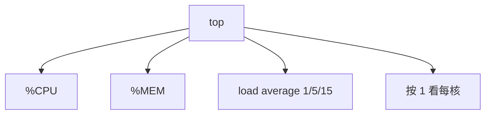
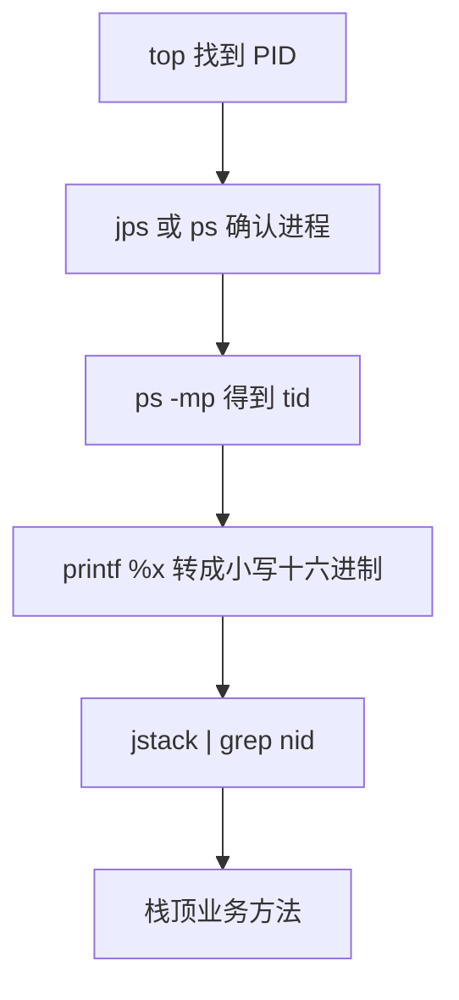

# Linux 诊断思路

## 命令集合

### 整机：top，查看整机系统性能

`top` 打开后优先看三列：`%CPU`、`%MEM`，以及顶部的 `load average`。

- `load average` 的三个数依次是 1 分钟、5 分钟、15 分钟的平均运行队列长度。多核机器上，长期高于 CPU 核数，说明可运行任务在排队。

在 `top` 界面按 `1`，负载会拆到每一颗逻辑核。

`uptime` 只保留负载和运行时间。



### CPU：vmstat

- 看 CPU，也顺带看进程排队和块设备
- 想再拆细时：
  - 每颗核的统计：`mpstat -P ALL 2`
  - 某个进程的 CPU 分解：`pidstat -u 1 -p 进程号`

命令格式：`vmstat -n 2 3`

两个数字里，前一个是采样间隔（秒），后一个是采样次数。`-n` 让表头只打印一次。

**procs**

`r`：正在运行或等 CPU 的进程数。经验上，单核运行队列不要长期超过 2，整机不要长期超过核数的 2 倍，否则 CPU 侧已经排起队。

`b`：因为资源不可用而停住的进程数，常见是在等磁盘或网络。

**cpu**

`us`：用户态消耗的百分比。长期高于 50%，优先从业务代码找热点。

`sy`：内核态消耗的百分比。过高时看系统调用、锁、中断。

`us + sy` 长期高于 80%，多半是算力不够或代码过热。若两者之和仍低，却觉得慢，就不要先加 CPU，去看 `wa`。

`id`：空闲百分比。

`wa`：等待 I/O 的百分比。它高而 `us` 不高，瓶颈在磁盘或网络，不在纯计算。

`st`：虚拟机里被宿主机抽走的 CPU 时间比例。

### 内存：free

- 看应用还能用多少：`free -m`
- 可用内存 / 物理内存大于约 70%：内存宽裕
- 可用内存 / 物理内存小于约 20%：内存紧张，考虑加内存或查泄漏
- 落在两者之间：基本够用，仍要看是否在缓慢下降

`free -h` 按人类可读单位显示。`free -m` 以 MiB 计，`free -g` 以 GiB 计。

看 `available`，不要只看 `free`。缓存可回收，`available` 才接近还能申请的量。

```text
              total        used        free      shared  buff/cache   available
Mem:          15987        6120         820         210        9047       9310
```

上面这份样例里，available / total 大约是 58%，落在“基本够用”的区间。

### 硬盘：df

格式：`df -h /`。`-h` 把块数换算成 K/M/G。

关注挂载点的 `Use%`。根分区长期高于 85%，日志和临时文件就可能把后续写入堵住。

- 硬盘 IO：`iostat`

机器变慢通常来自两类：CPU 打满，或 I/O 打满。

格式：`iostat -xdk 2 3`

磁盘块设备里常用这几列：

`rkB/s`：每秒读出的数据量，单位 KB。

`wkB/s`：每秒写入的数据量，单位 KB。

`svctm`：平均服务时间，毫秒。新版本 sysstat 里该列可能被去掉，可用 `await` 配合利用率一起看。

`await`：平均等待时间，毫秒，包含排队。越小越好。

`util`：采样期内设备有多长时间在处理 I/O。接近 100% 说明带宽或队列已经饱和，需要减少读写或加盘。

`rkB/s`、`wkB/s` 没有统一阈值，但持续的超大读写不正常，应回到程序里看是不是全表扫描或日志刷盘过猛。

`await` 接近服务时间，说明几乎没有排队；`await` 远大于服务时间，说明请求堆在队列里，要优化访问模式或换更快的盘。

### 网络 IO：ifstat

不少发行版默认没装 `ifstat`。装好后能看到每块网卡每秒的进、出流量。连接和丢包改用 `ss -s` 或 `sar -n DEV 1`。

## 生产环境服务器变慢，诊断思路和性能评估

一次 CPU 被打满的排查，可以把 Linux 命令和 JDK 命令串起来：

- 用 `top` 找出 CPU 最高的进程，记下 PID
- `ps -ef | grep PID` 或 `jps -l` 确认它是哪一个 Java 服务
- 再定位到线程：
  - `ps -mp 进程号 -o THREAD,tid,time`
  - 参数：`-m` 展开线程，`-p` 指定进程，`-o` 选择列。`tid` 是线程号，`time` 是累计 CPU 时间
- 把最耗 CPU 的十进制线程号转成小写十六进制，因为 `jstack` 里的 nid 是十六进制：
  - `printf "%x\n" 线程号`
- `jstack 进程号 | grep nid -A 40`，`nid` 写成 `0x` 加刚才的十六进制。往下几十行就是该线程的 Java 栈，能看到停在哪一个方法



栈停在业务循环就回到代码；大量线程停在网络读，就先查下游超时。
