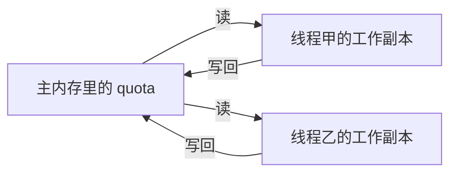

- JUC（`java.util.concurrent`）
  - 进程和线程
    - 进程：操作系统调度的资源容器。打开一个独立程序，通常就是一个进程，它有自己的地址空间。
    - 线程：进程里的执行流。同一个进程的多个线程共享堆和方法区，各自有栈和程序计数器。一个编辑器里同时跑界面刷新和自动保存，就是多条线程。
  - 并发和并行
    - 并发：一段时间内多条执行流都在推进，单核上靠时间片交替也能并发。
    - 并行：同一时刻真有多颗核心各自执行指令。
- JUC 里常被一起提到的三个包
  - `java.util.concurrent`
  - `java.util.concurrent.atomic`
  - `java.util.concurrent.locks`

## 谈谈对 Volatile 的理解

只在一个线程里读写字段时，用不上 `volatile`。编译器已经保证单线程结果正确。

- `volatile` 是 JVM 提供的轻量同步手段，它覆盖三条里的两条：
  - 保证可见性
  - 不保证原子性
  - 禁止会破坏其语义的指令重排

## JMM 是什么

JMM 是 Java Memory Model 的缩写，一套关于读写共享变量的规则，不是一块真实划出来的内存条。它规定实例字段、静态字段以及数组元素该如何在线程之间传递。

和锁相关的三条约定是：

- 解锁之前，必须把工作内存里改过的共享变量刷回主内存
- 加锁之前，必须把主内存的新值读进自己的工作内存
- 加锁和解锁必须配同一把锁

JVM 真正调度的是线程。每个线程有私有的工作内存（可以理解成寄存器和缓存里的一份副本）。JMM 规定共享变量的本体在主内存。线程不能绕过工作内存直接改主内存：先拷贝，再在本地改，最后写回。线程之间看不见对方的工作内存，传递新值只能经过主内存。



速度上，硬盘慢于内存，内存慢于高速缓存，缓存又慢于寄存器。正因为有多级缓存，才会出现“甲已经写了，乙还拿着旧副本”。

两个词再分开说：

- 主内存：JMM 的抽象共享区，所有线程最终都要在这里汇合。它不是“机器上的 16G 内存条”本身，但可以对应到那块对所有核心可见的存储层次。

- 工作内存：`new Student()` 之后，`age = 25` 的本体在主内存。三个线程同时读 `age`，就会各自拷一份到工作内存。之后谁改了本地副本，别人不会自动跟着变，除非按 JMM 的规则写回并让对方重新读。

可见性指的就是：主内存被某个线程写过之后，其他线程能知道副本已失效，并重新拿到新值。

## 缓存一致性

一个值被改写后，别的核心为什么能发现？靠的是缓存一致性协议，总线嗅探是实现手段之一。

多颗处理器同时缓存同一块主存地址时，各自的副本可能分叉。为了把它们拉齐，读写要遵守协议。常见的有 MSI、MESI。

### MESI

核心准备写一个共享变量时，若其他核心也缓存了这一行，它会发出失效消息。其他核心把对应缓存行标成 Invalid。之后谁再读，发现行已经无效，就从主存或仍持有最新副本的核心重新装载。

四个状态可以记成：Modified（本核改过、尚未写回）、Exclusive（只有本核有、与主存一致）、Shared（多核只读副本）、Invalid（不能再信）。

### 总线嗅探

核心如何知道自己的行过期？它一直监听总线上的事务。发现某个地址被别的核心写过，就把本地对应行标成无效。下一次本核要读或写，会重新取一份新数据，而不是继续用旧行。

### 总线风暴

嗅探不是免费的。大量 `volatile` 写会在总线上来回广播失效，CAS 失败又会反复读同一行。无效流量把总线打满时，整体吞吐下降。所以不要把每个字段都标成 `volatile`。短临界区、单变量状态用它合适；复合操作、需要互斥的结构仍然用锁。

## JMM 的特性

JMM 要求可见性、原子性、有序性。`volatile` 管前者和有序性，不管复合操作的原子性。

- 可见性
- 原子性
- 有序性

## 可见性代码验证

字段不加任何同步修饰时，一个线程的写入，另一个线程可能一直看不见。

```java
import java.util.concurrent.TimeUnit;

/**
 * 共享状态。quota 不加 volatile 时，主线程可能永远停在循环里。
 */
class QuotaBox {
    int quota = 0;

    public void raiseTo80() {
        this.quota = 80;
    }
}

/**
 * 先不加 volatile，观察主线程是否能离开自旋。
 */
public class VisibilityDemo {

    public static void main(String[] args) {
        QuotaBox box = new QuotaBox();

        new Thread(() -> {
            System.out.println(Thread.currentThread().getName() + " 进入");
            try {
                TimeUnit.SECONDS.sleep(2);
            } catch (InterruptedException ex) {
                Thread.currentThread().interrupt();
            }
            box.raiseTo80();
            System.out.println(Thread.currentThread().getName() + " 已写成 " + box.quota);
        }, "writer").start();

        while (box.quota == 0) {
            // 主线程只在寄存器里反复看自己的副本
        }

        // 能走到这里，说明主线程看见了 80
        System.out.println(Thread.currentThread().getName() + " 观察到更新，结束");
    }
}
```

不加 `volatile` 时，常见现象是 writer 打出“已写成 80”，主线程仍不打印结束语，进程停住。主线程把 `quota == 0` 提升成了寄存器判断，writer 写回主内存也唤醒不了它。这就是没有可见性。

把字段改成 `volatile`：

```java
class QuotaBox {
    /**
     * 写入会让其他线程的缓存行失效，读取会重新取主内存。
     */
    volatile int quota = 0;

    public void raiseTo80() {
        this.quota = 80;
    }
}
```

这时主线程会离开循环，并打印“观察到更新，结束”。`volatile` 读不能被缓存成“永远是 0”，写也会带着释放语义把 80 推到其他线程可见的地方。

睡眠只是为了让主线程先进入循环。可见性本身不依赖这 2 秒；没有 `volatile` 时，即使 writer 已经写完，主线程仍可能出不来。
