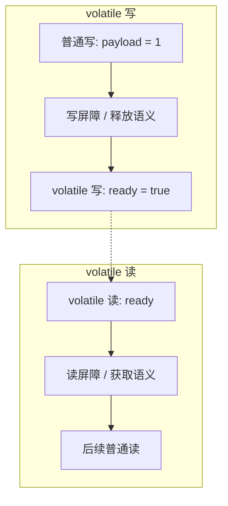

# Volatile 禁止指令重排

程序真正跑起来之前，语句可能被调整三次：

```text
源代码 -> 编译器优化重排 -> 指令级并行重排 -> 内存系统重排 -> 最终执行的指令
```

单线程下，重排的结果必须和按源码顺序执行的结果一致。处理器重排时要尊重指令之间的数据依赖：后一条要用前一条的结果，就不能把它挪到前面。

多线程交替执行时，两个线程各自看到的变量没有跨线程的数据依赖，编译器就可能重排。另一个线程观察到的中间状态因此无法预测。

## 指令重排 - example 1

```java
public void adjust() {
    int p = 4;
    int q = 7;
    p = p + 3;
    q = p * p;
}
```

单线程的书写顺序是 1、2、3、4。多线程观察时，没有依赖的语句可能变成：

- 2、1、3、4
- 1、3、2、4

这就是重排：机器内部的次序和源码行号不一致。

下面这种次序不会出现：

- 4、3、2、1

第 4 步要读 `q` 的定义，还要读已经更新过的 `p`。依赖还在，处理器不能把乘法挪到加法前面。

### 例子

四个变量初值都是 0：`a = b = x = y = 0`。

| 线程甲 | 线程乙 |
| --- | --- |
| x = a | y = b |
| b = 1 | a = 2 |

若两边都按书写顺序，并且交错得比较“碰巧”，可能读到 `x = 0, y = 0`。

这四条赋值之间没有数据依赖，编译器或 CPU 可以改成：

| 线程甲 | 线程乙 |
| --- | --- |
| b = 1 | a = 2 |
| x = a | y = b |

此时可能读到 `x = 2, y = 1`。同一份源码，观察结果和“先读再写”的直觉不一致。`volatile` 写和读两侧插入屏障，就是为了禁止这种跨线程可见的重排。

## 指令重排 - example 2

```java
/**
 * 演示标志位被提前写出去之后，另一个线程可能读到还没准备好的数值。
 */
public class ReadyFlagDemo {
    int payload = 0;
    boolean ready = false;

    public void publish() {
        payload = 1;
        ready = true;
    }

    public void consume() {
        if (ready) {
            payload = payload + 5;
            System.out.println("seen:" + payload);
        }
    }
}
```

若 `publish` 完整发生在 `consume` 之前，打印的是 6。

两个方法之间没有编译器能看见的数据依赖，书写顺序是：

```text
payload = 1;
ready = true;

payload = payload + 5;
System.out.println("seen:" + payload);
```

重排后可能变成：

```text
ready = true;

payload = payload + 5;
System.out.println("seen:" + payload);

payload = 1;
```

线程乙刚看到 `ready == true` 就进入分支，此时 `payload` 还是 0，加 5 之后打印 5，随后线程甲才把 1 写回去。数据在两个线程之间对不上。

原因就是：多线程交替执行，编译器优化允许在没有依赖的语句之间换序，两个线程对同一组变量的观察没有共同的时间线。

把 `ready` 声明为 `volatile` 后，对它的写会带上释放屏障，之前的普通写不能跑到这条写之后；对它的读会带上获取屏障，后面的读不能跑到这条读之前。乙一旦看见 `ready == true`，就一定能看见 `payload = 1`。

## Volatile 针对指令重排做了啥

`volatile` 通过禁止特定方向的重排，避免多线程看见乱序。

内存屏障（Memory Barrier，也叫内存栅栏）是一类 CPU 约束，作用有两面：

- 把指定操作的相对顺序固定住
- 把缓冲区里的数据推到对其他 CPU 可见的层次，从而实现可见性

编译器和处理器都能重排。在两条指令之间插入屏障，等于声明：屏障之前的相关操作不能挪到后面，屏障之后的相关操作不能挪到前面。屏障还会让当前 CPU 的缓冲对其他 CPU 可见，于是其他线程读到的是新值。



也就是在 volatile 写之前、volatile 读之后安上屏障，不让标志位跑到数据准备完成之前。

## 线程安全获得保证

工作内存和主内存同步滞后，会造成可见性问题。

- `synchronized` 或 `volatile` 都能让一个线程的写入及时被其他线程看见。锁靠解锁时刷新、加锁时重读；volatile 靠屏障和缓存一致性协议。

指令重排带来的有序性问题，同时也是一种可见性错觉。

- `volatile` 专门禁止会破坏其语义的重排，所以它同时覆盖可见性和有序性。它仍然不保证 `count++` 这种读改写的原子性。

## 总线嗅探

多个 CPU 各自有缓存。某核改了共享行，会在总线上广播失效，其他核把对应行标成无效，下次再从内存重新取。volatile 写能被较快看见，靠的就是这套嗅探。
