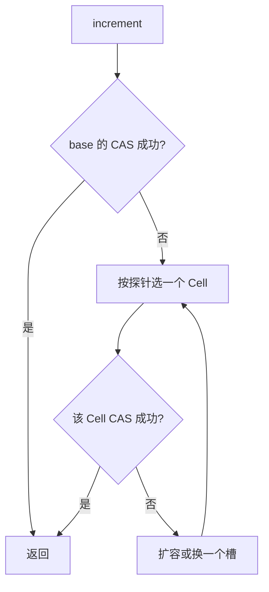

# 原子类 AtomicInteger 的 ABA 问题

## 连环套路

从 `AtomicInteger` 往下追，问题会连成一条：

CAS 做什么 → 它为什么要经过 Unsafe → 失败后为什么会自旋 → 自旋只看头尾会漏掉什么 → 这就是 ABA → 用原子引用替换整个对象 → 再用版本号把 ABA 挡在外面。

## ABA 问题是什么

可以把它想成“票据被掉包又放了回来”。

线程甲准备把库存从 80 改成 50，手里的预期值是 80，但甲在真正 CAS 之前被挂起了几秒。线程乙更快：把 80 改成 0，完成一次出库，又把 80 补了回去。甲恢复后看到内存仍是 80，和预期一致，CAS 成功。甲不知道中间已经发生过出库和补货，账上的 80 不是它当初看见的那 80。

所以 ABA 指的是：从读到旧值，到拿这个旧值去做 CAS，中间变量被改过任意次，最后又回到了原来的数值。

## CAS 导致 ABA 问题

CAS 的前提是“我读到的那个瞬间”和“我写入的这个瞬间”之间，值如果没变，就可以替换。这两个瞬间之间有空档。

线程甲从位置 V 读到 A。线程乙也读到 A，把 V 改成 B，做完自己的业务，再把 V 改回 A。甲执行 CAS 时仍看到 A，于是成功。

甲的 CAS 在指令层面是对的，业务层面却可能已经错了。凡是“值相同就代表没人动过”的协议，都会被这种回写骗过。

## ABA 问题

CAS 只核对开头和结尾。头尾都是同一个数，就允许写入，中间经历过的状态全部被忽略。

## 原子引用

`AtomicInteger` 只能包一个整数。`AtomicReference` 把同一套 CAS 用在对象引用上：要么整个引用换成另一个对象，要么保持原样，不会出现写了一半字段的撕裂。

```java
import java.util.concurrent.atomic.AtomicReference;

/**
 * 用原子引用替换整个账户快照，而不是分别改名字和余额。
 */
class Wallet {
    final String owner;
    final int cents;

    Wallet(String owner, int cents) {
        this.owner = owner;
        this.cents = cents;
    }

    @Override
    public String toString() {
        return owner + ":" + cents;
    }
}

public class WalletSwapDemo {
    public static void main(String[] args) {
        Wallet before = new Wallet("lin", 1800);
        Wallet after = new Wallet("lin", 2600);
        AtomicReference<Wallet> slot = new AtomicReference<>();
        slot.set(before);

        System.out.println(slot.compareAndSet(before, after) + "\t " + slot.get());
        System.out.println(slot.compareAndSet(before, after) + "\t " + slot.get());
    }
}
```

第一次预期引用就是 `before`，交换成功。第二次内存里已经是 `after`，再拿 `before` 当预期，返回 false。引用比较的是对象身份，不是 `equals`。两个内容相同的新对象也换不上去，除非你把预期设成当前这个实例。

### 基于原子引用的 ABA 问题

下面用 `AtomicReference<Integer>` 演示数值回到原点。注意 `Integer` 缓存只覆盖一小段，100 和 101 在缓存范围内，`compareAndSet` 用的是引用相等，这里的 100 必须是同一个缓存实例才稳妥。直接写字面量 100 时，编译器会把它们收成同一份缓存，所以示例能成立。

```java
import java.util.concurrent.TimeUnit;
import java.util.concurrent.atomic.AtomicReference;

/**
 * 甲把 70 改成 71 再改回 70。乙睡醒后仍能用预期 70 写入 90。
 */
public class AbaRaceDemo {
    static AtomicReference<Integer> balance = new AtomicReference<>(70);

    public static void main(String[] args) throws InterruptedException {
        Thread changer = new Thread(() -> {
            balance.compareAndSet(70, 71);
            balance.compareAndSet(71, 70);
        }, "changer");

        Thread late = new Thread(() -> {
            try {
                TimeUnit.MILLISECONDS.sleep(400);
            } catch (InterruptedException ex) {
                Thread.currentThread().interrupt();
            }
            System.out.println(balance.compareAndSet(70, 90) + "\t" + balance.get());
        }, "late");

        changer.start();
        late.start();
        changer.join();
        late.join();
    }
}
```

输出通常是：

```text
true	90
```

乙看到的 70 已经不是最初那个“没被动过”的 70。CAS 仍然成功，这就是 ABA。

## 解决 ABA 问题

给值再配一个只增不减的版本。每次成功修改，版本都加一，即使数值绕回原点，版本也不会回到旧数字。

甲第一次读到：数值 70，版本 1。它后来想写成 90，但必须带着版本 1。

乙在中间做了两次修改：70/1 → 71/2 → 70/3。

甲再拿版本 1 去比，当前版本已经是 3，CAS 失败。甲必须重新读最新的值和版本。版本号起到了逻辑时钟的作用，不一定是墙上时间。

## AtomicStampedReference

它把引用和 int 戳记放在一起比较。`compareAndSet` 要四个参数：预期引用、新引用、预期戳记、新戳记。四个里有一个不符就整次失败。

```java
import java.util.concurrent.TimeUnit;
import java.util.concurrent.atomic.AtomicReference;
import java.util.concurrent.atomic.AtomicStampedReference;

/**
 * 前半段没有戳记，ABA 能骗过 CAS。
 * 后半段每次修改都让戳记加一，迟到的线程写不进去。
 */
public class StampedAbaDemo {
    static AtomicReference<Integer> plain = new AtomicReference<>(70);
    static AtomicStampedReference<Integer> stamped = new AtomicStampedReference<>(70, 1);

    public static void main(String[] args) throws InterruptedException {
        System.out.println("---- 没有版本号 ----");
        Thread t1 = new Thread(() -> {
            plain.compareAndSet(70, 71);
            plain.compareAndSet(71, 70);
        }, "t1");
        Thread t2 = new Thread(() -> {
            try {
                TimeUnit.MILLISECONDS.sleep(300);
            } catch (InterruptedException ex) {
                Thread.currentThread().interrupt();
            }
            System.out.println("plain 成功? " + plain.compareAndSet(70, 90) + " 值=" + plain.get());
        }, "t2");
        t1.start();
        t2.start();
        t1.join();
        t2.join();

        System.out.println("---- 带戳记 ----");
        Thread t3 = new Thread(() -> {
            int stamp = stamped.getStamp();
            System.out.println(Thread.currentThread().getName() + " 起始戳记 " + stamp);
            try {
                TimeUnit.MILLISECONDS.sleep(200);
            } catch (InterruptedException ex) {
                Thread.currentThread().interrupt();
            }
            stamped.compareAndSet(70, 71, stamped.getStamp(), stamped.getStamp() + 1);
            System.out.println(Thread.currentThread().getName() + " 第一次改完 " + stamped.getStamp());
            stamped.compareAndSet(71, 70, stamped.getStamp(), stamped.getStamp() + 1);
            System.out.println(Thread.currentThread().getName() + " 绕回之后 " + stamped.getStamp());
        }, "t3");

        Thread t4 = new Thread(() -> {
            int stamp = stamped.getStamp();
            System.out.println(Thread.currentThread().getName() + " 起始戳记 " + stamp);
            try {
                TimeUnit.MILLISECONDS.sleep(800);
            } catch (InterruptedException ex) {
                Thread.currentThread().interrupt();
            }
            boolean ok = stamped.compareAndSet(70, 90, stamp, stamp + 1);
            System.out.println(Thread.currentThread().getName()
                    + " 写入成功? " + ok
                    + " 当前戳记=" + stamped.getStamp()
                    + " 当前值=" + stamped.getReference());
        }, "t4");

        t3.start();
        t4.start();
        t3.join();
        t4.join();
    }
}
```

一种稳定的结果：

```text
---- 没有版本号 ----
plain 成功? true 值=90
---- 带戳记 ----
t3 起始戳记 1
t4 起始戳记 1
t3 第一次改完 2
t3 绕回之后 3
t4 写入成功? false 当前戳记=3 当前值=70
```

数值回到了 70，但戳记从 1 走到 3。t4 仍拿着旧戳记 1，所以失败。若业务上这次失败应该重试，就重新 `getReference` 和 `getStamp`，再决定新值。

`AtomicMarkableReference` 只有一个布尔标记，只能区分“动过 / 没动过”两种状态，挡不住两次修改把标记又翻回来。需要计数时用 `AtomicStampedReference`。

## LongAdder（CAS 机制优化）

`LongAdder` 是 JDK 8 加入的累加器，高并发下比所有线程去敲同一个 `AtomicLong` 更合适。

```java
// 声明
LongAdder hits = new LongAdder();
// 加一
hits.increment();
// 求和。返回的是调用瞬间的近似快照，之后还可能继续涨
long total = hits.sum();
```

### 为什么有了 AtomicLong 还要新增一个 LongAdder

`AtomicLong.incrementAndGet` 的核心是一个循环：读当前值，CAS 成当前值加一，失败就重来。竞争不激烈时一次就成功。几十个线程同时敲同一个缓存行时，绝大多数 CAS 失败，线程在自旋里空转，这颗缓存行还会在核与核之间来回失效。

LongAdder 的办法是把热点拆开。

内部先有一个 `base`。没有竞争时，所有加法都 CAS 在 `base` 上，开销和 `AtomicLong` 接近。

一旦 CAS 失败，说明出现了竞争，才去准备 `Cell[]`。每个 `Cell` 是一段独立的 `long`，线程用自己的探针值映射到其中一个下标。不同线程尽量改不同的单元，等于把一把锁拆成多把。数组会按 2 的幂扩容，上限和 CPU 核数同一量级：核数之外再拆，也没有更多核心去并行。

某个 `Cell` 上的 CAS 也失败时，线程可以换一个下标再试，而不是死盯着同一个单元自旋。这就是自动换槽。

读取总和时，把 `base` 和所有已创建的 `Cell` 加起来。这个和不是原子快照，累加过程中其他线程可能又写入了，所以 `sum` 适合统计，不适合拿来做强一致的余额。



用一段简化的结构看分槽，而不是照搬类库里的实现：

```java
/**
 * 教学用的分槽累加。真正的 LongAdder 还要处理扩容、探针和伪共享填充。
 */
final class LaneAdder {
    private final java.util.concurrent.atomic.AtomicLong base = new java.util.concurrent.atomic.AtomicLong();
    private final java.util.concurrent.atomic.AtomicLong[] lanes;

    LaneAdder(int lanes) {
        this.lanes = new java.util.concurrent.atomic.AtomicLong[lanes];
        for (int i = 0; i < lanes; i++) {
            this.lanes[i] = new java.util.concurrent.atomic.AtomicLong();
        }
    }

    void add(long delta) {
        int index = (int) (Thread.currentThread().getId() & (lanes.length - 1));
        if (!lanes[index].compareAndSet(lanes[index].get(), lanes[index].get() + delta)) {
            base.addAndGet(delta);
        }
    }
}
```

上面的 `add` 为了好读，在失败时退回 `base`，并且 `get` 与 CAS 之间仍有窗口，不能当作生产实现。它只说明“先分散，分散失败再有退路”。JDK 的 `LongAdder` 在无竞争时先打 `base`，有竞争才创建 `cells`，创建是懒的，因为每个 `Cell` 为了避开伪共享会填充到独占缓存行，数组很占内存。

伪共享指两个无关的 volatile 变量落在同一条缓存行。核 A 写变量 a，核 B 写变量 b，整行失效，两边互相拖累。`Cell` 用 `@jdk.internal.vm.annotation.Contended` 把自身垫开，让不同槽落到不同缓存行。这个注解要在启动时打开 `-XX:-RestrictContended` 才会给非 JDK 类生效；JDK 自己的 `LongAdder` 已经处理过。

和 `AtomicLong` 比，还有一个 API 差别：`incrementAndGet` 能返回加完之后的值，`LongAdder.increment` 返回 void。因为加完之后真实总和还要再扫一遍数组，当场返回“全局新值”并不便宜。需要精确返回值时仍用 `AtomicLong`；只需要高并发计数、偶尔求和时用 `LongAdder`。

`LongAdder` 继承自 `Striped64`。父类里放着 `base`、`cells` 和忙碌标记 `cellsBusy`。扩容或初始化数组时用 `cellsBusy` 做一次 CAS 自旋，保证只有一个线程在改表结构。槽的下标来自 `ThreadLocalRandom` 的探针，而不是 `threadId` 取模。探针冲突时可以改探针再换槽。线程死掉后，它曾经用过的槽不会被清掉：服务进程寿命很长，清掉的收益很小，槽以后还会被别的线程复用。
