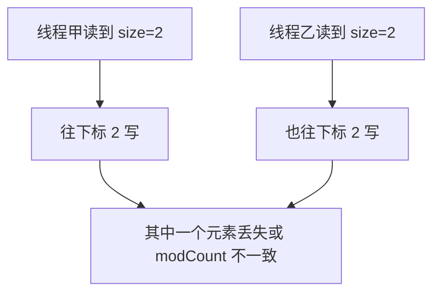

## 集合在并发下会坏成什么样

## 前言

1、下面这行在 JDK 8 及以后实际做了什么

```java
new ArrayList<Integer>();
```

构造时内部数组是空的，第一次 `add` 才分配长度为 10 的数组。注释里常说的“初始容量 10”指的是第一次扩容的默认容量，不是构造完成瞬间就有 10 个槽。

元素个数超过容量时会扩容。默认增长为原来的 1.5 倍（`old + (old >> 1)`），不是“只多一半个元素”这种含糊说法。新数组通过下面的拷贝得到：

```java
Arrays.copyOf(elementData, newCapacity)
```

## 单线程环境下

只有一个线程调用 `add` 和遍历时，`ArrayList` 的行为是确定的。

```java
import java.util.ArrayList;
import java.util.List;

public class ListSingleThreadDemo {
    public static void main(String[] args) {
        List<String> names = new ArrayList<>();
        names.add("pine");
        names.add("cedar");
        names.add("birch");
        for (String name : names) {
            System.out.println(name);
        }
    }
}
```

## 多线程环境

`ArrayList` 的 `add` 没有 `synchronized`，也没有 CAS。两个线程可以同时读到同一个 `size`，都往该下标写，后写的覆盖先写的；扩容时两个线程各自 `copyOf`，后执行的 `elementData = newArray` 会把另一个线程已经写入的数组丢掉。迭代器还会检查 `modCount`，发现结构被别的线程改过，就抛出 `ConcurrentModificationException`。



下面启动 20 个线程同时往同一个列表塞短串：

```java
import java.util.ArrayList;
import java.util.List;
import java.util.UUID;

/**
 * 并发 add 可能抛出 ConcurrentModificationException，也可能悄悄丢元素。
 */
public class ListRaceDemo {
    public static void main(String[] args) {
        List<String> names = new ArrayList<>();
        for (int i = 0; i < 20; i++) {
            new Thread(() -> {
                names.add(UUID.randomUUID().toString().substring(0, 6));
                System.out.println(names);
            }, "writer-" + i).start();
        }
    }
}
```

不稳定复现，但常见两类结果：抛出 `java.util.ConcurrentModificationException`，或者列表长度小于成功 `add` 的次数。前者是并发修改检查，后者是 `size` 更新丢失。

## 解决方案

### 方案一：Vector

换成 `Vector`。它的 `add`、`get` 等方法用 `synchronized` 锁住整个集合，同一时刻只有一个线程能改或读，因此没有上面的竞态。锁粒度是整表，并发读也会互斥，吞吐下降明显。

### 方案二：Collections.synchronizedList()

```java
List<String> names = Collections.synchronizedList(new ArrayList<>());
```

工具方法在 `ArrayList` 外面套一层同步包装，每个公开方法进入前先拿包装对象的锁。迭代时仍要调用方自己对包装对象同步，否则迭代器还是会看到并发修改。

### 方案三：采用 JUC 里面的方法

`CopyOnWriteArrayList` 的思路是写时复制：读不加锁，写的时候复制一份新数组。

往容器里加元素时，不在当前 `Object[]` 上直接追加。先在锁里把数组拷出来，长度加一，把新元素放进副本，再用一次 volatile 写把内部引用换成新数组。读者始终看某一份完整数组，所以读可以并发，也不需要和写互相阻塞。代价是每次写都复制整表，写多读少时不合适。

`add` 的结构是：

```java
public boolean add(E element) {
    final ReentrantLock guard = this.lock;
    guard.lock();
    try {
        Object[] current = getArray();
        int length = current.length;
        Object[] grown = Arrays.copyOf(current, length + 1);
        grown[length] = element;
        setArray(grown);
        return true;
    } finally {
        guard.unlock();
    }
}
```

先拿独占锁，避免两个写者同时复制：

```java
final ReentrantLock guard = this.lock;
guard.lock();
```

再按当前长度加一格：

```java
Object[] current = getArray();
int length = current.length;
Object[] grown = Arrays.copyOf(current, length + 1);
```

新元素放在新数组末尾，然后发布新数组：

```java
grown[length] = element;
setArray(grown);
```

## HashSet 线程不安全

### CopyOnWriteArraySet

它的底层就是一个 `CopyOnWriteArrayList`。加元素时先按 `equals` 在副本里查找，不存在才追加。线程安全和写时复制的代价都跟着列表走。

### HashSet 底层结构

`HashSet` 内部是一个 `HashMap`。`add` 只收一个元素，是因为元素当 key，value 固定放一个占位对象：

```java
public boolean add(E element) {
    return map.put(element, PRESENT) == null;
}
```

`PRESENT` 是同一个静态常量。集合只关心 key 是否出现，不关心 value。`put` 返回 null 表示之前没有这个 key，`add` 因此返回 true。

## HashMap 线程不安全

JDK 8 的 `HashMap` 在并发 `put` 时同样没有锁。扩容和链表改红黑树都可能被别的线程打断，表现为丢失更新、读到不完整结构，严重时死循环出现在更老的 JDK 7 头插法扩容里。JDK 8 改成了尾插，死循环少了，但数据仍然不可靠。

```java
Map<String, String> table = new HashMap<>();
for (int i = 0; i < 20; i++) {
    new Thread(() -> {
        table.put(Thread.currentThread().getName(),
                UUID.randomUUID().toString().substring(0, 6));
        System.out.println(table);
    }, "mapper-" + i).start();
}
```

### 解决方法

1、`Collections.synchronizedMap(new HashMap<>())`，整表一把锁。

2、改用 `ConcurrentHashMap`。JDK 8 里桶级别用 CAS 和 `synchronized` 锁住链表头，不同桶可以并行更新。

```java
Map<String, String> table = new ConcurrentHashMap<>();
```
