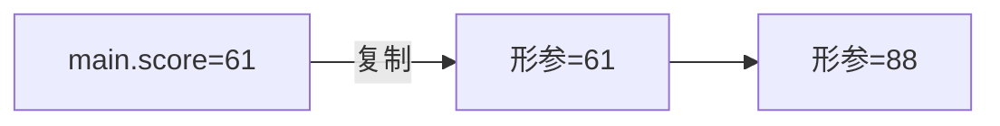
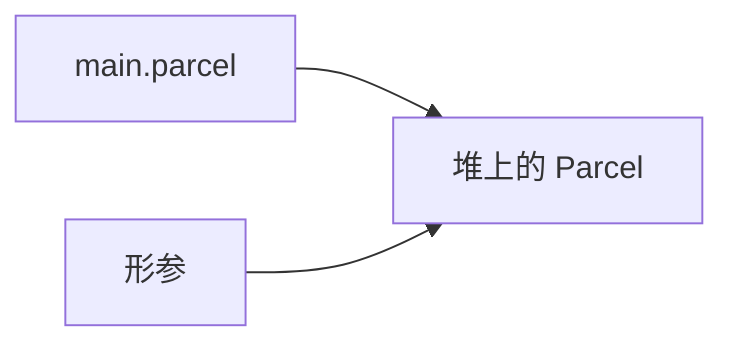
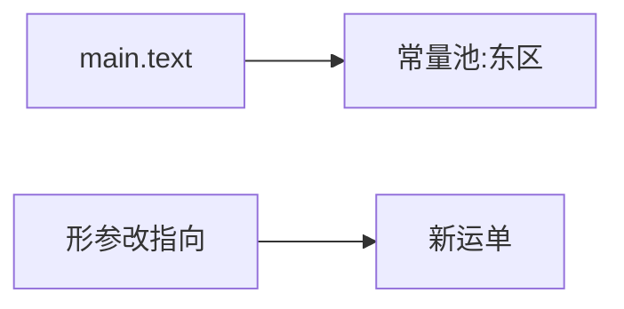

# 值传递和引用传递

## 举例

```java
/**
 * 演示：基本类型、可变对象、字符串常量，三种参数进方法后各自怎么变。
 */
class Parcel {
    private Integer code;
    private String label;

    public Parcel(String label) {
        this.label = label;
    }

    public String getLabel() {
        return label;
    }

    public void setLabel(String label) {
        this.label = label;
    }
}

public class PassStyleDemo {

    public void rewriteScore(int score) {
        score = 88;
    }

    public void rewriteLabel(Parcel parcel) {
        parcel.setLabel("改派-西区");
    }

    public void rewriteText(String text) {
        text = "新运单";
    }

    public static void main(String[] args) {
        PassStyleDemo demo = new PassStyleDemo();

        int score = 61;
        demo.rewriteScore(score);
        System.out.println("score ----" + score);

        Parcel parcel = new Parcel("东区");
        demo.rewriteLabel(parcel);
        System.out.println("label-----" + parcel.getLabel());

        String text = "东区";
        demo.rewriteText(text);
        System.out.println("text-----" + text);
    }
}
```

输出：

```text
score ----61
label-----改派-西区
text-----东区
```

## rewriteScore 的执行过程

基本类型的局部变量在栈帧里。`rewriteScore` 的形参只是 61 的副本，改成 88 不影响 `main` 里的 `score`。



## rewriteLabel 的执行过程

`Parcel` 传进去的是堆地址的副本，两份引用指向同一对象。`setLabel` 改的是堆上的字段，所以 `main` 读到的已是“改派-西区”。传对象时传的仍是引用这个值。



## rewriteText 的执行过程

`String` 不是基本类型，结果仍是“东区”。字面量进常量池，`text = "新运单"` 只让形参改指向新字符串，`main` 的引用没变。改可变对象的内容才会反映到调用方。


