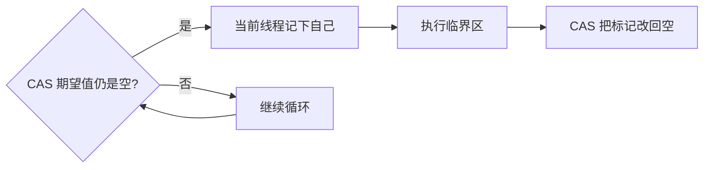

# Java 锁之自旋锁

自旋锁（spinlock）的含义是：线程抢不到锁时不进入阻塞队列，而是在循环里反复尝试。少一次挂起和唤醒，就少一次内核态上下文切换。代价是循环本身占着 CPU。

CAS 失败后的重试就是一种自旋：线程不睡眠，只是一次次比较并交换，直到成功或主动放弃。



## 优缺点

优点：成功之前只有用户态循环，没有 `wait` 那种进入等待队列的挂起。锁持有时间极短时，自旋往往比阻塞更便宜。

缺点：自旋的线程变多、临界区又很长时，大量核心花在空转上，吞吐反而下降。所以自旋适合临界区很短的场景，不适合拿来保护一段耗时 I/O。

## 手写自旋锁

用 `AtomicReference<Thread>` 记录当前持有者。线程甲先调用 `acquire`，把引用从空改成自己，然后占用大约 4 秒。线程乙随后进来，发现引用不是空，就停在循环里，直到甲把引用改回空，乙的 CAS 才能成功。

```java
import java.util.concurrent.TimeUnit;
import java.util.concurrent.atomic.AtomicReference;

/**
 * 用 CAS 自旋的简易锁。
 * 只有持有者线程可以把标记清掉，避免别的线程误释放。
 */
public class TicketSpinLock {

    private final AtomicReference<Thread> owner = new AtomicReference<>();

    public void acquire() {
        Thread self = Thread.currentThread();
        System.out.println(self.getName() + " 尝试进入");
        // 期望无人持有，成功则把持有者写成自己
        while (!owner.compareAndSet(null, self)) {
            Thread.onSpinWait();
        }
    }

    public void release() {
        Thread self = Thread.currentThread();
        owner.compareAndSet(self, null);
        System.out.println(self.getName() + " 已离开");
    }

    public static void main(String[] args) {
        TicketSpinLock spin = new TicketSpinLock();

        new Thread(() -> {
            spin.acquire();
            try {
                TimeUnit.SECONDS.sleep(4);
            } catch (InterruptedException ex) {
                Thread.currentThread().interrupt();
            }
            spin.release();
        }, "worker-a").start();

        try {
            TimeUnit.SECONDS.sleep(1);
        } catch (InterruptedException ex) {
            Thread.currentThread().interrupt();
        }

        new Thread(() -> {
            spin.acquire();
            spin.release();
        }, "worker-b").start();
    }
}
```

一种符合时序的输出：

```text
worker-a 尝试进入
worker-b 尝试进入
worker-a 已离开
worker-b 已离开
```

甲立刻打出“尝试进入”并拿到标记。大约 1 秒后乙也打出“尝试进入”，但 CAS 一直失败，卡在循环里。大约第 4 秒甲清空标记，乙下一次循环成功，随即释放。两行“已离开”因此挨在一起，而不是乙一进来就离开。
