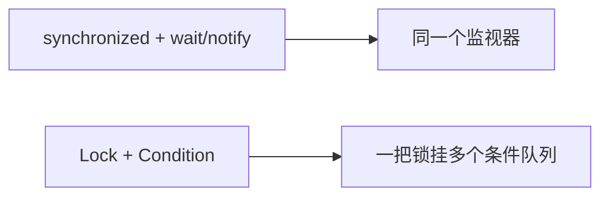

# Synchronized 和 Lock 的区别

## 前言

早期协调线程，常用的一组是：

- `synchronized`、`wait`、`notify`

后来 JUC 提供了可以分开控制的一组：

- `Lock`、`await`、`signal`



## 问题

### synchronized 和 lock 有什么区别？用新的 lock 有什么好处？举例说明

1）层次不同

- `synchronized` 是 JVM 关键字。进入同步块对应 `monitorenter`，离开对应 `monitorexit`。`wait` / `notify` 也依赖这把监视器，所以只能写在同步块或同步方法里。
- `Lock` 是接口，常用实现是 `ReentrantLock`，属于 JDK 类库，不占用一个 Java 关键字。

2）释放方式

- `synchronized`：代码块正常结束或抛出异常，监视器都会被释放，调用方不用写解锁。
- `ReentrantLock`：必须自己 `unlock`。漏写就会一直占着锁。标准写法是 `lock` 放在 `try` 前面或紧贴 `try`，`unlock` 放进 `finally`。

3）能不能响应中断

- `synchronized`：拿锁阶段不能被中断，只能等拿到之后自己结束，或者线程在别的可中断点响应。
- `ReentrantLock`：`lockInterruptibly()` 在等待时可以响应 `interrupt()`；`tryLock(timeout, unit)` 可以限时放弃。

4）公不公平

- `synchronized`：非公平，不保证先申请的线程先拿到。
- `ReentrantLock`：默认也非公平。构造参数传 `true` 才按队列顺序发放。

5）条件队列的个数

- `synchronized`：一把锁只有一个等待集合。`notify` 随机叫醒一个，`notifyAll` 全部叫醒，叫不醒“某一组”。
- `ReentrantLock`：可以 `newCondition()` 出多把条件。每个条件单独 `await` / `signal`，用来精确唤醒下一组线程。

## 举例

第 5 条最容易用场景看出来。

```text
三条线程按顺序循环：
甲打印 3 次，乙打印 6 次，丙打印 9 次
然后回到甲，一共转 4 轮
```

用一个 `synchronized` 加 `notifyAll` 也能做，但每次全员醒来再自己判断，写起来容易错。`Condition` 可以让甲只叫醒乙，乙只叫醒丙，丙再叫醒甲。

先建锁：

```java
private final Lock lock = new ReentrantLock();
```

再挂三个条件，相当于三条独立的等候队伍：

```java
private final Condition turnA = lock.newCondition();
private final Condition turnB = lock.newCondition();
private final Condition turnC = lock.newCondition();
```

每个方法都按“先判断、再干活、后换班”写。判断必须用 `while`，防止被意外唤醒后条件其实还不成立。

干活就是按次数打印。换班时先改轮次标志，再只 `signal` 下一组：甲做完把标志改成 2 并叫醒乙，乙改成 3 叫醒丙，丙改回 1 叫醒甲。

```java
public void printA() {
    lock.lock();
    try {
        while (stage != 1) {
            turnA.await();
        }
        for (int i = 0; i < 3; i++) {
            System.out.println(Thread.currentThread().getName() + "\t stage=" + stage + "\t seq=" + i);
        }
        stage = 2;
        turnB.signal();
    } catch (InterruptedException ex) {
        Thread.currentThread().interrupt();
    } finally {
        lock.unlock();
    }
}
```

完整示例：

```java
import java.util.concurrent.locks.Condition;
import java.util.concurrent.locks.Lock;
import java.util.concurrent.locks.ReentrantLock;

/**
 * 一把锁，三个条件队列，按甲乙丙的顺序各打印固定次数。
 */
class RoundPrinter {
    private int stage = 1;
    private final Lock lock = new ReentrantLock();
    private final Condition turnA = lock.newCondition();
    private final Condition turnB = lock.newCondition();
    private final Condition turnC = lock.newCondition();

    public void printA() {
        lock.lock();
        try {
            while (stage != 1) {
                turnA.await();
            }
            for (int i = 0; i < 3; i++) {
                System.out.println(Thread.currentThread().getName() + "\t stage=" + stage + "\t seq=" + i);
            }
            stage = 2;
            turnB.signal();
        } catch (InterruptedException ex) {
            Thread.currentThread().interrupt();
        } finally {
            lock.unlock();
        }
    }

    public void printB() {
        lock.lock();
        try {
            while (stage != 2) {
                turnB.await();
            }
            for (int i = 0; i < 6; i++) {
                System.out.println(Thread.currentThread().getName() + "\t stage=" + stage + "\t seq=" + i);
            }
            stage = 3;
            turnC.signal();
        } catch (InterruptedException ex) {
            Thread.currentThread().interrupt();
        } finally {
            lock.unlock();
        }
    }

    public void printC() {
        lock.lock();
        try {
            while (stage != 3) {
                turnC.await();
            }
            for (int i = 0; i < 9; i++) {
                System.out.println(Thread.currentThread().getName() + "\t stage=" + stage + "\t seq=" + i);
            }
            stage = 1;
            turnA.signal();
        } catch (InterruptedException ex) {
            Thread.currentThread().interrupt();
        } finally {
            lock.unlock();
        }
    }
}

public class LockConditionDemo {
    public static void main(String[] args) {
        RoundPrinter printer = new RoundPrinter();
        new Thread(() -> {
            for (int round = 0; round < 4; round++) {
                printer.printA();
            }
        }, "甲").start();
        new Thread(() -> {
            for (int round = 0; round < 4; round++) {
                printer.printB();
            }
        }, "乙").start();
        new Thread(() -> {
            for (int round = 0; round < 4; round++) {
                printer.printC();
            }
        }, "丙").start();
    }
}
```

四轮里每一轮都是甲的 3 行、乙的 6 行、丙的 9 行，不会出现乙插进甲还没打印完的间隙。这是 `synchronized` 的单个等待集合很难精确表达的分组唤醒。
