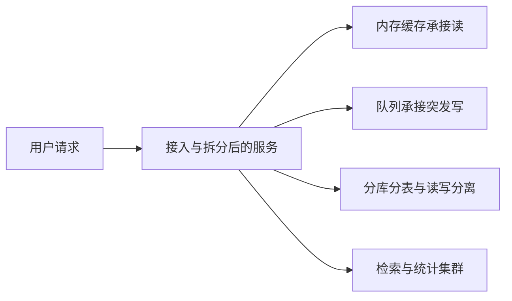

# 高并发系统通常怎么拼

## 前言

假如简历上写过日活过亿、晚高峰每秒上万甚至十万的交易站点，对方一定会顺着架构往下挖：进程怎么拆、机器大概多少、缓存挡在哪一层、写入是不是先进队列、库是单点还是已经拆开。真正扛过流量的人知道，离开具体业务去背一张「标准图」没有用。订单、库存、支付缠在一起时，丢一个内存库加一条队列远远不够。

如果对方一上来就问「你来画一个能抗并发的系统」，多半是简历里看不出你做过这块，想试探你有没有自己整理过。下面按一条能讲完的主线来答，同时记住：真实系统比这条主线细得多。

## 面试题剖析

并发从哪来？早期几乎每个请求都直打数据库。单机库撑到每秒大约两三千次读写，延迟和锁等待就会明显变差。业务涨得比机器快时，系统不是「配置没调好」，而是存储层先被打满。瞬时每秒六千、九千甚至更高，常见的关系库单机很难稳住。

互联网产品的日常高峰每秒几千次很常见；大促时一个核心接口到几万、十几万也不稀奇。业务规则又复杂，所以真正值钱的经验是：在规则很多的系统里，一块一块把压力挪走。可以按下面六步来组织回答。

- 按领域拆服务。一个大进程拆成订单、库存、账户等若干子系统，用远程调用把边界画清。每个子系统连自己的库，原来压在一个库上的连接被摊开，写入并发先降一截。
- 读路径放缓存。多数接口读远多于写，同一份结果可以在库和缓存各留一份，查询尽量命中内存。单机内存库每秒几万次读取很常见。先找出占了大头流量的查询，再决定哪些字段进缓存。
- 写路径进队列。有的操作一次要改几十行，增删改叠在一起，同步打库会把连接打光。内存库不适合当账本：数据可能被淘汰，结构也撑不起事务。把突发写入先推进队列，消费者按库能承受的速度落库。单机队列每秒几万条写入，在参数合适时是做得到的。
- 库和表再拆开。服务拆完之后，某个库仍可能成为热点。一个库拆成多个库去分摊连接；一张大表拆成多张，让单表行数下降，语句才跑得动。
- 读写分开。库上也常常是读多写少，不必让查询和提交抢同一台机器。主库只接写，从库接读；读流量再涨就加从库。要注意从库会落后，刚写完立刻读的场景要单独处理。
- 检索和聚合另放。搜索集群可以加节点。简单条件查询、统计、全文检索不必都压在事务库上。

这六块是高并发系统几乎都会碰到的改造，不是背名词。每一块都有自己的坑：缓存和库不一致、消息重复、从库延迟、跨库不能随意关联。能把这些坑和对应手段串起来，比只说「上了缓存和队列」更像做过。

纸上的六块，到了几十万行的业务里会再裂出很多特例：哪张表该拆、哪张表必须留在一起才能关联、哪些字段进缓存就够挡住高峰、哪些字段必须回源。这个取舍只能对着具体接口做，做完一轮，比只会画框更有说服力。公司真正缺的，往往不是「听说过某几个中间件的人」，而是能在复杂分布式代码里把上述改造逐段落地的人。

## 例子

假设票务详情每秒 1.8 万次读取、下单每秒 900 次写入。详情按场次编号进缓存，命中后不再打库。下单先写队列，消费者把落库速度限在每秒 400。订单表按用户编号拆到 8 个库，每个库再按月份留在合理行数。支付结果只读主库，详情页读从库。场次搜索和「按关键字找演出」交给检索集群，不在事务库里做模糊查询。这样讲，比只报六个名词更像你真的拆过一条链路。
