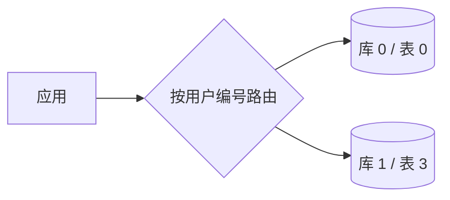
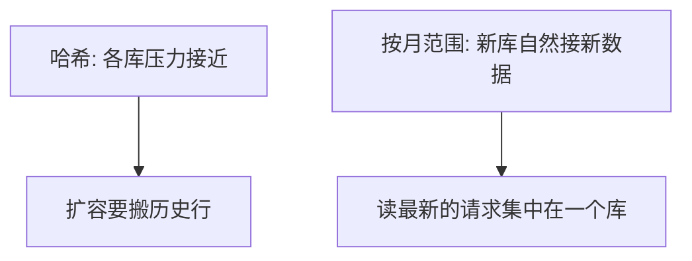
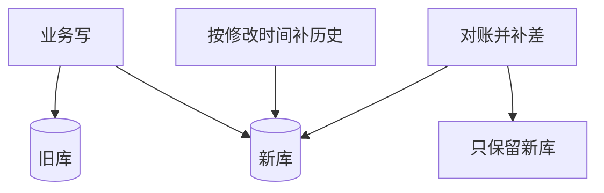

# 分库分表连环问

## 面试题

- 什么情况下才要拆库、拆表？
- 用过哪些中间件，它们分属哪一类？
- 垂直拆和水平拆分别解决什么？
- 线上还是单库时，怎么迁到拆分后的库而不停机？
- 以后还要扩，路由怎样才不用改代码？
- 拆开之后主键从哪来？

## 为什么要拆

拆库和拆表不是一回事。可以只拆库，也可以只拆表。用一条增长曲线就能看懂动机。

一开始注册用户 8 万，日活 3000，单表每天新增 400 行，峰值每秒 20 次请求。这种规模，一个有经验的人和两个新人就能守住。

业务后来涨到注册 600 万、日活 40 万、单表每天 6 万行、峰值每秒 700。一个月新增大约 180 万行，单表很快到几百万。峰值 700 靠几台应用加负载均衡还能撑，但已经该规划下一步。

再涨到注册 4000 万、日活 500 万、单表每天 30 万行、单表总量大约 1800 万，峰值每秒 4000 到 6000。磁盘和锁都会先告警，系统撑不到这个量级还不拆，多半已经出过故障。

所以拆分是跟着数据量和并发走的，不是架构图上的装饰。单表太大时，同样的语句会越来越慢。经验上，行数到大约 300 万就该评估拆表，而不是等到上千万。

拆表是把行分到多张结构相同的表，查询时只打其中一张。按用户编号取模，一个用户的订单落在固定的表，单表可以控制在 150 万行以内。

拆库是因为一个库的连接和写入撑不住。经验上单库并发到每秒 1500 左右就要扩，健康水位尽量留在每秒 800 上下。把数据分到多个库，每次访问只打一个库。



## 中间件有哪些

### 两类

- 代理：请求先到独立进程，再转发到库，要单独部署。
- 客户端：应用进程里就完成路由，不经第二跳。

### 几个名字

常见的有 Cobar、TDDL、Atlas、ShardingSphere JDBC、Mycat。

Cobar 是早期代理，读写分离、跨库连接和分页都不完整，仓库也停了很久，新项目不用。

TDDL 走客户端，基本增删改查可以，连接和多表语法弱，还依赖一套配置中心，离开原环境不好落地。

Atlas 也是代理，社区停更多年，现在很少新接入。

ShardingSphere 的 JDBC 模式走客户端，语法限制相对少，能做分片、读写分离、发号和柔性事务，版本还在维护，中小团队好嵌入。

Mycat 在早期代理上继续做，功能面宽，社区活跃。它比 JDBC 模式更「重」，踩坑时间也短一些，但代理对业务代码透明。

### 怎么选

现在值得比较的主要是 JDBC 客户端和 Mycat 这类代理。

客户端不用额外部署，少一跳，延迟更好；升级时每个应用都要改依赖并发布，耦合在业务工程里。

代理要有人运维，多一跳；业务只看到一个数据源，升级集中在代理上。

系统少、人少，用客户端更轻。系统多、有专人看数据库中间件，用代理，避免几十个工程各自嵌一套路由。也有团队两条都自己做过，先代理后客户端，或反过来，取决于发布权在谁手里。

## 垂直拆和水平拆

### 水平

同一套表结构复制到多个库，每个库只放一部分行，合起来才是全量。目的是用更多库扛并发，并用更多磁盘装数据。

### 垂直

把宽表按列切开，或者按业务把表分到不同库。热字段少的那些列单独成表，冷字段放到另一张。库有缓冲池，行越窄，同样的内存能留下越多热行。订单主表、支付表、明细表拆开，就是常见的垂直拆。

表再按行切开，是为了让单表行数可控。语句越复杂，单表越要小，150 万、300 万都要看这条语句怎么扫，没有统一阈值。

中间件按你指定的列，例如用户编号，先选库再选表。垂直拆留给特别宽的表；水平拆留给并发或容量不够的表。若拆到多个库之后单表仍太大，就在库内再分表。

路由有两种。按范围分，例如每个月一个库，扩容时准备好下个月的空库即可，但流量总打在最新的库上，容易热点。按哈希分，数据和请求更匀，扩容时要搬数据。范围分只适合访问均匀打在历史和最新数据上的场景，否则不要用。



## 不停机迁过去

假设线上单表 480 万行，目标是 4 个库、每库 8 张表，每张大约 15 万行。中间件已经选好，剩下的是怎么切流量。

### 停机搬

最笨的办法是公告停服 4 小时。停写之后，用一次性任务把旧表读出来写入新表，改连接，发新版本，校验后再开服。数据量不大时一两个小时能导完，但要停机，只适合能接受窗口的系统。


### 双写

不停机的做法是双写。所有插入、更新、删除同时打旧库和新库。上线后新库仍缺历史行，再用导入任务补。补的时候比较修改时间：新库没有这条，或新库的修改时间更旧，才覆盖。导完一轮后按主键对账，不一致的再从旧库写一次，直到抽样和计数都对齐。然后发只写新库的版本。中间没有多小时的停写。



## 以后还要扩容

步骤是：先把中间件摸熟；定好库数和表数；在测试环境验证路由；用双写完成第一次迁移；线上跑起来；真不够了再扩。

停机扩容和停机迁移类似，只是数据源从「单表」换成「已经拆过的库表」。第一次迁移时单表可能只有一两千万行，并行导入一小时能结束。拆过之后总量到 1 亿甚至 2 亿，光导入就要好几个小时，加上改配置和验证，窗口会拖到白天。不要把这种窗口当常规手段。

更省事的规划是第一次就按 2 的幂把逻辑表分够。例如 32 个库、每库 32 张表，一共 1024 张。对多数团队，这个粒度足够用几年。

单库写入按每秒 800 估算，32 个库大约每秒 2.5 万；按每秒 1200 估算，大约 3.8 万。前面再加队列削峰，峰值可以更高。除非是极少数核心库，否则不会一开始就需要上百台数据库。1024 张表、每表 400 万行，大约能放 40 亿行。每秒数万写入加上这个容量，对大多数业务够用。

一开始这 32 个库可以是逻辑库，先落在少数几台机器上，例如 4 台机器各放 8 个库。扩容时按倍数加机器，把其中一半库整库迁走，应用只改数据源地址，取模规则不变。最多可以到 32 台机器各一个库；再不够就到一张表一台机器，因为逻辑表只有 1024 张。搬迁用库迁移工具，不必自己扫表导数据。缩容同样按倍数合并，路由不用改。

```text
对 2 的幂取模
票号 % 32 = 库
票号 / 32 % 32 = 表

900    -> 库 4  表 28
2100   -> 库 20 表 1
77     -> 库 13 表 2
8193   -> 库 1  表 31
```


收束成几句：先定 32×32 这类 2 的幂；路由是先对 32 取模得到库，商再对 32 取模得到表；扩容只加机器并迁库；地址改配置；路由代码不动。

## 主键从哪来

拆开之后每张表都不能各自从 1 开始，否则主键会撞。要有全局唯一的号。

### 数据库自增

专门一张发号表，插入一行拿自增号，再拿这个号去写业务表。实现简单。高并发时这张表会成为瓶颈。可以改成服务一次取一段，例如当前最大号是 50000，服务在内存里发出 50001 到 50500，再把表更新成 50500。号仍然来自单个库。

它适合「并发不高、但行数很大」的拆分：每秒只有两三百次写入，数据却有几十亿行，发号库撑得住，容量问题交给分片。

### 随机串

本地就能生成，不依赖库。缺点是又长又不递增，当主键时索引页分裂严重，不适合做聚集索引。拿来做文件名、外部追踪号可以。

### 时间戳拼接

直接用当前毫秒，每秒几千次就会重复，不能单独当主键。可以拼业务字段：毫秒 + 用户编号 + 渠道码，组成订单号。能否接受，取决于业务是否允许号里带这些信息，以及时钟是否会回拨。

### 雪花算法

把一个 64 位整数拆开用：最高 1 位固定为 0，保证是正数；接着 41 位是毫秒时间；10 位是机器，其中 5 位机房、5 位机器，最多 32 个机房、每个机房 32 台；最后 12 位是同一毫秒内的序号，最多 4096 个。41 位毫秒大约覆盖 69 年。

例如机房 6、机器 11、某一毫秒内第 4 个号（序号从 0 起则序号为 3）。布局是：

```text
0 | 41 位毫秒差 | 00110 | 01011 | 0000 00000011
  符号   相对纪元     机房6   机器11    序号 3
```

同一毫秒里再要一个号，序号加一；加到 4096 就等到下一毫秒。时钟回拨则拒绝发号，避免和已经发出的号冲突。

```java
public class TicketIdGen {
    private final long roomId;
    private final long nodeId;
    private long cursor = 0L;
    private long lastMs = -1L;

    private static final long EPOCH = 1609459200000L;
    private static final long CURSOR_BITS = 12L;
    private static final long NODE_BITS = 5L;
    private static final long ROOM_BITS = 5L;
    private static final long MAX_NODE = ~(-1L << NODE_BITS);
    private static final long MAX_ROOM = ~(-1L << ROOM_BITS);
    private static final long CURSOR_MASK = ~(-1L << CURSOR_BITS);
    private static final long NODE_SHIFT = CURSOR_BITS;
    private static final long ROOM_SHIFT = CURSOR_BITS + NODE_BITS;
    private static final long TIME_SHIFT = CURSOR_BITS + NODE_BITS + ROOM_BITS;

    public TicketIdGen(long roomId, long nodeId) {
        if (roomId < 0 || roomId > MAX_ROOM) {
            throw new IllegalArgumentException("机房编号超出 0..31");
        }
        if (nodeId < 0 || nodeId > MAX_NODE) {
            throw new IllegalArgumentException("机器编号超出 0..31");
        }
        this.roomId = roomId;
        this.nodeId = nodeId;
    }

    public synchronized long next() {
        long now = System.currentTimeMillis();
        if (now < lastMs) {
            throw new IllegalStateException("时钟回拨 " + (lastMs - now) + " 毫秒");
        }
        if (now == lastMs) {
            cursor = (cursor + 1) & CURSOR_MASK;
            if (cursor == 0) {
                while (now <= lastMs) {
                    now = System.currentTimeMillis();
                }
            }
        } else {
            cursor = 0L;
        }
        lastMs = now;
        return ((now - EPOCH) << TIME_SHIFT)
                | (roomId << ROOM_SHIFT)
                | (nodeId << NODE_SHIFT)
                | cursor;
    }
}
```

每个机房的每台机器持有一个生成器，序号从 0 开始。同一毫秒内序号递增，跨毫秒则回到 0。单机每毫秒最多 4096 个号，每秒理论值约四百万，实际每秒几万的发号绰绰有余。5 位加 5 位也可以改成别的业务分区，只要仍然放得进这 10 位。

时钟回拨和机器编号重复是两件要单独防的事：编号必须由部署系统分配，不能让两台进程用同一个机房加机器组合。

## 把迁移和扩容算成一张表

用前面的 480 万行再走一遍，避免只记得名词。目标 4 库 × 8 表。按用户编号取模：编号 1001 落到库 `1001 % 4 = 1`，表 `(1001 / 4) % 8 = 2`。同一用户的后续订单都进库 1 表 2，查询不用扫 32 张表。

停机方案要算窗口。480 万行、单行约 1KB，总量约 4.8GB。若导入任务每秒写 2 万行，大约 4 分钟能导完，但还要停写、改配置、抽样校验。窗口看起来短，可是停写期间的支付回调会失败，所以能双写就不要停。

双写期间旧库仍是准。新库一开始只有双写之后的增量。补历史时按修改时间比较：旧库这行是 10:06 改的，新库没有，就插入；新库已有 10:08 的版本，旧库读到的是 10:06，就不要覆盖。对账可以发现漏网，例如某次双写超时只写了旧库。循环到抽样 1 万行全部一致，再切读流量，最后停掉旧库写入。

第一次如果就按 32×32 规划，上面这 4×8 只是早期形态。逻辑表先建满 1024 张，先放在 4 台机器上。写入涨到每台每秒 1200、接近单机舒适区之上时，加到 8 台，每台迁走一半库。票号 900 仍然是库 4、表 28，只是库 4 的数据源地址从机器 A 改到机器 E。应用不改取模。

主键不要混用。发号表适合每秒 300 次的归档库：一次取 200 个号，内存发完再取，数据库每秒只被访问一两次。雪花适合下单。机房 6、机器 11 在同一毫秒发出序号 0 到 3，四个号的机器部分相同，序号部分递增，全局不撞。若两台进程都配成机器 11，同一毫秒的序号会撞车，这是配置错误，不是算法不够长。随机串做主键时，16 字节的无序值会让索引页频繁分裂，写入比递增整数慢一截，所以只拿它做对外文件名。

垂直拆和水平拆可以发生在同一张订单上。40 个字段里，列表页只用到编号、状态、金额、用户，这 4 列留在主表；发票抬头、备注等 20 列拆到扩展表，缓冲池就能留下更多主表热行。主表行数到 300 万后，再按用户编号水平拆开。范围按月拆只在对账场景合适：财务会均匀查过去 12 个月。用户查订单几乎总查最近 7 天，按月拆会把这些读全部打到当月库。

中间件升级也要算进成本。客户端模式改路由策略，要发 20 个应用。代理模式只发代理，但代理自己的发布会挡住全部查询，所以代理至少要有两台，发布时摘一台。中小团队没有专人看代理时，这个发布风险比「每个应用多一个依赖」更大。

发号和雪花还可以对着失败场景讲。发号服务一次取 200 个号之后进程崩溃，这 200 个号会空置，但不会重复，业务只要唯一、不要求连续，就可以接受空洞。若两个发号服务同时读到最大号 50000 又都写回 50200，就会发出重复号，所以更新最大号必须带条件：只有当前值仍是 50000 才能改成 50200。雪花的 41 位从纪元 2021-01-01 起算，大约可以用到 2090 年前后；到了上限要换纪元并接受新号段，不能在运行中把纪元改小，否则新号会和旧号重叠。时钟回拨 3 毫秒时直接拒绝，调用方重试即可；若改成阻塞等待，回拨很多秒时所有下单线程都会被卡住。

对账任务不要全表无条件覆盖。480 万行里若有 0.1% 在双写窗口不一致，大约 4800 行需要重写。按主键分批、每批 1000 行，几分钟能补完。无条件用旧库覆盖新库会把双写期间已经在新库成功的更新冲掉。切读之前先把只读流量的 5% 打到新库，看慢查询和行数是否正常，再切 100%。回滚方案是读仍能切回旧库，所以旧库在观察期不要立刻下线。

32 个逻辑库先放在 4 台机器上时，每台 8 个库。扩到 8 台时每台留下 4 个库。迁移用整库工具，单库 150GB 的话按每秒 100MB 大约要 25 分钟，加上校验，一台机器的搬迁可以安排在低峰，不必停写整个集群。应用配置只改这 4 个库的地址。若路由写成范围而不是取模，扩容时新库没有历史，旧库仍承受全部旧数据的查询，热点还在。取模的代价是第一次就要把逻辑表建够，这是用提前规划换以后少搬行。

垂直拆之后的查询要接受一次回表。列表只查主表的 4 列，点进详情再按主键读扩展表。若列表接口把 20 个冷字段也查出来，垂直拆就没有收益。水平拆之后禁止不带分片键的分页：`SELECT * FROM orders LIMIT 20` 会被中间件打到 32 张表再合并，页面一深就慢。列表改成「带用户编号」或「带票号」的点查。跨库连接同样不让中间件做，需要订单加用户昵称时，在应用里先查订单再查用户，或者在写入时把昵称冗余进订单行。冗余的代价是昵称变更要异步改历史行，这比一次跨库连接可控。

全局号还要避免出现在业务含义经常变化的字段上。票号一旦发出去就被打印到短信里，不能因为分表规则调整而改变。所以号的生成和「落在哪张表」分开：雪花号只保证唯一和大致有序，落表仍用用户编号取模。若用雪花号取模，同一用户的票会散落在很多表，查「我的票」就要扫全部表。这是分片键选错，不是号不够长。查一个用户的最近 20 张票，只打一张表，限 20 行，和单表时期的语句成本接近。没有用户编号的运营查询则放到检索或离线表，不走这套在线分片。在线接口的超时可以仍按单表来定，例如 50 毫秒；一旦监控里出现扫完全部分片的语句，就把它从在线路径挪走，而不是把超时放宽到 1 秒。
