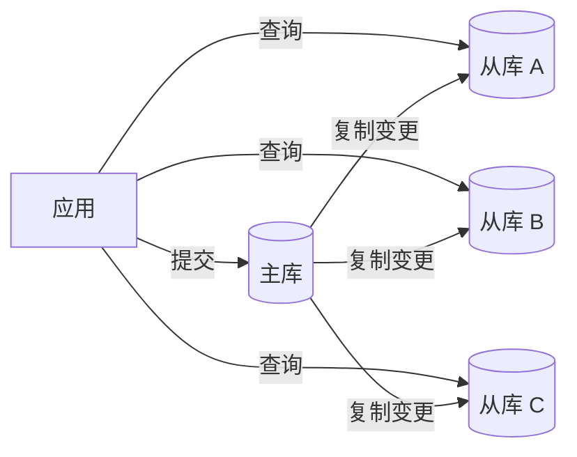
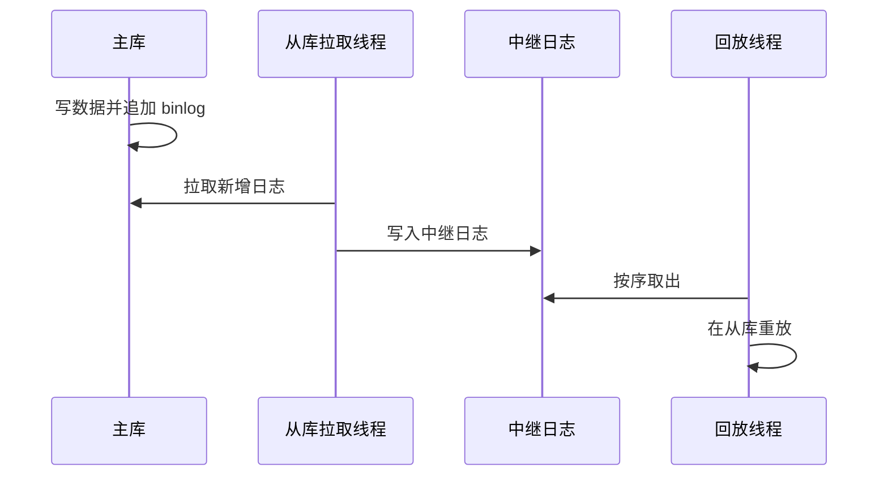
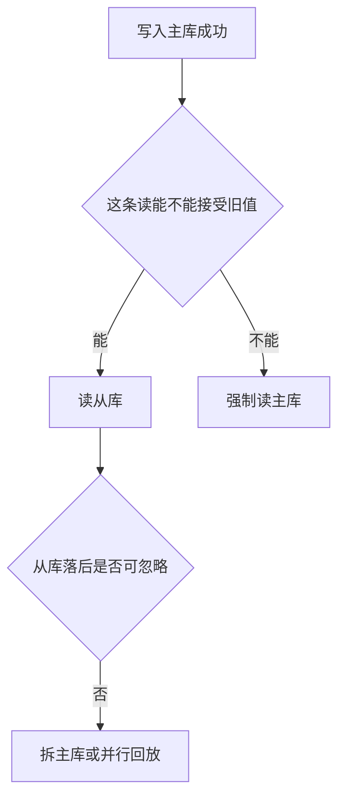

# MySQL 读写分离与从库落后

## 面试题

- 读写分离在工程上怎么落地？
- 主库把变更交给从库，中间经过哪些步骤？
- 从库追不上主库时，读到旧数据怎么处理？

## 前言

流量上来之后，多数站点仍然是读多写少。一台主库负责提交，后面挂几台从库分担查询，读并发就可以随从库数量往上加，而不必把所有 SELECT 都压在写库上。

## 读写分离怎么做？

做法建立在复制之上：只向主库写入，主库把变更带到从库。线上常见是一台主库带 3 到 4 台从库，再多就要看复制线程和网络是否还跟得上。应用或中间件按语句类型把写发到主库、把读发到从库。

## 主从复制经过哪几步？

变更类语句除了改数据页，还会追加到 binlog。从库的拉取线程连上主库，把这段日志拷到本地中继日志；从库的回放线程再按中继日志把语句或行变更执行一遍，从而跟上主库。

关键限制是：主库上可以并行提交的事务，在传统复制里往往被从库串行回放。并发一高，从库必然落后，刚写入的行可能要过几十毫秒甚至几百毫秒才查得到。主库若在日志还没传到从库时宕机，已提交但未复制的变更会丢。

为此引擎提供了两条相关机制。半同步要求主库在收到至少一个从库把日志写入中继日志后的确认，才向客户端返回提交成功，用来缩小主库宕机时的丢失窗口。并行复制则让从库用多个线程按库（或按组提交）同时回放，用来缩小落后。

可以按四句话收束：复制靠 binlog 和中继日志；落后来自串行回放；丢失窗口用半同步收紧；多库并行回放用来减轻延迟。

## 从库落后（重点）

线上出过这样的事故：用户提交订单后立刻刷新详情，读从库读到空，前端当成下单失败再提交一次，产生重复单。看从库状态里的落后秒数，能知道回放比主库慢了多少。

因此主从更适合「读远多于写，而且读可以接受轻微过期」的接口。刚写完必须看见的路径，不要无脑打到从库。

并行复制有帮助，但若并行粒度只到库，而热点集中在一个库里的少数表，收益有限。延迟已经明显时，可以组合下面几招，数字按另一套业务来记：

- 把单主库拆成 6 个主库，每个主库写入压到每秒 400 左右，从库回放通常就追得上。
- 打开并行回放。若某一库的写入仍有每秒 1500，而其余几十张表每秒只有个位数，并行帮不上热点库。订单类表经常就是这少数热点。
- 改写调用：插入之后不要马上再查一遍来决定下一步，能在同一次提交里做完的更新就做完。
- 极少数「插入后必须立刻读到」的语句，单独指定走主库。这条口子开多了，读写分离就名存实亡，只留给资金或状态机这类不能读旧值的点。

