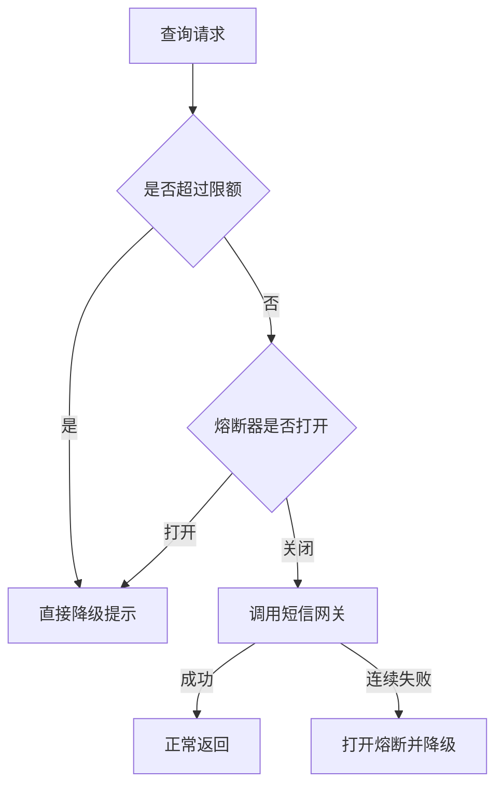

# 高可用：熔断、降级与限流

目录里这一题几乎只有标题。下面用票务查询依赖短信网关的例子，把三个手段讲清楚。

## 思路

高可用不是机器永远不挂，而是某个依赖变慢或出错时，故障停在边界上，核心路径还能返回。三道闸门分工不同。

- 限流：在入口限制每秒放行多少。票务查询接口容量是每秒 800，短信提醒每秒只能打 120 次，多出来的直接拒绝或排队，避免线程被慢调用占满。
- 熔断：连续失败或超时达到阈值就暂时不再调用下游。例如 15 秒内超时超过 40%，熔断器打开 20 秒，这 20 秒内查询页不再等短信网关。
- 降级：熔断或超时时走备用结果。短信发不出去，订单仍然成功，页面提示「出票成功，短信稍后补发」，而不是整页 500。

## 例子

晚高峰查询每秒 900，短信网关 P99 从 30 毫秒涨到 3 秒。不限流时，查询线程全部堵在网关调用上，连接池被占光，连「只查票」的请求也失败。加上限流之后，短信调用最多 120 个在途；错误率一高就熔断；页面改成只展示座位，短信改为异步补发。查询成功率从不到三成回到九成以上，代价是部分用户晚几分钟才收到短信。

## 易错点

- 熔断只包住非核心依赖。把下单扣款也熔断掉，等于核心交易被静默丢掉。
- 半开状态要放少量探测请求。一直关闭或一直打开，都会错过恢复时机，或者在下游刚复活时又被打满。
- 降级结果要事先定义。临时在异常分支里返回空列表，前端可能把它当成「没有票」展示给用户。
