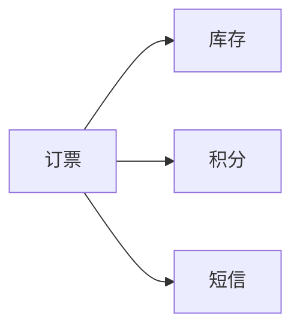
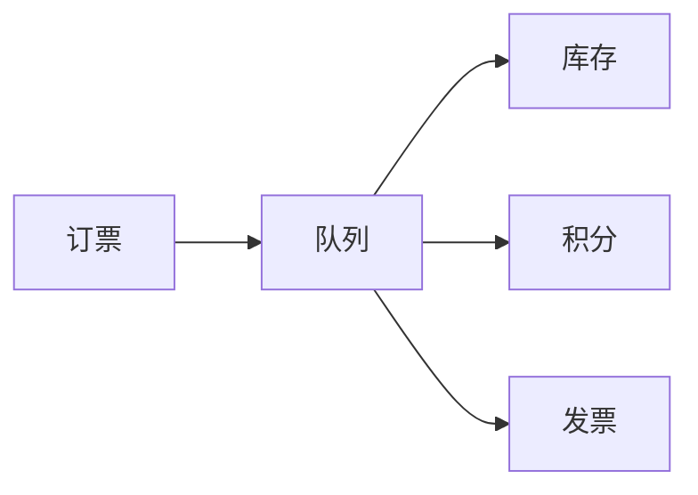
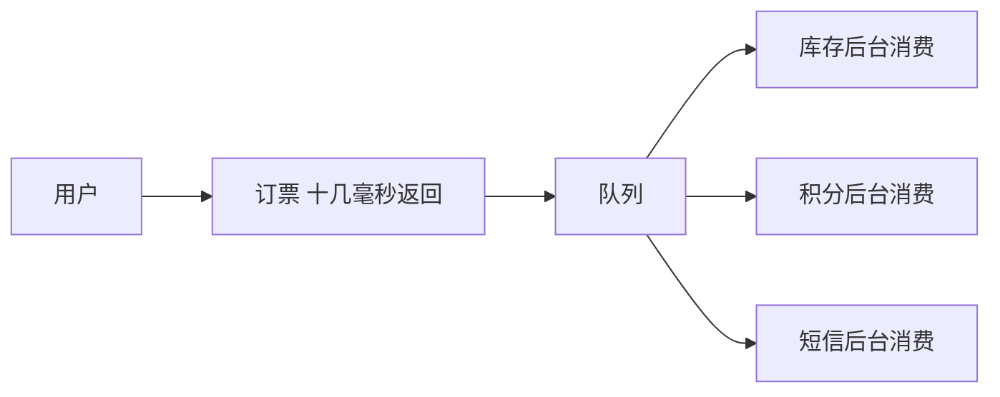
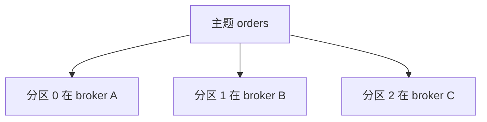
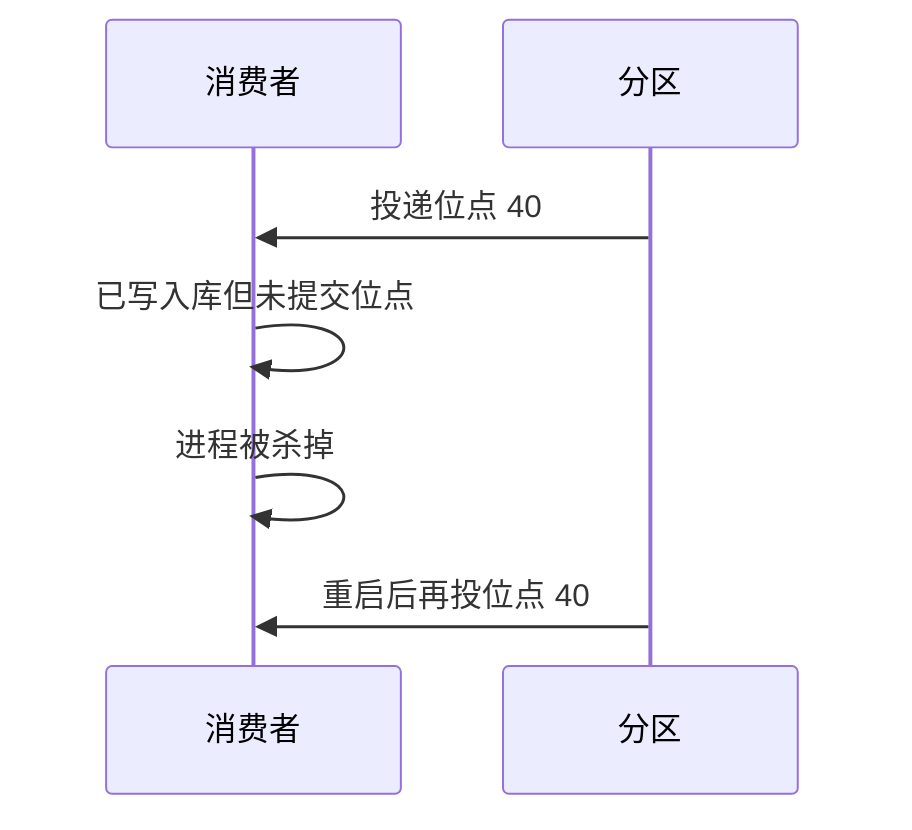
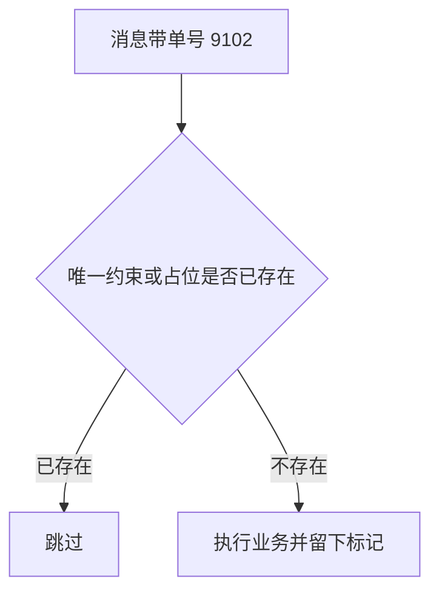
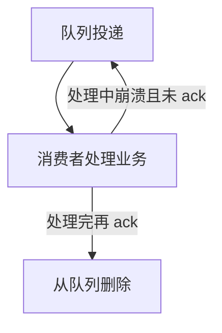
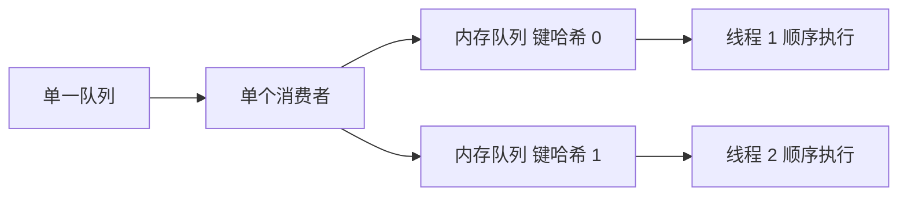
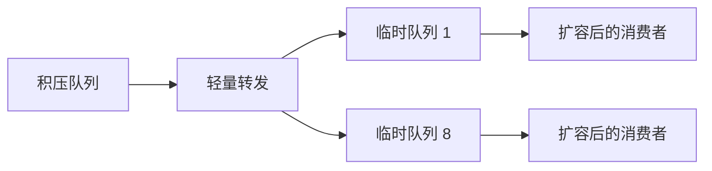

# 消息队列连环问

## 前言

面试很少只问「用过队列没有」。常见追问是一条线：

- 项目里哪一段用了队列？
- 例如订票服务每生成一张新票，就往队列丢一条；库存服务取走这条消息再减座位，而不是订票服务直接调库存。
- 为什么不直接调对方接口？
- 核心收益是异步、解耦、削峰。
- 代价是什么？
- 几种主流实现差在哪，什么场景选谁？
- 怎样做到挂一台还能收发？
- 怎样避免同一条消息被处理两次，或处理两次也不出错？
- 消息在半路丢了怎么办？
- 多条消息必须按原顺序执行时怎么保证？
- 堆积了几小时、消息过期、磁盘写满，分别怎么处理？
- 如果从零设计一个队列，骨架是什么？

好的追问不是散点，而是先从高并发聊到缓存和队列，再对队列从浅到深。

## 为什么要上队列

### 剖析

先问目的，再问选型。很多人简历上写了缓存和队列，却说不清这段调用如果不用队列会怎样，只是架构图上已有，就跟着用。讲不出「为什么」的人，后面的高可用和幂等也多半是背的。

### 解答

对方想听的是：队列适合哪类场景，你的项目属于哪一类，以及你选的产品为什么配这个场景。用途很多，面试里优先讲清三个：解耦、异步、削峰。

### 解耦

#### 不用队列时

订票成功后要通知库存、积分、短信。调用方逐个调接口，任何一个超时都要在订票代码里处理。



后来加上发票，又下线短信。订票服务每次都要改代码、改超时和失败策略，调用方被所有下游绑住。

#### 用队列之后

订票只发一条「票已生成」。谁需要谁订阅。发票上线，只加一个消费者；短信下线，只停掉那个消费者。订票不再关心对方成功、失败或超时。



这是发布订阅：生产者和消费者通过队列脱开。如果你的模块同步调了好几个系统，而这些调用并不需要立刻拿到返回值，就可以考虑改成订阅。

### 异步

#### 同步把耗时叠在一次请求里

用户点「提交订单」时，订票同步调库存 180 毫秒、积分 140 毫秒、短信 220 毫秒，用户干等大约 540 毫秒。再叠加网络，就接近 1 秒。面向用户的操作，体感上希望在大约 150 毫秒内返回，超过这个量级用户会以为页面卡死。

#### 改成丢消息就返回

订票把消息写入队列后立即返回，三个下游各自消费。用户看到的耗时只剩写入队列的几毫秒到十几毫秒，慢操作挪到后台。



### 削峰

#### 流量直接打到库

午间抢票每秒 6000 次写入，单机库在大约每秒 1500 次提交时就已经吃力，6000 会把连接和磁盘打满，整个下单不可用。午间过去后，同时在线可能只剩几千人，每秒写入掉到 30 左右，机器又闲着。峰值短、谷值长，按峰值扩库很浪费，不扩又会在峰值宕机。

#### 先收进队列再匀速消费

请求先进入队列，下游按每秒 800 条的速度落库。峰值持续二十分钟的话，队列里会暂时堆积，峰值过后慢慢消化。系统保持可用，代价是部分请求延迟完成，而不是全体失败。


## 好处和代价

好处就是上面三项。代价同样要主动讲：

- 可用性变差。原来四个服务互相调用，现在多了一个必须在线的队列。队列挂了，整条异步链路停摆。
- 复杂度上升。要处理重复消费、丢失、顺序被打乱，每一项都是额外设计。
- 一致不再瞬时。订票返回成功，只说明消息进了队列。库存和积分写成功、短信失败时，用户以为全部完成，数据却不齐。

所以队列不是加一个依赖就结束。好处要拿，坏处要用幂等、确认、死信、顺序键去补。系统会复杂一个数量级，该用的时候仍然要用。

## 几种实现怎么选

常见是 Kafka、ActiveMQ、RabbitMQ、RocketMQ。下面的量级是量级感，不是某次压测的精确值。

| 维度 | ActiveMQ | RabbitMQ | RocketMQ | Kafka |
| --- | --- | --- | --- | --- |
| 单机吞吐 | 万级，明显低于后两者 | 万级 | 十万级 | 十万级，适合日志和实时计算 |
| 延迟 | 毫秒 | 微秒到毫秒，延迟是强项 | 毫秒 | 毫秒 |
| 可用性 | 主从 | 主从，镜像队列 | 分布式，多副本 | 分布式多副本，少数节点宕机仍可用 |
| 丢数据 | 有较低概率 | 默认路径上可以做到不丢 | 参数调好后可以做到不丢 | 参数调好后可以做到不丢 |
| 功能面 | 传统特性很全 | 并发模型强，管理界面完整 | 特性较全，主题数量可以很多 | 功能相对瘦，吞吐和扩展优先 |

选型可以这么收：

- ActiveMQ 早年用得多，现在社区对 5.x 的维护变少，也缺少超大吞吐场景的普遍验证，新项目较少再选。
- RabbitMQ 在中小团队里很常见，延迟低、控制台好用。实现语言不是 Java，业务团队很难改到源码级，吞吐也低于后两者。
- RocketMQ 用 Java 实现，在大规模交易里验证过，主题多、分布式扩展方便，适合希望掌握到源码、又有交易消息的团队。
- 日志、埋点、实时计算以 Kafka 为事实标准。它更适合主题数量可控、吞吐优先的数据管道。

中小团队、并发不是极端高，优先 RabbitMQ。要吃透源码、主题很多、和交易链路绑在一起，优先 RocketMQ。数据管道用 Kafka。

## 高可用怎么做

### 剖析

问题故意不点名产品。你要先说自己用的是哪一种，再讲它的可用方案，而不是背一套通用口号。

### RabbitMQ

它的高可用建立在主从思路上，常见三种跑法。

#### 单机

本地演示用。没有人把单进程当生产。

#### 普通集群

多台机器各起一个实例，队列的元数据互相同步，但队列里的消息只躺在其中一台。其他实例接到消费请求时，再去消息所在的那台拉取。

这不是把一份数据拆开存放。要么每次消费都多一跳拉取，要么客户端固定连到持有队列的那台，后者又会把压力集中到单点。持有者宕机后，其他实例拉不到消息；即使开了落盘，也要等这台恢复才能继续。所以它主要是为了把多个队列分到多台机器上提高总吞吐，而不是为了单队列高可用。

缺点有两个：实例之间可能有大量消息搬运；持有队列的节点一挂，这个队列就不可用。


#### 镜像

镜像才是它的高可用模式。队列的元数据和消息都会复制到多个实例。写入时同步推到各个镜像。任一节点宕机，其他节点仍有完整队列，消费者可以改连过去。

代价是每条消息都要复制，网络和磁盘放大；队列很热时，加机器也不会把这个队列拆开，新机器只是再存一份全量，不能线性扩展单队列容量。

在控制台加一条策略，指定复制到全部节点或指定个数，新建队列时套用该策略即可。节点宕机不影响已镜像的队列。仍解决不了「一个队列的数据大于单机磁盘」：它不是分片存储。

### Kafka

一个集群由多个 broker 组成。主题切成多个分区，分区可以落在不同 broker 上，每个分区只保存主题的一段数据。主题因此天然分片，而不是每台机器都存全量。



RabbitMQ 的一个队列无论是否镜像，单节点上看见的都是这份队列的全部消息。Kafka 的一个分区只是主题的一片。

0.8 之前没有副本，broker 宕机后它上面的分区既不能读也不能写。之后每个分区有 leader 和若干 follower。写入只进 leader，再同步到 follower；读取也走 leader。若允许每个副本各自读写，一致性会复杂很多。副本会尽量铺到不同机器上。

leader 所在机器宕机时，控制器从仍同步的 follower 里选出新 leader，分区继续服务。每个副本并不保存整个主题，只保存自己那几个分区。

## 重复消费怎么办

### 剖析

消费就可能重复。问题本质是幂等，不是幻想中间件永不重投。RabbitMQ、RocketMQ、Kafka 都会出现重复，因为它们优先保证「至少一次」，而不是恰好一次。

以 Kafka 为例：每条消息在分区里有位点。消费者隔一段时间提交已处理的位点，重启后从该位点继续。若进程被直接杀掉，处理完还没提交，重启后会把这一小段再投一次。

重复本身不可怕，可怕的是没有想过第二次执行会不会插出第二行。



### 幂等指什么

同一条业务数据执行多次，库里的结果和执行一次相同，并且不抛出让上游误判的错误。

## 消费端怎么做幂等

同一条消息出现两次，库里仍然只有一行，才算这层幂等成立。

- 写库前按主键查：已存在就改，不存在才插。
- 若目标是 Redis 的覆盖写，多次 `SET` 同一个键天然幂等。
- 其他情况让生产者带全局唯一号，例如出票单号。消费前用这个号去 Redis 占位，占到了才执行，执行完留下标记；占不到就跳过。
- 也可以靠唯一索引。重复插入会失败，失败当成「已经处理过」即可，不要当成系统错误去重试插入。



## 怎样不丢消息

### 剖析

队列有两条底线：不能多处理出错误结果，也不能把消息弄丢。计费尤其明显。广告按点击扣费，若点击消息在链路里消失，每一次丢失都是一笔没扣到的钱，积少成多。

丢失要么发生在进队列之前或队列内部，要么发生在消费端提前确认。下面分 RabbitMQ 和「消费确认」来说，Kafka 的思路类似：生产者要等确认，broker 要落盘和副本，消费者要处理完再提交位点。

### 生产者没送进队列

网络闪断时，生产者以为发出去了，broker 没收到。事务模式是发送前开启通道事务，失败就回滚再发，成功再提交。它是同步的，吞吐会掉一截，生产上较少用。

```java
// 事务路径：失败则回滚后重发。同步等待使吞吐下降。
try {
    channel.txSelect();
    channel.basicPublish(exchange, routeKey, props, body);
    channel.txCommit();
} catch (Exception ex) {
    channel.txRollback();
    // 带同一业务单号重发，避免对端当成新账单
}
```

更常用的是确认模式：通道设成 confirm，发出后不阻塞下一条；broker 落库后回调 ack，失败则回调 nack，生产者再重发。异步确认比事务更能保住吞吐。

### 队列自己弄丢

只把消息放在内存里，进程一挂就没了。要同时做两件事：声明队列时标记为持久，发送时把投递模式设成持久（值为 2）。只持久化队列元数据、不持久化消息体，重启后队列还在、消息没了。

确认模式可以配成「落盘之后才 ack」。这样在落盘前宕机，生产者收不到 ack，会自己重发。极端情况下仍可能丢极少量，但窗口比纯内存小得多。

### 消费者提前确认

自动确认打开时，消息一交出就被当成消费完成。若业务还在处理，进程却退出了，队列不会再投，这条就丢了。应关掉自动确认，业务成功后再发 ack；处理中宕机，队列会把这条交给其他消费者。



## 顺序怎么保证

曾经做过度 binlog 的同步，一天上亿行。同一行的插入、更新、删除三条日志进了队列，消费时必须仍是这个顺序。若变成删除、更新、插入，行会被错误地留在目标库。

两种容易打乱的用法：一个队列挂多个消费者，谁先处理完谁先写库；一个分区里再开多个线程并发处理。

队列里的一条消息通常只会被一个消费者取走，但多个消费者速度不同，写库顺序仍会乱。

### RabbitMQ

拆成多个队列，每个队列只挂一个消费者，把需要保序的键哈希到固定队列。或者仍用一个队列、一个消费者，消费者内部按键放进不同内存队列，每个内存队列单线程执行。这样同一键有序，不同键仍并行。



### Kafka

同一分区内的写入顺序是固定的。要保序，就把同一业务键放进同一分区，并且这个分区只由一个线程消费。若一个消费者里再用多线程抢消息，分区内的顺序会再次被打乱。

做法是：消费者按键哈希到 N 个内存队列，每个队列一个线程。同一订单键总是进同一个内存队列。

## 堆积了上百万条怎么办

堆积往往是生产事故：消费者每处理一条要写库，库挂了或变慢，消费停住，消息在队列里躺几个小时。

### 只是堆积，消息还在

例如 800 万条积了 6 小时。一个消费者每秒 600 条，4 个是每秒 2400 条，一分钟约 14.4 万，800 万条约 55 分钟才能消化。能等就等，不能等就临时扩。

- 先修好消费者，让单条处理恢复到正常耗时，然后停掉现有消费者。
- 临时建大约 8 倍数量的队列。
- 写一个只做转发的程序：把积压消息均匀写进这些临时队列，不做业务。
- 临时扩 8 倍机器，每组只消费一个临时队列。

整体速度大约变成原来的 8 倍。转发本身要快，不能在转发里做原来的慢逻辑。



### 堆积期间消息已过期

有的队列可以给消息设存活时间。积压超过存活时间后，消息被删掉，问题从「慢」变成「丢」。这时加消费者没有用，因为队列里已经空了。

等峰值过去，用离线数据把丢失的业务键查出来再补投。例如 2 万张订单进过队列，其中 1500 张已过期，就按这 1500 个单号重放，而不是把全量再灌一遍。

### 磁盘被写满

转发扩容来不及时，队列磁盘先满，生产者也会失败。临时程序改为「取到就丢弃」，尽快把磁盘腾出来，恢复收发。被丢弃的部分仍按上一节，在低峰用业务库补投。先保队列活着，再补数据。

## 从零设计一个队列

不要求你写过某份源码，但要能说出骨架。

- 能扩容。参考「节点、主题、分区」：一个分区放一部分数据。容量不够就加分区、迁走一部分、加机器。吞吐和容量一起涨。
- 要不要落盘。要防丢就落盘，并且顺序追加，避免随机写。顺序写的吞吐远好于随机写。
- 高可用用多副本：一个 leader 写入，follower 跟随；leader 消失就从 follower 里再选。
- 若要求接近不丢：生产者等待副本确认，消费者处理完再提交位点，磁盘用同步刷盘或按时间刷盘，并讲清你接受丢失的窗口。

真正的产品比这四条复杂得多。这道题看的是你能不能从扩展、持久化、副本、确认四件事把系统设计圆，而不是背 API。

## 把一条订票链路串起来

用同一组数字把前面几问答完，比分开背定义更稳。场次 SH-19 开售，订票服务每秒接到 4500 次下单。库存库只能承受每秒 700 次扣减，所以订票只负责落自己的订单并发送「待扣座」，立即给用户「排队中」。库存服务按每秒 700 条消费。峰值持续 8 分钟时，队列里大约会暂时留下 `(4500-700)×480 ≈ 182 万` 条。峰值过后若仍按 700 条每秒消化，大约还要 40 多分钟才能排空。这就是削峰：用户请求没有失败，完成时间被拉长。

解耦体现在同一条消息上还挂着积分和出票短信。三个月后短信供应商更换，只改短信消费者，订票服务的发送代码不动。异步体现在用户点击后 20 毫秒内得到受理号，而扣座、积分、短信在后台完成。若改回同步，180 毫秒的扣座加上 160 毫秒的积分，页面就会超过 150 毫秒的体感预算。

高可用按产品分开讲。若用镜像队列，策略设成复制到 2 个节点：一台机器重启，另一台仍能被消费。若用分区日志，主题 `seat-hold` 设 6 个分区、每个分区 2 个副本，领导副本宕机后由跟随副本接上，主题不会整段不可用。

幂等用扣座单号 `H-19077`。库存表对这个单号建唯一约束。第一次消费插入成功并扣掉 1 个座位；进程在提交位点前被杀掉，消息再来一次，插入冲突，消费者把它当成已处理并提交位点，座位不会被扣成 2。

不丢要三处一起做：发送端等落盘确认；队列本身持久且至少一份副本确认；消费者处理完再确认。只做其中一处，丢失会留在另外两处。例如自动确认打开时，消息刚到内存、扣座语句还没执行，进程退出，队列已经认为消费完成。

顺序用座位行的变更日志说明。同一座位先锁定、再支付、再释放，三条必须进同一分区，并由该分区的单个线程按位点执行。若三个线程抢着执行，可能先执行释放，锁定后到，座位会被错误地留下。

积压升级成过期时不要再扩消费者。假设存活时间是 30 分钟，上面那 182 万条里有 2 万条在库存库恢复前被删掉。低峰用订单库把这 2 万个单号查出来重投，而不是把全天订单再灌一遍。磁盘若先写满，先用丢弃式消费者把队列腾空，恢复收发能力，再按同样的单号清单补投。

从零设计时就按这套容量留余量：6 个分区足以把每秒 4500 条摊开；副本数 2；刷盘间隔若接受丢 1 秒，就不要每条都强制刷盘。把这些数字和取舍讲出来，比只说「我们用了队列」更完整。

再补三个容易被追问的岔路。第一，确认模式是异步的，发送线程可以连续发出 100 条再统一处理回调。若回调线程里同步重试并阻塞，确认模式就退化成事务，每秒发送量会从几千掉到几百。重试要放进另一条带单号的队列，并限制次数，例如最多 5 次、间隔 2 秒。第二，镜像队列复制份数不是越多越好。3 节点全镜像时，一条 1KB 消息要写 3 份，网卡和磁盘都放大。场次 SH-19 每秒 4500 条时，全镜像大约是每秒 13MB 量级的复制；改成复制 2 份就少掉三分之一。单队列大到超过单机磁盘时，镜像解决不了，要换成按分区拆开的日志。第三，积压扩容的转发程序必须无业务逻辑。若转发时仍去查库存，它自己会成为新的瓶颈，8 倍队列也消化不了。转发只做取消息和按序号取模写入，业务仍留在扩容后的消费者里。磁盘告警阈值可以设在 70%，到了就先丢弃再补投，不要等到 100% 写不进去才处理。

顺序键的选择也要提前说清。用用户编号做分区键时，同一个用户的锁定、支付、释放会进同一分区，顺序有保证，但热门用户会把一个分区打满。用座位编号更匀，前提是这三条日志的键都是座位而不是订单。键在三条消息里不一致，哈希就会把它们分进不同分区，内存队列也救不回来。所以保序从生产者选键开始，不是从消费者加线程开始。

重复消费和丢失不要用同一种开关去「兼顾」。把确认关得太晚，消息不容易丢，但进程崩溃后会重投，必须幂等。把确认开得太早，重复变少，丢失变多。订票链路选择晚确认加上唯一单号，接受少量重投，不接受座位少扣。日志采集则可以接受丢一小段，换更高的批量确认。两种业务不要共用同一套确认参数。同一集群里可以用不同队列分开，座位队列晚确认，日志队列批量确认，互不影响磁盘和重试策略。参数写在队列上，不要写在集群全局，否则一次调整会同时改变两条链路。

## 这一串问题怎么收

水平够的面试官会沿着一条线问到底，从「为什么用」问到某一种实现的源码，再扣回你的业务：哪一种消息、重复了怎么办、丢了怎么发现、顺序键是什么。把上面几段和项目里的真实链路对上，比单独背比较表更有用。
