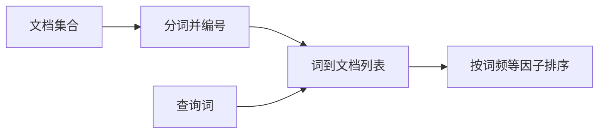
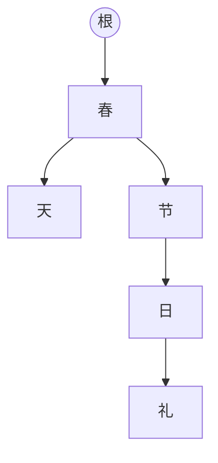
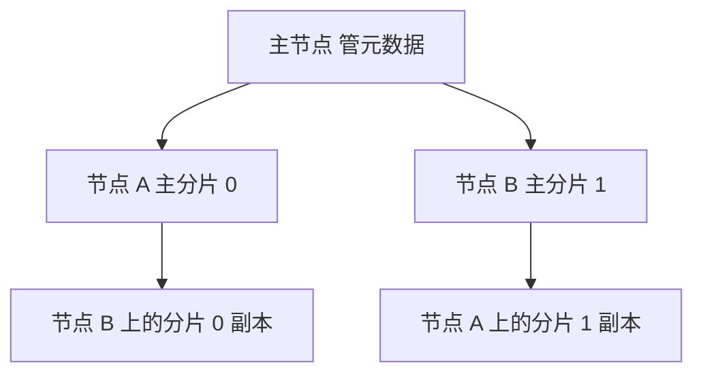
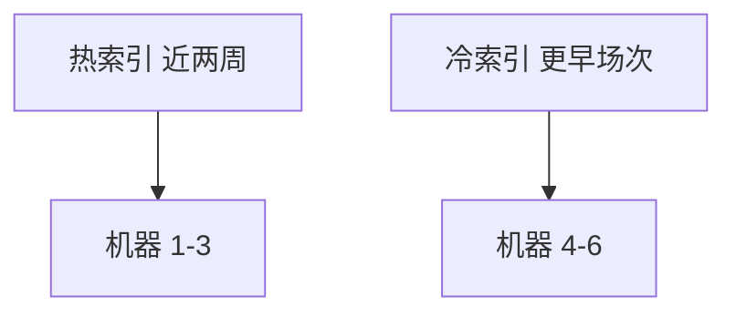

# 分布式搜索连环问

业界现在的默认选择是 Elasticsearch。更早一批系统用 Solr。两者底下都是 Lucene，而 Lucene 能做全文检索，靠的是倒排。

## 倒排是什么

倒排用来快速回答「哪些文档包含这个词」。它由不重复的词组成，每个词后面挂着包含它的文档编号列表。

假设馆藏里有四篇短文，编号 11 到 14：

- 11：雨天适合喝热茶
- 12：热茶配点心
- 13：雨天图书馆很安静
- 14：点心铺在图书馆旁边

中文没有天然空格，要先分词，再给每个不同的词一个编号，并记下它出现在哪些文档。最简倒排可以是：

| 词 | 文档 |
| --- | --- |
| 雨天 | 11, 13 |
| 热茶 | 11, 12 |
| 点心 | 12, 14 |
| 图书馆 | 13, 14 |

还可以记下词频，也就是这个词在该文档里出现了几次。排序时，词频是查询和文档是否相像的一个因子。再进一步，列表里可以带上出现位置：

```text
热茶 -> (11, <2>, 1), (12, <1>, 1)
```

含义是：文档 11 的第 2 个词出现一次，文档 12 的第 1 个词出现一次。用户搜「热茶」时，直接读这行就能拿出候选文档，再用词频和文档频率算分，按分数从高到低返回。这就是检索系统内部的一段路径，而不是把每篇文档从头扫一遍。



## 中文分词

### 词典逐词尝试

内存里放一本词典。扫描句子时，从当前位置取出越来越长的片段，看词典里有没有。有就切出一个词。方法直观，句子一长，重复比较会变多。

### 词典树

Trie 是一棵共享前缀的树，常用来存大量字符串。同一个前缀只走一次，比把每个候选都拿去哈希表里查更省。

词典收这八个词：春天、春节、节日、日历、节日礼物、生气、生活、生日。树的每一层边是一个字，走到标了词尾的节点就得到一个词。

用这棵树切「春节日历」：从根沿「春」走到「春节」，再往下没有更长的词，第一轮得到「春节」。接着从「节」出发得到「节日」，再处理后面的字。词典扫描要对「春」「春节」「春节日」「春节日历」各查一次；树在走到「春节」且没有更长分支时就停，句子越长，少掉的比较越多。



### 失败指针

切完「春节」后，若没有以「春」开头的更长词，朴素做法要回到根，再从「节」开始。如果「节」这个节点有一根指针直接指向「节日」那条路径上的对应节点，就可以少一次从根重走。这种「当前节点匹配不下去时跳到哪」的指针就是失败指针。带失败指针的树，也就是 AC 自动机那一层想法。

建立顺序：

- 先把词典树建完。
- 用广度优先遍历。必须先完成上一层的失败指针，下一层才能引用它，所以不能用深度优先。
- 根的直接子节点，失败指针都指回根。
- 其他节点看父节点的失败指针所指向的节点，它的子节点里有没有同一个字。有就把失败指针指过去；没有就再沿那一节点的失败指针找，直到找到或回到根。

查询时沿树往下走，走不动就跳失败指针，而不是每次都回到句首重扫。


## 集群是怎么搭起来的

设计目标就是多机检索，存储和查询的基本单位仍来自 Lucene。多台机器上各自启动进程，组成一个集群。

存数据的基本单位是索引。要存演出票，就建一个索引 `show_ticket`，全部票文档写进它。可以把索引类比成一组结构接近的表。层级是：索引、类型、映射、文档、字段。

类型用来放「大部分字段相同、少量字段不同」的文档。例如同一索引里，实体票有座位号，电子票有兑换码，其余场次、价格、用户都一样，就可以分成两个类型。很多索引其实只有一个类型。若一个索引里有多个类型，索引像一类业务，类型更接近具体表。映射就是这个类型的字段定义：字段名、类型、是否分词。

写入的一条记录叫文档，相当于一行。文档由多个字段组成。

一个索引再切成多个分片，每个分片存一部分文档。每个分片有一个主分片负责写，另有若干副本分片。主分片写完后把变更同步到副本。某台机器宕机，同一分片在别的机器上还有副本。

集群会选出一个主节点，它管元数据：索引有哪些分片、主分片和副本的身份切换。主节点宕机就再选一个。非主节点宕机时，由主节点把失效的主分片身份交给存活的副本。机器修复重新加入后，主节点再把缺少的副本补回去并追数据。



## 写入、读取和搜索


### 写入

1. 客户端把请求打到任意节点，这个节点成为协调节点。
2. 协调节点按文档路由到持有主分片的节点。
3. 主分片执行写入，再同步到副本。
4. 主分片和所需副本都完成后，协调节点才向客户端返回。

### 按编号读取

每条文档有全局编号，也可以由业务指定，例如票号。编号经过哈希决定落在哪个分片。读取时：

1. 请求进入任意协调节点。
2. 按编号算出分片，再用轮询在主分片和副本之间挑一个，让读流量摊开。
3. 该节点把文档还给协调节点。
4. 协调节点回给客户端。

### 搜索

全文检索不是按编号取一条，而是按词找一批。例如三条文档：「雨天看剧」「雨天堵车」「夜场演出」。搜「雨天」，应返回前两篇。

1. 请求进入协调节点。
2. 协调节点把查询分发到该索引的每一个分片（主或副本都可以）。
3. 查询阶段：各分片只回文档编号和分数，协调节点合并、排序、分页。
4. 取回阶段：协调节点再按编号到对应分片拉取正文，返回客户端。

和事务库的差别在于：库多半是按行存，条件查询要扫行；倒排是先按词找到行号，再取行。

### 写入落到磁盘的路径

一条文档不会立刻变成可搜索的磁盘文件。

1. 先进入内存缓冲，此时搜不到；同时把操作追加到 translog。
2. 缓冲快满或到达时间点，就刷新成一个新的段。段先进入操作系统缓存，还不一定在磁盘上。默认大约每秒刷新一次，所以这一秒里的写入，下一秒才能被搜到，称为近实时。缓冲为空就不必制造空段。也可以用接口手动刷新，让数据马上可搜。刷新之后缓冲清空，translog 仍保留。数据只要进了操作系统缓存就可以被搜。
3. 重复上述步骤，translog 会变大。大到阈值或到达周期，就做一次提交，对外叫 flush。
4. 提交时先把缓冲刷进操作系统缓存，写一个提交点，点名这次包含哪些段，再把操作系统缓存强制刷到磁盘，然后清空 translog，另起一个新文件。默认周期可以是几十分钟，translog 过大也会提前触发。
5. translog 自己往往也先写进操作系统缓存，默认大约每 5 秒刷一次盘。机器在这 5 秒内宕机，缓冲和 translog 缓存里的操作会丢。可以把 translog 改成每次写入都刷盘，丢失窗口接近零，写吞吐会明显下降，例如从每秒 1500 条掉到每秒一两百条。
6. 删除不会马上从段里抹掉，而是写进 `.del`，搜索时跳过这些编号。更新等于把旧文档标删除，再写一条新文档。
7. 段太多时做合并：多个段合成一个，把标了删除的文档物理去掉，写新的提交点，删掉旧段。

四个词要记清：refresh 让数据可搜，flush 才真正提交到磁盘，translog 用来在宕机后重放，merge 用来收拾段和删除标记。

若面试没问丢数据，也可以主动补一句：默认近实时，大约 1 秒后可搜；大约 5 秒的操作可能只在内存缓存里，宕机会丢这几秒。不能丢就让 translog 每次刷盘，并接受写吞吐下降。

## 几十亿文档时查询怎么变快

没有一个参数能治所有慢查询。下面是按场景拆开的办法。

### 把段留在文件系统缓存里

操作系统会把热点文件页放进内存。检索非常依赖这块缓存。段文件若都能留在内存，查询就是内存访问；一旦大量走磁盘，耗时经常从几十毫秒变成数秒。

例如 4 台机器，每台 64G，堆各 30G，留给文件系统缓存的大约每台 20G，集群合计约 80G。索引文件在磁盘上占了 800G，缓存只能装下大约十分之一，大部分查询会读盘。

经验是：留给缓存的内存至少覆盖热点数据的一半，查询才比较稳。更稳的做法是索引里只放要搜的字段。一行业务有 40 列，搜索只用演出名、城市、日期这三列，就把这三列写入检索，其余放在适合按主键取行的存储里，例如 HBase 或数据库。检索返回 15 个编号，再用编号去取完整行。检索 15 毫秒加回表 25 毫秒，远好过把 800G 全塞进检索、每次 6 到 12 秒。

写入检索的体积应接近、最好略小于文件系统缓存。100 个字段里只有 8 个参与搜索，就只放这 8 个。

### 热点预热

即使做了字段裁剪，单机 50G 数据、缓存只有 24G，仍有一半在盘上。对已知热点，例如每周都在搜的那几场演出，后台每 2 分钟主动查一次，把对应页留在缓存里。用户真正搜索时就走内存。

### 冷热分开放

访问很少的历史场次单独一个索引，近两周的场次另一个索引。6 台机器里 3 台只放热索引，3 台只放冷索引，避免冷段把热段从缓存里挤出去。热数据若只占总文档一成，又独占缓存，多数请求会很快；冷查询慢一点，只影响少数请求。



### 文档模型不要在查询时再关联

库里有两张表。票表：`id=7, code=T-19, amount=360`。明细：一行是票 7、商品 3、数量 2、单价 120；另一行是票 7、商品 8、数量 1、单价 120。库里可以用连接查。检索里做连接、嵌套父子，代价高，分页和缓存都不友好。

写入时就做成查询友好的文档：明细索引的每一行已经带上票号、总价、商品和数量。关联在写路径完成，查询只做过滤和排序。实在复杂的计算，用程序在检索结果之外做，而不是在查询语句里完成。

### 深分页

每页 15 条，要第 80 页。协调节点必须从每个分片拿前 80×15=1200 条，6 个分片就是 7200 条，合并排序后再切出那 15 条。页码越深，每个分片返回越多，协调节点越慢。前几页可能 40 毫秒，翻到几十页会到数秒。

两条出路：

- 产品上禁止深翻，只允许前若干页。
- 若是信息流不断向下加载，用游标接口。它先保留一段时间的快照，之后按游标取下一页，代价不随页码线性涨，但不能从第 10 页跳到第 90 页再跳回第 3 页。快照也不要维持几个小时。

## 线上集群长什么样

这道题考的是你有没有真部署过。没部署过也不要编造监控截图，给一套自洽的规模即可，并说明这是练习用的数量级。

一套练习集群可以是：4 台，每台 8 核 48G，合计内存 192G。每天新增约 800 万条、大约 180MB，一个月约 2.4 亿条、约 5.4G。跑了四个月后，集群存量大约 22G。线上 4 个索引，每个约 5G，各 6 个主分片。这个体量下缓存能罩住热段，分片数也比「数据很少却开很多分片」更合适。真正面试时，把台数、单条大小、日增量和分片数换成你环境里的数字。

## 用一场检索把路径走完

文档仍用前面的四篇短文。查询「雨天」只命中倒排里的 11 和 13。若再要求短语「热茶」，就用位置：文档 11 里「热」和「茶」是否相邻。没有位置信息时，只能知道文档里有这两个字，不能区分「热茶」和「茶很热」。所以排序因子至少要准备词频，短语检索还要位置。中文分词若把「热茶」切成两个单字，倒排里就没有「热茶」这一行，查询要改成按字再做邻近。分词词典和查询用的分析器必须是同一套，否则写入和搜索对不齐。

词典树再用「春节日历」走一遍失败指针。第一轮吃到「春节」为止。失败指针把「节」跳到「节日」那条边的起点，下一字「日」就能接上，而不必把「节日历」从根重新比。广度优先建指针时，若先用深度优先，子节点会引用父节点还没算完的失败指针，跳转目标是错的。这一步讲不清时，画三层字节点比背「AC 自动机」四个字有用。

写入一条票档文档，按秒来看。第 0 毫秒进入缓冲并追加 translog，此时搜索仍是旧结果。默认 1 秒刷新后，段进入操作系统缓存，搜索能看见新票价。若进程在刷新前被杀掉，而 translog 还没刷盘，这条可能丢失。默认大约 5 秒刷一次 translog，所以要主动说明：可搜和已落盘不是同一时刻。30 分钟一次的 flush 会写提交点、把缓存强刷进磁盘并清空 translog。刷新只影响「能不能搜」，提交才影响「宕机后还在不在」。

删除票号 15：段里的旧文档先留着，`.del` 记下 15。搜索跳过它。更新票价等于删除旧文档再写新文档，所以更新很密时删除标记会变多，段文件看起来比真实文档大。合并把多个段收成一个，物理去掉标记过的文档，并写新的提交点。合并本身吃磁盘，不要在导入高峰手动把所有段并成一个。

容量用 4 台、每台缓存约 20G、合计 80G 来算。全字段索引 800G 时，大约九成查询要读盘，P99 到 6 秒不奇怪。只把演出名、城市、日期三列写入，体积降到 70G，能放进 80G 缓存，同样的查询可以回到几十毫秒。回表 15 个编号，每个再花 2 毫秒去数据库取剩余 37 列，额外大约 30 毫秒，总时间仍远小于 6 秒。若热数据只占 70G 里的一成，再把近两周放进单独索引、独占其中 2 台机器的缓存，绝大多数请求不和三年前的场次抢内存。

深分页用页大小 15、第 80 页、6 个分片：每个分片贡献前 1200 个候选，协调节点合并 7200 条才切出 15 条。第 2 页只需要每个分片前 30 条，所以「越翻越慢」是结构问题，不是没加机器。信息流改用游标后，每一页的代价接近常数，但不能跳页。快照保留 2 分钟足够一次下拉，保留 2 小时会占着段不让合并。

文档模型再看那张票。库里连接可以得到两行明细。检索里若在查询时做连接，分页会发生在连接之后，协调节点要先拉回远超一页的数据。写入明细时就把票号、总价 360、商品和数量放进同一条文档，过滤「总价大于 300 且商品为 3」只打一个索引。需要两张索引才能完成的关联，尽量在写入程序里做完。

集群规模要和分片数一起讲。22G 数据开 4 个索引、每个 6 个主分片，主分片共 24 个，每片大约 1G 不到，恢复和迁移都轻。若把每个索引开成 60 个分片，每片只有几十兆，集群元数据和段数量会先成为负担。分片数按「单片几十 GB 以内、总数不要远超节点数的十倍」来估，而不是越大越并行。副本数至少 1，否则一台机器宕机时那个主分片既不能写也不能被提升。主节点只负责元数据，不建议把全部主分片都堆在同一台，否则它既要管集群又要扛写入。

刷新和提交还可以用一条时间线对着讲。10:00:00.100 写入票价 186，此时搜索仍返回旧价 180。10:00:01 刷新，搜索开始返回 186，但磁盘上的段可能还没有这条。10:00:05 translog 刷盘，机器若在此之前断电，重启后重放日志也找不到这 5 秒里没刷下去的操作，搜索会退回旧价。10:30 的提交把操作系统缓存强刷进磁盘并换新的 translog。此后即使日志是空的，段文件里已经有 186。把「1 秒可搜、5 秒可能丢、30 分钟才提交」三句话和这条时间线对齐，近实时就不会被说成「写完立刻可搜且不会丢」。

若业务要求不能丢这 5 秒，就把 translog 改成每次写入都刷盘。写吞吐可能从每秒 1500 降到每秒 200，导入任务就要加机器或拉长窗口，不能只在查询侧加节点。查询侧加节点只能分摊读，不会让刷盘变快。

冷热分离后再看缓存命中。热索引 8G，放在两台各有 20G 缓存的机器上，热段可以常驻。冷索引 60G 放在另外两台，缓存装不下，查询到秒级也可以接受，因为只有一成请求会查三年前的场次。若冷热仍在同一个索引，一次大范围的历史统计会把热段从缓存里挤出去，接下来几分钟的热查询全部变慢。预热程序每 2 分钟查询一次本周十场热门演出，是为了在统计任务之后把热页抢回来。

分页和游标不要混在一个接口里。后台对账需要跳到第 80 页，只能用普通分页，并且限制最多 50 页，超过就要求改用条件缩小范围。前台下拉用游标，保留 90 秒。用户把页面放了 10 分钟再拉，游标过期，就从当前条件重新开一个快照，而不是报500。跳页需求若一定要，应把「第 N 页」改成「从上一页最后一条的排序值继续」，让每个分片按这个值过滤，而不是每个分片都回传前 N 页。

分词失败指针再用短句验证。词典只有「春」「春节」「节日」。句子「春节日」走到「春节」后，失败指针应让下一字能从「节」继续，得到「节日」，而不是只输出「春节」就结束。若指针指回根，仍能出结果，但每个字都重新下探，长文本上会慢一截。建树用广度优先，是为了保证父节点的指针已经就绪。这一点和集群主节点选举无关，面试里两段不要揉成一句「搜索很复杂」。

协调节点本身不存数据，只负责转发。三台数据节点之外，客户端连到任意一台都可以当协调者，所以数据节点也要留出转发的 CPU，不要把堆设到物理内存的全部。4 台各 48G，堆 30G 已经偏高，文件系统缓存会被挤到十几 G。更常见的是堆大约 30G 封顶附近再留一半给缓存。堆再大，垃圾回收的停顿会让查询超时，缓存再大也补不回停顿的那几百毫秒。

副本同步失败时，主分片仍可写，但副本数不够的索引会变成黄色状态。一台机器磁盘满了，不要继续往这台分配新分片。22G 的练习集群磁盘不是问题；若日增 180MB 连续写满一块 200G 的盘，要先看是段合并留下了双倍空间，还是把不该进索引的大字段也写进去了。合并期间旧段和新段会同时存在，磁盘至少留出一倍余量，否则合并写到一半失败，查询仍能用旧段，但删除标记清不掉，文件会越来越大。

路由也可以用票号手算一次。文档编号若由业务指定为票号 8800，哈希后落到分片 2，则读取只访问分片 2 的主或副本，不会问其他分片。搜索「杭州」则没有编号，协调节点必须问到该索引的每一个分片，再把文档编号和分数合在一起。所以「按号取一条」和「按词搜一批」的耗时模型不同：前者随副本数可以摊开，后者随分片数线性增加协调成本。分片从 6 加到 12，按号读取几乎不变，全文搜索的合并量大约翻倍。这就是小索引不要盲目加分片的原因。

写入程序还要处理版本冲突。两条请求同时改票号 8800 的价格，后写的会把先写的标成删除再插入新文档。若没有外部版本号，后到的旧请求可能覆盖新价格。给文档带上库里的更新时间，写入时要求新时间更大，搜索侧才不会把 180 写回已经是 186 的票。这个判断放在写入程序里，不要指望搜索引擎替你做数据库那种行锁。冲突的旧写入直接丢弃并记日志，查询侧不会看见价格来回跳。日志里记下票号和被丢弃的价格，方便对账时确认库里的 186 才是最终值，搜索侧只是晚到了同一次刷新。刷新周期仍大约 1 秒，所以对账不要在写入后立刻断言搜索结果，至少等一次刷新再查。需要立刻可见时，写入后主动调用一次刷新，再查这一条，不要为了这一条把全局刷新改成更密。手动刷新只影响这一次可见性，不会把 translog 提前刷进磁盘，宕机窗口仍按刷盘周期计算，不要把两次操作当成同一件事。
