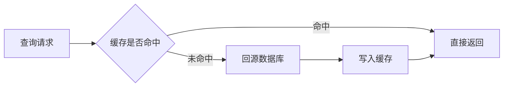
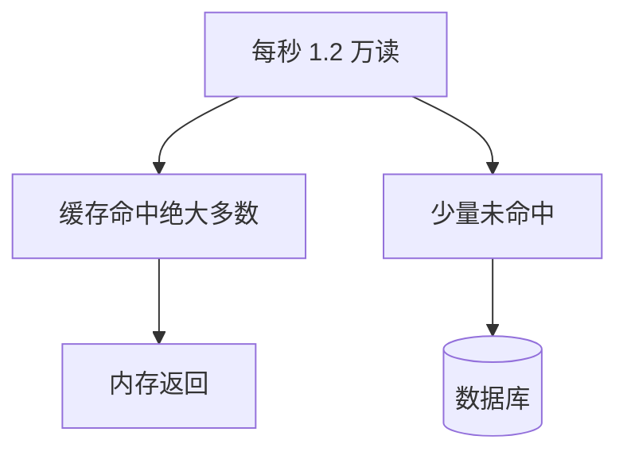

# 分布式缓存

项目里缓存放在哪？放错了会出什么事？

## 项目里为什么要加缓存？

常见目的就两个：把慢查询变快，以及挡住数据库吃不消的读流量。

### 把响应时间压下来

有个报表接口要跑 8 条关联语句，稳定耗时 450 毫秒，而这份汇总在随后 3 小时内不会变，晚一点刷新用户也能接受。第一次算完后按业务键写入缓存，下一次用同一个键直接取出，耗时大约 1 毫秒，响应差了两个数量级。适合放进去的，是计算贵、读得勤、短时间内允许略旧的结果。

### 把读并发从库上挪走

关系库单机读到大约每秒 1500 次就容易告警，因为它要走磁盘和锁。内存缓存没有这层负担，单机每秒几万到十几万次简单读取很常见，大约是单机库的几十倍。

若晚高峰一个接口每秒 1.2 万次读取，单机库会先垮。把热点记录放进键值缓存，请求多数在内存里结束，库只接未命中和写入。

#### 缓存为什么更能扛并发

数据在内存里寻址，没有每次随机读盘。库的数据页在磁盘上，连接和缓冲池先成为上限，所以不宜按每秒数千以上去规划单机。

#### 用错缓存会带来的问题

至少要能讲清这四类：

- 缓存和库各写一份，两边暂时或长期不一致
- 查询根本不存在的键，每次都穿透到库
- 大量键同时失效，流量瞬间全部打到库
- 同一个键被并发回源，把库打出重复压力
