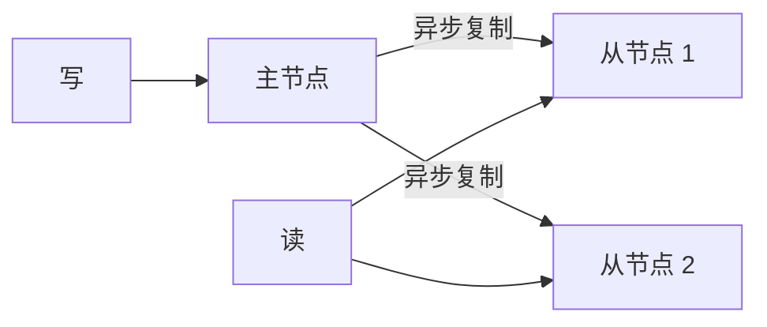
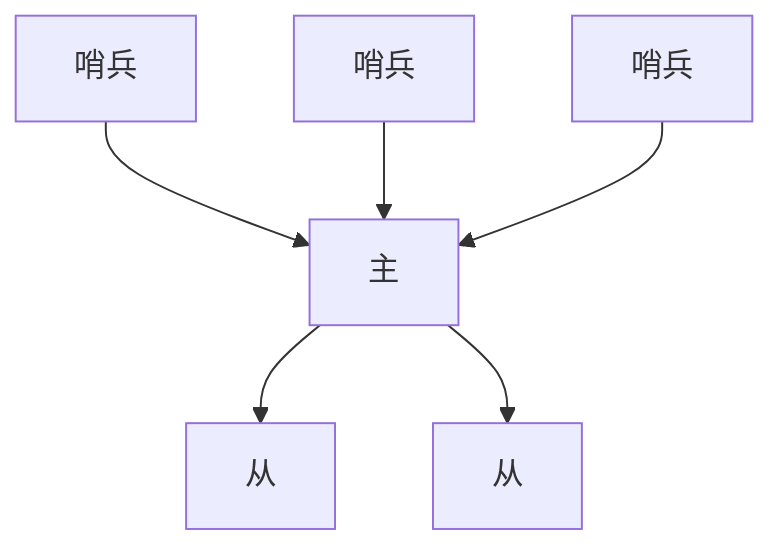

# Redis 基础连环问

## 面试题

- 和 Memcached 比，差在哪？
- 线程模型是什么样？
- 有哪些数据结构，分别适合什么？
- 为什么单线程还能比多线程的缓存更快？
- 单线程凭什么扛高并发？
- 读写分离怎样把读取顶到很高的 QPS？
- RDB 和 AOF 各有什么得失？
- 过期和内存淘汰怎么配合？
- 高并发和高可用分别靠什么？
- 主从复制的步骤？
- 哨兵做什么，底层怎么判断宕机和选主？
- 主从切换时，异步复制和脑裂会丢哪些数据？

## 剖析

最核心的运行特点是：命令在一个线程里执行，网络层用多路复用接很多连接。Memcached 早年用得很多，近几年业务缓存几乎都转到 Redis。单个字符串值的上限是 512MB，键也受同样量级限制，不要把超大对象塞进一个键。

## 和 Memcached 的差别

- 结构更多。对方要改一个字段，Memcached 往往得把整个值取回客户端改完再写回，多一次网络来回。Redis 可以在服务端直接改哈希字段或列表，复杂度和一次普通读写接近。
- 内存。纯字符串键值时，Memcached 更省。Redis 把小字段收进哈希并压缩后，同样的对象可能更省。
- 吞吐。Redis 命令线程主要吃一个核，小值时单核效率往往更高；值大到大约百 KB 以上时，多核能摊开的 Memcached 可能更快。Redis 后来对大值也有优化，但不必假设它在所有尺寸上都领先。
- 集群。Memcached 没有官方分片，分片在客户端。Redis 有官方集群模式，槽位由服务端管。

## 数据结构

- 字符串：最基本的键值，适合计数器、令牌、整段 JSON。
- 哈希：一个键下面多个字段，适合没有再嵌套的对象。例如场次 `show:88` 里放 `city=杭州`、`price=186`、`left=42`。改库存只动 `left`，不必重写整个对象。
- 列表：有序、可重复。粉丝时间线、评论楼层可以用它。按区间取出一段，就能做「继续下拉」这种翻页。也可以从一端推进、另一端弹出，当成简单队列，但没有确认和堆积治理，不能替代正式消息中间件。
- 集合：无序且去重。多机部署时，进程内的集合去不了全局重，把用户编号放进 Redis 集合即可。还能做交集并集，例如两个账号的关注列表求共同关注。
- 有序集合：成员唯一，另外带一个分数排序。分数用时间戳就是时间线；用积分就是排行榜。

```text
ZADD rank 91 nova
ZADD rank 77 kai
ZADD rank 88 mica
ZREVRANGE rank 0 1
```

上面会先看到 nova 的 91，再看到 mica 的 88。`ZRANK` 可以查某个成员排第几。样例不要再用固定的人名分数，面试时换成你业务里的分值。

## 持久化是为了什么

内存里的数据会随进程退出消失。持久化把数据留在磁盘上，再复制到别处，进程重启后能恢复。它是可用性的一环，不是用来替代数据库。

只把 Redis 当缓存、又完全关掉持久化时，进程一挂，所有请求打到数据库，数据库会被打满，这就是雪崩的一种触发。重启后若磁盘上没有快照或日志，缓存也补不回来，因为缓存的内容本来是从库里装进去的，库若已经被打挂，就没有机会回暖。

### RDB

隔一段时间把内存打成一份紧凑快照。恢复时直接加载这份文件。

### AOF

把写命令追加到日志。重启时重放命令重建数据。文件会随写入变大，但内存里的键数量有上限，日志不会因为「内存无限涨」而无限涨。内存满了会按淘汰策略删键。日志大到阈值后做重写：按当前内存重新生成一份更短的命令文件，替换旧文件。

两种都开时，重启优先用 AOF，因为它通常比上一份快照更新。

### RDB 的好处

- 每一份文件都是某一时刻的全量，适合拷到别处做冷备。AOF 只有一份不断追加的日志，冷备要自己定时复制。快照由服务端按间隔生成，省得自己写定时脚本。
- 主进程只负责 fork 出子进程写盘，平时的读写不逐条刷日志，对延迟影响小。
- 恢复快。快照是数据而不是命令，加载进内存即可。AOF 要逐条重放。

### RDB 的坏处

- 间隔常常是数分钟。按 5 分钟一份来估，宕机就可能丢掉这 5 分钟的写入。它不适合当唯一的恢复手段。
- 数据很大时，fork 可能让主进程卡顿数毫秒甚至更久。间隔太长、单份文件太大，卡顿更明显。

### AOF 的好处

- 后台每秒刷一次盘时，最多丢大约 1 秒。
- 追加写，没有随机寻址，文件尾部损坏也容易截掉坏尾。
- 重写在后台进行，重写期间旧文件继续追加，完成后切换，不挡住线上读写。
- 日志可读。有人误执行清空命令时，若重写还没发生，可以拷出文件、删掉最后那条清空、再用来恢复。

### AOF 的坏处

- 同一份数据，日志通常比快照大。
- 每秒刷盘会让写 QPS 低于只做快照的情况。若改成每条命令都刷盘，QPS 会掉更多。
- 重写、切换、重放的路径比「加载一份快照」复杂，历史上也更容易出缺陷。现在的重写是按内存现状重造命令，而不是把旧命令拼接起来，健壮一些。
- 恢复慢，冷备也不如多份快照直观。

### 怎么选

不要只留快照，否则宕机丢的窗口太大。也不要只留日志：冷备恢复慢，而且少了一份结构简单的全量。两边一起开：日志负责尽量少丢，快照负责冷备和日志损坏时的快速恢复。

## 线程模型

网络事件由文件事件处理器承担，它是单线程的。多路复用同时盯着很多套接字，哪个套接字就绪，就交给对应的处理器。因为只有一个线程在跑命令，内部模块不用加锁，模型简单。

结构是四块：套接字、多路复用、分派器、处理器。多个连接上的事件先排队，分派器每次取出一个交给处理器，处理完再取下一个。所谓单线程，指的是这条命令执行路径，不是说进程里绝对没有其他后台线程（刷盘、关闭文件可以在别的线程）。


## 为什么单线程还快

- 数据在内存里。
- 网络用非阻塞多路复用，一个线程就能盯住大量连接。
- 没有多线程来回切换的开销，也不用给每个命令加锁。

## 过期和淘汰

### 为什么键会自己没了

Redis 是缓存，内存有限。一台机器内存可能只有几十 GB，磁盘可以到数 TB。给进程 8GB，却写入 20GB，多出来的一定会被清掉。清掉的是相对不用的，留下常用的。键可以自己设过期，也可以等内存满了被淘汰。把它当永久存储，就会觉得「数据丢了」。

```text
SET show:88 "{...}" EX 7200
```

两个小时后这个键失效。

### 过期了为什么内存还不降

过期不是到点就逐个删除。若每 100 毫秒扫一遍十万个带过期时间的键，CPU 会花在扫描上。实际是两种删除一起用。

定期删除：大约每 100 毫秒随机抽一批设了过期的键，到期就删。抽不到的就留下。

惰性删除：读取某个键时再看它是否到期，到期就删并返回空。

两边都没覆盖到的过期键会占着内存，直到读到它，或者内存不够触发淘汰。

### 内存不够时的策略

1. `noeviction`：拒绝新写入。几乎不用于缓存。
2. `allkeys-lru`：在全部键里丢掉最久没被用到的。缓存最常用这一条。
3. `allkeys-random`：随机丢。分不出冷热，一般不用。
4. `volatile-lru`：只在设了过期的键里做 LRU。没设过期的大键会一直占着，容易不合适。
5. `volatile-random`：只在设了过期的键里随机丢。
6. `volatile-ttl`：优先丢更早到期的键。

例如三个键：一个最近 1 分钟被读了 80 次，一个最近 10 分钟被读了 30 次，一个最近 1 小时只被读了 1 次。LRU 会先考虑第三个。

## 近似 LRU 的一个内存实现

Redis 自己的淘汰是采样近似，不是严格的链表 LRU。下面这段只说明「按访问顺序丢掉最旧的」这个想法，用的是语言库里的有序映射。

```java
public class RecentMap<K, V> extends LinkedHashMap<K, V> {
    private final int limit;

    public RecentMap(int limit) {
        // 访问顺序：刚用过的挪到尾部，最久没用的留在头部
        super((int) Math.ceil(limit / 0.75) + 1, 0.75f, true);
        this.limit = limit;
    }

    @Override
    protected boolean removeEldestEntry(Map.Entry<K, V> eldest) {
        return size() > limit;
    }
}
```

容量设为 4 时，依次放入再访问较早的键，再插入新键，最久没被访问的那个会被移出。

## 高并发和高可用分别靠什么

缓存要扛并发，就要多加只读副本：一台主节点写，多台从节点读。主节点每秒几万次写入，从节点加起来可以把读顶到每秒十万以上。每台都存全量，所以容量等于单机内存。数据到了几十 GB 以上，要用下面一篇里的集群，把数据拆到多台主节点，读写可以到每秒几十万。

高可用是在主从之外加哨兵：任一实例挂了，自动把从节点提升为主节点。

## 读写分离

商品详情这类接口可以到每秒十万甚至更高，数据库即使分库也很难单独扛住。Redis 是整条缓存链里的一层，前面还可以有本地缓存和热点缓存。单机 Redis 的 QPS 多在数万，成为瓶颈之后就做读写分离，而不是幻想单机稳定超过十万。

写仍走主节点，每秒可能只有一两千；读走从节点，每秒可以到二十万。从节点不够就再加，读能力水平扩展。



### 复制时要注意什么

- 复制是异步的。从 2.8 起，从节点会周期上报自己复制到的位置。
- 一个主节点可以挂多个从节点，从节点也可以再挂从节点。
- 复制不会挡住主节点的写入。从节点在加载新数据集的那一下会短暂暂停对外服务，加载前仍用旧数据回答。
- 从节点用来扩读，不用来扩容量。

主节点必须开持久化。若关掉，主节点空数据重启后，会把空库复制给所有从节点，造成整组数据被清空。哨兵还没判定宕机、进程却先被拉起时，同样可能发生。本地文件若也丢了，要从备份里找一份快照先恢复主节点，再让它对外。

### 复制步骤

从节点启动后发送 `PSYNC`。曾经连过并且积压缓冲里还找得到位置，就只补缺口；第一次连接则全量。

全量时主节点后台生成快照，期间的新写进缓冲区。快照发给从节点，从节点先落盘再加载，然后主节点把缓冲的写命令送过去。多个从节点同时来要全量时，主节点可以只做一次快照，供它们共用。

断线之后不必总是全量。主从都记着复制偏移和主节点运行编号。主节点内存里有一块积压缓冲，默认大约 1MB。从节点带着上次的偏移重连，缓冲里还有这段就增量续传，否则全量。

也可以无盘复制：快照不落在主节点磁盘，直接从内存送给从节点。会等一小段时间，好让更多从节点一起用这一份。

完整顺序是：从节点只先记下主节点地址；定时任务每秒检查，需要时建立连接；发 ping；若主节点设了口令就认证；第一次做全量；之后主节点把写命令异步推过去。

两边各自累加偏移，从节点每秒上报，主节点据此知道差多少。运行编号变了（主节点换了数据身份）就要全量。不改运行编号的重启可以用调试重载命令。`PSYNC` 的回复要么是全量，要么是继续增量。

全量细节：主节点 `BGSAVE`；传文件超过 `repl-timeout`（默认 60 秒）会失败，千兆网上大约每秒 100MB，6GB 的文件很容易超时，要把超时调大；生成期间的新写放在缓冲里，从节点加载完再送；缓冲超过配置（例如持续 64MB 或一次 256MB）会中止复制；从节点加载前清空旧数据。若从节点开着 AOF，加载后还会重写日志，这段时间也不短。

增量就是从积压缓冲里按偏移把缺口补上。主节点收到写命令后先改自己的内存，再异步发给从节点。主节点大约每 10 秒发一次心跳，从节点大约每秒一次。

### 可用性大概是什么意思

按一年计，99.99% 意味着不可用时间大约是一年里的万分之一，也就是大约 50 分钟量级。从节点挂一台，只要还有别的从节点能读，读路径仍可用。主节点挂了，写就停了，这才算这组 Redis 不可用。哨兵的故障转移就是为了把某台从节点提升上来，缩短这段时间。



一主多从解决读并发；容量大了用集群；主从再加哨兵解决自动切换。哨兵加主从不保证零丢失。

## 哨兵

哨兵进程负责：看主从是否还活着；出问题通知人；主节点确认宕机后把从节点提升上来；把新地址告诉客户端。哨兵自己也要多实例，避免「负责切换的系统」先成为单点。判定宕机和执行切换都要多数哨兵同意。现在用的是第二代哨兵，切换算法比第一代简单、也更稳。

至少 3 个哨兵。这套架构保证的是自动恢复，不是数据零丢失。上线前在测试环境演练一次切换。

### 为什么两个哨兵不够

两个哨兵、法定人数配成 1 时，只要一个认为主节点宕机就可以讨论切换。但执行切换还要「多数派还活着」。两个哨兵的多数是 2。主节点和其中一个哨兵若在同一台机器上一起宕机，只剩一个哨兵，多数派不满足，另一台机器上的从节点不会被提升。

三个哨兵、法定人数 2 时，主节点所在机器宕机，剩下两个哨兵仍构成多数，可以完成切换。

```text
三个哨兵分开放
主节点旁边一个，两台从节点各旁边一个
法定人数 = 2
```

### 切换时怎样丢数据

复制是异步的，主节点宕机前还没推到从节点的写会丢。

脑裂是主节点还活着，但网络把它和从节点、哨兵隔开。哨兵认为主节点宕机，提升一台从节点。客户端若还连着旧主节点，会继续写入。网络恢复后，旧主节点变成从节点，清空自己再向新主节点对齐，这段写入消失。

```text
min-replicas-to-write 1
min-replicas-max-lag 10
```

含义是：至少有 1 个从节点，并且它的复制延迟不超过 10 秒，主节点才接受写。从节点全都落后超过 10 秒时拒绝写入。脑裂后旧主节点连不上从节点，大约 10 秒后也会拒绝新写，从而把丢失窗口压到大约 10 秒，而不是脑裂期间全部照单全收。

### 哨兵怎么判定和选主

主观下线：一个哨兵 ping 主节点，超过 `down-after-milliseconds` 没响应，它自己认为宕机。

客观下线：在限定时间内，至少法定数量的哨兵都认为主观下线，才升级成客观下线。

哨兵彼此发现靠发布订阅。每个哨兵大约每 2 秒向所监视主从的约定频道发自己的地址、运行编号和配置，其他哨兵订这个频道，从而互相看见，并同步对主节点的监视配置。

哨兵还会改正从节点：该跟上哪一个主节点、故障转移之后不要还连着旧主节点。

选主时先排除失联太久的从节点：断开时间超过宕机判定时间的 10 倍，再加主节点已经处于主观下线的时长，就没有资格。剩下的按优先级数值从小到大（数值越小越优先），再比谁的复制偏移更大，最后比运行编号更小的优先。

执行切换的哨兵，除了客观下线的票数，还要得到多数哨兵授权。5 个哨兵的多数是 3。法定人数若小于多数，授权数达到多数即可；法定人数若大于等于多数，则要凑够法定人数。例如 5 个哨兵、法定人数 5，就要 5 个都同意。

每次切换有一个配置纪元，必须唯一。第一个哨兵切换失败，其他哨兵等到故障转移超时后再试，并领取新的纪元。新主节点配置通过原来的发布订阅带上纪元传开，其他哨兵按更大的纪元更新自己的视图，避免旧消息把新主节点盖回去。

## 用一组数字把复制和哨兵走完

缓存里放票档，单条约 2KB。主节点内存上限 8GB，理论能放大约 400 万条，实际要留碎片和过期键，按 250 万条规划。读请求每秒 12 万，单机做不到，就挂 3 个从节点，每个承担大约 4 万读。写每秒 1500，仍由主节点承担。从节点再加第 4 台时，读可以继续摊，容量仍是 8GB，因为每台都是全量副本。

持久化按丢失窗口选。只做快照、每 5 分钟一次，主节点在两次快照之间宕机，最多丢这 5 分钟里的 1500×300 秒 = 45 万次写里实际发生的那一部分。票档价格若不能丢，就要 AOF 每秒刷盘，窗口大约 1 秒、约 1500 次写。每条都刷盘能把窗口收到接近 0，写延迟会从零点几毫秒涨到数毫秒，1500 的写 QPS 也许还撑得住，写到每秒 2 万就会先被刷盘拖住。重启时若两种文件都在，用日志重放，因为它比上一份快照新。日志损坏时才退回快照，并接受多丢几分钟。

误操作也可以用日志补救。某人执行了清空，重写还没开始。把日志拷出来，删掉末尾那条清空，再让进程按这份日志恢复。快照没有这个「删掉最后一条命令」的机会，因为它是二进制全量。

复制用偏移说明续传。从节点断线前偏移是 900000，积压缓冲只有约 1MB。若断线期间主节点又写了 3MB，缓冲里已经没有 900000 那个位置，重连只能全量。全量期间 6GB 的快照按每秒 100MB 传输要 60 秒，默认超时卡在 60 秒边缘，应把超时调到 120 秒，并保证复制缓冲大于「生成快照期间的写入」。每秒 1500 次、每次 2KB，60 秒大约 180MB，默认 256MB 的硬上限还够；若写入涨到每秒 8000 次，60 秒约 960MB，复制会中途被掐断，从节点永远建立不起来。多个从节点同时全量时，主节点只做一次快照，但网络仍要按从节点份数发送。

主节点若关掉持久化后被拉起，内存是空的，它会把空数据同步给从节点。哨兵若还没判定宕机，自动拉起就会造成这起事故。所以主节点的快照或日志必须开着，拉起脚本也要先确认磁盘上有文件。

可用性按一年约 525600 分钟估算。99.99% 允许的不可用大约是 52 分钟。从节点挂一台不影响写，读还有另外两台。主节点挂了，写停止，直到哨兵完成切换。三个哨兵、宕机判定 5 秒、法定人数 2，典型切换可以在十几秒内完成，远小于 52 分钟的年度预算。两个哨兵时，主节点和其中一个哨兵同机宕机，剩下一个不够多数，切换不会发生，写会一直停，这个预算就守不住。

脑裂用 10 秒的延迟阈值限制。旧主节点和从节点失联后，超过 10 秒不再接受写。若客户端仍连着旧主节点，最多再写进大约 10 秒 × 1500 = 1.5 万次，而不是失联的整整 2 分钟。网络恢复后旧主节点变成从节点，这 1.5 万次里没复制出去的会丢。要更小的窗口就把秒数调低，代价是从节点一抖动主节点就拒绝写。

选主时把三个从节点比清楚。A 失联 80 秒，超过判定时间 5 秒的 10 倍，直接淘汰。B 优先级 100、偏移 900000。C 优先级 100、偏移 1200000。两者优先级相同，C 的数据更新，C 当选。若 C 的优先级是 150（数值更大、更不优先），则选 B，即使 B 少一段数据。优先级用来把更好的机器放在前面，偏移用来在机器相同时少丢数据。

过期键不要指望到点就释放内存。10 万个键都设了 2 小时过期，定期删除每 100 毫秒只抽一小批。两小时后内存可能仍接近打满，直到读请求触发惰性删除，或写入因为内存上限走到 `allkeys-lru`。监控要看过期键数量和淘汰次数，而不是只看进程 RSS 有没有立刻下降。

结构选型再用一个接口收束。票档详情是哈希，改剩余座位只动一个字段。开售提醒列表用列表，下拉时按区间取。已预约用户用集合去重。热度榜用有序集合，分数是预约人数，取前 20 不用在应用里排序。把一个完整 JSON 塞进字符串也能用，但每次改座位都要读改写整段，并发下更容易互相覆盖。大字符串接近 512MB 的上限时，复制和网络会先出问题，应拆成多个键。

线程模型可以用一次改座位走完。客户端发出 `HSET show:88 left 41`。监听套接字就绪后，多路复用把这条连接放进队列。分派器取出它，读命令、在内存里改字段、写回响应，然后才处理队列里的下一条。所以一条慢命令会挡住后面的连接。若有人用 `KEYS *` 扫 250 万个键，这一下可能要几百毫秒，期间那 12 万读里正在到达的请求都会排队。线上用扫描迭代代替整库扫描，慢查询单独记日志。单线程的好处是这条命令不用加锁；坏处是没有别的命令线程可以并行把慢命令绕开。后台刷盘线程不执行命令，所以每秒一次的 AOF 刷盘不会把命令线程变成多线程模型。

和多线程缓存比，小值时这个模型往往更划算。2KB 的票档，一次读写几乎都是内存操作，单核可以打满。把票档放大到 200KB 后，拷贝和网络占主导，多核分摊会更有优势，这时不应再假设单实例一定更快。官方集群是多进程多实例吃多核，不是把一个实例的命令线程改成多线程就能线性变快。

哨兵的发布订阅可以用三个地址走一遍。哨兵甲每 2 秒向主节点的约定频道发布自己的 `10.0.0.1:26379` 和运行编号。乙、丙订了同一频道，于是知道甲的存在，并把各自看到的主节点地址对齐。若甲的配置里从节点漏了一台，它会在交换中被纠正。频道名固定、内容是状态而不是业务数据，不要往这个频道塞票档。

配置纪元用来挡住旧消息。第一次切换把从节点 C 提升为主，纪元是 7。甲发布「主节点是 C，纪元 7」。若乙还没完成切换、手里有一份纪元 6 的旧视图，它看到 7 更大，就改成 C。若网络里又冒出一条纪元 6 的消息，因为 6 小于 7，会被丢掉，不会把主节点改回已经下线的 A。甲切换失败时，乙等待超时后再领纪元 8，避免两个哨兵同时用纪元 7 做两次切换。

`min-replicas` 和哨兵判定是两件事。前者让主节点在从节点落后时拒绝写，缩小丢失；后者决定何时把从节点提升上来。只开哨兵、不限制落后，切换可以成功，但新主节点可能少一截数据。只限制落后、不开哨兵，主节点宕机后没有人把从节点提升上来，写会一直失败。票档缓存两种都要：落后超过 10 秒就停写，宕机超过 5 秒且两名哨兵同意就切换。

内存淘汰和过期同时存在时，监控看两个指标。过期键很多但淘汰次数是 0，说明还没到 8GB，只是惰性删除没跟上，可以等读流量慢慢清，也可以在低峰扫描一批带过期时间的键。淘汰次数持续增加，说明 250 万条的规划被打破，要先查是不是有人把整页详情写进了单个字符串，而不是先把上限调到 16GB。上限调大之后，fork 做快照的卡顿和全量复制的 6GB 传输都会一起变长。

冷备按文件用途分。快照每小时拷一份到另一机房，保留 24 份，用来应对误清空被重写之后日志里已经没有旧数据的情况。日志留在本机，负责宕机后少丢。恢复演练每个季度做一次：停掉从节点，只用快照拉起，看票档是否回到上一小时；再用日志拉起，看是否更接近宕机前。没演练过的持久化配置，面试里不要说成已经能恢复。

主从心跳和积压可以再对一下数量。从节点每秒上报偏移，主节点每 10 秒发一次心跳。若 15 秒没收到从节点的偏移，监控先报警，不必立刻切换，因为哨兵的宕机判定是另一条路径。积压缓冲 1MB、平均命令 2KB 时，大约只能留下 500 条命令。每秒 1500 次写，缓冲只能覆盖大约三分之一秒。网络抖动超过这个时间就一定会全量。要把断线续传变得有用，缓冲要按「允许断线的秒数 × 写入速率」放大，例如允许抖动 5 秒，就至少留 1500×5×2KB ≈ 15MB。这个值占的是主节点内存，调到几百 MB 时要算进 8GB 上限，不能只顾续传把缓存容量吃掉。

无盘复制适合主节点磁盘已经很忙的时候。快照不落本地盘，直接从子进程的内存送给从节点。代价是生成期间要多占一份内存。8GB 的实例若数据已经 6GB，无盘复制可能把机器打到交换区，反而比落盘更慢。数据量超过内存一半时，优先落盘复制并加大超时，而不是打开无盘。

哨兵至少 3 个，并且和数据节点错开机器。一种摆法是 3 台物理机：每台一个哨兵，主节点和其中一个从节点分开。不要把 3 个哨兵都放在主节点那一台，那台一断电，哨兵集群一起消失，从节点即使还活着也没有人组织投票。法定人数 2 时，剩下任意 2 个哨兵都能授权切换。客户端要订阅切换结果或定时重查主节点地址，否则哨兵已经把 C 提升上来，应用仍往 A 的旧地址写，会一直超时。连接池在收到新地址后丢掉旧连接，而不是只改配置等进程重启。

过期策略用票档锁座再看一眼。锁座键 15 分钟过期，定期删除可能到 16 分钟才抽到它。在这 1 分钟里键还占内存，但读取会触发惰性删除并返回空，业务上座位已经释放。不要另起线程去提前删除，除非内存已经吃紧。内存吃紧时用 `allkeys-lru`，锁座键若刚刚还在被读，不会先被淘汰；很久没人读的详情会先走。若锁座键没被读、也没被抽到，又赶上内存满，它可能在 15 分钟之内就被 LRU 清掉，用户会看到锁提前消失。所以锁座这种不能提前丢的键，要么放在不过期淘汰的实例上，要么内存留足并监控淘汰次数，不能和纯缓存混在同一个已经打满的实例里。

复制偏移还可以用来解释「从节点提供旧数据」这件事。主节点偏移已经到 2000000，从节点上报 1900000，中间大约 10 万次写还没跟上。按每秒 1500 次估算，落后接近 70 秒。读请求若打到这台从节点，票档价格可能还是一分钟前的。哨兵不会因为落后 70 秒就切换，因为主节点仍然健康。要避免读到旧值，要么读主节点，要么在客户端记下写入时的偏移，从节点没追上之前不去读它。缓存场景通常接受这 70 秒，锁座和余额不要走这台落后的从节点。

fork 做快照时的卡顿也可以估。数据 6GB，fork 要复制页表，主线程可能停顿几十毫秒。若同时每秒有 4 万次读打在这台主节点上，这几十毫秒会变成一批超时。所以快照间隔不要短到每分钟一次，除非从节点已经把读流量接走、主节点只承担每秒 1500 次写。从节点加载快照的那一下会暂停服务，三台从节点不要在同一秒一起做全量，否则读路径同时中断。主节点发现多个从节点等待全量时只生成一份快照，但发送仍是逐台的，网络要按台数相加。

哨兵通知和客户端切换之间还有一段空档。投票完成到应用连上新主节点，可能要 2 到 5 秒。这段时间写命令会失败。票档缓存失败了可以回源数据库；若把 Redis 当成唯一存储，这几秒的写要进本地队列稍后重放，否则就丢了。所以「有哨兵」不等于「写入永不失败」，只等于「故障后有人把从节点提升上来」。应用仍要处理这几秒的失败，并在收到新地址后重试幂等写。非幂等的增加操作在这几秒里重试，可能加两次，需要前面说的唯一单号或版本。

结构再落到命令成本上。哈希改一个字段是一次命令；字符串存整段 JSON 时，改座位要先读出 2KB、在客户端改、再写回，两次网络，中间还可能被别的客户端覆盖。列表做提醒时，只保留最近 100 条，用裁剪命令丢掉更早的，避免列表无限变长后每次按区间读取都变慢。集合求两个用户的共同关注，数据量各 5000 时可以在服务端算完再返回；各有 50 万时，交集会堵住单线程，应改成离线计算或只对小集合在线求交。有序集合取前 20 名是稳定的，频繁按分数全范围扫描则不是。命令选型的标准是：让单线程在内存里做完一小步就返回，不要在一条命令里扫完整库。

持久化文件的位置也要和备份分开。快照和日志放在数据盘，不要和操作系统放在已经快满的系统盘。磁盘满时日志追加失败，实例可能停写，表现像主节点突然拒绝命令。监控磁盘剩余，低于 20% 就清理过期快照。从节点的日志可以关，只在主节点留日志和快照，减少从节点的刷盘；但主节点的文件必须在，否则空重启仍会把从节点清空。关从节点日志之前先确认故障转移后新主节点会重新打开持久化，否则提升上来的那台一旦再重启，又是空库。这个开关要写进切换后的检查清单，而不是只写在初始配置里。清单上至少三项：新主节点的持久化已打开，从节点偏移在追上之前不接锁座读，客户端连接池已经换成新地址。三项都满足，这次切换才算结束，而不是哨兵日志里出现一行提升成功就结束。演练时可以拔掉主节点网卡而不是停进程，这样能同时看到脑裂窗口和哨兵投票，比只杀进程更接近真实故障。拔网卡后旧主节点上的写入应在大约 10 秒后被拒绝，新主节点开始接受写，客户端在收到新地址后恢复。这三步都能在演练记录里对上，配置才算可用。记录里写明开始时间、拒绝写入的时间、新主节点地址和客户端恢复时间，下次改超时参数时用同一张表对比，而不是只记一句切换成功。少任何一列，这次演练就不能当作通过。把表格留在变更记录里，方便下一次改判定时间时直接对照。
