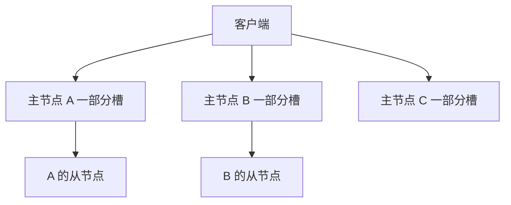
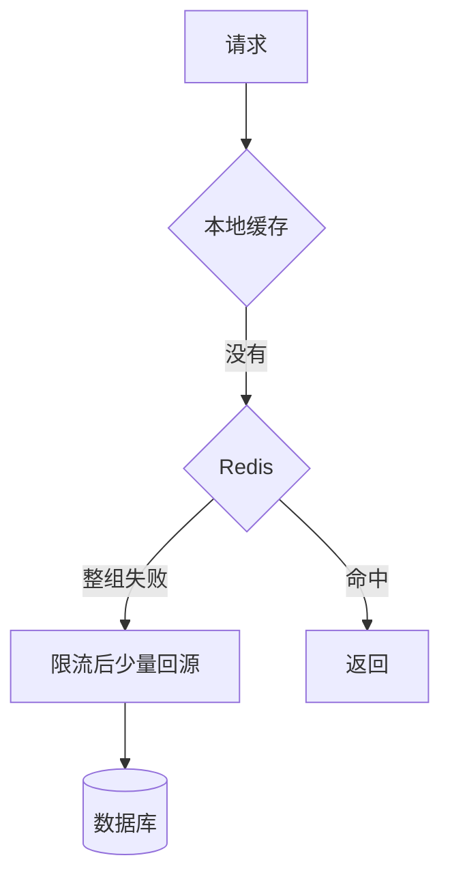
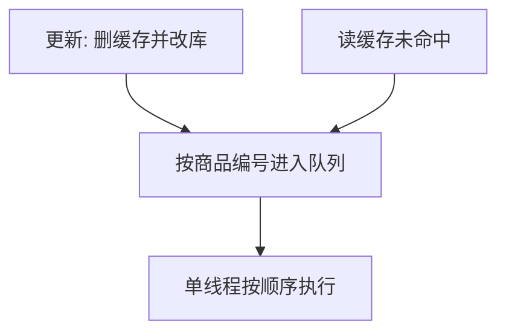

# Redis 集群与缓存一致性

## 面试题

- 集群模式怎样把数据摊开，又怎样自己切换？
- 一个键怎么找到节点？
- 分布式寻址有过哪些算法？
- 一致性哈希解决了什么，又没解决什么？
- 雪崩和穿透怎么防？
- 缓存和数据库同时写，怎样减少不一致？
- 多个客户端抢着写同一个键会怎样？
- 事务和 `WATCH` 算不算乐观锁？

## 剖析

早年要做分片，得在前面加 Codis 或 Twemproxy 这类中间件，由它们把键分到多台实例。后来官方集群把分片和高可用做进服务端：多台主节点各存一部分槽位，每台主节点还可以挂从节点，主节点失效就提升从节点。没用过官方集群也可以，但面试会默认你研究过槽位、重定向和故障转移。

## 集群在解决什么

单主节点的容量等于这一台的内存。从节点只是副本，不会让总容量变大。要缓存 1TB，单主结构会先撞上内存墙。

集群支持多台主节点，每台再挂从节点。写进该主节点，读可以走它的从节点。某一台主节点失效，集群把对应从节点提升上来。不需要再手工搭一套复制加哨兵，分片和切换是同一套机制。



每个节点开两个端口。服务端口例如 6379，再加 10000 得到 16379，这条总线用来做故障检测、配置传播和转移授权，不承接业务命令。

数据量只有几 GB、主要是扛并发时，一主多从加哨兵更简单。数据量大、又要高并发和高可用，再用集群。

## 键怎么分到节点

演进是：取模哈希，然后是一致性哈希，再然后是固定槽位。

### 取模

三台机器时，`hash(key) % 3`。实现短，但一台宕机或扩成四台，余数整体变化，大约三分之一甚至更多的键会换机器，缓存大面积失效，请求涌向数据库。

### 一致性哈希

Memcached 客户端常用一个环：把节点和键都哈希到环上，键沿顺时针找到第一个节点。加一台或减一台，只影响环上相邻的一段，而不是全部键。

环上若节点太少，某一段会特别长，热点键都落到同一台，其他机器空着。解决办法是虚拟节点：每台物理机在环上放很多点，区间被打散，负载更匀。

```mermaid
flowchart LR
  K[键的哈希] --> R{顺时针]
  R --> N1[节点或虚拟节点]
  N1 --> P[对应的物理机]
```

### 槽位

官方集群把键空间固定成 16384 个槽。对键算 CRC16，再对 16384 取模，得到槽号。每台主节点负责一段槽。三台主节点时，每台大约五千多个槽。加节点就从别的节点挪走一部分槽，减节点就把槽交出去。挪的是槽，不是按机器台数重新取模，所以其他槽上的键不用搬家。

同一批键若要落在一个槽，用哈希标签：`ticket:{42}:seat` 和 `ticket:{42}:price` 只对花括号里的 `42` 做哈希，它们会进同一个槽，才能在同一个节点上一起操作。

一台主节点宕机时，其他槽完全不受影响，因为取模的除数是 16384，不是节点个数。

## 节点之间怎么交换信息

元数据（谁负责哪些槽、谁下线了）有两种放法。集中存放时，更新立刻可见，但所有写都压在一处。Gossip 则是节点之间互相传，更新被摊开，压力小，代价是短时间里各节点看到的视图可能不一致。集群选的是后者。

每个节点按自己的节奏向几个节点发 ping，对方回 pong。交换的内容包括故障、节点增减和槽位表。消息类型还有：

- meet：邀请新节点加入。管理工具加节点，内部就是发这条。
- ping：带上自己的状态，以及自己知道的一部分其他节点。
- pong：回应 ping 或 meet，也可用来广播。
- fail：认定某节点客观下线后，通知其余节点。

ping 太勤、携带的元数据太大，会占带宽。每个节点大约每秒挑若干个最久没联系的节点发 ping；若某个节点的延迟已经超过节点超时的一半，就立刻 ping，避免视图落后太久。一次 ping 带上自己，再带上大约十分之一的其他节点信息，至少几个，最多也不会把全部节点都塞进去。超时时间调大，发送会更疏。

## 客户端怎样找到槽

可以每次随便连一台，由服务端计算槽位。不在本地就返回 `MOVED`，里面有槽号和正确地址，客户端再去那台执行。命令行加上自动重定向参数就会自己跟过去。`CLUSTER KEYSLOT` 能查看某个键的槽号。

只靠重定向会多一次网络来回。聪明客户端在本地保存「槽到节点」的表，并给每个节点建连接池。初始化时连上任意一台，把这张表拉下来。之后先在本地算槽、找节点。若期间发生过搬迁，节点仍可能回 `MOVED`，客户端用这份新信息更新本地表，再重试。重试超过大约 5 次就报错，避免死循环。

槽正在迁移、还没完成时，服务端回的是 `ASK` 而不是 `MOVED`。客户端这次改到目标节点执行，但不更新本地表，因为迁移可能还没结束。只有 `MOVED` 才表示槽已经归新节点。

老版本客户端在故障转移还没完成时，可能频繁刷新槽表并探测节点，造成额外流量。新版本收紧了这种刷新。

## 集群里的故障转移

和哨兵的思路接近，投票的是主节点。

1. 一个节点在超时时间内没收到对方的 pong，就把它标成主观下线，并在 gossip 里告诉别人。超过半数的主节点都这么认为，就变成客观下线。
2. 从该主节点的从节点里选候选人。和主节点失联超过「节点超时 × 系数」的从节点没有资格。
3. 从节点按自己的复制偏移决定何时发起选举，偏移越大越早。主节点投票，得到超过半数主节点的票就可以切换。
4. 因此集群把复制和哨兵式切换收进了同一套协议，不必再外挂哨兵。

## 雪崩和穿透

这两类问题一出现就可能把数据库打挂，所以缓存面试几乎必问。

### 雪崩

缓存整组不可用，或大量键同一秒过期，请求全部落到数据库，数据库跟着不可用。

事前：用主从加哨兵，或直接用集群，避免单点全灭。过期时间加随机抖动，避免同一分钟集体失效。

事中：应用内再留一份短时本地缓存，并用限流和降级把打到数据库的并发截住。例如本地最多顶 30 秒，数据库侧每秒只放行 500 次回源。

事后：打开持久化，进程拉起来就能从磁盘恢复，缩短全空窗。



### 穿透

请求的键在缓存和数据库里都不存在。有人用大量不存在的编号扫接口，每次都打到数据库。

处理是：数据库确认没有这条时，仍写一个短寿命的空值，例如 60 秒。下一次同样的非法键命中空值，不再打库。空值要设过期，否则真正的新数据插入后会被空值挡住。也可以用布隆过滤器先挡掉明显不存在的编号，过滤器和空值可以一起用。

## 缓存和数据库怎样一起写

只要两处都存，就有不一致。经典读法是旁路缓存。

读：先读缓存，没有再读库，把结果放进缓存后返回。

更新：先删缓存，再改数据库。不要在每次改库时顺手把缓存算出来写回去。

### 为什么删而不是改

复杂页面的缓存不是某一列的原样拷贝。改了库存表的一列，缓存里的可售数量可能还要读价格表和锁定表才能算出来。若这一行一分钟被改 30 次，却只被读 1 次，更新缓存 30 次就是浪费。删掉之后，只有那一次读取会重算。这和延迟加载一样：部门下面有两千名员工，查部门信息时不必把两千人都查出来，真要名单时再查。

大约两成的数据承担八成的访问。冷数据更不该在每次写入时重算缓存。

### 最简单的不一致

先改库、再删缓存：删除若失败，库已是新值，缓存仍是旧值。

改成先删缓存、再改库：删除成功但改库失败时，缓存是空的，下次读取会把库里的旧值装回去，两边不会一个新一个旧。


### 并发下仍会错

删除缓存之后、更新数据库之前，另一个请求发现缓存空了，读到旧值并写回缓存。随后更新提交。结果库是新的，缓存是旧的。

并发低时，例如一天一万次读取，这个交错很少。每秒几万次读、又夹着更新时，窗口会被撞上。

### 把读写放进同一队列

按数据编号做路由，更新请求和「缓存未命中后的回填」进同一个内存队列，由一个线程串行执行。更新若还在队列里，回填就排在它后面，等库更新完再读库写缓存，读到的是新值。队列里已经有一个回填时，不必再塞第二个，后来的读请求等这一次回填即可。

若等的时间超过预算，这次读直接回库，避免一直挂住。库里根本没有这条、队列里也没有更新时，不要空等，直接返回不存在。



这套串行能把交错窗口合上，但吞吐会掉，往往要多几倍机器。若业务允许缓存偶尔旧一点，就不要上这么重的方案。

还要注意这些点：

- 读请求必须有超时。队列里若堆了 80 个更新，每个 15 毫秒，最后一个读要等大约 1.2 秒，已经不能当页面接口。要压测最忙时一个队列里会堆多少更新。200 毫秒的预算下，堆 8 个、每个 20 毫秒，还勉强。堆得多就把数据分到更多实例，每个队列更短。
- 写通常远少于读。每秒 400 次写、分到 16 个队列，每个队列大约二十几个写，单次 20 毫秒的话，读等待多在几百毫秒内。写再翻十倍，就加机器而不是把队列无限加长。
- 同一编号的读在更新期间会被去重成一个回填，更新完成后，等着的读一起命中缓存。
- 突然有几百个读挂在服务上时，要确认线程池扛得住。按读写大约 100 比 1 估算：每秒 4 万读，更新大约 400 次。若每条更新只引来两三个回源读，同时挂住的请求有限。若一条更新引来二十个并发读，400 次更新就是 8000 个挂起，库存服务会被拖死。这个比例必须压测，不能假设。
- 多实例时，同一编号的更新和回填必须进同一台机器的同一个队列，否则串行没有意义。网关按编号哈希过去。
- 个别热点编号会把一台机器打高。更新不频繁时影响有限；若某个商品一直被改，要单独拆队列或限制它的更新速率。

## 多个客户端同时写一个键

几个系统同时写缓存，期望顺序是 V1、V2、V3，实际可能先到的包后执行，变成 V1、V3、V2。后写的旧值把新值盖掉。

可以用分布式锁保证同一时刻只有一个写入者。更轻的做法是带时间戳：值来自数据库，库里每一版都有时间。写入前比较缓存里的时间，只有新时间更大才覆盖。例如：

```text
v1 10:00:00
v2 10:00:01
v3 10:00:02
```

迟到的 v1 发现缓存已经是 10:00:02，就丢弃。锁和版本可以一起用：锁防同时读改写，版本防乱序覆盖。

## 事务

一次 `MULTI` 到 `EXEC` 之间的命令会按顺序执行，中间不会插入别的客户端的命令。单条命令是原子的，事务整体不是：没有回滚，某条失败后其余命令仍会执行。阶段是开始、入队、执行。

正常路径：

```text
MULTI
SET seat:15 held
INCR holds:show:3
EXEC
```

`EXEC` 之后两条都生效。`DISCARD` 则清空队列，什么都不做。

入队时命令名就是错的（类似编译失败），`EXEC` 时整组都不会执行。入队成功、执行时才出错（例如把字符串当数字去加），其他命令仍然生效，出错的那条返回错误。所以不能把事务理解成数据库那种全部回滚。

`WATCH` 类似乐观锁。监视 `balance` 之后，若在 `EXEC` 之前没有别的客户端改过它，事务执行；若被改过，`EXEC` 返回空，整组取消。无论成功还是失败，这次监视都会解除，下一次要重新 `WATCH` 再 `MULTI`。

```text
WATCH wallet:204
MULTI
DECRBY wallet:204 35
EXEC
```

若在 `EXEC` 前有人把 `wallet:204` 改掉，这次扣减不会发生。调用方应重读余额再决定是否重试。

## 线上怎么部署

要能说出架构而不是背参数。一套练习规模：8 台机器，4 台主、4 台从，每台主挂一台从。单主高峰大约每秒 3 万读写，四台合计大约 12 万。机器可以是 16 核、64G 内存、1TB 盘，但进程的最大内存设成 8G，线上尽量不要让单个实例超过这个量级，主从复制和 fork 的成本会明显变大。四台主合计 32G。

存的是票档摘要，每条约 6KB。大约 170 条 1MB，100 万条约 6G。常驻 250 万条，大约 15G，不到总内存的一半，留给碎片和突发。当前业务高峰大约每秒 4200 次，离集群上限还远。大公司里缓存集群通常由基础组件的同学维护，业务侧要说得清自己用了多少内存、键有多大、高峰打到了多少。

## 收束

缓存题的骨架就是：结构与过期、持久化、主从与哨兵或集群、雪崩与穿透、双写、并发覆盖、线上规模。面试官若没问全，可以把你们怎么避免集体失效、空值怎么挡穿透、更新是先删缓存还是进队列、实例内存和高峰 QPS 主动讲出来。再往下会扣到具体接口：高峰 4200 里有多少打到缓存、多少打到库、热点键是否把一块网卡打满、一个特别大的值要不要拆开。这些要回到自己的监控，而不是背默认数字。

## 槽位、故障和双写再算一遍

三台主节点、16384 个槽，大致每台 5461 个槽。键 `show:88` 的槽号是 `CRC16("show:88") % 16384`。若结果是 12000，而 10000 到 16383 在主节点 C，请求就必须到 C。客户端本地表若还认为它在 B，B 会回 `MOVED 12000 C的地址`，客户端更新表后再打到 C。迁移过程中槽 12000 还在搬家，C 可能回 `ASK`，这次去目标节点，但本地表先不动，避免把尚未完成的迁移当成最终归属。

哈希标签让 `seat:{88}:row` 和 `seat:{88}:left` 落在同一槽，才能在一个节点上一起读。没有标签时，这两个键可能分到两台机器，应用以为能一次取齐，实际上要两次往返，事务也无法跨节点原子执行。

扩容从 3 台到 4 台，只迁移大约四分之一的槽，其余槽的键原地不动。取模哈希做不到这一点：从 3 台变成 4 台时，`% 3` 和 `% 4` 的结果大面积不同，缓存会成片失效。一致性哈希只搬环上相邻的一段，比取模好，但节点少时仍会倾斜，所以要虚拟节点。官方集群用固定槽位，倾斜问题变成「某个槽特别热」，要用标签把热点拆开，而不是再加虚拟节点。

主观下线和客观下线用 3 台主节点说明。A 在超时内没回 pong，B 先标主观下线并告诉 C。只有 B 这么认为时还不能切换。C 也确认后，超过半数，A 客观下线。A 的从节点里，偏移更大的那个先发起选举，需要至少 2 张主节点的票。A 已经下线，投票的是 B 和 C，两票刚好过半。失联太久的从节点不参加，避免把一份很旧的副本提升上来。

雪崩用过期抖动量化。100 万个键若都在同一秒到期，回源即使只有一成，也是 10 万次同时打库。给过期时间加 0 到 300 秒的随机数，回源被摊到 5 分钟。再加本地缓存 20 秒和数据库每秒 500 的回源限额，Redis 全挂的那几秒里，数据库看到的是限额而不是全部流量。持久化让 Redis 重启后不必等这 100 万个键全部回源。

穿透用空值。编号 999999 在库里不存在，第一次回源后写入空值，TTL 45 秒。这一分钟内的重复请求打在空值上。新票若刚好使用了这个编号，要等空值过期或在插入时主动删掉空值，否则 45 秒内会一直显示没有这场票。布隆过滤器可以先挡掉明显没出现过的编号，误判时才会打到库，误判率按容量估算，不能当成绝对没有。

双写用库存 42 说明最容易讲错的顺序。先把库改成 41、再删缓存，删除若失败，缓存仍是 42，页面会超卖。先删缓存再改库：删除成功、改库失败，缓存为空，下次读到库里的 42，两边一致。并发窗口是：删缓存后、改库前，另一次读把 42 又填回缓存，然后库提交成 41。低并发时这个窗口窄；每秒 2 万读、每秒 50 次改库存时，就要考虑按商品编号串行。

串行队列按商品 88 只进一个队列。更新「删缓存、把库改成 41」先入队。期间的读发现缓存空，只追加一个回填，不追加十个。线程先做完更新，再读库得到 41 并写入缓存。若队列里已经有 30 个别的商品更新、每个 20 毫秒，商品 88 的读要等大约 600 毫秒，超过 200 毫秒预算就直接回库。写每秒 400、16 个队列时，每个队列每秒大约 25 个更新，排队通常短于预算。热点商品若独占一个队列且每秒改 100 次，这台机器会被打满，需要把热点单独限流。

多实例时商品 88 的更新和回填必须进同一台。两台机器各有一个队列，更新在机器 A、回填在机器 B，串行就失效，旧值仍可能被填回去。网关按商品编号哈希，而不是按随机轮询。

并发写用时间戳收束。缓存里已经是 10:00:02 的剩余座位 41。迟到的消息带着 10:00:00 的 42，比较之后丢弃。若没有时间戳，后到的旧消息会把 41 盖回 42。分布式锁能让读改写不要交错，但锁不住「已经在路上的旧消息」，所以版本时间仍然需要。

事务用余额演示 `WATCH`。余额 200，监视之后别人先扣了 30，本地再 `DECRBY 35` 并 `EXEC`，会得到空结果，余额保持 170，而不是变成 135。调用方必须重读。入队阶段就把命令名写错，整组不执行；执行阶段对字符串做加法，其他命令仍会生效。因此不能用它替代数据库事务去扣款。跨槽的两条命令也不在同一个事务里，这是集群和单机的差别。

部署规模再对一下内存。8G 上限、每条 6KB，理论上约 140 万条就会接近上限，所以常驻 250 万条必须分到多台主节点，而不是一主多从。4 台主、每台 8G，合计 32G，250 万条约 15G，占用不到一半，淘汰不会在正常流量下触发。高峰 4200 相对每台 3 万的能力还有余量。若把每条详情放大到 200KB，15 万条就到 30G，既占满内存，也会把网卡打满，这时要裁字段而不是再加一倍机器。

Gossip 的延迟也要算进操作窗口。改完槽位后，某个节点可能要再过一两秒才从 ping 里得知新归属。这段时间客户端会多收到几次重定向，本地表更新后恢复。不要在迁移过程中把超时设成 5 毫秒，否则重定向还没完成就被客户端当成失败。节点超时若设成 15 秒，故障发现会变慢，但 ping 更疏，3 台主节点的总线流量可以忽略；超时设成 1 秒，切换更快，总线在 30 台节点时要观察网卡。每秒大约 10 次 ping、每次带若干个节点的状态，节点一多就要用抓包确认总线没有占满业务带宽。

空值和布隆不要互相替代时说反。布隆说「可能存在」才回源，说「一定不存在」就直接返回。它会把极少数存在的编号误判成需要回源，不会把存在误判成不存在（在容量没超的前提下）。容量超了误判率会升高，回源变多，数据库又会被打到。空值则是回源之后的第二道，专门挡住「库里确实没有」的重复请求。两者一起用：过滤器挡住乱编的长编号，空值挡住刚查过的不存在编号。

串行方案的机器数可以按等待时间反推。目标是排队不超过 200 毫秒，单次更新 20 毫秒，则一个队列里排队的更新不要超过 10 个。每秒 400 次写、希望每个队列每秒只进 10 次，大约需要 40 个队列。一台机器放 20 个队列的话就是 2 台；写再翻十倍到每秒 4000，就大约 20 台，而不是在一台机器里把队列加到几百个把 CPU 打满。读请求在缓存命中时不进队列，所以读的 QPS 不按这个公式扩。只有未命中且刚好碰上更新的那一部分才排队。按 1% 的读会碰上更新来估，每秒 4 万读里大约 400 个会挂起，分到 40 个队列后每个队列同时等的读并不多。这个 1% 必须用压测确认，热点商品会让比例高得多。

`WATCH` 失败后的重试也要有上限。余额竞争激烈时，十个客户端同时监视并扣减，九个会在 `EXEC` 得到空结果。若无限重试，它们会把 Redis 打满。扣减类最多重试 3 次，仍失败就回数据库用版本号更新，而不是在缓存里循环。集群里两个槽的键不能放进同一个事务，扣减余额和写流水若必须原子，就把它们做成哈希标签落在同一槽，或者把原子性交给数据库，缓存只保留可以丢失后重建的结果。

搬槽时客户端会同时看到新旧两台的回复，重试次数留到 5 次通常够用。若应用把一次 `MOVED` 当成业务失败直接返回给用户，迁移窗口里的错误率会虚高。捕获重定向、更新本地表再发一次，才是集群客户端该做的事。自己封装连接池时如果丢了这一步，表现就是「只有迁移那天会偶发键不存在」。

空值的 TTL 不要和正常缓存一样长。正常票档可以缓存 10 分钟，空值 45 秒就够。空值设成 10 分钟时，刚创建的场次会有 10 分钟被显示成不存在。插入成功的事务里顺手删掉对应空值，可以把这个窗口再缩短。
