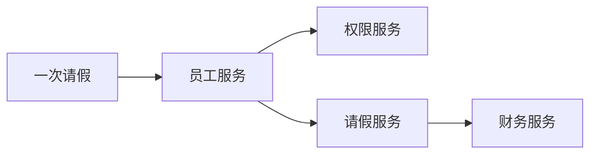
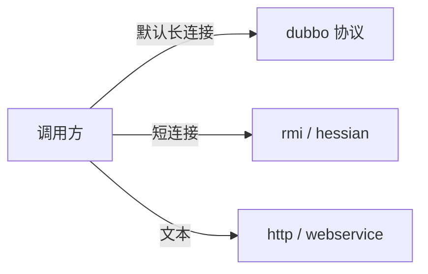
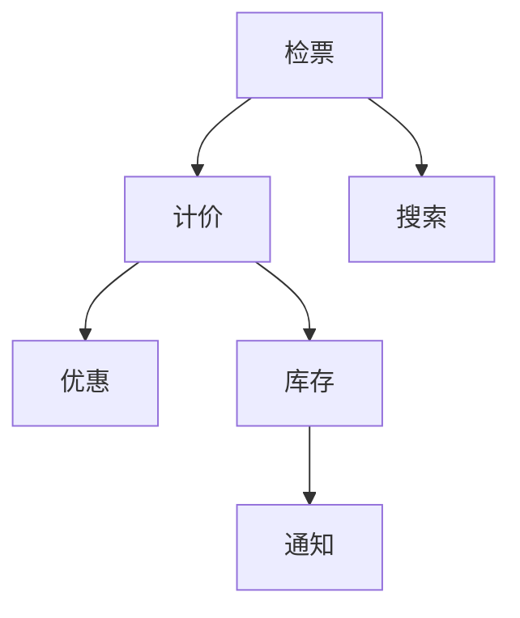

# 分布式系统连环问

## 面试题

- 怎样才算一个分布式系统？
- 为什么要拆？按什么边界拆？拆完不用现成 RPC 框架行不行？两套 RPC 框架差在哪？
- 服务框架在调用链上做了什么？
- Dubbo 一次调用怎么走完？
- 它能选哪些通信协议？
- 负载和集群容错有哪些策略？
- SPI 想解决什么？

## 什么是分布式系统

这里说的不是自己做一套分布式文件系统或计算引擎，而是把原来一个大 Java 工程拆成多个业务服务，服务之间远程调用，合在一起仍完成同一件业务。

例如原先一套办公系统，权限、员工、请假、报销放在一个工程里，部署在一台机器上，模块之间直接方法调用。拆开之后是四个工程、四台机器。一次请假会先问权限，再写请假单，再通知财务，四边都做完，这次请求才算结束。



单体是一个进程里的方法调用；分布式是多个进程用网络把同一件事做完。

## 为什么要拆，为什么用 Dubbo

### 行业是怎么走到这一步的

大约十多年前，中小团队的标配还是一套 Web 框架加一套 ORM，数据库认证和调优比服务治理吃香，大数据也还没成为面试必问。大型公司内部早就有自己的服务框架，只是没有统一名字。

后来开源的 RPC 框架让中小团队也能把系统拆开：每人认领一个服务，仓库不再天天冲突，发布可以只上线改过的那一个服务，而不是几十万行一起冒烟。到现在，分布式已经是普通业务岗位的默认背景，所以面试会默认你讲得清拆分和调用。

### 不拆会怎样

一个二十多万行的工程，二十个人改同一份代码。合并冲突天天有；你改了公共方法，调用方全得回归；每次发布都是整包上线，所有人守在日志前面。技术升级也会被卡住，因为一升框架版本，别人的模块可能编不过。

假设整包 18 万行，某人只改了 800 行，发布时仍是 18 万行一起替换。二十个人各自盯自己那一块。有人改完配置就走了，结果那次配置把另外两个模块的开关打错，故障要到用户投诉才暴露。上线准备往往要提前许多天：冻结、联调、部署、每人检查自己的功能。

从零到一的阶段，单体反而合适：人少、还没上线、规则变化快，一套框架加数据库加容器就够。等用户从十万涨到百万、千万，团队也从十几人涨到几十人，单体的发布和协作会先崩，而不是机器先崩。

### 拆开之后

18 万行拆成大约 15 个服务，每个服务一两万行，独立仓库、独立部署。每个人只对自己的接口负责，冲突少了，回归范围也小了。接口不变，内部可以单独升级依赖。复杂系统配上大团队时，拆分换来的是研发效率。

代价是网络、超时、重复调用、数据不一致会一起出现。后面的问题都是在为这些代价找办法。

### 按什么拆

不必先背领域建模的整套术语。实际是分好几轮，而不是架构师一次拆到最终形态。

第一轮按模块：电商可以分成订单、商品、采购、仓储、用户。某个服务后来涨到十万行、五个人一起改，就再拆一轮。采购再分成供应商和采购单，订单再分成购物车、计价和订单中心。

人手上的经验是：一个服务尽量不超过三个人共同维护；理想情况是一个人负责一个或两三个边界清晰的服务。代码量到了一个人看不过来，就继续拆，而不是加人去守一个大仓库。单服务体量控制在一两万行量级更利于交接，两三万行已接近一个人能兜住的上限。

#### 拆完不用 Dubbo 行不行

行。服务之间用 HTTP 接口也能通信。痛处是超时、重试、负载、实例上下线都要自己做。商品服务有 6 台机器时，订单服务得自己把请求摊匀，否则就是在重复实现一个简陋的 RPC。

Dubbo 这类框架把「像调本地接口一样调远程」包起来：代理负责选机器、感知上下线、超时重试。你只留接口和实现。

## Dubbo 一次调用怎么走


- 接口层：提供者和调用方共同依赖的接口。
- 配置层：超时、协议、注册中心等配置。
- 代理层：客户端桩和服务端骨架，让调用看起来像本地方法。
- 注册中心层：登记和发现实例。
- 集群层：把多实例收成一个逻辑服务，负责路由和负载。
- 监控层：记录调用次数和耗时。
- 协议层：封装远程调用的报文。
- 交换层：请求响应模型，同步语义下面可以是异步传输。
- 传输层：把不同网络框架收成统一接口。
- 序列化层：对象和字节互转。

流程可以收成四步：提供者注册；调用方订阅，注册中心把地址推下来；调用方经代理打到某个提供者；双方把次数和耗时异步报到监控。

注册中心后来宕机，已经建立的调用仍可继续。初始化时调用方把地址缓存在本地，不依赖注册中心在每次请求时都在线。新实例的上下线感知会暂停，直到注册中心恢复。

## 通信协议和序列化



### 通信协议

#### dubbo 协议

地址形如 `dubbo://10.2.0.8:20881`。默认协议是单条长连接、异步 NIO，序列化默认用 hessian。适合单次载荷小（大约一百 KB 以内）、并发高的调用。提供者可能只有数台，调用方上百台，日调用上亿。每个调用方维持一条长连接，总连接数大约就是调用方实例数，而不是「每次请求一条短连接」。载荷如果很大，单连接会把并发拖下来，所以不适合传大文件。

#### rmi

Java 原生序列化，多条短连接。两边实例数量接近、偶尔传文件时才见得到，业务里少用。

#### hessian 协议

同样是 hessian 序列化，但是多条短连接。提供者比调用方还多、或要传文件时可以考虑，日常业务也少用。

#### http

走 JSON 一类文本序列化，便于跨语言，开销比二进制大。

#### webservice

走 SOAP 文本，历史系统对接时还会碰到。

### 序列化

随协议不同，可以是 hessian、Java 二进制、JSON、SOAP。默认实现选的是 hessian。

## 负载、容错和代理

### 负载

#### 加权随机

默认策略。按权重随机，权重大的实例分到更多流量。机器规格接近时，用默认即可。

#### 加权轮询

默认把请求均匀轮过去。机器规格不同时，差机器会被打满，要把权重调低。例如先申请到两台 8 核 32G，后来只补到一台 4 核 16G，第三台的权重就应该更小，而不是三台平分。

#### 最少活跃

框架统计正在处理的请求数。处理得慢的实例活跃数更高，新请求会少分给它。适合机器性能参差、又不想手工调权重的时候。

#### 一致性哈希

相同参数的请求落到同一提供者。某台挂了，用虚拟节点把原来属于它的请求摊开，不会全部挤到相邻的一台。需要「同一类请求固定到一台」时用它，例如按订单号做本地排队。

### 集群容错

- 失败转移：自动换一台重试，默认策略，适合读。
- 快速失败：一次失败立刻返回，适合写，避免重试造成重复提交。
- 失败安全：异常吞掉，只适合记日志这类可丢的调用。
- 失败回补：先记下失败请求，后台再发，适合写消息。
- 并行：同时打多台，有一台成功就返回，耗资源，只用在必须压低尾延迟的读。
- 广播：逐台都调用，适合刷新全部实例的本地缓存。

### 动态代理

默认用字节码工具生成代理类，也可以通过扩展点换成别的生成方式。

## SPI 是什么

SPI 就是「接口在运行时选哪个实现」。一个接口有三份实现，启动时读配置，决定装载哪一份并拿它的实例对外服务。

```text
接口 Gate
  实现 GateA / GateB / GateC
配置：Gate = GateB
运行时只创建 GateB
```

JDK 的做法是：在 jar 的 `META-INF/services/` 下放一个与接口全名相同的文件，文件里写实现类名。调用方只依赖接口和这个 jar，运行时就能扫到实现。JDBC 是典型：JDK 只定义接口，MySQL 或别的驱动 jar 提供实现类，程序用的是接口，真正执行的是驱动。

Dubbo 没有直接用 JDK 那套扫描，而是自己做了扩展加载器。例如：

```java
Protocol protocol = ExtensionLoader.getExtensionLoader(Protocol.class).getAdaptiveExtension();
```

意思是：`Protocol` 在运行时该用哪一个实现，由配置里的键决定，再加载进虚拟机。没配就用默认。这是一种微内核：协议、负载、序列化都是可替换组件，你实现接口、打进 jar、配一个键即可。

接口上的默认键写在注解里：

```java
@SPI("dubbo")
public interface Protocol {
    int getDefaultPort();

    @Adaptive
    <T> Exporter<T> export(Invoker<T> invoker) throws RpcException;

    @Adaptive
    <T> Invoker<T> refer(Class<T> type, URL url) throws RpcException;

    void destroy();
}
```

框架 jar 里有一份与接口全名同名的文件，内容类似：

```text
dubbo=com.example.rpc.protocol.DefaultWireProtocol
http=com.example.rpc.protocol.HttpWireProtocol
hessian=com.example.rpc.protocol.HessianWireProtocol
```

`@SPI("dubbo")` 表示默认键是 `dubbo`，对应文件里的第一行。带 `@Adaptive` 的方法会生成代理：运行时读 URL 上的协议参数，默认仍是 `dubbo`，你若写成别的键，就换成另一份实现。这样同一套接口可以按调用参数切换组件。

自己扩展时，新建一个 jar，在约定目录放同名文件，写上 `mine=com.demo.rpc.MineProtocol`，发布到私服。提供者工程依赖这个 jar，配置里把协议名写成 `mine`、端口写成例如 `20990`。启动时就会装载你的类。负载、过滤器等大量扩展点都是同一模式：实现接口、在 jar 里用键指向类、在配置里写这个键。

## 治理、降级和重试

能讲清治理，说明你做过服务变多之后的麻烦，而不只是调通过一次接口。降级是为了别让一个下游把整条链拖死。重试是因为网络失败和超时都会发生，但不是所有失败都该重试。

前面几节已经覆盖了注册与代理、长连接和序列化、负载与容错、扩展点。这一节补治理、降级和重试。

### 治理

#### 自动画出调用链

服务上百甚至上千之后，没有人能靠记忆说出谁调谁。需要把每次远程调用记下来，自动生成依赖图。例如检票服务调用计价，计价再调用优惠和库存；库存旁路还会通知搜索。图上能看见这条链，排障才有起点。



#### 压力和耗时

统计要有两层。接口层：每个接口每天被调多少次，TP50、TP90、TP99 各是多少。链路层：从入口走到最后一个服务，完整请求每天多少次，整链的 TP50、TP90、TP99 是多少。有了这两层，才知道该扩哪一个服务，而不是给所有机器加一倍。

#### 其他

服务分层以避免循环依赖；失败要能报警；调用要有鉴权；可用性按成功比例看，例如 99.9% 和 99.99% 差的是每月允许故障的分钟数，不是口号。

### 降级

检票调计价，计价挂了，重试几次仍失败，就走备用逻辑：按原价出票并提示「优惠暂不可用」，而不是整页失败。

框架里可以把引用配成失败时返回空，也可以把 mock 打开，并在接口同包下提供一个以 Mock 结尾的类，里面写备用逻辑。

```java
public interface PriceService {
    int quote(String showId);
}

public class PriceServiceImpl implements PriceService {
    public int quote(String showId) {
        // 正常计价，例如场次 SH-77 返回 186
        return 186;
    }
}

public class PriceServiceMock implements PriceService {
    public int quote(String showId) {
        // 降级：优惠算不出来时返回座位置顶价，并让上游自行提示
        return 240;
    }
}
```

提供者侧仍注册接口、协议和超时；调用方把 mock 指到上述备用实现。空返回只说明「这次不要用下游结果」，备用类才承载业务上能接受的替代值。

### 失败重试和超时

调用抛错或超过时限，都可以按配置重试。例如超时 400 毫秒、重试 2 次：等到 400 毫秒还没回来就放弃这次，再换实例试，而不是干等对方 5 秒。

超时按接口预算来。页面接口若要求 300 毫秒内返回，下游超时就不要配成 2 秒。重试主要给读：第一次读失败再读两次，结果应相同。写接口默认不要重试，除非下游幂等，否则一次超时加一次重试可能扣两次款。

## 用一次检票把参数定下来

假设检票页要在 300 毫秒内返回，下游有计价、库存、搜索三个调用。预算可以切成：计价 120 毫秒、库存 80 毫秒、搜索 60 毫秒，剩下留给本服务组装。计价是读，超时 120 毫秒、重试 1 次，失败走备用价 240。库存是写预留，超时 80 毫秒、重试 0 次，失败直接告诉用户稍后再试，避免预留两次。搜索只影响推荐，超时 60 毫秒、失败忽略，页面仍展示主座位。

负载上，计价有三台机器，两台 8 核、一台 4 核。权重设成 2、2、1，而不是各三分之一。若同一用户的计价必须落到同一台做本地优惠草稿，就改用一致性哈希，键用用户编号。某台权重为 2 的机器下线后，哈希环上只挪走它那一段，不会把全部用户打到剩余机器的同一台。

容错不要混用。读用失败转移，写用快速失败，记日志用失败安全。把库存预留配成失败转移，是这一页里最贵的配错：第一次超时但对方其实已经预留成功，重试又预留一次。

治理数字也要能算。计价接口一天被调 900 万次，TP50 是 40 毫秒，TP99 是 110 毫秒，接近 120 毫秒的超时，说明尾部已经顶到预算，该先优化或加机器，而不是把超时放宽到 500 毫秒掩盖问题。整条检票链一天 900 万次，TP99 若到 280 毫秒，就几乎没有余量给网络抖动。可用性若要求 99.9%，一天大约只允许 86 秒完全不可用；99.99% 则大约只允许 8 秒。这个差别决定你要不要做自动切换，而不是多买一台机器就结束。

注册中心短时不可用时，已缓存的三台计价地址仍能调用，新扩出来的第四台要等注册中心恢复才会被看见。所以扩容窗口不要卡在注册中心维护期。SPI 替换协议时，先在测试环境把键从默认改成自己的实现，确认端口和序列化之后再上生产。默认键写错时，进程会在启动期就找不到实现，而不是在第一笔请求时才随机失败。

拆分节奏也可以用人数说明。15 人维护一个 18 万行的仓库时，每人每次发布都要看整包。拆成 12 个服务后，一个人通常看 1 到 2 个服务，单服务控制在 1.5 万行上下。某个服务涨到 6 万行、三个人一起改，就再拆，而不是继续加人共享一个仓库。HTTP 直连能跑通演示，但 6 台库存机器的摘除、权重和超时要自己做，做到后面会发现自己在重写集群层。

协议和序列化也可以用载荷算。检票请求体大约 4KB，一天 900 万次，只算请求方向大约 36GB。走默认长连接时，连接数约等于调用方实例数，例如 40 台检票机就约 40 条连接，提供者扛得住。若改成每次短连接，900 万次握手会先把提供者的文件描述符打满。所以小报文、高并发用长连接；偶尔传 20MB 的对账文件就不要走这条单连接，改走短连接协议，避免大文件堵住同一条通道上的检票请求。

降级类要放在接口同一包路径，名字在接口名后加固定后缀，框架才能找到。备用价写死 240 只适合演示，线上应返回「优惠暂不可用」并由前端展示座位置顶价，避免用户以为 240 是算出来的成交价。mock 配置成直接返回空时，前端若把空当成 0 元，会比超时更危险。

调用链上的分层用来阻止循环：入口层调领域层，领域层不回调入口层。检票若反过来被库存调用，一次超时会在链上放大。鉴权放在调用方把令牌带上，提供者拒绝没有令牌的内部误调用。这些治理项没有统一开关，但讲的时候能对应到「谁调谁、慢在哪、失败了给用户什么」，就比只画十层框架图更像做过。

注册中心里的地址是实例列表，不是配置中心的全部内容。把票价规则也塞进注册中心，会导致每次改价都触发地址推送，调用方重建连接。规则放在独立配置里，地址变更才走注册中心。调用方缓存的地址要有刷新间隔，例如 10 秒，否则摘掉一台坏机器后，最坏还要等缓存过期才不再打它。这段空窗用快速失败接住，不要用长超时干等坏机器。

动态代理默认用字节码生成，启动时多花一点时间，调用时比反射快。实例只有十几台时，两种代理的差距可以忽略。真正要换代理实现，是为了接入已有的监控或链路号，而不是为了再快几微秒。换实现后要确认超时和重试仍由集群层处理，不要在代理里再重试一次，否则读请求会被乘成两次重试。
