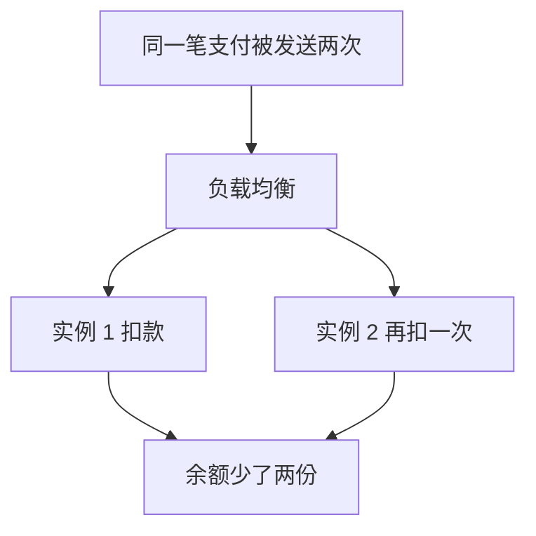
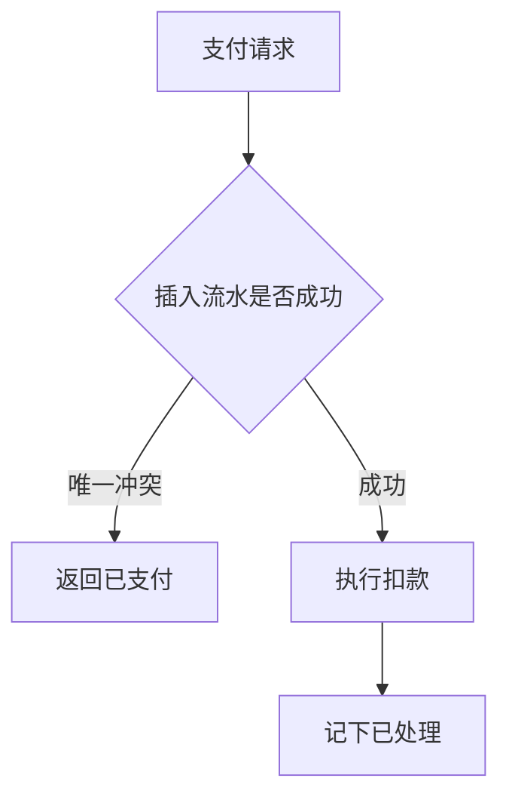
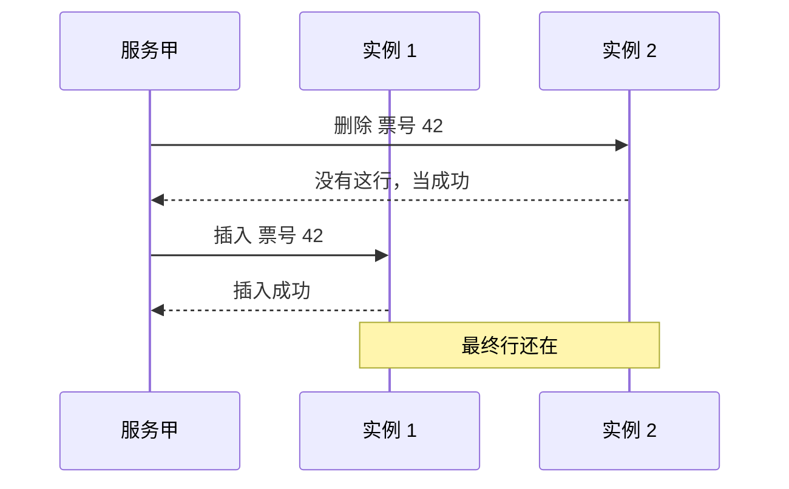
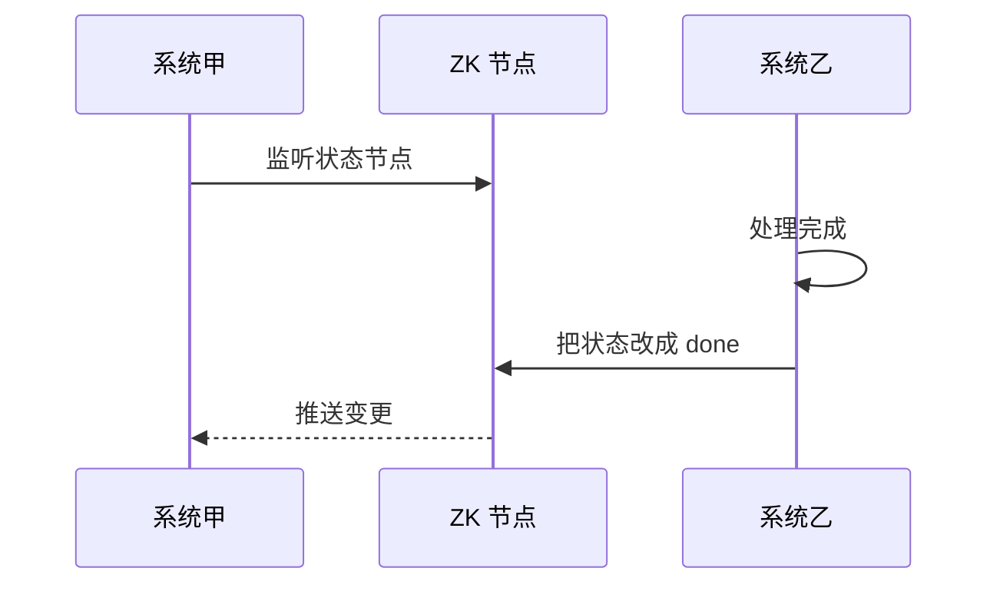
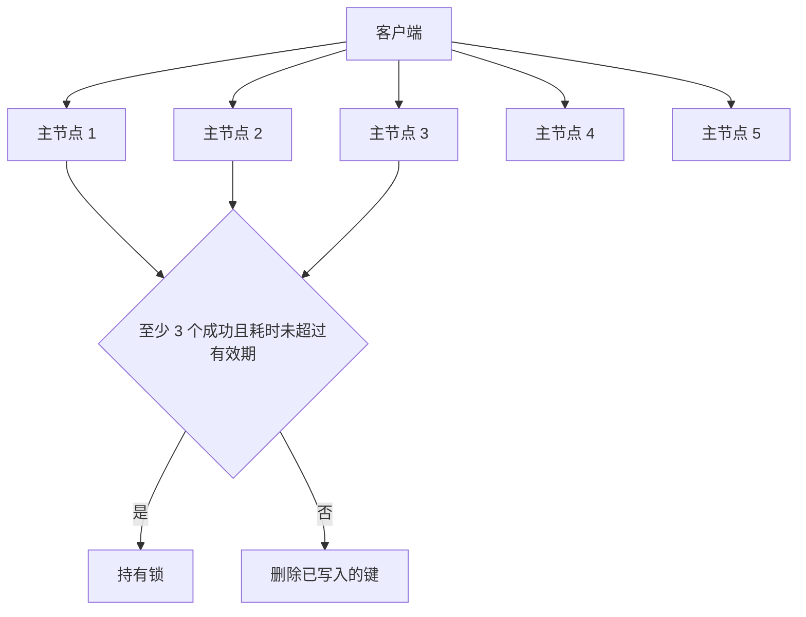
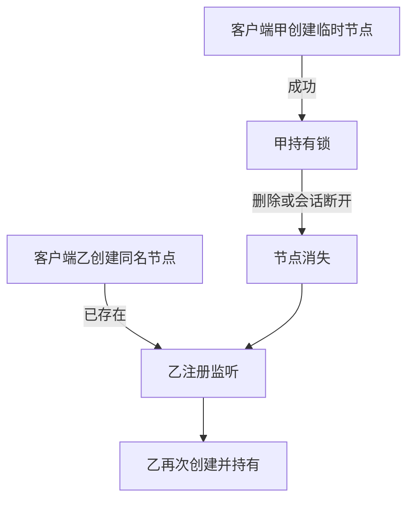

# 幂等、调用顺序与分布式锁

## 分布式接口怎样做到幂等

### 什么是幂等

服务拆到多台机器之后，同一个业务动作可能被投递两次，接口必须保证结果仍然正确。这是上线前就要设计的，不是出了事故再补。

例如付款接口部署了 4 台。用户手抖，同一张票款单发出两次支付，两次被分到不同机器，结果扣了两笔。或者订单服务调支付时超时，按策略重试，支付侧又收到一次，负载均衡把它分到另一台，同样会多扣。

网络超时并不少见。可以按量级记：一千次调用里几乎没有重试；一万次里可能有 2 次超时重试；十万次里大约 20 次；一百万次里大约 200 次。若这 200 次都没拦住，就是 200 张订单被扣两次，客诉会按月累积。写入型接口若把重试当成新请求，库里还会多出重复行。



单机时用进程内的集合记住「这张单已经付过」就行。多机没有这种共享内存，而且也没有放之四海皆准的框架开关，只能结合业务做。

幂等的意思是：同一请求执行多次，数据仍然对。不能多扣、不能多插一行、不能把计数器多加一。

### 怎样保证

抓住三件事：

- 每个请求带稳定的业务标识。支付请求里必须有订单号，一个订单号最多成功支付一次。
- 处理成功后留下「已处理」的痕迹。常见是在库里插一条支付流水，并且让订单号成为唯一约束。
- 下次再来先判断。流水插不进去，说明这张单已经付过，本次不再扣款。

也可以把状态放到 Redis：`SET pay:order:88421 done`。重复请求先读这个键，值已经是 done 就直接返回上一次的成功结果。更稳的顺序是：先插唯一流水，插入成功才真正扣款；唯一冲突则整笔回滚。多个实例可以一起读写 Redis，不依赖某一台机器的内存。



## 分布式调用的先后怎么保证

多数接口不需要严格顺序。少数场景需要，否则结果会反。服务甲先让服务乙插入一行，再让它删掉。两个请求落到不同机器，删除因为没有目标行而空跑，插入后到，行就留下来了。业务期望是「先有后无」，实际变成「先无后有」。



能从业务上消掉顺序要求就消掉。一旦要保序，复杂度和热点都会上来：某一张单的请求全挤到一台机器，那台机器会变成热点。

一种做过的办法：用一致性哈希把同一个订单号固定打到一台机器，再在那台机器里把该订单号的请求放进内存队列，单线程按到达顺序执行。后续问题很多，例如某张热门订单把一台机器打满。更干净的做法是把「插入再删除」合成一个操作，从源头去掉先后依赖。

### 用队列和内存队列

把必须保序的请求先按哈希送到固定机器，机器内部再入内存队列，由单个线程按序消费。这样能挡住机器内部的并发打乱。它盖不住更前面的乱序：如果接入层已经把 1、2、3 收成 2、3、1 再写入队列，队列只能保证「进队之后」的顺序。

### 用分布式锁

锁能把同一把钥匙上的操作收成串行，语义强，但每次都要抢锁、放锁，并发会掉一截。只适合真正不能并行的那一小段。

## 若要自己做一个类似 Dubbo 的 RPC

从你熟悉的分层往下说，不要空谈「会用 Netty」。

- 提供者启动时向注册中心登记地址，注册中心可以用 ZK 保存服务名和实例列表。
- 调用方订阅这个服务名，拿到可能位于多台机器上的地址。
- 业务侧只依赖接口。运行时给接口生成动态代理，代理负责把调用变成远程请求。
- 多台机器之间要有负载策略，最简单是轮询或加权随机。
- 传输可以用 NIO 框架维持长连接；报文可以用二进制序列化，也可以换成别的协议。请求发出去之后，对端按同样的契约解码。
- 提供端也给本地实现套一层代理，监听端口，收到请求后反射或直接调用本地方法，再把结果写回。

## ZK 常见用在哪

分布式锁只是 ZK 的一个用途。被问到 ZK，往往是看你知不知道它在分布式里扮演的角色，而不是背选举论文。

### 协调

甲把任务丢进队列，乙处理完之后，甲怎么知道结果？甲可以在某个节点上挂监听；乙改这个节点的数据，甲立刻收到通知，不必轮询对方接口。



### 互斥

两台机器同时收到对同一条数据的修改，只能一先一后。先到的创建临时节点表示拿到锁，执行完再删除。后到的创建失败，就等着；节点消失后再创建。

### 配置与元数据

很多基础系统把集群成员、主题分区、开关放在 ZK 上，例如消息系统和一些计算框架，注册中心也可以用它。改一处，订阅方都能看见。

### 主备切换

关键进程做成一主一备。主进程在 ZK 上维持临时节点，会话一旦断开，节点消失，备进程收到通知后接管。大数据组件里的高可用经常是这个模式。


## 分布式锁

### 面试题

- 实现一把跨进程的锁，常见有哪几条路？
- Redis 这把锁怎么设计才不会误删？
- 用 ZK 做可以吗？
- 两边谁更省、谁更稳？

### 用 Redis

官方有一套叫 RedLock 的多节点算法。设计时看三点：同一时刻只有一个客户端持有；持有者崩溃后锁一定能消失；少数节点故障时仍能加锁和释放。

最朴素的写法是一条命令：

```text
SET lock:seat:7781 9f3c2a NX PX 15000
```

`NX` 表示键不存在才写入成功，`PX 15000` 表示 15 秒后自动过期。别人再写就会失败。释放时不能盲目删除，要用一段脚本核对值：

```lua
if redis.call("get", KEYS[1]) == ARGV[1] then
  return redis.call("del", KEYS[1])
else
  return 0
end
```

值必须是随机串。假如客户端甲拿到锁后卡了很久，锁已经过期，乙又拿到了同一把锁。甲醒来若按键名删除，会把乙的锁删掉。先比较值再删，才能避免误释放。

单实例有单点；普通主从是异步复制，主节点写下锁之后、复制到从节点之前宕机，从节点升主，另一个客户端还能再加到同一把锁。所以单把 `SET NX` 不够当生产方案。

RedLock 假设有 5 个独立主节点，步骤是：

- 记下当前毫秒时间。
- 依次向每个主节点发加锁，过期时间很短，例如几十毫秒，单次网络超时也要短。
- 在多数节点上成功才算拿到，5 个节点至少 3 个（一半再加一）。
- 用现在的时间减去开始时间，若小于锁的有效期，才承认成功；否则锁可能在你认为拿到的那一刻已经开始过期。
- 失败就把刚才写上的键逐个删掉。
- 没拿到就等待一小段再试。



### 用 ZK

客户端尝试创建临时节点，创建成功即持有锁。其他客户端创建失败，就在这个节点上注册监听，而不是空转重试。释放锁就是删除节点，等待者会收到通知再抢。持有者宕机时会话结束，临时节点自动消失，锁不会永久占着。



和其他线程的差别只在节点名字。已存在就说明锁被占；节点被删，ZK 通知等待者。不需要客户端自己轮询。

### ZK 锁的示例代码

```java
/**
 * 场次座位锁，基于临时节点。
 */
public class SeatLockSession {

    private static final CountDownLatch READY = new CountDownLatch(1);
    private final ZooKeeper zk;
    private CountDownLatch waiters;

    public SeatLockSession() {
        try {
            this.zk = new ZooKeeper(
                    "10.8.0.11:2181,10.8.0.12:2181,10.8.0.13:2181",
                    20000,
                    new SeatWatcher());
            READY.await();
        } catch (Exception ex) {
            throw new IllegalStateException("连接协调服务失败", ex);
        }
    }

    /** 抢到返回 true。 */
    public boolean acquire(Long seatId) {
        String path = "/seat-mutex-" + seatId;
        try {
            zk.create(path, new byte[0], Ids.OPEN_ACL_UNSAFE, CreateMode.EPHEMERAL);
            return true;
        } catch (Exception busy) {
            // 节点已在，挂上监听等待释放后再创建一次
            try {
                Stat stat = zk.exists(path, true);
                if (stat != null) {
                    waiters = new CountDownLatch(1);
                    waiters.await(8, TimeUnit.SECONDS);
                    waiters = null;
                }
                zk.create(path, new byte[0], Ids.OPEN_ACL_UNSAFE, CreateMode.EPHEMERAL);
                return true;
            } catch (Exception again) {
                return false;
            }
        }
    }

    public void release(Long seatId) {
        String path = "/seat-mutex-" + seatId;
        try {
            zk.delete(path, -1);
        } catch (Exception ex) {
            // 会话已断时临时节点会被协调服务清掉
        }
    }

    private class SeatWatcher implements Watcher {
        public void process(WatchedEvent event) {
            if (Watcher.Event.KeeperState.SyncConnected == event.getState()) {
                READY.countDown();
            }
            if (waiters != null) {
                waiters.countDown();
            }
        }
    }

    private static class Holder {
        private static final SeatLockSession INST = new SeatLockSession();
    }

    public static SeatLockSession get() {
        return Holder.INST;
    }
}
```

这段只演示「临时节点 + 监听」的骨架。生产里更常见的是临时顺序节点：每个等待者创建自己的序号，只监听前一个，避免一群客户端同时被叫醒。

### Redis 锁和 ZK 锁怎么比

Redis 方案在没拿到时要自己重试，空转会耗 CPU。ZK 没拿到就挂监听，锁释放时被通知，等待期间不必反复请求。

持有者进程卡死时，Redis 只能干等到过期；ZK 的临时节点随会话消失，锁会马上让出来。RedLock 还要数成功节点、算时间差，步骤多。ZK 的模型就是「创建成功即持有，节点消失即释放」。

只比这两点的话，ZK 锁更不容易因为过期和误删出事，语义也更直白。Redis 锁的优势在延迟更低，适合临界区极短、可以容忍极小失败窗口的场景。资金或库存这类更在意正确性时，优先考虑 ZK 或数据库唯一约束，而不是只靠单节点 `SET NX`。
