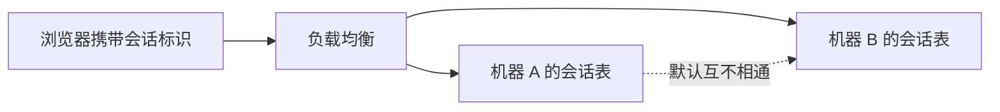

# 多机登录态怎么共享

## Session 是什么

浏览器会保存一小段 cookie。在它过期之前，每次请求都带上名为会话标识的那一块。服务端凭这个标识找到一块内存，里面可以放用户编号、购物车草稿这类只在本次访问期间有用的数据。

浏览器不关、cookie 还在，服务端那块数据就还在；cookie 被清掉，对应的会话也就作废。单机进程里这样做没问题。进程变成多台之后，第一台机器写下的会话，请求被分到第二台就找不到了。



常见落地是两条路：容器自己把会话塞进 Redis，或者由框架接管会话再写入 Redis。

## 容器会话管理器加 Redis

业务代码仍调用容器原生的会话接口，另外装一个把会话存到 Redis 的管理器，所有节点的会话数据集中到同一处。在容器配置里指定管理器类、Redis 地址和空闲超时即可。

```xml
<Valve className="com.example.tomcat.redis.SessionValve" />
<Manager className="com.example.tomcat.redis.SessionStore"
     host="${cache.host}"
     port="${cache.port}"
     database="2"
     maxInactiveInterval="180"/>
```

上面把空闲时间设成 180 秒，库号用 2，避免和别的业务键挤在 0 号库。也可以改成走哨兵，这样缓存主节点切换后会话仍在：

```xml
<Valve className="com.example.tomcat.redis.SessionValve" />
<Manager className="com.example.tomcat.redis.SessionStore"
      sentinelMaster="seat-master"
      sentinels="${s1}:26380,${s2}:26380,${s3}:26380"
      maxInactiveInterval="180"/>
```

读会话时，容器会到 Redis 里把属性取回来，所以多台机器看到的是同一份登录态。代价是会话实现绑死在这一种容器上，换掉容器就要重做一遍配置。

## 框架会话加 Redis

会话如果焊在某一种容器里，迁移到另一种容器就得把配置重写。技术栈再换成别的运行时，这层胶水更没法带走。更稳的办法是让框架在过滤器里替换会话实现，存储仍用 Redis，业务代码继续用标准会话 API。

### 依赖

```xml
<dependency>
    <groupId>org.springframework.session</groupId>
    <artifactId>spring-session-data-redis</artifactId>
    <version>2.7.0</version>
</dependency>
<dependency>
    <groupId>redis.clients</groupId>
    <artifactId>jedis</artifactId>
    <version>4.3.1</version>
</dependency>
```

### 容器配置

```xml
<bean id="ticketSessionConfig"
   class="org.springframework.session.data.redis.config.annotation.web.http.RedisHttpSessionConfiguration">
  <property name="maxInactiveIntervalInSeconds" value="900"/>
</bean>

<bean id="ticketPool" class="redis.clients.jedis.JedisPoolConfig">
  <property name="maxTotal" value="64" />
  <property name="maxIdle" value="16" />
</bean>

<bean id="ticketRedisFactory"
   class="org.springframework.data.redis.connection.jedis.JedisConnectionFactory" destroy-method="destroy">
  <property name="hostName" value="${cache_host}"/>
  <property name="port" value="${cache_port}"/>
  <property name="password" value="${cache_secret}" />
  <property name="timeout" value="2000"/>
  <property name="usePool" value="true"/>
  <property name="poolConfig" ref="ticketPool"/>
</bean>
```

空闲 900 秒、连接池最多 64 个，和上一节的容器方案故意用了不同的超时，避免两套配置抄成一样。

### 过滤器

```xml
<filter>
  <filter-name>ticketSessionFilter</filter-name>
  <filter-class>org.springframework.web.filter.DelegatingFilterProxy</filter-class>
</filter>
<filter-mapping>
  <filter-name>ticketSessionFilter</filter-name>
  <url-pattern>/*</url-pattern>
</filter-mapping>
```

### 示例

```java
@Controller
@RequestMapping("/seat")
public class SeatDraftController {

    @RequestMapping("/saveDraft")
    @ResponseBody
    public String saveDraft(HttpServletRequest request) {
        // 写入的是场次编号，不是用户昵称
        request.getSession().setAttribute("showId", "SH-2048");
        return "saved";
    }

    @RequestMapping("/readDraft")
    @ResponseBody
    public String readDraft(HttpServletRequest request) {
        Object showId = request.getSession().getAttribute("showId");
        return showId == null ? "" : showId.toString();
    }
}
```

过滤器把会话操作交给框架，框架再落到 Redis。代码里看起来仍是标准 API，实际读写已经跨机器共享。

分布式登录态还有别的做法，例如把令牌做成无状态签名、或把会话放进数据库。上面两条是最常被问到的：早期多把容器会话外挂到 Redis；后来为了不绑死容器，改由框架会话来做同一件事。
