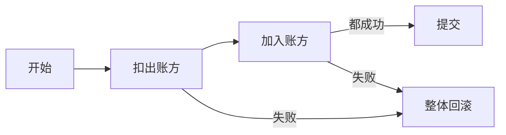
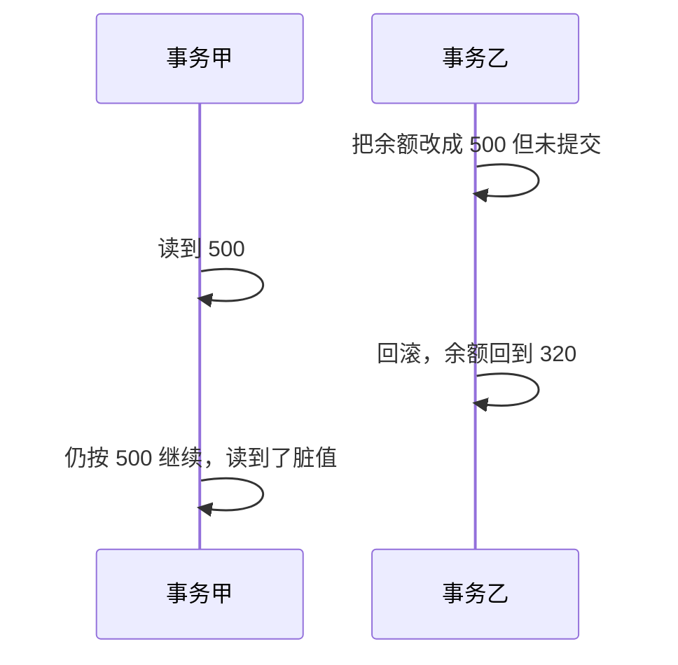
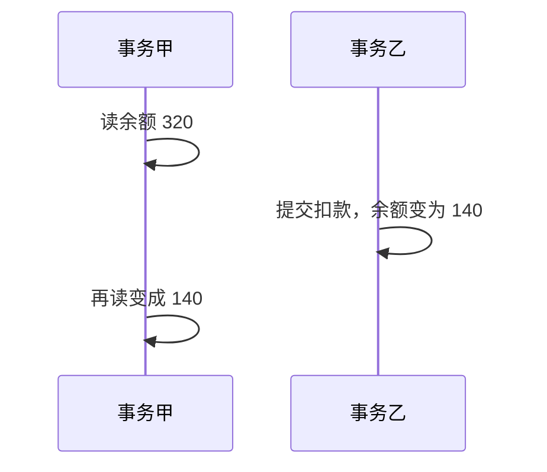

# Spring 里的事务

## 什么是事务

事务是库把若干语句当成一次提交的最小单元：这一组要么全部留下，要么全部撤销。目的就是让中途失败时，数据不要停在一半。

钱包转账是典型例子。周宁转给林夏 860：

```text
开始
① 周宁余额减少 860
② 林夏余额增加 860
提交
```

任意一步失败，两笔改动都要撤回，否则总金额会对不上。



## 四个特征

口诀可以记成「原子、一致、隔离、落盘」：

- 原子：组内动作全部生效，或全部当没发生。
- 一致：结束后业务约束仍成立。转账前后两个余额之和仍是原来的数。
- 隔离：并发的事务不要互相读到不该看见的中间态。
- 持久：提交返回之后，即使进程马上退出，重启也能把这组改动找回来。

## JDBC 里手工控制

```java
try {
    // 关掉自动提交，后面的语句才归到同一事务
    connection.setAutoCommit(false);
    // 扣款与入账
    connection.commit();
} catch (Exception ex) {
    connection.rollback();
} finally {
    connection.setAutoCommit(true);
}
```

## 隔离级别

由松到紧通常是：读未提交、读已提交、可重复读、串行化。并发下可能出现脏读、不可重复读、幻读，以及更新被盖掉。

### 四个级别

#### 读未提交

一个事务能看见另一个事务还没提交的改动，脏读就是从这里来的。

#### 读已提交

要等对方提交之后才能看见。同一事务里两次读取，可能因为别人在中间提交了更新而得到不同值，这叫不可重复读。很多库把这一档当默认，因为业务往往只关心最后一次提交后的值。

#### 可重复读

事务开始读过的行，在本事务结束前，别人的更新不会改变你再读的结果。MySQL 默认就是这一档。它仍可能在范围查询里看见别的事务新插入的行，也就是幻读。实现上常靠锁或快照。

#### 串行化

事务排队执行，脏读、不可重复读、幻读都能避开，但吞吐最差，一般只留给极短的关键段。

#### 对照

不少库默认读已提交，例如 SQL Server、Oracle。MySQL 默认是可重复读。

### 并发下会看见什么

#### 脏读

事务甲读到事务乙尚未提交的新余额；乙随后回滚，甲却已经按那个余额做了决定。



#### 不可重复读

同一事务对同一行读两次，中间另一事务提交了更新，两次结果不同。重点落在对已有行的修改。



把隔离级别提高到可重复读，可以让甲的两次读取保持 320，直到甲自己结束。

#### 幻读

事务甲按条件统计行数，事务乙在中间插入并提交一行，甲再次统计时多出一行。重点落在插入（范围上多出来的行），而不是某一行被改掉。

第一次按「状态=待支付」数到 240 行，第二次变成 241 行，多出来的那一行就是幻影。

#### 两者差在锁的范围

不可重复读盯着已经存在的行，锁住这些行就能挡住更新。幻读盯着「符合条件但还不存在的行」，只锁已有行不够，还得锁住间隙或整段范围，代价更高。所以两种现象看起来都是「再读不一样」，根子和锁的范围并不相同。

## 更新丢失

### 回滚把别人的提交冲掉

甲、乙都改同一行。乙先提交，甲后回滚。若回滚写成「把旧值写回去」，乙的提交就消失了。这叫回滚丢失。正规的回滚只撤销甲自己的改动，不应覆盖乙已经提交的版本。

### 后写的人盖掉先写的人

甲、乙同时读到余额 320。乙先提交成 140，甲仍按自己读到的 320 加 50，再提交成 370，乙扣掉的 180 被盖没了。这叫覆盖丢失。乐观版本号或「按旧值更新」可以拦住后写的人。

## Spring 里怎么配事务

先有一张账户表：`id`、`holder`、`balance`。实体只保留这三个字段。

```java
public class Wallet {
    private Integer id;
    private String holder;
    private Integer balance;
}
```

数据访问层提供按户名减少余额、按户名增加余额。业务层若在两步之间抛错且没有事务，钱会只扣不加。

### 编程式

在配置里声明事务管理器，再用模板把一段代码包进事务。XML 形态：

```xml
<bean id="txManager" class="org.springframework.jdbc.datasource.DataSourceTransactionManager">
    <property name="dataSource" ref="walletDataSource"/>
</bean>
<bean id="walletTxTemplate" class="org.springframework.transaction.support.TransactionTemplate">
    <property name="transactionManager" ref="txManager"/>
</bean>
```

注解形态则在配置类上声明同一个管理器，业务代码里调用模板的执行方法，成功就提交，运行时异常就回滚。老的代理工厂做法这里不再展开。

### 声明式

基于切面的 XML：先去掉模板 Bean，只留管理器，再用通知把方法名和传播、隔离绑在一起。

```xml
<tx:advice id="walletAdvice" transaction-manager="txManager">
    <tx:attributes>
        <!-- 默认隔离，必须有事务；超时不额外限制 -->
        <tx:method name="move" isolation="DEFAULT" propagation="REQUIRED"/>
    </tx:attributes>
</tx:advice>
<aop:config>
    <aop:pointcut expression="execution(* com.demo.wallet.service..*.*(..))" id="walletCut"/>
    <aop:advisor advice-ref="walletAdvice" pointcut-ref="walletCut"/>
</aop:config>
```

业务方法保持原样，中间故意失败，用来观察整笔是否回滚：

```java
/**
 * 出账与入账必须同一事务。
 */
public void move(String fromHolder, String toHolder, Integer amount) {
    walletDao.decrease(fromHolder, amount);
    if (amount == 860) {
        throw new RuntimeException("入账前失败");
    }
    walletDao.increase(toHolder, amount);
}
```

注解方式：配置类加上开启事务管理的注解，服务类或方法上标注事务注解即可。

```java
@Service
@Transactional
public class WalletService {
}
```

也可以按方法名前缀分别给策略，例如所有以 `credit` 开头的方法使用默认隔离和 REQUIRED。

### 传播行为

一个带事务的方法调用另一个带事务的方法时，内层事务怎么摆，就是传播。例如：

```java
public class CrewService {
    @Transactional
    public void lead() {
        // 外层：登记班组
        assist();
    }
    @Transactional
    public void assist() {
        // 内层：登记组员
    }
}
```

要问清两件事：外层失败时内层是否一起撤；内层失败时外层是否一起撤。

#### 不希望待在事务里

- NEVER：调用方没有事务就照常执行；调用方已经有事务则直接抛错。
- NOT_SUPPORTED：没有事务就照常执行；已有事务则先挂起，自己以非事务方式跑。挂起期间若还去抢同一行锁，容易和被挂起的事务互相等待。

#### 有没有都行

- SUPPORTS：外面有事务就加入，没有就单独跑。

#### 必须处在事务中

- REQUIRES_NEW：无论外面有没有，都新开一个事务；外面那个先挂起。两边互不影响，内层提交后外层再回滚也撤不回内层。
- NESTED：没有就新建；有就在当前事务里做一个保存点。外层回滚时，嵌套的部分一起撤；内层回滚到保存点时，外层仍可继续。
- REQUIRED：默认。没有就新建，有就加入当前事务。内外层任一方抛出运行时异常，整笔一起撤。
- MANDATORY：没有事务就抛错；有就加入。用来强制「必须由上层开启事务」。
