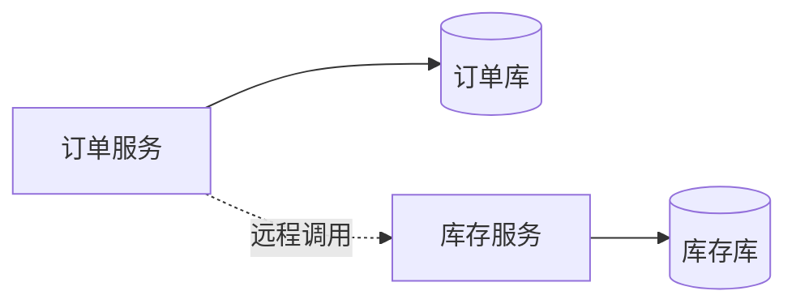
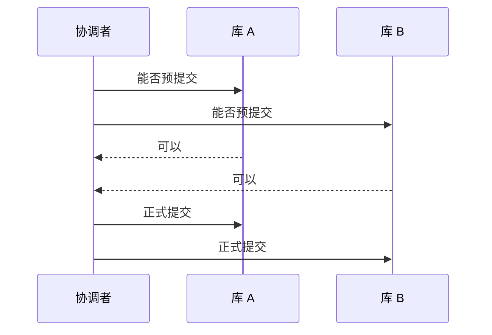
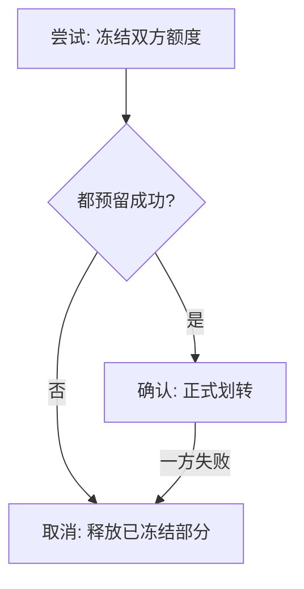
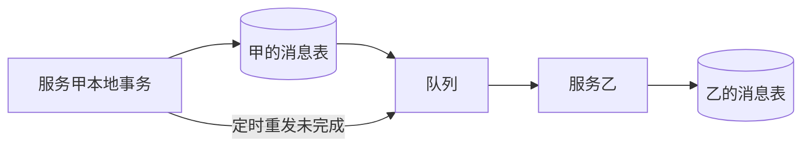
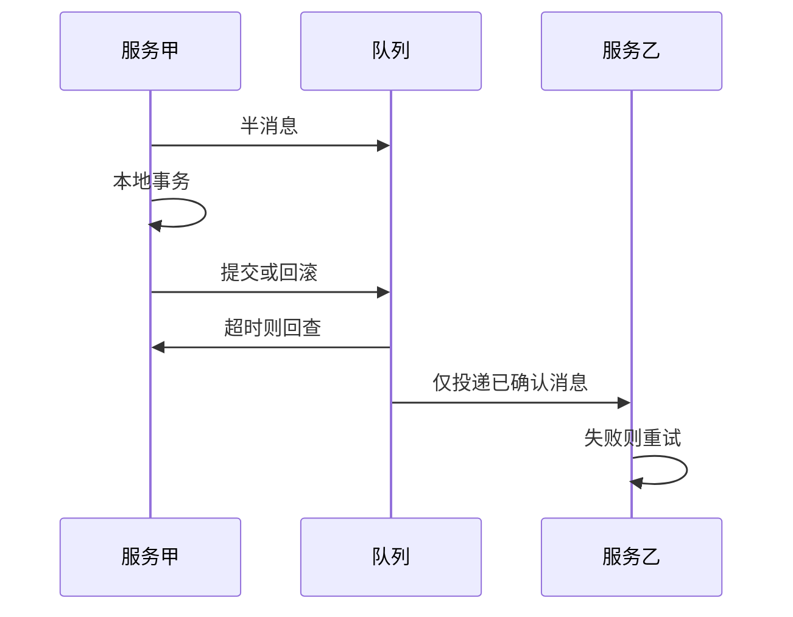
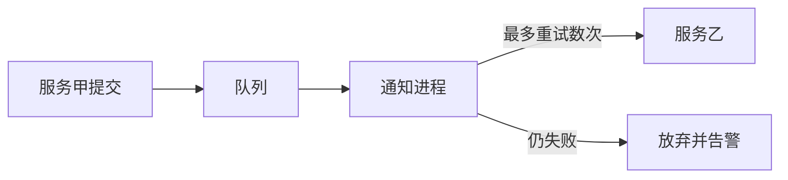

# 跨服务事务怎么收场

- 知道分布式事务这回事吗
- 你准备用哪一种把它做完
  - 两阶段提交 / XA
  - TCC
  - 本地消息表
  - 基于消息的最终一致
  - 最大努力通知
- 你们线上实际选了哪一种，为什么不是全部都上

## 分布式事务

系统一旦拆开，面试几乎必问跨服务的事务。至少要讲得出有哪些方案、各自适合什么量级、坑在哪。单机里用本地事务就够；调用链跨了进程和库之后，本地事务包不住对方的提交。

例如 TCC 要处理网络重试带来的重复确认，XA 则常常在协调者故障时把资源长时间挂住。这些坑比「知道名词」更重要。

### 单机里的事务

一个进程、一个库：扣余额和写流水可以放在同一个本地事务里，提交或回滚由这一个库决定。

### 拆开之后

订单服务写自己的库，库存服务写另一个库。两边各自能提交，但没有一个库能同时回滚对方。

## 两阶段提交 / XA

可以把它想成一次车间停机检修的报名，而不是团建。协调人先问每条产线：周六检修你能不能停机？所有产线都回答可以，协调人才下第二次通知：按计划停。任何一条产线回答不行，整个计划取消，没有人先停了却等不到别人。

对应到 XA：事务协调者先问每个资源管理器能否预提交；全部答应，才发正式提交；任一拒绝或超时，就让已经预提交的资源回滚。

它比较适合单个应用跨多库、并发不高的场合。事务状态卡在数据库内部，锁持有时间长，高并发下吞吐会掉得很厉害。Spring 配上 JTA 能跑通一个示例，但很少拿它扛核心流量。

微服务里通常规定每个服务只碰自己的库。几百个服务若互相直连对方的表，改错和锁冲突无法治理。要动别人的数据，只能调对方接口。因此「一个服务内部跨好几个库」本身就往往不符合边界，XA 更少被选为默认。

## TCC

三个字母是尝试、确认、取消。

- 尝试：检查并预留资源，先不落最终结果。
- 确认：各参与方把预留变成正式变更。
- 取消：任一环节失败，就把已经成功的预留或正式变更补偿回去。

钱包互转可以这样拆：

- 尝试：冻结甲的 240 和乙的入账额度，两边都还不能把这笔钱再花掉。
- 确认：甲冻结额扣掉 240，乙可用余额加上 240。
- 取消：若乙入账失败而甲已经扣减，就把 240 退回甲的可用余额。

补偿逻辑得自己写，分支一多就很难维护，所以用得少。资金、清结算这类「错一分都不行」的链路才会上 TCC，并且每一步都要短，避免预留占太久。能不手写回滚就不要手写。

## 本地消息表

大致步骤：

- 服务甲在本地事务里既改业务表，又插入一条待发送记录。
- 事务提交后，甲把这条记录发到队列。
- 服务乙收到后，在自己的事务里写入消费记录并执行业务；若消费记录已存在，事务失败回滚，从而不重复执行。
- 乙成功后，把自己和甲那边的记录标成完成。
- 乙若失败，状态保持未完成；甲定时扫自己的表，把没完成的再次发出去。
- 最终乙总会成功，中间允许短暂不一致。

硬伤是事务进度绑在数据库表上。流量高时这张表的扫描和行锁会先成为瓶颈，扩容也不如把状态放进队列自然。所以高并发场景里较少单独用它。

## 可靠消息最终一致

不再依赖业务库里的消息表，而让队列本身支持「半消息」。以支持事务消息的队列为例：

- 甲先发一条半消息。发送失败就不要做本地事务。
- 半消息成功后，甲执行本地事务。成功则提交消息，失败则回滚消息。
- 消息被确认后，乙才能消费并执行自己的本地事务。
- 队列会回查甲：这条半消息对应的本地事务到底成了没有？甲查自己的库再决定提交或回滚，避免「本地已提交但确认包丢了」。
- 乙失败就重试到成功。资金类若重试仍不行，再让乙本地回滚并通知甲，或告警人工处理。

国内很多团队要么直接用带事务消息的队列，要么在普通队列外包一层同样的半消息和回查。消费者没成功就持续重试，直到处理完，得到的是最终一致，不是瞬时一致。

## 最大努力通知

- 甲的本地事务完成后，发一条普通消息。
- 独立的通知进程消费这条消息，先落一条发送记录（或放进内存队列），再调乙的接口。
- 乙成功就结束。乙失败则按间隔再调若干次，例如 1 分钟、5 分钟、20 分钟，超过次数就放弃并告警。

允许少量最终失败，适合记日志、刷新非关键状态，不适合记账。

## 线上到底怎么选

资金划转这类绝对不能错的链路用 TCC，追求参与方一起成功或一起补偿。订单创建后通知库存扣减，库存没有资金那么敏感，用可靠消息做到最终一致即可。

事务消息的接口在不同版本里有差别，讲原理时说明「半消息 + 本地事务 + 回查」即可，不必背某一个小版本的类名。也可以按同一思路用别的队列自己包一层。

有人希望几十个服务之间每一次调用都套上分布式事务。经验是：服务数量上去之后，真正上事务方案的链路很少。每上一条，那段代码的分支会多出一个数量级，吞吐也会掉。

多数调用失败时打完整日志、发告警，事后修数据，比到处套事务便宜得多。每个月真正伤到数据的缺陷往往只有几起，用临时脚本补行、删行或改字段就能收场。若为了这几起上几十套分布式事务，开发和性能成本会高几十倍。

大约只有资金、成交、核心订单这类很小比例的链路值得上 TCC 或可靠消息。积分、券、商品资料展示，监控加人工修复通常就够。
